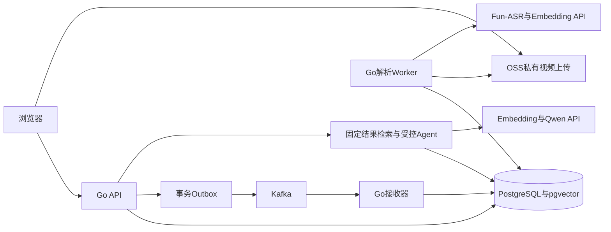
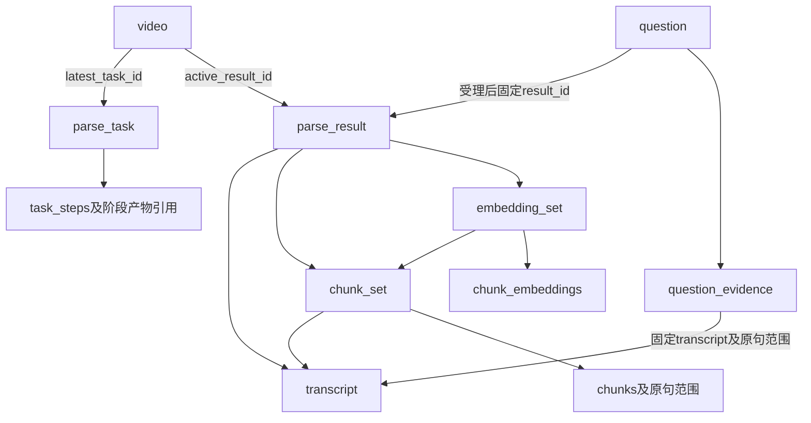

# MirrorCore 项目设计与问题记录

围绕 MirrorCore 视频问答项目，持续记录 Go 后端与 Agent 的技术设计、方案取舍、开发问题和面试追问。首版聚焦视频中的语音内容；2026年11月10日起按开发任务书分阶段实现，并在实现过程中review设计与运行证据。

记录起始日期：2026年10月26日。原始方案：[MirrorCore 技术方案](https://ucn587v9qoxi.feishu.cn/wiki/G4elwIrunisErIk5gtuctEcon0b)。

# 当前进度与后续顺序

截至2026年11月11日，本地开发已覆盖M1至M13首片及M16至M75：Go API、媒体解析Worker、ASR/Embedding/问答与Agent适配、任务版本/执行epoch、上传恢复、删除回收和Kafka交接均已实现；22份数据库迁移已应用到本机PostgreSQL。M34/M65跑通本地合成媒体解析与问答演示；M70至M74补齐上传回执不明、删除Worker、迟到ASR对账、补交预算和隔离Kafka交接的集成验证；M75又在当前源码上隔离跑通“合成MP4→7阶段解析→内容revision→API登录→问答SSE→答案持久化”，并运行固定RAG/Agent同结果对照。M74全量Go测试（PostgreSQL与独立Kafka启用）、build、vet通过。

**本地演示主链路已跑通，完整设计仍有未实现项。** 经用户确认，三个既定模型的百炼Key、workspace、北京私有OSS Bucket、限定RAM授权和存储凭据均已配置；Embedding/Qwen限流已按对应模型详情页写入本机`.env`，详见下方云端配置记录。真实业务云调用仍未执行。本地对象存储、ASR和模型替身不能证明真实供应商兼容、费用或回答质量。历史数据保留期回收、崩溃后的scratch清理和部分关键自动回归仍待补齐，不能把剩余工作概括为“只差云账号”。

**后续优先级：**先完成用户上传到引用答案/授权播放的真实单视频闭环；无云账号时先补关键自动回归和资源回收。随后按冻结的评估计划准备真实问题与人工标注，再衡量Agent相对固定RAG的收益。生产多实例、负载、备份恢复和部署检查放在生产交付前完成。每项使用下面的完成判定，不以增加里程碑编号作为进度目标。

面试问题与逐阶段证据继续追加到本文件和`docs/development-log.md`；M67至M75具体变更及边界见开发日志。

## 云端配置记录（2026年11月11日）

用户已开通OSS，并分别确认创建百炼Key、RAM用户与永久AccessKey、限定策略授权和未完成分片清理。阿里云要求的两次身份验证由用户在页面自行完成。现已完成以下配置：

- 北京Bucket `mirrorcore-dev-20261111-b7f6`：标准存储、本地冗余、私有ACL、阻止公共访问、版本控制开启。
- RAM用户`mirrorcore-dev`关闭控制台登录，仅绑定自定义策略`MirrorCoreOSSDevStorage`。允许列出该Bucket版本；对象读写、版本读取/永久删除、分片查询/中止仅限`source/`、`artifacts/audio/`、`artifacts/asr/`。策略清单保存在`deploy/ram/mirrorcore-oss-policy.json`，未授权管理Bucket或其他云服务。
- 生命周期规则`mirrorcore-abort-incomplete-source-uploads`已保存并显示“启用中”：只中止`source/`下超过3天未完成的分片上传。完整文件、历史版本及删除标记不自动过期；清单为`deploy/oss/abort-incomplete-multipart.xml`。控制台提示规则设置后48小时内生效。
- 凭据只写入Git忽略的本机`.env`，权限0600；RAM凭据下载CSV在保存核对后删除，文档不记录密钥。百炼Key仍只允许`fun-asr`、`text-embedding-v4`、`qwen3.7-plus-2026-05-26`。
- 百炼北京模型详情页显示：`text-embedding-v4`为1800 RPM/1200000 TPM，`qwen3.7-plus-2026-05-26`为600 RPM/1000000 TPM；四个值已填入`.env`。主干`qwen3.7-plus`显示另一组限流，不能拿主干值替代固定快照。记录来源是控制台模型详情，尚无真实请求/429/usage证明账户实际限流行为。

本轮仅配置云资源并检查本地文件语法与必填状态，没有启动应用、上传视频或调用模型。真实单视频上传→解析→问答→引用播放仍是下一项验收；还需要一段允许上传处理的测试视频。CORS待接入实际浏览器前端来源时限定配置，命令行HTTP验收不依赖浏览器CORS。

面试追问：**为什么打开OSS版本控制后不直接自动删除3天前的历史版本？** 本项目把对象版本作为不可变产物身份，旧结果、问答或恢复检查点可能仍引用历史版本；按年龄删除会留下有效数据库引用却读不到对象。业务GC必须先核查引用和执行资格，再删除指定版本。未完成分片尚未成为可引用产物，可按独立上传窗口清理；即便如此，超时未完成的上传也必须重新开始。

面试追问：**模型同名系列的限流能直接复用吗？** 主干别名与固定快照的限流可能不同。应按实际请求中的模型ID和地域记录配额，并在API/background共用同一门闩；控制台值只是配置依据，实际请求仍要处理429、Retry-After和共享冷却。

## GitHub源码与界面预览（2026年11月11日）

已按用户要求将整个Go后端、设计记录及可点击界面预览推送至[指定仓库的开发分支](https://github.com/MOLI0711/VedioAgent/tree/codex/mirrorcore-import-20261111)，首次源码提交为`fadb289`；保留远程已有设计历史，未合并main或部署。`web/preview/index.html`为独立浏览的演示界面，`mirrorcore-preview.fragment.html`为可编辑片段；仅使用示例内容，不上传视频或调用模型。README记录打开预览与启动后端的方法。

提交前扫描通过，`.env`、实际云凭据、个人简历、截图、日志、二进制和scratch未进入Git。`go test -count=1 -v ./...`、`go build ./...`与`go vet ./...`通过；本轮10个PostgreSQL/Kafka集成测试因未配置依赖跳过，真实云端验收仍未完成。

## 接手核查：实际剩余项（2026年11月11日）

本轮核查了现有代码、迁移、进程入口、B01至B16验收要求和历史运行日志，并重新运行`go test -count=1 -v ./...`、`go build ./...`、`go vet ./...`，均退出0。10个数据库/Kafka集成用例因未配置测试依赖而SKIP；此前M74/M75运行记录仍作为历史证据，本轮没有重新启动数据库、Kafka或云服务。

| 顺序 | 缺口与当前证据 | 完成判定 |
| --- | --- | --- |
| 1 | 真实上传到问答/播放闭环未验收。`cmd/api/main.go`仅在配置OSS时启用上传；local-demo通过seed命令导入合成视频，未经过用户上传。真实Fun-ASR、Embedding、Qwen及签名播放均无账号运行证据。 | 用一段可使用的视频实际走HTTP登录、分片上传、完成、解析、提问、答案持久化、引用定位；保留请求/任务标识、状态、usage和失败恢复证据。 |
| 2 | 历史保留期回收未实现。现有清理器按用户删除整段视频执行；`purged_at`只在视频删除脱敏中设置，未发现正常存活视频下按保留期清理历史问答/轨迹、旧结果、无引用产物的调度器。Inbox/Outbox也没有按年龄清理流程。30天/7天仍是设计建议值。 | 明确保留政策；在视频锁下排除active结果、运行任务、有效问答和复用引用，分批清理并保存幂等墓碑；覆盖B04/F19中“清理与新增引用并发”的场景。 |
| 3 | 崩溃资源收尾不完整。媒体临时目录依赖`defer os.RemoveAll`，未发现启动/周期扫描遗留scratch的逻辑；SIGKILL无法执行defer。媒体工具使用`exec.CommandContext`，未见显式进程组控制，包装器/子进程整体退出还需专项验证。 | 注入强制退出和取消后，安全回收过期且无有效执行者的目录；保留活跃任务目录，并确认媒体作业及子进程已结束。 |
| 4 | 核心自动回归不足。QA、chunk、媒体处理、内容处理和配额包没有直接测试文件；部分故障有开发日志中的手工演练，不能自动防止后续修改破坏规则。 | 优先覆盖UTF-8长句/重叠/来源映射、非法或伪造引用、重复/并行工具调用、预算耗尽、NO_AUDIO/NO_SPEECH及取消/提交竞争；将关键集成场景纳入明确要求依赖的验收入口。 |
| 5 | 评估工具已实现，真实评估数据和结论缺失。`assets/evaluation`只有synthetic fixture；建议的5段视频/50题人工计划尚未建成。 | 冻结来源视频、版本、问题和证据组，完成人工审核；同输入比较固定RAG与Agent，记录引用支持、材料不足判断、延迟、调用数和真实usage，不用固定答案推断模型质量。 |
| 6 | 工程交付尚未收敛。Compose只启动依赖，缺API/background部署镜像或统一启动入口、CI；源码基线已推送至指定GitHub仓库的`codex/mirrorcore-import-20261111`分支；凭据、个人输出和scratch均已忽略，尚未配置CI。生产Kafka仍为单副本配置，备份恢复/多实例故障无完成证据。 | 整理可复现启动与验收步骤，隔离运行产物，建立代码版本基线；若实际部署，再补镜像、密钥注入、备份恢复、多实例与broker故障演练。后几项不冒充面试首版的前置业务功能。 |

已确认的Go、Kafka、OSS/Fun-ASR API、pgvector、任务版本/执行epoch分离、较大已完成版本即可发布和先保存再展示答案等决策保持不变。前端、视觉理解、自部署模型、HNSW性能优化、独立向量库和SFT/RL均不计入首版必补清单。

| 模块 | 当前状态 | 还需要讨论的内容 |
| --- | --- | --- |
| Worker 与任务可靠性 | 数据库领取、租约/epoch围栏、阶段检查点恢复、人工继续与取消、删除同步取消、UNKNOWN审计处置；M31本地演示CHUNK→PUBLISH，M34经Outbox/Kafka/Inbox运行PROBE→PUBLISH；M35 AUDIO确定性对象恢复已在隔离库完成故障注入；M65新增合成媒体task再次跑通7阶段 | 000018至000022已应用；M34/M65任务SUCCEEDED、7步READY、epoch 8；M41验证task version 3在DB提交失败后由新run_epoch从已写WAV恢复；真实OSS/百炼和多实例压力仍未验收 |
| Fun-ASR | Go HTTP适配、提交预算、UNKNOWN恢复、并发gate、结果恢复；M36跟踪被补交替代/不可继续终态后的已知远端作业；可人工继续的FAILED任务保留最新submission；M37允许不可继续失败任务做证据化UNKNOWN处置；M42隔离验证reconciler失败重试和UNKNOWN审计幂等；M44验证对账lease takeover与epoch fencing；M69本地HTTP mock覆盖异步提交/状态查询/结果下载及错误分类；M72验证视频删除后旧epoch迟到返回task_id并由reconciler收敛；M73验证自动补交最多一次且run_epoch变化不重置预算 | `000005`及`000021`已应用；M72/M73使用独立PostgreSQL schema和真实仓储/Worker，provider为本地替身；真实百炼、签名URL、账单及供应商迟到受理仍未验证 |
| 字幕转写产物 | 原始JSON校验、视频时间轴映射、稳定序号、空白过滤、小范围边界修正、200条批次与连续位点原子提交、完整后发布 | `000006`已应用；没有真实Fun-ASR响应验证边界处理或Worker崩溃恢复 |
| 数据库与可靠投递 | Outbox→Kafka→Inbox→READY；M34媒体任务经本机PostgreSQL/Kafka实际交接；M74在独立Kafka broker与隔离PostgreSQL schema中验证发布、Inbox幂等重放、offset提交和任务READY终态 | `000001`至`000022`已应用；M74全量Go测试时启用独立Kafka broker并通过；重平衡、长时间broker故障与跨机压力仍需验收 |
| 字幕切分 | `chunk_v1_bytes`已实现：按句合并，目标512字节、硬768字节、最多重叠1条完整句且不超过128字节；超长句按标点/UTF-8安全边界拆分；有来源区间和持久化恢复 | 这是首版有明确单位的降级profile，不代表模型tokens，也不保证所有文本字节数必然低于v4 token限制；需用真实请求核验拒绝情况并做检索效果评估 |
| Embedding 与索引 | 百炼同步HTTP适配；固定批次、输入指纹、整批响应校验、批次预算账本、pgvector同库提交、READY/NO_CONTENT与复用；M29恢复验证；M31本地demo使用独立local-demo profile完成新向量；M69本地HTTP mock覆盖query/document参数、1024维dense响应与index映射 | `000008`已应用；真实供应商API、账户配额、Embedding质量及并发/崩溃竞争仍未验证 |
| 结果清单与版本发布 | M9实现完整性核验、不可变清单、task_version单调发布、旧版本不覆盖新指针；M31本地任务从版本1发布版本2；M52验证版本乱序及并发发布 | `000009`已应用；M52在隔离克隆中调用真实仓储，覆盖中间版本发布、旧版本跳过及版本6/7并发后的active=7 |
| 检索 | M10实现query角色向量、cosine Top-K=8精确检索、固定embedding_set过滤、句子级证据登记与引用映射；离线夹具成功取回2条证据 | 无真实query embedding、召回评估或性能测量；HNSW留作条件优化 |
| 问答和会话 | M10实现conversation创建/历史/归档、请求键幂等、受理时固定结果、冻结上下文、结构和引用校验、先存后发的SSE；M31本地演示从版本2完成检索、答案校验与SSE落库；M58新增持久化策略profile和评估用固定RAG回答路径，保留Agent默认；M59受理可锁定指定result_id供配对评估；M60/M61打通固定计划→成对question→人工草稿；M64在API关闭时阻止新问答并取消已登记执行；M65当前源码API完成登录→会话→Agent补查→SSE答案→DB SUCCEEDED链路；M66验证成功提交与后到取消的锁竞争 | 本地评估fixture完成1 case/2 runs；M65用固定本地替身且无云调用；conversation已归档、session已撤销。M64以定向延迟RETRIEVAL step验证活动问答在SIGTERM后持久化为INTERRUPTED且无答案；客户端RST断连和SIGTERM取消已实测。M66观察成功UPDATE事务持有owner/question锁时取消请求等待；4秒延迟后提交成功，取消接口、SSE及DB均为SUCCEEDED且答案非空；12秒延迟触发续租2秒超时，故不作为目标竞态证据。真实百炼模型、语义收益或SFT/RL效果未验证 |
| Agent | M11实现`search_video`与`read_context`只读工具、有界循环、消息关联、严格最终Schema和校验修复；M58保留Agent默认路径，并在问答step metadata记录初检排名和工具新增句序号；M69本地Qwen HTTP mock覆盖关闭思考、工具ID配对及strict schema | M58本地fixture验证一次无进展补查；未用百炼账户验证真实工具协议、取消/预算竞争与语义效果 |
| 内容概览与章节 | M12实现独立内容job/revision、固定字幕范围计划、逐批结构化提取/校验、预算预留、合并检查、CREF来源映射、条件发布与API查询；核心结果发布时自动seed revision 1 | `000011`已应用；M32/M75已有本地内容Worker运行证据，真实百炼响应和内容质量未验证；长转写超预算时标记partial；共享RPM/TPM准入已实现；内容历史保留/回收和生产竞争仍需补齐 |
| 上传与业务接口 | Go API实现OSS分片初始化/签名/查询/完成/取消；对象核验后同事务创建源blob、version 1任务及Outbox；后台具备取消与过期回收代码；M70隔离PG集成演练验证OSS合并响应丢失及DB提交回执丢失后的同任务恢复 | 迁移已应用；无OSS凭据、Bucket策略/CORS/生命周期配置，真实分片链路未联调 |
| 删除与ASR远端对账 | 已知task_id且不再由解析Worker消费的作业由独立reconciler轮询；SUCCEEDED/CANCELLED/不可继续FAILED及删除流程中的遗留任务收敛至`REMOTE_TERMINAL`；可人工继续FAILED任务保留最新submission；无task_id的UNKNOWN需供应商证据并由审计命令解除。M72验证未知受理阻塞、删除后迟到task_id保存、远端终态核验后放行 | `000016`与`000020`已应用；M71实际运行删除Worker，M72实际运行reconciler和PostgreSQL仓储；provider状态为本地替身，真实OSS删除/百炼对账及供应商处置记录仍未运行 |
| 模型额度 | Embedding和Qwen调用由数据库按workspace/model共享滚动60秒RPM/TPM门闩协调；请求前保守预留，成功后回填usage；429共享冷却；M53移除准入路径清理，由API/background各自启动全局周期清理器，按created_at索引分批处理并用SKIP LOCKED协同 | `000017`和`000022`已应用；隔离克隆验证已移除workspace账本回收及清理故障不影响准入；真实账号额度、token估算偏差及压力下公平性尚未验证 |
| 工程运行与资源管理 | API与background独立Prometheus监听默认绑定回环地址；本地Prometheus抓取两个进程；含HTTP、模型、Worker、pgxpool、任务/Outbox/ASR积压、Kafka consumer group lag、offset过期与拒收记录计数，以及21条告警规则；M43验证FAILED内容任务告警触发，M45验证数据库快照错误指标恢复，M46验证Kafka offset计算，M48验证数据库快照失败告警、M49验证Kafka高lag和offset过期告警、M50验证非空Outbox/DLQ指标及Outbox告警，M51验证parse/deletion/ASR告警进入firing，M54验证quota清理失败告警进入firing，M55本地假provider验证429/额度等待/调用账本失败告警，M56验证API 5xx、DB pool高水位和Kafka snapshot failure指标及规则；完整路由有嵌入式OpenAPI 3.1契约 | 真实多实例压力与真实百炼下的provider告警仍待验证；review跨进程预算、保留根及晚到对象 |
| 效果评估与面试训练 | D1样本计划与指标已实现；M57离线评估器、M60数据库question trace导出人工审核草稿、M61冻结计划成对运行命令已落地；M62保护已人工编辑的导出文件；M63匿名盲审包/回填工具已落地 | 尚无真实人工标注集或百炼调用结果；需准备5段可用视频/50题、人工盲审答案与引用、冻结实验清单后再比较Agent收益；继续练习口述，不报告未测量效果 |

历史实施与环境观察（M37至M66阶段，以下服务启动时间和可用性不代表当前运行状态）：M1至M13首片、M16至M37均有代码；22份迁移已应用本地PostgreSQL。现存API（8080/8081）和background（9093）readiness均为200，但它们分别于当日02:46、04:20、06:56启动，早于当前cmd/api/main.go（10:43）及cmd/background/main.go（08:09）的修改时间；其metrics也未出现当前源码注册的quota-prune指标，因此不能当作已加载最新源码。为避免打断本机使用，本轮未重启这些常驻服务；M65/M66使用隔离API端口验收当前源码。另在M53阶段的独立端口启动曾通过readiness并由启动清理器删除旧workspace合成账本。M34本地PROBE至PUBLISH链路保持成功；M41隔离运行验证M35上传后检查点恢复，并修正阶段失败、ASR对账失败、删除重试的JSON错误参数类型；M42隔离运行验证M36已知远端任务查询失败后重试并收敛，以及M37人工处置命令的审计与重复请求幂等；M43补充content_job终态失败规则，并观察本机2条旧失败触发告警；M44验证ASR对账lease接管后的epoch围栏；M45验证队列快照错误指标的失败和恢复值；M46实现Kafka consumer group lag采集，并用临时topic验证offset差值与保留起点越界检测；M47将Kafka拒收审计数加入队列快照，后台实测为0；M48用隔离Prometheus验证队列查询失败告警进入firing；M49用真实规则引擎验证Kafka高lag、offset过期告警进入firing；M50克隆数据库后验证非空Outbox/DLQ指标及Outbox stale/failed告警；M51验证parse/deletion/ASR告警进入firing；M52验证乱序及并发版本发布；M53验证全局配额账本清理和清理故障隔离；M54增加并实触发清理失败告警；M55以本地假provider跑通429、额度等待及调用后账本写失败指标，并用Prometheus规则引擎验证三条告警；M56验证API 5xx、pgxpool高水位和Kafka lag snapshot error指标，并通过Prometheus规则引擎验证对应告警；M57实现配对离线评估器；M58/M59实现固定RAG/Agent同版本对照及结果版本受理围栏；M60打通question持久化轨迹到annotation-draft再到离线评估器的合成数据链路；M61打通冻结评估计划→成对问答→轨迹导出→synthetic离线报告，真实Provider路径有费用显式开关，未发起云调用。下一步使用可合法评估的视频先冻结实验清单、完成50题人工定义和审核，再运行真实百炼配对并盲审；M64已用本地定向故障注入验证SIGTERM可中断在途问答并防止未验证答案持久化。M65验证媒体到解析结果和当前源码API问答；客户端断连和SIGTERM取消已验证。M66验证取消请求等待正在提交的答案事务，事务先提交后question与SSE保持SUCCEEDED；继续确认常驻API/background部署版本。真实OSS/百炼、跨workspace账户额度和生成效果仍未验收；当前没有云凭据，因此不把本地替身结果当作供应商验收。

后续按“正常链路→故障恢复→版本与取消竞争→效果与面试表达”逐段review，每次将发现、理由和修订回写同一文档。先判断是否违反已确认规则，再讨论默认值是否合适；设计覆盖、用户确认、文档推演和实际验证分别记录，不再将所有已有方案重新从零选型。

## 实际开发进度

更新日期：2026年11月11日。实现按《MirrorCore Go后端与Agent开发任务书》推进；以下是已经落地的代码与验证，不把尚未接入的服务写成已完成。

| 范围 | 已完成 | 当前缺口/证据 |
| --- | --- | --- |
| Go基础 | `mirrorcore`模块、Gin、request_id、结构化日志、统一JSON响应、healthz/readyz、受控分页视频查询；OpenAPI 3.1嵌入`/openapi.yaml`；读超时30秒、写超时210秒，覆盖180秒问答窗口及终结事件 | OpenAPI已做YAML解析和HTTP返回检查；尚未用正式OpenAPI validator或完整SSE时限请求验收 |
| PostgreSQL | pgx连接池；advisory lock迁移；本机PG17/pgvector已应用`000001`至`000022`；隔离schema集成测试覆盖资源/上传恢复、删除回收、ASR对账和M74 Kafka交接；离线问答查询/证据/答案已写入数据库 | 解析各阶段边界、真实OSS事务外部性和生产并发仍需专项验收 |
| 登录会话 | 预置账户bcrypt；数据库存令牌摘要；HttpOnly/SameSite Strict Cookie与CSRF；注销幂等；登录、写请求CSRF、撤销后401已集成验证 | 7天有效期是临时默认值；Secure生产部署及演示账户轮换策略待review |
| 视频/任务资源 | 列表/详情、任务查询、按创建键lookup、重建受理、同版本一次性人工继续、任务取消；上传完成事务登记源blob、首个task_version和Outbox | `000018`、`000019`已应用；人工继续和活动取消均有临时数据运行证据，真实媒体/云端依赖仍未联调 |
| M3上传 | `POST/GET/lookup/part-urls/complete/DELETE`；OSS multipart SDK适配；服务端ListParts/HEAD核对；操作epoch；异步取消/过期abort；M70隔离PG测试验证OSS完成回执及数据库提交确认不明后首task唯一 | OSS凭据、限定授权及source/三天未完成分片清理已配置；真实签名头、CORS、metadata、生命周期实际执行和计费未验收；初始化响应丢失且未知upload_id时依赖生命周期规则清理孤儿分片 |
| 本地环境 | `.env.example`、Compose、README；Podman容器中PG17/pgvector与Kafka 4.1.1运行 | 本地单Broker只用于开发；不代表生产高可用 |
| 检查 | 本轮运行`gofmt`、`TEST_DATABASE_URL=... TEST_KAFKA_BROKERS=... go test -count=1 ./...`、`go build ./...`、`go vet ./...`；Kafka用独立临时broker、PG用隔离schema | 未验证真实媒体输入、OSS、百炼协议及Agent语义效果；本地provider替身不提供质量证据 |
| 媒体阶段 | PROBE校验MP4/H.264/AAC、时长和偏移；AUDIO提取16kHz单声道PCM；OSS或本地文件适配器提供不可变工件接口；检查点按epoch提交 | M34使用容器内FFmpeg/FFprobe和合成MP4跑通；本地适配器不是OSS，转写不是Fun-ASR结果；真实云对象与ASR仍未运行 |
| M13/M16及运行维护 | 视频删除/清理、对象版本扫描、ASR远端对账、UNKNOWN审计处置、Worker租约同步；M71在隔离PG运行删除Worker全流程，M72验证迟到ASR task ID对账，M73验证最多一次补交预算跨epoch，M74隔离运行Kafka交接；`000012`至`000022`已应用 | OSS与Fun-ASR仍无真实云验收；UNKNOWN无task_id仍依赖供应商证据和人工审计；生产多实例、重平衡/长故障与生产监控告警操作流程仍待验证 |

M1已达到API与资源基础判定；M2 Outbox/Kafka/Inbox及数据库任务状态交接已有本地PG/Kafka运行记录。M3上传、M4 PROBE/AUDIO及M5 Fun-ASR代码已实现，000001至000022迁移已应用；M70至M74已验证部分关键SQL路径，其余边界以顶部缺口清单为准。M5使用北京HTTP客户端、提交前账本预留、数据库provider gate、UNKNOWN等待5分钟及最多一次补交、异步任务轮询、限次结果下载和原始JSON持久化。M6字幕归一化Worker读取并重新校验OSS原始JSON及SHA；支持正负`audio_origin_ms`映射到原视频时间，稳定排序和过滤空白句，裁剪不超过1秒的部分边界越界并记录；最多100万句，每批最多200句，句段与连续位点同事务提交，最终在run_epoch有效的事务里发布字幕并推进CHUNK。NO_AUDIO与NO_SPEECH分别记录。M7的CHUNK处理器已接入同一两槽Worker：按完整transcript与版本化配置重算；用`chunk_v1_bytes`按UTF-8字节切分，不宣称token等价；目标512、硬上限768、最多重叠1条完整句且不超过128字节，超长句按标点和安全UTF-8边界拆分；每100片一批保存正文、摘要、时间及来源字节范围。READY/NO_CONTENT可跨任务复用；BUILDING只由创建task恢复，逐条核对前缀后补齐；完整集合与CHUNK task_step在租约围栏事务内发布并推进EMBEDDING。M8至M11随后已实现Embedding、结果发布、固定结果问答和受控Agent；M20补齐parse-task lookup、人工继续、取消和OpenAPI契约；M21补齐取消阶段检查点状态；M24补齐无task_id的UNKNOWN审计运维处置及迟到接受恢复；M25补齐租约过期、deadline终止及关机释放时当前stage与任务状态同步；M26核验并发领取与旧epoch写围栏；M27实际恢复已持久化的转写前缀；M28实际恢复已持久化的CHUNK前缀；M29实际恢复Embedding批次账本并跳过已验证成功的批次；M30移除Worker阶段事务中无关的用户行锁；M31运行本地Kafka问答演示；M34实际跑通合成媒体PROBE至PUBLISH全链路。M34任务版本1以epoch 8完成，7个stage均READY；本轮本地临时记录已验证人工继续受理/重放/耗尽、活动取消/旧epoch拒绝，以及UNKNOWN命令幂等和迟到task_id重开对账，真实媒体/云端边界见上方进度表及开发日志。

## 面试问题记录：M4 媒体 Worker

### 为什么Kafka consumer不直接处理视频，而由数据库扫描Worker领取任务？

Kafka consumer只负责消息验收、去重和把任务推进到READY，然后及时提交offset。视频下载和FFmpeg处理可能持续数分钟，绑定Kafka消费会让重平衡、位点提交和长任务生命周期耦合。Worker按数据库状态、下一次运行时间和阶段筛选任务，用`FOR UPDATE SKIP LOCKED`领取，并通过`run_epoch`保护最终写入。

### `task_version`和`run_epoch`分别解决什么问题？

`task_version`表示一次业务解析配置版本；`run_epoch`标识同一任务第几次获得执行权。自动重试不增加业务版本。租约过期后新Worker领取会递增epoch，旧Worker即使恢复也不能覆盖新Worker的数据库提交。

### Worker重启后如何知道PROBE或AUDIO是否要重跑？

阶段运行开始先写`task_steps`检查点。PROBE完成后将源blob的SHA-256、媒体信息与视频有效状态一并持久化；AUDIO成功后把OSS对象引用、校验元数据、profile指纹和阶段结果在一个受当前epoch保护的数据库事务中提交。重试优先核查READY音频对象的版本、大小、SHA和profile元数据；只有找不到可用产物时才重新提取。

### FFmpeg完成了，但数据库提交失败，系统会怎样恢复？

音频对象使用不可变的唯一OSS key。DB事务失败时，任务不会有READY产物引用，该对象只是孤儿候选，不能被任务当作已完成结果。新执行重新查已登记的READY对象；找不到时重新提取并写新key，未来垃圾回收再按引用关系清理未登记对象。外部对象存储和PostgreSQL之间没有共同事务。

### 为什么选择音轨时既看默认标记，也要尝试解码？

PROBE按默认标记优先，把其他AAC轨道也持久化为有序候选；AUDIO从首选轨开始用FFmpeg实际解码并验证WAV，失败后尝试下一条。选中的stream index和`audio_origin_ms`进入音频指纹与产物元数据，后续ASR时间戳可以映射回视频时间线。

### 为什么临时目录要限制空间并在失租时取消子进程？

最大源文件为2GiB，最大PCM WAV约231MiB，单任务按3GiB预留；领取任务前保留10GiB空闲空间，避免磁盘耗尽。90秒租约每20秒续租；续租失败时取消下载或FFmpeg context。Worker退出后清理task_id/epoch隔离目录，数据库写入仍需重新验证owner、epoch和租约有效期。

实际面试时还要说明当前验证边界：媒体Worker本轮只构建，未运行M4迁移或测试；本机没有FFmpeg和OSS凭据，尚未产生真实媒体处理结果。

## 面试问题记录：M5 Fun-ASR

### 为什么不能在POST超时后直接重试？

客户端超时只说明没有按时收到响应，不能证明供应商没有受理。POST重试可能额外创建远端任务并重复计费。因此先在数据库预留submit_seq，再发送一次；结果不确定就持久化UNKNOWN并等待5分钟。只有仍无法确认且第二个预算位未使用时才补交一次。HTTP客户端禁用重定向跟随，也不启用POST自动重试。

### `task_version`、`run_epoch`和`submit_seq`有什么区别？

`task_version`表示用户发起的业务解析轮次；`run_epoch`表示这轮任务当前哪次本地执行资格；`submit_seq`表示本逻辑任务消耗了第几次外部ASR提交预算。Worker接管只提升run_epoch，不增加ASR提交次数；补交消耗submit_seq=2，不创建新业务版本。

### 为什么UNKNOWN要继续占用供应商并发名额？

UNKNOWN表示本地不知道远端是否仍有任务。若自动释放名额，后续请求可能持续越过实际并发限制；所以UNKNOWN作为可能在途状态继续计入runtime gate。两个名额都不明时系统会暂停新的ASR提交，牺牲可用性换取不继续放大外部调用的不确定性。

### Fun-ASR已经成功，为什么还需要`RESULT_READY`？

供应商任务成功只表示转写结果可以下载。`RESULT_READY`记录远端已结束、结果链接待取回；只有下载完整JSON、验证结构、上传自有OSS并登记blob之后，提交记录才成为SUCCEEDED，task_step才READY并推进TRANSCRIPT。这样provider并发名额可以在远端结束后释放，同时本地结果保存仍可恢复。

### OSS已经上传原始JSON、PostgreSQL事务却失败时如何恢复？

结果对象使用由video、输入指纹、task和submit_seq组成的稳定key，并带SHA与profile元数据。重新领取后先HEAD该对象，再下载、校验大小/版本/元数据/SHA及JSON；有效时直接完成DB登记，不再次下载供应商结果链接。若DB事务实际已提交，任务阶段已原子推进，Worker不会再次处理ASR。

### 这轮Fun-ASR接入有哪些验证证据？

本轮只运行`gofmt`和`go build ./...`。没有运行测试、数据库迁移或云端调用；缺少OSS与百炼凭据，也没有FFmpeg。因此实现代码、协议契约、数据库状态机与真实服务可用性是四种不同的验证层次，当前只有Go构建证据。

## 面试问题记录：M6 字幕归一化与恢复

### 为什么既保存供应商原始JSON，又单独保存规范化字幕？

原始JSON用于供应商协议排查和重建；规范化字幕提供稳定的数据契约，后续切块与引用无需依赖Fun-ASR字段。字幕身份绑定原始结果摘要、音频时间原点及归一化配置。改动归一化规则时生成不同配置身份，可以从原始结果重建，不必重新付ASR费用。

### ASR句子时间如何映射到视频？

Fun-ASR返回音频局部时间，阿里云接口文档将`begin_time`/`end_time`说明为毫秒；字幕保存视频时间：`video_time = audio_origin_ms + provider_time`。音轨可以早于或晚于视频起点，所以偏移可正可负。部分句子越出视频起止边界不超过1秒时裁剪到可显示范围并记录修正量；完全位于视频时间轴外的句子不建字幕行，但计入产物metadata，原文仍保留在OSS原始JSON。更大部分越界或裁剪后零长度视为无效数据。尚无真实服务响应样例，边界处理还没有实际验证。[Fun-ASR结果字段说明](https://help.aliyun.com/zh/model-studio/fun-asr-recorded-speech-recognition-http-api)

### 为什么恢复位点使用连续的`last_committed_seq`？

最大序号不能证明前面的句子都存在。每批先检查当前位点，在同一数据库事务写入连续字幕并推进位点；事务失败时两者一起回滚。接管后先校验固定输入归一化出的前缀，再从位点后一条继续。位点绑定transcript产物身份和配置，不跨转写结果复用。

### `task_steps`和transcript产物状态为什么分开？

task step属于某次逻辑任务的处理进度，受`run_epoch`保护；transcript是视频内可被其他任务版本复用的不可变派生产物。新版本可以复用READY字幕；同一个版本重试可以恢复BUILDING字幕。`task_version`决定业务轮次，`run_epoch`围栏本次提交，产物指纹决定内容是否兼容。

### 为什么首版批次设为200句？

这是实现中的初始批次上限，用于限制事务时长和单批内存/数据库工作量；不是压测得到的最佳值。每批200条以内，字幕插入和`last_committed_seq`一起提交。以后根据真实句数分布、事务耗时与锁等待再调整，并同步更新配置版本。

### `NO_AUDIO`和`NO_SPEECH`有什么区别？

`NO_AUDIO`表示媒体处理没有发现音轨，ASR供应商根本没有被调用；`NO_SPEECH`表示有音频输入但规范化后的结果没有有效文本。两者都生成空字幕终态，方便后续切块和发布阶段明确跳过Embedding，但诊断原因与计费含义不同。

### M6目前验证到什么程度？

本轮执行`gofmt`和`go build ./...`通过；未运行测试、未应用`000006_transcript_pipeline.sql`、未连接真实OSS或Fun-ASR。阿里云文档说明时间戳单位为毫秒，但数据库事务行为、真实时间戳边界及音视频样例仍待集成验证。

## 面试问题记录：M7 字幕切分与集合恢复

### 为什么使用字节长度，没有继续使用Qwen本地tokenizer？

Embedding服务是托管的text-embedding-v4，而服务契约没有提供可核对的本地tokenizer版本。另一个Qwen模型的tokenizer不因此自动等价。为了不把估算说成模型tokens，首版明确使用`chunk_v1_bytes`，用UTF-8字节长度做确定的工程切分；512/768/128是待评估的profile参数，不是最优值，也不是v4 tokens上限的数学证明。真实Embedding调用若报告超长，记录供应商错误并据此评估新profile；新配置产生新集合和向量版本，不修改已发布集合。

### 为什么重试重新切分，而不是持久化算法游标？

当前切分是确定性的本地计算，没有远程模型副作用。持久化游标还要记录缓冲句、重叠窗口和超长句内部位置，复杂度高于重新计算。Worker按固定transcript和配置重算完整计划，再核对数据库中已提交的连续前缀；一致则只写缺失批次，不一致则把该BUILDING集合标为BROKEN并清理重建。READY/NO_CONTENT集合按指纹验证并复用。

### task_version、run_epoch和chunk_set身份分别负责什么？

task_version是用户的一次逻辑解析版本；run_epoch是同一任务当前Worker的执行资格；chunk_set身份由固定字幕输入和切分配置决定，可以跨task复用。自动重试不改变task_version；接管会递增run_epoch，但不改变已提交chunk ID。批次保存和最终发布都在事务中检查task、owner、epoch及租约。

### 为什么来源引用使用字节范围？

切分限制明确按UTF-8字节计量，超长句只能在安全码点边界拆开，因此用半开`[start_byte,end_byte)`范围可以精确复原transcript片段。byte_count包括chunk拼接产生的换行；来源范围只引用真实字幕文本，不伪造换行的原文位置。展示时仍以原字幕句段及时间戳为准。

### READY和NO_CONTENT各代表什么？

READY表示chunk集合完整且可交给Embedding；NO_CONTENT表示字幕本身没有可切分文本，不应向Embedding发送空批次。BUILDING只服务同一task的恢复；完整READY/NO_CONTENT集合可由匹配的后续task复用。数据库中的状态和任务CHUNK step在run_epoch围栏事务内一起提交。

### M7目前验证到什么程度？

本轮执行`gofmt`、`go mod tidy`和`go build ./...`通过，没有运行测试或迁移`000007_chunks.sql`。因此目前只有静态编译证据；chunk schema、部分批次恢复、跨task复用和实际Embedding输入限制尚未在PostgreSQL或百炼服务上验证。

开发交接的最新范围：用户于2026年11月9日明确只关注后端和Agent，不开发前端。已重新读取原飞书的前端图、后端请求链路图和用户流程图；独立交接规格按S01至S16对照原后端职责，补齐Gin、持久会话及有界上下文、摘要章节后台作业、Agent消息/工具/输出Schema、仓储提交契约及B01至B16验收。2026年11月10日的H7更新M7 CHUNK切分实现和字节计量profile；页面、播放器、浮窗和图谱可视化不属于本轮开发交付。D1保留形成时设计记录，交接规格和开发日志保留实施进度。

## 剩余设计审查（2026年11月9日历史记录）

审查日期：2026年11月9日。以下保留补齐前的七类缺口及完成判定；当时已在D1基线逐项给出方案，之后转入实现与验证。工作区未发现项目源码是当日核查结论，不代表当前状态；当前实现进度见上文。

| 建议顺序 | 剩余模块 | 需要补齐的内容 | 设计完成的判定 |
| --- | --- | --- | --- |
| 1 | 问答受理与断线收尾 | question_id与客户端幂等键、问答执行状态及答案状态、重复提交、结果查询、取消与最终提交竞争、进程退出遗留执行记录的收敛、SSE事件与客户端解析方式 | 能推演重复提问、受理确认丢失、保存后断线、中途退出四类路径，并说明每步读写与恢复依据 |
| 2 | 原视频上传与访问 | 原视频存储及直传或经Go转发、上传凭证、完成校验、大小时长限制、半成品回收、视频归属与播放授权；已定音频OSS不等于原视频上传方案已定 | 从用户提交文件到确认可创建解析任务形成闭环，访问他人视频或未完成上传不会进入处理 |
| 3 | 全链路数据模型与接口 | 视频、任务、产物及阶段引用、字幕、片段、向量集合、结果清单、问答与工具轨迹的关系；唯一约束、索引、版本分配及事务边界；受理、进度、重试、重建、查询与删除接口和错误表达 | 形成一致的数据关系图与接口契约，能明确自动重试、新解析轮次和已完成结果发布的区别 |
| 4 | 消息投递与可靠执行收尾 | Outbox独立表或任务投递字段取舍、Kafka消息契约及Go客户端、确认与异常消息处理、对账补投；完整状态机、错误分类、租约续期、阶段超时、扫描与重试参数；音频规格、链接有效期、无语音结果 | 形成投递及执行故障矩阵，明确各重试预算和原子提交边界；已定ASR一次补交不再重新选策略，仅细化保存和执行方式 |
| 5 | 检索与Agent配置收口 | cosine及Top-K候选确认、计数方法、证据包与输出预算、单次及累计超时、重试上限、工具参数Schema、完整回答Schema和引用校验实现 | 有版本化配置及可推演的正常、部分支持、无证据、工具错误、格式失败和预算耗尽路径，数值与效果结论分开记录 |
| 6 | 工程运行与产物回收 | Go模块及进程职责、配置与密钥、连接池、有界并发及账号限流、日志与指标、优雅停机、临时文件、删除及旧产物引用保护 | 能解释启动、资源耗尽、退出和清理的行为；正在执行、历史引用和其他任务复用的产物不会被无条件删除 |
| 7 | 评估与面试表达 | 问题及参考原句样例、检索与答案的分层评估、固定工作流与Agent对比、成本和耗时测量方案、完整故障推演、项目介绍与追问训练 | 在无代码交付范围内先完成评估设计和手工案例推演；实际召回、时延、吞吐及训练收益仅在有测量时记录为结果 |

HNSW、独立Qdrant、混合检索或重排、视觉内容、自部署模型以及SFT/RL保留为后续扩展或单独学习专题，不默认计入首版必需缺口。原自部署章节和更新记录属于历史对照，不按旧记录中的“尚未确定”重新打开已经形成的决策。

本轮新增参数与业务默认值集中在D1基线，均可review，不追溯改写为用户已经逐条确认的决策。

# 已确定的范围与学习方式

- 面试方向：Go 后端开发与 Agent 开发。

- 准备周期：约四十天。每天约四小时用于项目设计与学习，另外两小时用于算法。

- 当前基础：了解部分中间件的作用与框架的用途，需要补充具体应用和实现细节的理解。

- 开发起点：最初只有设计方案；用户于2026年11月10日授权按照设计开始开发。

- 首版内容来源：视频中的语音。涉及 PPT、代码或板书画面而语音没有提及的问题，属于后续视觉能力的扩展范围。

- 工作方式：先解释问题和候选方案，再共同调整。每个模块讨论到可说明其实现方式，并进行面试追问练习。

- 开发与学习方式：先理解链路设计及取舍，再按里程碑写实现；每个阶段对照代码、测试与设计，帮助用户在面试中说明实现细节。

- 记录方式：持续更新同一份文档，区分已确定的设计、待讨论方案、已发生问题与验证结果。

- 面试问题记录：每轮围绕已讨论的模块，补充面试问题、考察点、当前回答要点和进一步追问；未确定的实现保持建议状态，形成结论后再更新。

# 首版业务目标草案

用户上传一段讲解视频，等待后台提取带时间戳的语音转写内容，再针对当前视频提问。系统检索相关片段，生成带原文引用与时间戳的回答；用户点击引用后可以定位到相应的视频片段。证据不足时，应明确说明当前材料不足以回答。

这条业务主线用于推导接口、数据模型和系统职责。D1基线已经给出上传、时长、并发与验收方案，新增默认值后续通过review和样例调整。

# 已确定的决策

| 日期 | 决策 | 对后续设计的影响 |
| --- | --- | --- |
| 2026年10月26日 | 首版先处理语音内容 | 先设计语音转写、检索、问答和时间戳关联，画面理解留作扩展 |
| 2026年10月26日 | 以面试为目的讨论详细技术实现，不要求落代码 | 重点交付可解释的技术方案、取舍依据与追问训练 |
| 2026年10月26日 | 持续维护项目问题文档 | 讨论形成结论后更新问题状态，并保留关键取舍 |
| 2026年10月26日 | 采用视频与解析任务两个实体建模 | 资源与处理过程分别表达，支持失败重试和同一视频重新解析 |
| 2026年10月26日 | 恢复时检查已完成产物后继续处理 | 持久化阶段检查点，复用有效结果，对未完成或不匹配的阶段重做 |
| 2026年10月26日 | 任务版本与执行标识分开设计 | 新解析轮次改变任务版本，同一任务被重新授予执行权时改变执行标识 |
| 2026年10月26日 | 仅修改分段策略时复用转写结果 | 保留有效的音频与转写产物，从分段开始处理并生成对应索引 |
| 2026年10月26日 | 版本 2 重建索引期间继续使用版本 1 回答 | 构建进度与对外生效结果分开表达，保留旧版查询能力 |
| 2026年10月26日 | 单次问答固定开始时的结果版本，直到回答结束 | Agent 检索与补查沿用同一版本，切换后新问答读取新生效结果 |
| 2026年10月26日 | 已就绪且高于当前生效版本的结果即可发布 | 允许中间版本先上线，不要求发布任务必须是最新创建的任务；生效版本保持单调递增 |
| 2026年10月27日 | 异步解析消息队列采用 Kafka | 使用消息日志与消费者组机制，消费位点与业务任务状态分开设计，替换原 Redis 与 Asynq 队列候选 |
| 2026年10月29日 | Kafka 消费者可靠交接数据库任务后提交位点 | 消息消费与长耗时解析分开，Worker 从数据库领取任务并承担执行租约与恢复 |
| 2026年10月29日 | 原选择云服务器自部署语音模型，已于11月3日调整 | 原 Whisper 方案保留为选型对照，当前采用第三方 API |
| 2026年11月3日 | 业务开发统一采用 Go | API、任务执行和后续问答编排使用 Go；语音识别通过第三方 HTTP API 接入 |
| 2026年11月3日 | 语音转写选择阿里云百炼 Fun-ASR 北京地域 | 模型 ID 为 fun-asr，采用非实时录音文件识别 API；供应商托管模型与 GPU，后续据其协议设计 |
| 2026年11月3日 | 音频产物存储采用阿里云 OSS | 文件持久化到 OSS，由 Go 管理产物引用和访问链接；具体链接有效期与保留规则待细化 |
| 2026年11月3日 | 转写提交结果无法确认时最多自动补交一次 | 优先完成解析，接受可能重复转写和计费；补交预算属于同一逻辑任务，不随 Worker 接管重置 |
| 2026年11月4日 | 复核后保留 OSS 与 Fun-ASR API，不自部署语音模型 | 首版沿用外部转写服务，继续深入 Go 任务处理与 Agent 应用设计；后续问答模型另行选型 |
| 2026年11月4日 | 暂定字幕下载与批量落库方案 | 持久保存原始结果、按固定来源的连续位点恢复、字幕批次与位点一起提交，并使用 run_epoch 校验执行权；具体参数和异常分支继续细化 |
| 2026年11月4日 | 首版切分采用按句合并、长度限制与少量重叠 | 原字幕保留为证据来源，具体长度、重叠预算和超长句处理参数继续讨论；语义切分作为后续评估对照 |
| 2026年11月4日 | 暂定首轮切分参数和边界规则 | 目标512 tokens、硬上限768、重叠最多1句且不超过128 tokens；优先保留句子边界，每片包含新原文，超长句降级拆分；待模型选定后核对计数与输入限制，再按评估调整 |
| 2026年11月4日 | 片段集合与明细分开保存，恢复时复用有效记录 | PostgreSQL 保存集合及片段，构建与就绪状态分离；固定字幕和配置重算边界、核对已有片段后补齐缺失项，完整校验后提交 READY 与分段检查点；具体表结构待细化 |
| 2026年11月4日 | Embedding 采用百炼 text-embedding-v4 北京地域、1024维稠密向量 | Go 通过 API 接入，模型配置与索引结果版本关联；批量处理、重试与向量存储继续设计 |
| 2026年11月4日 | Embedding 按请求索引映射并校验整批结果，持久化后推进进度 | 先检查已有有效向量，缺失项分批调用；同步超时采用独立且有限的重试，错误分类处理；具体重试及并发参数待定 |
| 2026年11月4日 | 首版向量存储采用 PostgreSQL 加 pgvector | 向量与任务进度可在同库短事务中提交；Qdrant 保留为选型对照，具体集合、约束和检索索引继续细化 |
| 2026年11月4日 | 向量集合与明细分开保存，批次事务及按缺失项恢复 | embedding_set 固定片段集合与模型配置，集合 ID 与片段 ID 标识向量；短事务校验执行权并保存向量与进度，完整校验后就绪，问答限定结果所引用的集合；具体 SQL 与表约束待细化 |
| 2026年11月4日 | 首版暂按精确检索建立基线，HNSW保留为评估后的优化 | 先按授权视频与固定向量集合查询，依据实际候选规模、耗时和召回判断近似索引收益；cosine与初召回Top-K的具体配置继续讨论 |
| 2026年11月4日 | 暂定按原文来源去重、有限相邻补齐与证据支持程度处理 | 初始前后各最多补1句，受问答上下文预算限制；证据编号关联原句与固定结果，区分充分、部分和不足支持；系统失败单独表达，模型与具体预算待定 |
| 2026年11月9日 | 暂定单模型配合Go受控循环，使用两个只读补查工具 | search_video与read_context沿用固定授权及结果版本；最多2次额外工具执行尝试、3轮逻辑模型调用，末轮仅收尾；传输重试、时间和token预算另行细化 |
| 2026年11月9日 | 问答与决策采用百炼北京 qwen3.7-plus-2026-05-26 非思考模式 | Go调用API，同一快照承担工具决策与回答，显式 enable_thinking=false；生成配置与检索配置分别固定，后续训练模型另行选型 |
| 2026年11月9日 | 暂定工具消息关联与独立结构化收尾契约 | tool_call_id对应工具观察；收尾关闭工具并统一返回status、answer_blocks与unanswered_points，Go校验并生成来源映射；修复使用既有3轮预算，流式展示另行设计 |
| 2026年11月9日 | 首版采用进度流与校验后的完整答案 | 提前反馈检索、补查和生成进度，正文通过完整检查并保存后再一次展示；SSE事件、接口和断线生命周期继续设计 |
| 2026年11月9日 | 浏览器断线后停止本次未完成问答 | 执行跟随请求取消，停止后续模型和工具调用；已提交最终答案保留，未完成记录表达中断；状态转换、清理及查询接口继续细化 |
| 2026年11月9日 | 一次补齐剩余技术设计，之后持续review是否偏离目标 | 建立D1完整基线、故障推演和review记录；新增默认值保留建议状态，仍不要求项目代码 |
| 2026年11月9日 | 开发交接文档仅关注Go后端和Agent，不包含前端开发 | 原图后端职责逐项对照，保留后续明确组件替换；补齐会话、章节/摘要与Agent实现契约，交接H4按开发目标执行 |

# 视频与解析任务模型

状态：已确定采用两个实体；下面的字段清单供后续细化。

视频表示用户上传的资源，解析任务表示对该视频的一次逻辑处理。一个视频可以关联多个解析任务，以保留重新转写或重新建立索引的历史。解析任务失败不代表原始视频文件丢失，通常无需要求用户再次上传。

| 实体 | 字段建议 | 主要职责 |
| --- | --- | --- |
| 视频 | 视频 ID、所属用户、文件位置、大小、时长、上传状态、创建时间 | 描述资源及其归属 |
| 解析任务 | 任务 ID、视频 ID、任务版本、当前执行标识、状态、当前阶段、执行次数、错误原因、处理配置、创建与完成时间 | 描述一次逻辑处理及其执行过程 |

正常自动重试沿用同一个逻辑任务，并记录新的执行尝试；用户主动重新解析可创建新的逻辑任务。具体重试计数口径与任务状态转换仍需细化。

选择理由：资源状态与处理状态分开表达；解析失败后可以重试；同一视频支持重新处理并保留历史。代价：查询需要关联两个实体，还要定义多个任务并存时哪个结果当前有效。

已确定新索引构建期间继续使用有效的旧结果，最新任务与当前生效结果需要分别表达。待细化：结果引用的字段与表结构、发布校验、切换时请求的一致性，以及旧产物保留规则。

# 索引重建与问答版本切换

已确定业务规则：版本 2 正在重建索引时，继续使用仍然有效的版本 1 回答问题。构建中的新索引与对外服务的旧索引分别维护。

## 最新任务与生效结果

以下字段是实现建议，具体表结构仍待细化。

| 引用 | 含义 | 版本 2 构建期间 |
| --- | --- | --- |
| latest_task_id | 最近发起的解析任务 | 指向版本 2 的任务 |
| active_result_id | 当前提供问答的完整结果版本 | 继续指向版本 1 的结果 |

active_result_id 指向一份完整结果清单，关联片段集合、向量数据定位和 Embedding 配置。新任务发起不直接改变生效引用。首次解析尚无成功结果时，问答接口应表达内容尚未就绪。

## 构建与发布的候选流程

版本 2 的新片段和索引写入隔离的结果版本，保留版本 1 的产物。新版本准备完成后，先检查预期片段是否完整写入、引用是否可解析、向量配置是否匹配，以及数据是否已对查询可见，再进入发布步骤。具体检查项与一致性配置继续细化。

已确定自动发布策略：同一视频内，目标结果完整就绪、当前执行标识有效，且目标 task_version 高于当前生效结果的任务版本，即允许发布，不要求它是最新创建的任务。latest_task_id 用于表示最近发起的任务，不作为发布资格门槛。

例如当前生效版本为 1，版本 3 仍在构建，版本 2 已就绪时可以先发布 2；之后 3 就绪再发布 3。如果 3 先发布，迟完成的 2 正常完成处理但不再切换生效结果。同一结果的重复发布识别为已完成，不再次切换。

发布使用短数据库事务或等效条件更新，将目标任务版本与当前生效任务版本的比较、执行标识及结果就绪校验、active_result_id 切换放在同一个受保护的原子操作内。目标任务无需等于 latest_task_id。仅在应用层先查询再无条件更新，不足以防止并发覆盖。首版向量按受保护批次写入同一PostgreSQL，发布事务核验完整集合并切换引用，不包含远程Embedding调用。显式回滚属于另外的受控流程，首版是否提供该能力仍需另行决定。

首版以数据库中的生效引用控制逐视频切换。当前采用pgvector，检索按用户授权、视频和固定结果清单关联的embedding_set_id限定范围，避免混入同一视频构建中的其他版本。Qdrant仅保留在后文的选型对照，不再作为当前发布流程的依赖。

| 场景 | 生效结果的候选处理 |
| --- | --- |
| 版本 2 构建中 | 保持版本 1 |
| 版本 2 构建失败 | 保持版本 1，展示新任务失败信息 |
| 版本 2 已完整就绪且发布成功 | 新进入的问答可使用版本 2 |
| 版本 2 已就绪但发布事务未提交 | 仍使用版本 1，可重试发布 |
| 发布成功后任务消息被重复投递 | 识别已发布结果，避免重复发布或退回旧状态 |

## 正在执行的问答请求

已确定：每次问答开始时固定 active_result_id，并在本次 Agent 的全部检索、补查、证据读取和回答保存中沿用，直到本次回答结束。发布发生后，已经开始的请求继续使用原版本，新问答读取新生效版本。

查询向量也需要使用固定结果版本对应的 Embedding 配置，不能在构建期间直接改成全局最新模型。保存的回答与引用带结果版本，便于后续追溯。

## 版本上下文的传递建议

以下为实现建议，待后续接口设计细化。

Go 在接受问答请求时先校验用户对视频的访问权限，再读取当前生效结果，创建固定的请求上下文。上下文至少关联问答请求 ID、用户或权限范围、视频 ID 和结果版本 ID；结果清单提供所需的片段集合定位和 Embedding 配置。

Go 将该上下文传给 Agent。Agent 在本次检索、补查和证据读取中沿用相同上下文，检索工具从服务端注入视频与结果版本过滤条件。模型只决定业务查询和允许的工具动作，不负责挑选或修改访问范围与结果版本。

结果版本的固定通过请求上下文与不可变产物引用实现，不需要在整段模型生成期间维持一个长数据库事务。内部调用重试继续使用原请求的结果版本；新的一次问答才重新读取生效引用。

答案与证据保存来源版本，引用原文也通过该版本校验。若固定版本的数据意外不可用，候选处理是明确报错或按同一版本重试；改用其他版本应作为新的执行处理，不能在原回答里悄悄混入不同版本。

## 旧版本清理

旧版本失去生效引用后，仍可能被进行中的问答、历史答案引用或其他任务复用。清理时需要保护这些引用，不能仅因切换成功或某一个请求结束就立即删除。具体引用保护机制、保留窗口与回收方式仍待讨论；若允许回滚，还需保留完整可用的旧结果及其配置。

## 后续需要确定的边界

旧结果的引用保护、保留与回滚；Go 与 Agent 的具体接口字段和错误处理；任务处理完成但因生效版本已更高而未发布时，接口怎样分别表达处理状态与发布状态。

# 按阶段检查产物后恢复

已确定恢复方向：持久化处理进度，恢复时检查已完成且有效的产物，复用这些结果后继续处理。未完成、损坏或与当前输入和配置不匹配的阶段需要重新执行。

## 阶段检查点建议

进度应记录可恢复的阶段结果，百分比只用于展示。候选阶段包括音频提取、语音转写、内容分段和向量索引准备。每个检查点关联阶段状态、产物位置、输入标识、影响该阶段的配置版本和完成时间。

| 阶段 | 可复用的产物 | 恢复时的检查重点 |
| --- | --- | --- |
| 音频提取 | 已保存的音频文件 | 文件完整可读，与当前源视频和提取参数匹配 |
| 语音转写 | 带时间戳的完整转写结果 | 转写结果完整，与输入音频和转写配置匹配 |
| 内容分段 | 可定位原文的片段集合 | 分段结果完整，与转写结果和分段配置匹配 |
| 向量索引准备 | 已写入并可确认就绪的索引版本 | 对应片段、模型和维度等配置正确，结果集完整 |

只有已提交的检查点才参与恢复。文件存在或进度显示完成，不足以单独证明产物可复用。已提交且仍匹配的产物可以由新的执行尝试复用，不会仅因执行次数变化而失效。

## 分段策略修改后的产物复用

已确定：只修改分段策略时，复用已有且有效的语音转写结果。新解析任务从内容分段阶段开始处理，并重新生成对应的索引结果。

复用按阶段的输入与相关配置判断。整体任务版本不同，不代表所有上游产物都失效。转写产物复用要求音频输入未变化、转写模型与相关配置匹配，且转写产物已完整提交、仍然可读。

| 修改内容 | 可复用的上游产物 | 需要重新处理的部分 |
| --- | --- | --- |
| 仅修改分段策略 | 音频、转写结果 | 内容分段和后续索引 |
| 更换 Embedding 模型 | 音频、转写结果、分段结果 | 向量生成与索引 |
| 更换转写模型或相关配置 | 匹配的音频产物 | 转写及其下游处理 |

候选记录方式：新任务的转写阶段记录已复用、产物引用、复用来源及依赖信息。转写结果保留原始产物标识和来源，新任务直接引用；新生成的分段与索引使用新的产物版本，避免覆盖旧任务的结果。

候选依赖标识包括输入产物标识或内容摘要，以及规范化后的阶段配置摘要。转写阶段关注音频、转写模型和参数；分段阶段关注转写结果、分段方法及参数；向量阶段关注分段文本、模型、维度和其他影响输出的参数。具体摘要算法与字段布局仍待确定。

已有任务被清理时，应保留仍被其他任务引用的产物。已确定新索引重建期间继续使用有效的旧索引；发布与旧产物清理的实现建议见索引重建与问答版本切换部分。

## 任务版本与执行标识的边界

已确定将任务版本与执行标识分开设计。任务版本用于区分同一视频的不同逻辑解析轮次；执行标识用于区分同一任务的不同执行尝试。建议字段名分别为 task_version 与 run_epoch。

### 版本更新的业务场景

任务版本表示同一视频的第几轮逻辑解析，与网站或服务的发布版本不同。已确定的基本语义是新解析轮次产生新任务版本，同一任务的普通重试只更新执行标识。以下具体业务入口是触发规则建议。

| 业务动作 | 任务版本 | 执行标识与生效结果 |
| --- | --- | --- |
| 首次上传一个视频并创建解析任务 | 从版本 1 开始 | 首次执行获得执行标识，结果发布前尚无可用问答结果 |
| 原任务失败后按原输入和配置继续执行 | 保持原版本 | 重新授予执行权时更新执行标识，已有生效结果保持不变 |
| 用户主动发起新一轮重新解析 | 创建新任务并分配新版本 | 新任务独立执行，构建期间保留已有有效结果 |
| 调整分段策略，并要求对已有视频重建 | 创建新任务并分配新版本 | 复用匹配的转写结果，从分段及后续索引开始处理 |
| 更换转写模型或 Embedding 配置，并对已有视频发起重建 | 创建新任务并分配新版本 | 按阶段依赖决定复用范围，完成后再发布 |
| 提问、修改视频标题、处理任务推进到下一阶段 | 不改变任务版本 | 不因这些动作重新授予执行权或切换生效结果 |
| 新任务完整就绪并成功发布 | 不再创建另一个任务版本 | active_result_id 切换到新结果，任务版本保持该轮次的编号 |

修改系统默认配置不会自动修改正在执行的旧任务。每个任务应固定其处理配置；新默认配置用于后续新任务，需要更新旧视频时，由用户操作或明确的后台重建策略创建新任务。

仅更换生成回答所用的大模型，通常不要求重建视频的字幕与向量索引；这与更换转写或 Embedding 配置的影响范围不同。是否重建应依据具体变化影响了哪些持久化产物。

示例：视频的版本 1 已对外服务。调整分段参数后发起版本 2，latest_task_id 指向版本 2，active_result_id 仍指向版本 1。版本 2 的 Worker 超时重试时，版本仍为 2，只更新执行标识。版本 2 就绪并发布后，生效引用才切换到其结果；如果构建失败，则保持版本 1。

普通重试与主动重新解析应在业务入口上有明确语义。即便重新解析参数相同，也可以是一轮新任务；是否强制重做某个阶段由本次重建范围决定，不能仅凭任务版本变化推断所有阶段都要重新计算。对于同一个创建请求的网络重发，候选方案是用幂等键返回原任务，避免误创建多个版本。

示例：解析任务 J 的 task_version 为 3，Worker A 获得 run_epoch 7。A 失去执行资格后，Worker B 接管任务 J，task_version 仍为 3，run_epoch 原子递增为 8。A 恢复并提交时，提交端发现其执行标识为 7，拒绝其更新当前任务状态或发布新产物。

普通重试保持任务 ID 和任务版本不变，每次成功授予执行权时更新执行标识；主动发起新的解析轮次则创建新任务并分配新的任务版本。执行标识改变不会让已提交的有效检查点失效，任务版本改变时也应按阶段依赖判断是否可复用产物。

## 进度与产物提交的候选规则

字幕行和阶段检查点若同在关系数据库，可在短事务中锁定任务行，检查当前执行标识，再一起写入产物和完成状态。执行权接管也应遵守相同的任务行协调规则。仅在业务进程中先读版本、稍后无条件写入，无法避免检查后发生接管的竞争。带条件更新与行锁的并发行为可参考 [PostgreSQL 事务隔离说明](https://www.postgresql.org/docs/current/transaction-iso.html#XACT-READ-COMMITTED)。

对象存储中的文件无法与业务数据库直接共用一个本地事务。候选方案是先写入隔离的暂存产物，验证完成后，在校验执行标识的数据库事务中发布产物引用及检查点。当前pgvector向量与业务进度同库，可按后文方案在短事务中一起提交；若未来改用独立向量库，再设计外部写入与引用发布。旧执行不得覆盖新执行或当前已发布的产物；暂存命名与清理规则继续细化。

这套规则要求有效性校验与业务状态写入在受保护的提交边界内完成。终止旧执行可以减少重复计算，但正确性仍依赖提交端拒绝过期执行。该边界与 [fencing token 的原理说明](https://martin.kleppmann.com/2016/02/08/how-to-do-distributed-locking.html#making-the-lock-safe-with-fencing)一致。

待细化：阶段检查点的保存结构与完整性校验；Fun-ASR 外部任务号的可靠保存、提交结果不明和查询恢复；生效结果的引用字段、发布时的并发保护与保留策略。

# Worker 语音处理流水线

已确定首版通过阿里云百炼 Fun-ASR 非实时录音文件识别 API 完成语音转写，模型 ID 为 fun-asr，地域为华北2北京，业务代码统一使用 Go。模型与 GPU 由供应商托管。后文标为原自部署方案的章节仅保留选型对照；后续围绕已选 API 继续设计。

## 第三方语音转写 API

2026年11月3日已确定：采用第三方托管语音转写，供应商为阿里云百炼，使用 Fun-ASR 录音文件识别，模型 ID 为 fun-asr，北京地域。Go 通过 HTTP API 接入，不自行部署语音模型。

### 首版供应商选择

2026年11月3日，用户确认选择阿里云百炼 Fun-ASR 录音文件识别服务，模型 ID 为 fun-asr，使用华北2北京地域。选型已确定，尚未开通服务或执行付费调用。

选择依据是现有项目所需的长音频、中文及英语识别、句级时间戳和热词能力均有对应接口，且可使用 Go 通过 HTTP 调用。[模型功能与输入限制](https://help.aliyun.com/zh/model-studio/asr-model)、[Fun-ASR HTTP API](https://help.aliyun.com/zh/model-studio/fun-asr-recorded-speech-recognition-http-api)。

| 项目 | 已核对的服务能力 |
| --- | --- |
| 产品形态 | 托管录音文件识别 API，模型 fun-asr |
| 输入上限 | 单文件最长12小时、最大2GB；开启说话人分离建议不超过2小时 |
| 输入方式 | 可被服务访问的文件 URL |
| 结果能力 | 句级起止时间戳，支持热词 |
| 接口方式 | HTTP 异步提交与查询，业务代码使用 Go |
| 北京公开单价 | 0.00022元每计费秒，按3600计费秒折合0.792元 |
| 验证状态 | 已核对接口能力与公开价格，尚无本项目音频识别实测 |

价格计算只涵盖该转写模型，不包括对象存储、流量、问答模型等费用；实际按供应商计量及账单结算。[官方价格](https://help.aliyun.com/zh/model-studio/model-pricing)。

前文 Paraformer 示例保留为早期接口参考。官方将其归为较早一代模型，本项目首版已改选 Fun-ASR。后续按用户安排再讨论具体提交、查询与异常恢复协议。

面向 Go 后端与 Agent 面试，API 方案可以把设计重点放在可靠任务处理、外部调用恢复、限流与后续检索问答上。代价包括服务费用、供应商配额和可用性依赖，以及音频需要交给供应商处理。后端及任务系统仍需要部署。

长音频优先评估支持异步提交、按外部任务号查询、句级时间戳的接口。以 [Paraformer 录音文件识别 HTTP API](https://help.aliyun.com/zh/model-studio/paraformer-recorded-speech-recognition-restful-api)为接口形态参考：提交后返回任务号，再查询状态和获取结果。此例不代表已选定该供应商。

建议流程：Go Worker 复用或生成持久化音频 → 提交转写请求 → 保存 provider_task_id 并进入等待 → 到期领取任务查询 → 完成后获取并保存字幕 → 提交转写检查点，继续切分和索引。外部识别成功仅代表可取回字幕，不等于整轮解析已完成。

建议保存供应商、模型配置、来源音频、外部任务号、提交时间、下次查询时间及最近错误。外部仍在执行时释放本次 Go 执行槽位和租约，到期重新领取查询；run_epoch 随领取变化，provider_task_id 保持不变。暂时查询失败应优先重查同一外部任务，不重做已知仍有效的提交。

提交超时，或供应商受理后、Go 保存外部任务号前宕机，都会造成提交结果不明。优先核实供应商提供的幂等键和查询能力；没有相应能力时采用受控重试并承认重复计费的可能，不能声称只靠本地去重就能保证外部请求恰好一次。

如果接口按 URL 拉取音频，地址必须对供应商可达，访问有效期需覆盖拉取过程；仅内网可达的对象存储地址不能直接使用。获取结果后保存到自有存储，不把供应商的临时结果链接当成持久化字幕。音频格式、文件上限和结果有效期按所选接口核实。

供应商与模型已确定为阿里云百炼 fun-asr。后续按所选服务核对中文技术术语效果、时间戳、配额、计费与音频访问配置；Go 统一在服务端管理调用与凭证。

## 音频托管与访问

2026年11月3日，用户确认首版音频产物采用阿里云 OSS。建议音频对象保持私有，Go 在提交转写时生成限时 HTTPS GET 预签名 URL 交给 Fun-ASR。具体链接有效期与产物保留规则仍待细化；原始视频的上传方式另行讨论。

Fun-ASR 的 file_urls 接收 HTTP 或 HTTPS 文件地址，Go 提交地址后由供应商拉取音频。云端服务器的本地路径、localhost 地址或仅内网可达的对象地址不能作为普通公网文件 URL 使用。[Fun-ASR 输入说明](https://help.aliyun.com/zh/model-studio/fun-asr-recorded-speech-recognition-http-api)。

建议将音频文件放在对象存储，关系数据库保存稳定产物信息：audio_id、来源视频标识、Bucket 与 object_key、内容摘要、提取配置和阶段状态。按稳定 audio_id 定位音频，避免因任务版本或执行标识变化就创建全新音频；复用仍须检查输入、配置和完整性。

建议流程：提取音频到临时目录 → 上传对象存储并校验 → 以当前执行权提交产物引用及音频检查点 → 即将提交转写时生成预签名 URL → 将 URL 交给 Fun-ASR。临时文件不是跨 Worker 恢复点。

OSS Go SDK 可为私有对象生成有过期时间的 GET 预签名 URL。建议生成供应商仅凭该 URL 即可下载的请求形式，避免额外要求它添加业务自定义请求头。[OSS Go SDK 预签名下载](https://help.aliyun.com/zh/oss/developer-reference/v2-presign-download)。

文件身份与临时访问凭证分别保存：Bucket 和 object_key 是持久化引用，预签名 URL 是一次限时访问入口，不能用它代替音频产物引用。可记录提交 URL 的过期时间以便排查，但恢复时是否重新提交仍由外部任务状态和失败原因决定。

链接有效期需覆盖可能的排队及音频拉取窗口，并考虑签名凭证自身有效期，不能直接照搬 SDK 默认值。生成新 URL 不会自动替换已提交任务中的旧地址；若下载失败，需结合外部任务号及错误状态决定后续处理。具体时长、音频规格与文件保留周期仍待讨论。

## 解析任务状态与处理阶段建议

以下是正常流程的实现建议，具体状态名与完整异常状态机尚未定案。status 表示当前执行、等待或结束状态，current_stage 表示业务处理到音频准备、转写、分段或索引中的哪一步。租约与 run_epoch 另行表达当前执行资格。

| status 建议 | current_stage 建议 | 当前动作 |
| --- | --- | --- |
| RUNNING | AUDIO_PREPARE | 准备音频，提交 OSS 产物及检查点 |
| RUNNING | TRANSCRIBE | 调用 Fun-ASR 提交接口 |
| WAITING_EXTERNAL | TRANSCRIBE | 外部任务号已持久化，等待下次查询 |
| RUNNING | TRANSCRIBE | 到期领取任务，查询并获取完整转写结果 |
| RUNNING | CHUNK | 字幕产物及检查点已提交，继续分段 |

保存 provider_task_id、更新等待状态和 next_run_at，以及释放本次租约，应在校验当前 run_epoch 的同一个短事务中完成。提交事务之前不提前释放执行权；网络调用期间不持有数据库事务。该规则覆盖已取得外部任务号的正常路径；提交结果不明已选最多一次自动补交，尝试记录与预算保存结构见下文待细化方案。

查询时供应商尚未完成，则再次保存下一次查询时间并回到等待状态。正常排队等待不计为失败重试，不创建新任务版本。每次重新授予执行权更新 run_epoch，沿用原 provider_task_id。

Fun-ASR 成功后，仍需获取、验证并持久化字幕，再提交转写检查点。此时只推进到分段阶段；整轮解析成功需等待全部解析产物完整就绪，是否发布继续遵守单独的版本规则。WAITING_RETRY、FAILED 等异常状态、次数与错误分类在下一步细化。

## 转写提交不明与有限补交

已确定业务策略：对同一逻辑任务固定的音频输入与转写配置，若提交超时或受理后外部任务号未能落库，核实后仍无法确认是否受理，累计最多自动补交一次。查询已有任务失败不消耗该补交预算；Worker 重启、run_epoch 更新或调度重放不重置预算。此规则处理结果不明的补交，不替代明确拒绝、输入错误和普通查询错误的分类策略。

最多一次指原始结果不明的提交之外，再允许一次自动补交，不对每次新的超时递归增加一次机会。补交后仍结果不明时停止自动创建外部任务，保留未解决状态供后续核实或显式重试；不将本地超时直接解释为供应商明确失败。未知状态的具体名称和人工恢复入口仍待细化。

实现建议：将 unknown_resubmit_count 等预算字段持久化在任务或提交记录中，初始为0，允许值为0或1。补交前，在校验当前 run_epoch 和有效租约的短事务中，条件检查预算未消耗、原子消耗预算并保存新的提交尝试，再于事务外调用供应商。所有自动创建请求的重试入口应遵守该预算，避免客户端隐藏重试绕过控制。具体表结构、唯一约束与字段名待确定。

该建议采用保守计数：若预算已消耗但调用前进程退出，不因缺少发送成功记录而自动退还，因为恢复时可能无法证明请求尚未发出。它优先防止超额补交，代价是某些故障窗口下可能少用一次补交机会。尝试记录需保留，不用新的外部任务号覆盖并丢失旧尝试的追溯信息。

核实建议：百炼支持按时间、模型等条件列出异步任务，可辅助排查；只有能可靠关联到本地提交时才采用对应外部任务号。同一时间与模型不足以在并发下证明任务归属，request_id 也不能未经供应商保证就当作幂等创建键。[异步任务管理 API](https://help.aliyun.com/zh/model-studio/manage-asynchronous-tasks)。

可重试查询继续使用原 provider_task_id，记录查询错误与下一次查询时间，进行有上限的退避。正常排队等待不计为失败。输入或配置错误、明确的暂时拒绝、外部任务失败与提交结果不明应分别处理，不能统一采用遇错重新提交。

## 原自部署方案部署关系

云服务器承载 Go 后端、Go Worker、媒体工具和模型推理组件。业务开发统一使用 Go，推理引擎和 FFmpeg 等作为现成依赖部署。初期是否同机运行依资源预算而定；逻辑组件分开不要求每个组件单独租一台服务器。

建议用户通过 Go 后端提交视频，取得业务任务号后查询进度和结果。Kafka 消费者继续负责可靠交接数据库任务，Go Worker 领取并执行解析；转写阶段调用或集成模型推理组件，之后校验字幕并提交阶段检查点。

whisper.cpp 自带的 HTTP 示例服务接收音频并返回推理结果，它不自动提供业务任务持久化、提交后查询或跨重启恢复。若采用该服务，首版可以由 Go 保持任务执行权并等待调用完成；面向用户的解析请求仍异步返回业务任务号。[服务接口说明](https://github.com/ggml-org/whisper.cpp/tree/master/examples/server)。

## 输入与阶段产物

Worker 从数据库读取 task_id、video_id、task_version、当前 run_epoch、不可变的视频文件引用、处理配置快照和已有检查点。Kafka 消息只用于定位业务任务，视频内容和处理参数不以消息中的可变副本为准。

本段输出是持久化音频产物和带原视频时间戳的转写结果，并记录来源、输入与配置依赖。转写阶段完成后仍需分段和建立索引，不能直接将整轮解析标为完成或发布问答结果。

建议流程：Go Worker 检查可复用产物 → 获取视频并探测媒体 → 提取音频并持久化 → 提交或恢复 Fun-ASR 任务 → 校验并保存完整字幕 → 提交转写检查点 → 继续分段和索引。

## 视频获取与音频提取

首版候选方式是通过对象存储客户端将视频流式写入受限的本地临时目录，再由 ffprobe 探测媒体、FFmpeg 提取音轨。避免把整个视频读入 Go 内存；下载、媒体处理和临时磁盘使用分别设置并发与容量边界。

ffprobe 可输出容器和媒体流信息，用于检查文件可解析性、音轨、时长和起始时间；FFmpeg 可选择流并进行格式转换。参考：[ffprobe 官方文档源码](https://github.com/FFmpeg/FFmpeg/blob/master/doc/ffprobe.texi)、[FFmpeg 官方文档源码](https://github.com/FFmpeg/FFmpeg/blob/master/doc/ffmpeg.texi)。

音轨选择、编码、采样率和声道记录在提取配置中，具体规格按 Fun-ASR 的输入约束和业务音频样例确定。首版保留完整时间轴，避免媒体预处理直接删除中间静音或变速；原自部署方案中的音频规格不直接沿用为 API 必须条件。

本地临时音频不构成跨 Worker 恢复点。提取完成后先将音频保存到对象存储，确认完整可读，再在校验执行权的数据库事务中发布产物引用及音频阶段检查点。临时文件按任务与执行尝试隔离，退出后清理。

文件损坏、没有音轨、没有可识别语音和网络下载失败分别处理：前两者通常需要明确的输入错误；无语音需独立表达业务结果；网络错误可按策略重试。它们不应统一无限重试。

## 原自部署方案语言取舍

2026年11月3日问题：为什么要使用两种语言，能否只用 Go 设计？当前按业务开发统一使用 Go 的方向继续，模型引擎作为现成依赖，不要求项目自行实现底层推理。

项目可以用 Go 编写业务 API、Kafka 消费、Worker 调度、状态流转、恢复和后续问答编排。语音转写可通过现成 whisper.cpp 引擎接入，无需因使用 Whisper 而编写 Python Worker。[whisper.cpp 项目说明](https://github.com/ggml-org/whisper.cpp)。

单个 Go 业务任务系统负责完整解析流程。模型组件负责计算，不需要再引入第二套 Python 任务调度、父子任务状态机或 asr_run_epoch。业务任务的 task_version、run_epoch、阶段检查点和结果发布规则继续沿用。

接入候选一：在云服务器上运行 whisper.cpp 的 whisper-server，由 Go Worker 通过 HTTP 发送音频并获取结果。模型与 Go 分进程，便于隔离资源和进程故障；Go 等待结果期间继续续租并设置调用期限。此方案避免业务程序链接原生库，但仍需处理超时、重复推理与服务容量。

接入候选二：Go Worker 使用 whisper.cpp 提供的 Go 绑定，在进程内调用原生推理库。它减少跨进程 HTTP 调用，但需要构建并链接 C/C++ 库，原生崩溃和显存问题可能影响 Worker 进程。Go 绑定不代表推理引擎变成纯 Go 实现。[Go 绑定说明](https://github.com/ggml-org/whisper.cpp/tree/master/bindings/go)。

## 原自部署方案推理接入

Whisper 提供语音识别模型；whisper.cpp 提供 C/C++ 推理实现及服务或绑定；Go Worker 负责业务执行、持久化状态和恢复。这是业务语言统一为 Go 的设计，不包含自行重写模型推理引擎。

Go Worker 领取主任务后先校验已有完整字幕；没有可复用字幕时，检查持久化音频，再执行语音推理。当前主线不增加独立转写子任务表；首版恢复单位为已完成的音频和完整字幕阶段。

字幕复用依据为稳定音频标识及转写配置指纹。指纹包括模型权重版本、引擎版本、量化类型、语言、解码与 VAD 参数等影响输出的配置。普通重试或只改分段策略时，task_version 与 run_epoch 的变化不自动使有效字幕失效。

若采用 HTTP 接入，Go 准备兼容格式的音频后调用内部模型服务。whisper-server 示例使用 multipart 上传文件，不能假定它会按对象存储引用自动下载音频；对象引用仍用于业务恢复，实际传输协议按选定接口适配。[whisper-server 请求示例](https://github.com/ggml-org/whisper.cpp/tree/master/examples/server)。

内部同步推理期间，Go 持续维护主任务租约，通过独立心跳和阶段超时监督执行，不在网络调用或模型计算期间持有数据库事务。拿到完整结果后，先校验结构和时间轴，再持久化字幕并以当前 run_epoch 提交转写检查点。

HTTP 断连或超时只表明 Go 未取得完整响应，不能断言模型计算未发生或已经停止。重试可能重复消耗算力，需设置有界重试、推理并发限制和取消或超时监督；如果以后要求服务持久化接收并可找回同一推理请求，再设计稳定请求键和异步服务状态，不由当前接口凭空保证。

## 原自部署方案模型与 GPU

推理引擎先评估 whisper.cpp，模型可比较多语言 medium 与 large-v3-turbo。用中文技术讲解、英文术语混读、口音和噪声样例比较识别错误、时间戳偏差、延迟和显存后决定，当前没有实测结论。[模型与运行方式](https://github.com/ggml-org/whisper.cpp)。

首版容量基线可从单张 NVIDIA GPU、一个常驻推理进程、同时执行一个音频请求开始评估。CPU 媒体处理与 GPU 推理分别限流，容量需覆盖所有调用该实例的 Go Worker。模型加载和预热成功后才就绪，固定模型权重、whisper.cpp 构建版本及对应 GPU 运行环境。

显存预算包含权重、推理临时数据和并发开销。CPU 线程数、量化类型、GPU 后端以及同时运行的音频请求分别评估，不能把其他推理引擎的 batch_size 参数或基准直接套用为 whisper.cpp 的容量。[whisper.cpp 功能与量化说明](https://github.com/ggml-org/whisper.cpp)。

建议记录排队时长、输入音频时长、推理耗时、峰值显存、错误类型与重试次数。实时系数 RTF 为推理耗时除以音频时长；例如假设 RTF 为 0.1，一小时音频的纯推理时间约六分钟，排队、下载和预处理另计。该例仅解释计算方法，当前没有项目实测数据。

## 原自部署方案故障恢复

Go Worker 宕机后，任务租约到期，由新的执行者递增 run_epoch 后恢复；模型服务退出或 GPU 故障时，由 Go 按错误类别重试当前转写阶段。旧执行者不能提交有效检查点，但仍可能消耗算力，因此还要设计服务超时和停止计算的边界。执行标识保护提交，不自动保证物理推理仅发生一次。

显存不足先分类处理，避免以相同资源和配置无限重试。若更换模型、量化类型或其他会改变输出的配置，记录新的配置指纹；重试后不把不同配置的结果登记为同一产物。

首版建议承诺音频与完整字幕阶段级恢复：推理中途退出且没有完整产物时，重新执行该转写阶段。模型内部处理窗口不自动构成持久化断点。以后增加音频分片恢复时，需要同时解决边界上下文和时间轴合并。

收到部分文本或部分 HTTP 响应不能标记转写成功。Go 需确认完整响应、解析期望格式、检查时间戳与文本结构，并保存有效产物后再提交检查点；具体响应字段、时间单位及无语音表达按选定引擎版本核对。

## 统一转写结果与时间轴

建议归一化为可独立复用的 transcript 产物，保存来源音频、供应商、模型标识与配置指纹；供应商原始转写结果可保留用于排查。句级结果先满足检索引用需求，词级时间戳与说话人信息按产品需要扩展。

| 字段建议 | 含义 |
| --- | --- |
| transcript_id | 这份转写产物的稳定标识 |
| segment_id 与 sequence | 句段的稳定标识及展示顺序 |
| start_ms 与 end_ms | 相对原视频时间轴的起止毫秒 |
| text | 转写文字，作为后续分段与证据的来源 |
| source_audio_id 与 config_fingerprint | 来源及复用判断依据 |

模型输出的音频局部时间需要转换为原视频时间。整段音频至少记录音频零点相对视频零点的偏移；以后按音频分片时还要加上分片起点。保留相对原视频的时间，不直接把每个分片的零点当成视频零点。

业务侧允许的视频时长、文件大小与音频分片规则仍待确定，并须符合已选 API 的限制。应验证返回时间戳与原始音频及视频的对应关系；媒体预处理若删除静音或变速，需要额外维护时间映射。

## 检查点与恢复

仅在完整转写产物已持久化、时间戳范围和结构通过检查后，提交转写阶段完成状态。字幕行与检查点同在数据库时，可以使用短事务校验当前执行权并一起提交；大批量产物可先分批暂存，再原子发布完成标记，未发布的部分不参与复用。

| 退出或失败的位置 | 恢复建议 |
| --- | --- |
| 只生成了本地临时音频 | 重新提取，临时文件不视为可信检查点 |
| 音频产物与检查点已提交 | 复用音频，继续转写 |
| 外部任务号已经持久化 | 查询同一个 Fun-ASR 任务，不因 Worker 重启重新提交 |
| 查询暂时失败 | 按策略重试查询，保留原外部任务号 |
| 提交超时或外部任务号尚未保存 | 记录提交结果不明，按供应商能力对账或受控重试，不直接断言首次提交失败 |
| 供应商明确返回转写失败 | 分类判断输入、配置与临时错误，再决定是否重试 |
| 完整结果尚未登记为有效产物 | 不直接复用未校验的文件；完成校验与登记或重新执行 |
| 转写检查点已提交 | 复用完整字幕，进入分段 |

当前已确定音频托管采用 OSS，提交结果不明且无法核实时最多自动补交一次。仍待确定：访问 URL 的具体授权形式与有效期、业务时长上限及分片、补交预算与提交尝试的保存结构、查询频率与限流、字幕批量保存、无语音终态及产物保留规则。具体表结构、状态名和重试参数仍是待细化的实现建议。

## 字幕下载与批量落库暂定方案

2026年11月4日：用户在讨论下载重试、原始 JSON 持久化、固定来源的连续位点、批次事务和 run_epoch 提交保护后，确认暂按本节方案推进。以下是暂定设计；具体表结构、批次大小、重试参数及异常分支仍待细化。

### 下载失败的重试边界

已有 provider_task_id 且目标子任务成功后，暂时下载失败只重试获取这份结果，不因此重新创建 ASR 任务，也不消耗提交结果不明的自动补交预算。网络错误与暂时服务故障采用有上限的退避和抖动；保存 next_run_at、下载尝试与错误后释放执行资格，到期再领取。鉴权、链接失效、结果结构损坏等错误需要分类处理，不能无限重试同一地址。

Fun-ASR 的 transcription_url 有效期为24小时，文档同时说明超时后无法查询任务或通过旧链接下载。不能假定重新查询就能延长有效期。建议成功获取并校验完整 JSON 后，保存到自己的 OSS 私有对象，记录原始产物 ID、对象位置与内容摘要；字幕入库失败后可从这份持久化结果恢复。若临时结果已失效且没有持久副本，需要单独的异常恢复策略，不能当作普通下载重试。[Fun-ASR 查询与结果说明](https://help.aliyun.com/zh/model-studio/fun-asr-recorded-speech-recognition-http-api)。

原始对象采用不可变的独立名称，完整上传后再由当前有效执行者登记引用。旧执行留下但未登记的对象不能直接参与恢复，也不能覆盖已有有效对象；回收规则另行细化。

### 保存位点的定义与事务边界

建议把位点定义为同一 transcript 产物中已经连续提交的最后一个句子序号 last_committed_seq，不是 Kafka 消费位点、播放时间或数据库中最大的序号。对固定的原始 JSON，按固定归一化规则产生稳定的1到N编号；进度同时绑定原始产物摘要与归一化配置。重新转写或改变处理规则得到不同来源时，不能沿用旧位点拼接数据。

以下数字仅用于故障推演，不是确定的批次参数：共有1000句，每批200句，已提交前400句，下一批处理401到600句。在同一个短数据库事务中锁定任务行并校验执行权，写入这批句子，再把连续位点从400更新为600；最终执行资格检查失败则回滚整批。Worker 接管也遵守同一任务行的协调规则，网络下载与 OSS 上传在事务外完成。

| 退出位置 | 数据库结果与恢复行为 |
| --- | --- |
| 当前批次事务提交前 | 当前批次回滚，位点仍为400，从401继续 |
| 当前批次提交成功后 | 句子与位点一起生效，从601继续 |
| 提交请求发出后连接断开，不知道是否成功 | 恢复后读取数据库的已提交位点与产物身份，不凭本地异常推断回滚 |

建议对 transcript_id 与 seq 设置唯一约束，防止同一产物重复插入句子。冲突时只有确认来源与内容一致才能视为已写入，不能无条件覆盖。唯一约束控制重复，执行权校验控制谁有资格提交，两者不能互相替代。[PostgreSQL 冲突处理](https://www.postgresql.org/docs/current/sql-insert.html#SQL-ON-CONFLICT)。

位点只能表示连续前缀。若1到400与601到800已保存，不能因为最大序号为800就从801继续。首版建议同一转写产物顺序提交批次；若以后并行写入，需要额外的批次完成记录与连续位点推进规则。

### 部分字幕与完整产物分开发布

分批提交期间字幕处于构建状态，下游不把这些行当作完整转写产物。建议保存预期句数，最后校验句子序号连续、数量匹配、来源一致与时间戳结构合理，再在校验当前执行权的短事务中一起发布完整产物引用、转写检查点和下一阶段。无语音的空结果需单独定义业务状态，不能简单当作缺行。

字幕规模可控时，把全部字幕与检查点放在一个短事务中会更简单；分批方案能复用部分写入，但增加位点、完整性验证和发布状态。当前暂按顺序分批和连续位点恢复推进，批次大小待确定；业务容量边界明确后仍可调整为全量短事务。

### 旧 Worker 的提交保护

这里使用已确定分离的 run_epoch，而不是只检查 task_version。例如任务版本均为3，Worker A 的 run_epoch 为7，B接管后为8；任务版本相等不能拒绝A，执行标识不匹配才能拒绝它。

每批数据库写入及最终检查点发布，都在同一个受保护的短事务中检查任务状态、run_epoch、执行者与有效租约。不能先普通查询确认自己仍有效，再于事务外插入字幕；不能只在最后标记完成时校验，却允许旧 Worker 在此前覆盖字幕。锁定任务行、校验、字幕写入和位点更新必须形成共同的提交边界。[PostgreSQL 行锁与条件更新行为](https://www.postgresql.org/docs/current/transaction-iso.html#XACT-READ-COMMITTED)。

执行标识变化不使已经有效提交的字幕批次失效。新 Worker 可校验来源后继续写入同一产物；失去资格的旧 Worker 不得继续修改。执行权保护业务提交，不能保证旧进程或外部调用立即停止。

# 字幕切分与检索片段设计

状态：切分方向仍按句合并、长度限制与少量重叠。已选Embedding服务为百炼 text-embedding-v4、1024维。因为当前没有证据证明某个可本地运行的tokenizer与托管v4严格等价，M7首版按既有降级方案使用明确标注的`chunk_v1_bytes`，不能把计数值称为tokens。512/768/128字节只是首轮切分参数，不是经评估的最优值，也不是对供应商token限制的数学保证。

## 切分的目标与首版建议

切分输入是已经完整发布、不可变且带原视频时间戳的字幕产物，输出为一组适合检索的 chunk。原始句子保留为证据，检索片段是派生产物。片段太短可能缺少概念与解释的联系，太长可能混入无关主题并增加上下文开销，效果需要结合问题与参考证据评估。

首版按字幕句子顺序合并，优先保留句子边界，以目标长度和硬上限约束，并保留少量末尾句子作为相邻重叠。ASR 句界只是文本边界线索，不保证等同于主题边界。按时间分片可以辅助限制跨度，但不建议单独按固定秒数切断文字。

按句边界切分、按 token 切分和按相邻句向量相似度切分均有成熟实现思路；语义切分需要额外计算及阈值选择，不能预设一定改善本项目。这里只参考算法思想，业务仍由 Go 实现，不因此引入 Python 服务或相关框架。[LlamaIndex 切分器说明](https://developers.llamaindex.ai/python/framework/module_guides/loading/node_parsers/modules/#sentencesplitter)。

## 候选处理步骤

1. 读取已就绪 transcript 的句子及其稳定序号、文本和时间戳，固定输入产物与切分配置。
2. 按顺序积累完整句子，到目标长度附近时在句末结束；最终UTF-8文本不能超过字节硬上限。目标计量单位固定写入profile与数据库；不能把字节数当作token数。
3. 下一个片段可带入少量上一个片段的末尾句子，重叠也计入长度限制；超限时减少重叠，每个新片段必须纳入新的原文内容，避免停滞或重复输出相同片段。
4. 单句超过硬上限时，先尝试按较小的标点边界拆分，必要时按可安全处理字符的规则拆分，保存原句引用与文本范围；词级时间戳不可用时，继承原句覆盖的时间范围，不伪造更精细的时间。
5. 保存片段及其来源关系，校验原文覆盖、引用有效、长度限制与顺序后，再发布完整的片段集合和分段检查点。之后才进入 Embedding 与索引阶段。

最后一个短片段可以保留，不为了追求相同长度强行跨越硬上限合并。停顿阈值、说话人边界、主题识别和更复杂的语义切分暂不作为已选规则。

## 首轮评估参数与边界规则

以下数值是代码使用的首轮评估起点，不是已验证的最佳参数。当前profile为`chunk_v1_bytes`，以UTF-8编码后的字节数计量；中文字符通常占多个字节，字节数和模型token数不可互换。托管v4的本地等价token计数未验证；真实Embedding请求仍须按供应商返回处理长度拒绝，并据评估调整profile。

| 配置 | 暂定初始值 | 含义 |
| --- | --- | --- |
| target_bytes | 512 | 目标长度，达到后优先在当前句末结束，不要求每片恰好512字节 |
| max_bytes | 768 | `chunk_v1_bytes`应用侧硬上限，包含重叠与拼接分隔符；不宣称等于或严格限制模型tokens |
| overlap_sentences | 最多1句 | 候选重叠为上片末尾完整句子，不保证每片都有重叠 |
| max_overlap_bytes | 128 | 重叠预算；完整末句超过预算则不带入，不为凑预算截取半句 |

暂定规则：逐句尝试加入，在不超过硬上限的前提下合并；加入某句后达到目标，就结束当前片段。若加入下一句会超过硬上限，先结束已包含新内容的当前片段，再尝试将该句放入下一片段。进入下一片段时，若重叠妨碍新句在硬上限内放入，优先减少或取消重叠。

每个输出片段都必须包含此前未输出的新原文内容。只剩重叠时不再输出；不能因为携带重叠导致反复产生同一片段。阈值检查最终拼接文本的UTF-8字节数，包含生成的换行分隔符。重叠只带完整原句；若超长句已拆成多个子片段，不重叠其中一个子片段。

512字节是期望粒度，768字节是首版硬上限。例如当前拼接文本约470字节，下一句加入后约590字节，可以一起输出；若加入后约850字节，则当前片段先结束。以上只演示字节profile，不代表token数量。较短片段可能是尾段或为保留来源边界产生，不属于自动失败。

单句本身超过硬上限时，先按逗号、分号等较小边界拆分，再对仍过长的部分按安全UTF-8码点边界继续拆分；Go实现不能任意截断UTF-8字节。子片段保留原句引用与半开字节范围，有词级时间时据此映射，否则保持句级时间粒度。拆分规则及版本参与配置摘要，保证固定输入和配置下可复现。

若更换 Embedding 模型，需重新确认既有片段满足新模型的输入限制与计数方式。满足时可复用片段；不满足时调整切分配置并重建受影响片段及索引，仍可复用原字幕。供应商允许的最大输入长度，不等于业务检索片段应该采用的长度。

## 重叠与来源示例

假设仅为演示而规定每片最多3句、相邻重叠1句，原字幕为S1到S5：片段A包含S1、S2、S3，片段B包含S3、S4、S5。S3跨片保留，减轻边界处线索断开的风险；它仍然是同一个原始句子，下游应按来源去重。这个示例不是首版长度参数。

片段时间范围取其引用内容的最早开始与最晚结束；原始句子引用可用于展示更精确的证据。不能用 chunk 序号或平均语速推算时间。若一个原句被拆成多个子片段且只有句级时间，时间范围可重叠并标明其粒度。

候选数据关系如下，具体表结构另行细化：

| 数据 | 职责 |
| --- | --- |
| chunk_set_id 与切分配置摘要 | 标识由固定 transcript 和规则产生的一组片段，参与恢复与复用 |
| chunk_id 与 chunk_seq | 标识集合内的片段及顺序 |
| transcript_id 与原始句子引用 | 追溯证据；超长句拆分时补充文本范围 |
| text 与 start_ms、end_ms | 检索文本及其原视频时间覆盖范围 |

片段重叠会增加向量条数和重复上下文，需要限制重叠预算，并在检索后按来源去重。改切分参数会生成新的片段集合及下游索引，复用原有有效字幕；构建和发布继续沿用版本隔离、run_epoch 提交保护和就绪后发布的规则。

## 片段集合保存与恢复方案

2026年11月4日，用户确认以下保存与恢复方向。M7已按此新增`000007_chunks.sql`和Go仓储实现：初始批次最多100片，按任务恢复BUILDING并跨任务复用完整集合；迁移和SQL行为尚未在数据库验证。

建议字幕与检索片段正文均由 PostgreSQL 保存，OSS 保留前面暂定的原始转写 JSON。片段集合与明细分开建模：集合表示固定字幕及切分配置的一次构建，明细表示其中每个片段。首版构建中的集合只由所属逻辑任务写入，跨任务优先复用已经就绪的集合，避免让多个独立任务的执行标识共同控制同一半成品。

| 候选实体 | 字段与职责 |
| --- | --- |
| chunk_sets | 集合 ID、来源 transcript_id、配置摘要、计量单位和计数器指纹、构建 task、BUILDING/READY/NO_CONTENT/BROKEN、预期片段数 |
| chunks | 集合 ID、稳定片段 ID、连续序号、正文及SHA-256、UTF-8字节数、时间范围 |
| chunk_sources | chunk 与 transcript 句段的来源关系、半开字节范围；复用与恢复时验证范围 |

输入与配置固定后，按确定性规则重新执行可得到同一组有序片段。配置摘要包含算法版本、字节阈值、计量单位和计数器指纹。M7首版在数据库保存`measurement_unit=UTF8_BYTES`；不会把字节数冒称成v4 tokens。BUILDING集合只在创建它的task内恢复，READY/NO_CONTENT集合可以供同一视频、字幕和配置的其他task复用。完整集合不再追加或修改片段。

稳定业务键为chunk_set_id与chunk_seq，数据库设置唯一约束。chunk ID由集合ID和seq确定性生成，不随run_epoch变化。恢复时重算完整切分计划并比较已提交连续前缀；文本、字节数、时间或来源范围不符时，BUILDING集合标为BROKEN并清理后从固定输入重建，不做无条件UPSERT覆盖。READY集合验证不符则停止复用、标BROKEN并另建集合。文本相同但出现在视频不同位置的片段仍可分别存在，不能只按文本摘要合并。[PostgreSQL 唯一冲突处理](https://www.postgresql.org/docs/current/sql-insert.html#SQL-ON-CONFLICT)。

### 正常构建与完整提交

1. 读取匹配的已就绪集合引用，存在则直接复用；否则取得当前任务的构建集合，固定字幕与配置。
2. 在数据库事务之外生成确定性的有序片段计划，得到预期数量；这一步不调用 ASR 或 Embedding。片段过多时可再调整为流式生成，首版先明确业务容量边界。
3. M7每批最多100片；短事务校验run_epoch、执行者、状态、租约和集合归属。冲突行只可在与重算输出一致时继续；唯一约束不能替代执行权校验。
4. 最终重新校验预期数量、连续seq、每片来源范围和整个字幕原文覆盖。受保护事务把集合标为READY或NO_CONTENT，保存CHUNK task_step，并推进EMBEDDING；空字幕不会生成空Embedding请求。[PostgreSQL 行锁与条件更新行为](https://www.postgresql.org/docs/current/transaction-iso.html#XACT-READ-COMMITTED)。

集合 READY 表示完整片段可供后续索引构建，尚不表示索引完成或视频已经可问答；active_result_id 仍沿用独立的完整结果发布规则。首版后续阶段仅消费 READY 集合，暂不做切分与向量生成并行流水线。

### 首版恢复粒度的建议

沿用检查有效产物后继续的原则：READY/NO_CONTENT集合逐条验证文本和来源范围后复用；BUILDING集合恢复时从固定字幕和配置重新计算，再验证已提交前缀并补齐缺失记录。可以重复做本地切分计算，但不重写已确认一致的片段，也不重新转写。

例如预期100片，前60片已提交后进程退出，新 Worker 取得新的 run_epoch，固定原字幕与配置生成相同计划，核对前60片并保存剩余40片，最后统一完成检查点。若数据库提交响应丢失，以数据库实际已提交内容判断，而非凭客户端超时假设未写入。

这里暂不引入复杂的切分算法游标。仅保存最后处理的句子序号不足以恢复重叠窗口、尚未输出的句子缓冲和超长句内部位置；要做精细游标，需要一并持久化这些状态及配置版本。当前规则切分没有远程模型调用，建议先采用确定性重算与幂等保存；若以后引入昂贵的语义切分或文本规模明显增大，再比较更细检查点的成本。无需预设已有耗时测量。

| 故障位置 | 候选恢复方式 |
| --- | --- |
| 只在内存生成片段 | 根据固定字幕与配置重新计算 |
| 部分片段批次已提交 | 保留并核对已有记录，补齐缺失项 |
| 所有片段已写入但 READY 尚未提交 | 重新核对完整性，再原子提交 READY 与分段检查点 |
| READY 已提交但进入下一阶段前退出 | 根据检查点复用完整集合，继续 Embedding |
| 旧 Worker 在接管后尝试写入 | 批次及最终事务拒绝失效的执行权，不覆盖已有有效记录 |

## 如何评价切分方案

准备包含概念定义、原因解释、跨句联系和无证据问题的样例，标注支持答案的原始句子。在固定检索模型与其他检索条件下，对比不重叠的规则切分、少量重叠切分，以及后续语义切分候选。观察证据能否被检索到、无关文本比例、重复程度、引用时间范围和成本。参数与收益由后续评估确定，不声称当前已有最佳片段大小或效果提升。

# Embedding 模型与索引配置

状态：用户已确认阿里云百炼北京地域 text-embedding-v4、1024维稠密向量，通过Go调用API，向量存储使用PostgreSQL＋pgvector。M8已写入同步HTTP适配、固定批次预算账本、整批响应校验、同库向量提交及READY/NO_CONTENT集合恢复；`gofmt`与`go build ./...`通过。本轮未运行测试、迁移或外部API，没有付费调用、数据库恢复与真实配额证据。`chunk_v1_bytes`仍明确按UTF-8字节计量，未验证托管模型的本地等价token计数。

## M8代码实现与恢复边界

- HTTP适配使用百炼北京DashScope原生同步接口：`model=text-embedding-v4`、`input.texts`、`parameters.dimension=1024`、`text_type=document`、`output_type=dense`。解析`output.embeddings[].index`、向量、`request_id`和`usage.total_tokens`；不混用兼容API的`dimensions`字段。官方接口约束每请求最多10条；本实现按固定序号区间分批，最多10条。
- Embedding配置快照记录provider、地域、workspace、模型、维度、文档角色、dense输出、批大小和尝试上限，不记录API密钥。配置摘要进入集合身份及输入向量摘要；查询问题将来使用`text_type=query`和对应索引集合配置，当前还没有在线问答实现。
- `embedding_sets`固定chunk_set、输入指纹和模型配置；READY与NO_CONTENT可跨task复用，BUILDING只由创建它的逻辑task恢复。`chunk_embeddings`通过`vector(1024)`存向量并保存实际输入hash；向量数据与归属的chunk_set有组合外键。首版未创建HNSW，检索先保留精确距离基线，索引类型等测量后决定。
- `embedding_batches`以`task_id + chunk_set_id + config_hash + batch_index`作为稳定预算身份，固定序号1至10为batch 0、11至20为batch 1。每批最多3次HTTP调用；请求发出前先在受`run_epoch`保护的短事务中预留并递增attempt。Worker接管不会清空账本；发出前进程退出也保守消耗一次。
- 每个固定批次的所有向量和对应SUCCEEDED账本在同一短事务内提交，事务还锁任务、校验owner/epoch/租约及BUILDING集合。正常恢复先验证完整批次并跳过；若响应到达但事务没提交，数据库中没有本批向量，有限重试可能产生重复供应商计算或费用；若持久化向量损坏且预算未耗尽，清除该批错误行后可重新生成。预算用尽后失败关闭，不以Worker重启重新获配额。
- 响应整批验证输入index无重复/越界且覆盖完整，维度严格1024，数字必须有限且非零。向量通过pgvector文本编码写入`::vector(1024)`，读取`embedding::text`验证输入hash、维度及数值有效性，避免新增pgvector Go绑定依赖。若相同输入/配置发生重试，保留首个完整提交的有效向量，不要求后续供应商响应数值逐位相同。API 429遵从Retry-After，普通阶段重试与批次HTTP尝试分别计数；事务之外调用供应商，不在数据库锁期间等待网络。
- NO_CONTENT创建零向量的空集合，不发空API请求，即使百炼凭据未配置也能完成。存在文本而没有百炼凭据时，任务以明确的`EMBEDDING_PROVIDER_NOT_CONFIGURED`终止，避免静默挂在未注册stage。
- 当前仓储为完整输入读取并重算集合，最多容纳100万chunk；这给首版明确数据边界，但最大配置会占用较多内存，实际运行前仍需按产品时长/文本规模进一步收紧或改为流式读取。
- 数据库迁移`000008_embeddings.sql`及真实API契约未在本轮运行验证；`go build`只证明Go代码编译，不证明数据库字段/外键与供应商响应实际兼容。完整Embedding集合推进到PUBLISH，由M9生成结果清单并执行单调发布。

## M9 结果清单与单调发布

状态：PUBLISH阶段已接入Worker。它不调用模型，只消费TRANSCRIPT、CHUNK、EMBEDDING已经提交的检查点和完整集合；检查关联指纹、状态、实际行数、片段来源、空结果语义及集合间归属，保存不可变`parse_results`清单。随后在锁定视频行的同一事务中读取现有`active_result_id`所指向版本，仅当当前任务的`task_version`更大时更新视频指针。较旧版本仍可形成完整清单并以SUCCEEDED结束，但不会降级当前结果。`000009_publish.sql`已写，尚未运行；当前证据为`gofmt`及`go build ./...`通过，不包括SQL或并发验证。

### 发布事务做什么

1. 沿用解析阶段统一锁顺序，锁定用户、ACTIVE视频和当前RUNNING任务，并核对`run_epoch`、租约所有者与有效期限。
2. 读取TRANSCRIPT、CHUNK、EMBEDDING阶段检查点与产物行。阶段状态、输入fingerprint、config hash必须与集合记录相符；chunk_set必须指向该transcript，embedding_set必须指向该chunk_set。
3. 重新计数字幕、片段、向量，并确认每个片段至少有同字幕的来源映射。TEXT结果要求三类产物全部READY且数量为正、chunk与embedding数量相等。NO_SPEECH要求字幕为NO_SPEECH、其余集合为NO_CONTENT且三个数量均为零；它仍是一个可发布的完整结果，不等同于解析失败。
4. 每个parse task最多创建一份不可变清单，记录transcript/chunk/embedding集合ID、数量及关键配置快照。task_steps.PUBLISH检查点保存清单ID和`PUBLISHED`、`ALREADY_ACTIVE`或`SKIPPED_OLDER`结果。
5. 视频行锁将并发版本发布串行化。先完成事务才会更新active指针；条件是`task_version > active_task_version`，不等待或要求最新任务完成。清单创建、active指针更新、PUBLISH检查点与task SUCCEEDED处于同一个PostgreSQL事务；任一围栏或提交条件失败时一起回滚。

`parse_results`是已完成解析任务的不可变版本记录；`videos.active_result_id`是在线读取所用的当前指针。二者职责不同，因此一个有效但较旧的清单可以保留而不生效。问答记录通过`questions(result_id, video_id)`复合外键固定其使用的版本；在线检索必须从这份清单定位embedding_set，不能按视频查到的新旧向量混集。

### 失败与并发边界

- 新版先发布后旧版完成：旧任务照常建清单和结束；读到active版本更大后记录`SKIPPED_OLDER`，不改active指针。
- 旧版先发布、新版随后完成：旧版暂时生效；新版大于active版本时原子替换指针。用户确认的是“更大版本完成就上线”，不是等待队列中最后创建的版本。
- 同一任务重复进入发布：利用`parse_results.task_id`唯一约束读取既有清单，逐项核对它仍指向相同完整产物，然后完成/回放相同发布决定，不创建第二份版本。
- 数据库校验发现集合不完整、指纹不符、来源缺失或TEXT/NO_SPEECH状态组合不合法：终止为永久`PUBLISH_ARTIFACTS_INVALID`，不得发布部分结果。普通数据库故障仍走阶段退避；租约失效由围栏拒绝提交。
- 结果清单和任务状态在同一事务提交；commit响应不明时，任务状态及`videos.active_result_id`是恢复核对依据。发布阶段本身没有外部调用或额外计费。

### 面试表达与待验证项

**问：两个解析版本并行，版本2先完成，版本1随后完成，如何避免旧结果覆盖？**

答：`task_version`表示业务结果版本，`run_epoch`表示一次执行资格，二者分开。PUBLISH锁视频行，读取active结果版本，并只在当前task_version更大时更新`active_result_id`。所以2先完成后，1会保存自己的不可变清单并正常结束，但记录为`SKIPPED_OLDER`；1先完成则可以暂时上线，2完成后再替换。这样保留已完成产物，且无须等待“最新任务”，符合按更高版本完成即上线的产品规则。

**问：为什么结果清单、视频指针和任务SUCCEEDED要放一个事务？**

答：这三者共同表达“该版本已完整可读并且是否当前生效”。分开提交会出现任务显示成功但没有清单、指针指向不存在结果或清单被创建但任务未完成等中间状态。同库事务将它们一起提交，视频行锁同时串行化并发版本比较。

尚未验证：应用`000009_publish.sql`及M3–M9全部迁移；用PostgreSQL实际跑FK/检查约束；注入两任务同时发布、事务提交不明、任务租约过期和缺失来源行；确认已有questions数据兼容新增复合外键。当前只完成编译检查，没有执行数据库迁移或测试。

## Embedding 的职责与两条调用路径

Embedding 将文本映射为数值向量，用于寻找语义相关的候选内容。它不直接生成答案，单个维度也不是固定的关键词标签，相似度高仍需要核对原文是否支持结论。

离线构建路径：已就绪 chunk_set → 片段正文按文档角色生成向量 → 持久化向量并建立索引 → 验证完整结果后发布。在线问答路径：固定 active_result_id → 读取该结果关联的模型与查询配置 → 问题按查询角色生成向量 → 在同一结果对应的索引中检索 → 读取原文证据。索引配置从固定结果取得，不能直接使用全局最新默认值。

问题与底库片段需处于兼容的向量空间，使用匹配的模型、输出维度与查询及文档角色配置。同样维度不保证不同模型可以混用；不同模型的数值坐标没有天然的对应关系。向量中也不直接提供视频时间戳，时间与引用仍需通过片段 ID 回到原文。

## 首版模型与参数

首版基线已确定为阿里云百炼北京地域 text-embedding-v4，1024维稠密向量，通过 Go 调用 HTTP API。选择依据是现有百炼接入背景、纯文本及中英技术内容的需求和官方文本 RAG 选型建议，不代表已经比较出本项目精度最优。[官方选型建议](https://help.aliyun.com/zh/model-studio/embedding-rerank-model)。

截至2026年11月4日，官方同步接口说明：text-embedding-v4 支持多种维度，默认1024；每次最多10条文本，每条最多8192 tokens。它属于 Qwen3-Embedding 系列，支持中文、英文等100多种语言及多种编程语言。当前文档还列有 qwen3.7-text-embedding 及 flash 等其他候选，未做项目内对比。[同步接口及模型规格](https://help.aliyun.com/zh/model-studio/text-embedding-synchronous-api)。

| 配置项 | 当前选择或建议 | 原因与边界 |
| --- | --- | --- |
| 模型 | 已确定 text-embedding-v4，北京 | 作为纯文本检索基线，具体效果需评估 |
| 输出 | 已确定1024维、dense | 通用起点；维度不是片段 token 数，不能把高维等同于必然更好 |
| 文档角色 | text_type=document | 对片段正文生成底库向量 |
| 问题角色 | text_type=query | 对用户问题生成检索向量，使用匹配的模型与维度 |
| 相似度 | cosine作为首版精确检索基线 | 度量及归一化处理需要明确记录，尚无检索质量/性能测量 |

DashScope 接口说明建议对查询文本和底库文本区分 query、document 角色；HTTP 参数中的dimension为单数，`text_type`位于`parameters`中。M8文档角色写入实现为`document`，在线问答的query角色等到问答链路实现时接入；不能与其他兼容接口的字段名混用。[参数说明](https://help.aliyun.com/zh/model-studio/text-embedding-synchronous-api#dashscope)。

北京地域同步原价等外部价格可能变化，实施和成本估算时应重新核对官方价格；入库与用户问题向量调用都需计入输入，重试、重叠内容也可能增加计费。单次请求包含多条文本不等同于离线Batch服务或其折扣。[官方价格](https://help.aliyun.com/zh/model-studio/model-pricing)。

按 float32 保存数值时，1024维原始向量占4096字节，约4 KiB；2048维约8 KiB。这只是数值数组的计算，不含向量索引、元数据、复制与存储系统开销，也不是当前系统实测。维度选择需比较证据召回、延迟、内存与存储成本。

切分硬上限768字节数值上小于接口文档列出的8192 tokens，但这不是同一计量单位，也不能据此推导严格的token上界。`chunk_v1_bytes`只控制本地切分字节数；需在真实Embedding调用中记录并处理INPUT_TOO_LONG，之后再决定profile是否需要变更。

## 配置绑定与迁移边界

建议完整结果清单关联 chunk_set_id、向量定位及模型配置，至少记录供应商、地域、模型标识与可固定的版本、维度、向量输出类型、文档输入构造规则，以及配套的查询角色与处理配置。相似度度量和归一化策略随索引配置记录。若供应商模型别名可能更新，仅保存别名不能保证服务端权重永久不变；可用版本固定能力仍需核对。

新结果重建期间，使用旧结果的问答仍按旧结果对应配置生成问题向量。更换模型或维度通常需要重建向量与相关索引；字幕和片段是否复用，按输入兼容性判断。仅调整查询侧策略是否影响已有底库，需要根据变化内容单独分析，不能一概要求重新转写或重切分。

模型与维度已确定，下面继续讨论同步调用的批量映射、响应校验、重试与限流。向量持久化检查点需要结合向量库与结果发布设计确定。

## 批量调用与重试方案

状态：2026年11月4日，用户确认批量映射、整批响应校验、错误分类和持久化后推进进度的方向，向量存储已选 PostgreSQL 加 pgvector；批次参数、并发和重试次数尚待确定。采用已就绪片段集合，仅为缺少匹配有效向量的片段发起请求；单次最多10条是当前模型的接口上限，实际可以少于10条，无需为凑满批次等待新的解析任务。

### 输入输出必须按本次请求关联

每次调用建立有序映射，关联本次输入下标、chunk_id、实际输入文本摘要和 Embedding 配置摘要。例如本次输入0、1、2分别是C41、C42、C43，响应中输入索引2对应C43，不是当前任务的第2个片段。HTTP 返回结果的输入索引字段依照所选协议解析；当前文档的 DashScope HTTP 结果位于 output.embeddings，结果中的 index 表示本次输入数组的位置，不能混用其他 SDK 的字段名称，也不能把稀疏向量内部的 index 当成输入序号。[响应说明](https://help.aliyun.com/zh/model-studio/text-embedding-synchronous-api#dashscope)。

建议对完整响应进行校验：没有供应商错误；输入索引覆盖本批所有输入、不重复且不越界；每条向量维度为1024、数值有效。后续若采用 cosine，应拒绝无法计算该度量的零向量。首版建议整批校验通过后才接收这次计算结果；返回数量不符、索引异常等属于需要记录和限次处理的异常，不代表已确认供应商支持部分成功语义。

10条请求不是10个并发请求。API 批次大小控制单次文本数，Go 并发限制控制同时发出的请求数；进程内并发数也不能直接代表多个 Worker 共享账号的总请求配额。具体并发与账号级限流后续细化。

### 同步超时与异步任务恢复不同

当前使用同步 Embedding 接口，成功时直接得到向量，不依赖先获取外部异步任务号。若请求发出后超时，可能已经完成计算或计费，但本地没有结果。建议先检查是否已有匹配的持久化向量，没有则按独立且有限的重试策略重新请求；接受可能重复计算和计费。不能套用 ASR 的按任务号查询流程，也不自动沿用 ASR 提交不明时的一次补交预算。

| 情况 | 候选处理策略 |
| --- | --- |
| 网络超时、连接中断、暂时服务故障 | 保留输入与配置，按退避和抖动限次重试，设置累计截止时间 |
| 供应商限流 | 降低发送速率，若响应给出 Retry-After 则遵从其有效等待要求 |
| 鉴权、余额或明确配置错误 | 停止无效自动重试，保留原因供修复后恢复 |
| 输入超长、空文本或非法参数 | 校验并修复输入规则；不静默截断后仍按原输入摘要保存 |
| 结果数量、索引或维度不符 | 不标记完成，保留请求标识与校验错误，受控重试或进入异常状态 |

等待重试时持久化 next_run_at、尝试次数与错误，释放任务执行资格；每次重新授予执行权遵守现有 run_epoch 规则。HTTP 调用不放进数据库长事务。短时间对单个请求的局部重试和持久化调度重试需要共享预算，不能叠加成无限调用；具体上限待共同确定。

### 计算成功与向量持久化成功分开表达

拿到有效响应只代表本次计算完成，必须有可验证的持久化向量后才能提交该片段的完成记录。建议逻辑身份关联 chunk_id、实际输入摘要与模型配置摘要；普通重试或 run_epoch 改变不改变这些依赖。模型、维度、文档角色及实际输入构造改变时重新判断复用，不能仅凭片段 ID 宣布向量有效。

API 响应到达后、向量保存前进程退出，可能需要重新调用；向量已保存但检查点未提交时，恢复应先核对已有输出，再补齐进度。不要只持久化一个成功状态，却没有向量本体或有效产物引用。整轮检查须覆盖预期片段集合，不能仅凭已完成某几个批次就发布索引。

当前向量与任务状态均采用 PostgreSQL，稳定写入标识、数据隔离与最终检查点见下文保存候选方案。若未来改用独立向量库，普通数据库事务不能原子包含外部写入；run_epoch 的本地校验也不能天然阻止外部旧请求覆盖数据，需要重新设计写入隔离及有效引用发布。

# 向量存储选型讨论

状态：2026年11月4日，用户选择首版采用 PostgreSQL 加 pgvector。下文保留与原方案候选 Qdrant 的选型对照；具体保存与检索实现仍待细化，未执行部署或性能测试。

## 两种方案的职责与代价

pgvector 是 PostgreSQL 扩展，支持向量列、精确及近似最近邻检索、cosine 等度量，可以通过 PostgreSQL 客户端接入并沿用数据库事务。它支持 HNSW 和 IVFFlat 近似索引，1024维在当前 vector 类型的 HNSW 支持范围内。[pgvector 官方说明](https://github.com/pgvector/pgvector)。

Qdrant 是独立的向量数据库，支持向量与 JSON payload，并可按 payload 条件过滤，提供分片和副本等独立部署能力。存在官方 Go 客户端，使用它不要求增加 Python 业务服务。[Qdrant 官方说明](https://github.com/qdrant/qdrant)、[官方 Go 客户端](https://github.com/qdrant/go-client)。

| 对比点 | PostgreSQL 加 pgvector | PostgreSQL 加 Qdrant |
| --- | --- | --- |
| 向量位置 | 关系数据库中的向量列 | 独立向量服务中的记录 |
| 向量与任务进度提交 | 放在同一数据库内时可使用一个本地事务 | 普通 PostgreSQL 本地事务不包含 Qdrant 写入，需处理跨存储断点 |
| 原文与权限关联 | 可与现有关系数据关联查询 | payload 保存必要过滤信息，原文可继续从 PG 读取，需要维护两侧关联 |
| 资源与运行 | 共享数据库 CPU、内存和 I/O，需评估相互影响 | 增加服务运行成本，可单独规划检索资源与扩展 |
| 面试讨论 | 事务、数据建模、过滤查询、精确与近似检索、索引和执行计划 | 跨存储恢复、稳定写入身份、payload 过滤、版本隔离和独立服务运行 |

首版选择 pgvector 的理由：当前以单视频查询为业务边界，已有 PG 保存原文、任务及检查点，还没有证明需要独立扩展向量服务的规模指标。保持一致性边界更简单，也保留向量检索算法与数据库设计的讨论深度。Qdrant 可作为独立检索服务及跨存储恢复的扩展对照，应明确相应设计成本，不能仅凭组件名称声称性能更好。

## 同库提交可以解决哪段问题

基于已选 pgvector，候选流程是在数据库事务之外调用 Embedding 并校验响应，再在短事务中协调任务行、校验 run_epoch 与租约、写入该批向量及对应进度，一起提交。提交前退出则数据库写入回滚，提交成功后可从同库记录恢复；提交响应丢失时读取实际状态。它不能回滚已经发生的供应商计算与费用，最终完整性校验和业务结果发布仍需单独完成。

若选择 Qdrant，向量写入成功而 PG 检查点未提交是需要显式恢复的窗口。之后应设计隔离的构建目标、稳定对象定位、输出核对和有效引用发布；只在 PG 检查 run_epoch 不会自动取消已经发到 Qdrant 的旧写入。具体写入协议待选型后推导。

## 首版检索基线与后续优化

pgvector 可以先在用户权限、固定视频和固定结果版本的过滤范围内做精确检索，建立检索质量及耗时基线。是否采用 HNSW 等近似索引，应结合每个视频的片段数量、总数据量和实际查询负载评估，不预设数据条数阈值或性能收益。

近似索引在过滤条件下可能返回不足的候选，pgvector 官方说明涉及索引扫描后的过滤以及迭代扫描等处理方式。后续若采用近似检索，需要同时设计过滤、召回与执行计划，不能只写一个全局 Top-K 再在应用中剔除其他用户或视频。[pgvector 过滤说明](https://github.com/pgvector/pgvector#filtering)。

业务结果版本不等于一份新的物理数据库索引。结果清单可通过数据集合及模型配置定位本次有效向量，不要求每个视频、每个版本都创建一张新表或物理索引；具体表布局、分区和索引范围随选型确定。两种存储方案都继续遵守固定问答版本与完整结果单调发布规则。

## 同库向量保存与版本隔离方案

2026年11月4日，用户确认以下向量集合、批次事务、缺失项恢复与版本隔离方向。数据库结构、请求预算与事务围栏已在M8落入代码；尚未数据库执行验证。

### 向量集合与明细

建议向量独立于原文片段保存，引入 embedding_set 表达固定 chunk_set 与 Embedding 配置的一次构建。只更换模型时可保留原片段，为新模型生成另一组向量，不覆盖旧结果使用的记录。原文时间戳仍通过 chunk_id 与字幕关联。

| 候选实体 | 主要内容与约束 |
| --- | --- |
| embedding_sets | 集合 ID、来源 chunk_set_id、固定模型配置及摘要、构建任务引用、BUILDING 或 READY、预期片段数量 |
| chunk_embeddings | embedding_set_id、chunk_id、实际输入摘要、vector(1024) 向量；集合 ID 与片段 ID 组成唯一业务键 |

pgvector 支持指定维度的 vector 列，首版可据已选维度使用 vector(1024)。模型身份仍需通过集合配置记录，维度约束本身不能隔离不同模型。[pgvector 数据存储说明](https://github.com/pgvector/pgvector#storing)。

同一逻辑任务重新授予执行权时沿用其构建集合，run_epoch 不参与向量业务键。跨任务可复用匹配的已就绪集合，首版不让多个独立任务同时修改同一 BUILDING 集合。READY 集合保持不可变；新配置生成新集合。

写入前校验 chunk_id 属于集合固定的 chunk_set，可用关系约束及受保护的查询落实，避免把其他视频或集合的片段写入。唯一冲突时保留已有效提交的向量并核对来源、输入摘要和模型配置，不无条件覆盖。相同输入再次计算的浮点输出不要求逐位相同，判定复用依赖已验证的产物及其依赖身份。

### 批次提交与恢复

候选正常流程如下：

1. 根据已就绪 chunk_set 与固定模型配置取得当前构建集合，优先检查是否已有可复用的 READY 集合。
2. 固定以chunk序号分组，每组最多10片。完整提交的批次连同账本原子保存，因此正常故障恢复按批次检查并跳过，不会在同批中留下半批记录；如果发现部分/损坏记录，清理无效行后按原批次身份重试，仍受原预算限制。远程调用和响应解析都在数据库事务之外。
3. 完整校验本批响应后，开启短事务锁定任务行，校验任务状态、run_epoch、执行者、有效租约与集合仍为 BUILDING；写入该批所有向量和SUCCEEDED账本后一起提交。接管执行权也遵守同一任务行协调规则。[PostgreSQL 行锁说明](https://www.postgresql.org/docs/current/sql-select.html#SQL-FOR-UPDATE-SHARE)。
4. 成功提交的向量记录本身是细粒度持久进度。若另存 completed_count 用于展示，必须与该批提交协调，重复请求不能重复增加计数；统计值不能替代完整性检查。

恢复按预期片段与已保存有效向量的对应关系找缺失项，不把最大已完成序号当作连续位点。不同请求可以按不同分组重试，批次只是调用组织方式，不是向量身份。例如C1到C10、C21到C30先完成，不能直接从C31继续而遗漏C11到C20。

| 退出位置 | 候选恢复行为 |
| --- | --- |
| 调用成功、向量尚未提交 | 无匹配持久产物时有限重试，可能再次计算计费 |
| 批次事务提交前 | 本批数据库变化回滚，查询缺失项后继续 |
| 批次已提交、确认响应丢失 | 读取实际记录，跳过匹配产物，不按超时推断回滚 |
| 向量全部保存、阶段尚未完成 | 重新核对完整性，再提交集合就绪与检查点 |
| 旧 Worker 迟到提交 | 事务内拒绝失效的执行权，整批回滚，不覆盖新执行已提交结果 |

### 就绪与业务发布分开

最终候选检查不仅比较行数，还需要确认预期片段一一覆盖、没有越界片段，输入摘要及配置一致、维度和数值有效。在所有集合写入者遵守的受保护事务边界内，提交 embedding_set 的 READY、阶段检查点及对应完整结果清单的就绪状态。逻辑完整与物理索引可用的校验要根据实际检索方式定义，不默认每个视频必须新建物理索引。

结果清单 R1 可引用向量集合 E1，正在构建的 R2 引用 E2。问答固定 R1 时，只查询其 E1 并使用配套查询模型；E2 即使已有部分数据，也不混入 R1。R2 完整就绪后，按照已定的更高版本条件更新 active_result_id；若已有更高结果生效，R2可完成但不回退生效版本。结果处理完成、产物 READY 与对外激活仍分别表达。

相同物理表可以包含多个集合。检索必须在权限和视频校验基础上限定结果清单关联的 embedding_set_id；不能只按 video_id 过滤，否则同一视频的新旧向量可能混入。具体查询、度量、索引范围和执行计划在下一步检索设计中细化。

# 检索相似度与初召回设计

状态：2026年11月4日，讨论HNSW的动机后，首版暂按限定结果集合的精确检索建立基线，HNSW保留为评估后的优化。cosine度量与初召回Top-K为8仍为候选参数。当前进入候选去重、上下文补齐与证据支持判断讨论，没有执行查询或性能测试。

## 单次问题的候选检索流程

1. 校验用户对视频的访问权限，读取当前已发布的 active_result_id，固定本次结果清单、embedding_set_id、片段集合和配套模型配置。
2. 按固定配置调用 text-embedding-v4，使用查询角色生成1024维问题向量，并校验输出。读取结果清单和远程模型调用之间不保持长数据库事务；在线问答有自己的请求截止时间与取消处理，不能直接照搬后台任务的 next_run_at 调度等待。
3. 在数据库查询中限定授权的视频与固定向量集合，对允许的候选计算距离，按距离从小到大取最多K条。数据范围由权限与版本决定，相似度只负责该范围内的排序。
4. 返回片段 ID、原文及原句引用、时间范围、距离或相似度，以及本次结果标识，供后续去重、上下文补齐及回答使用。检索排序不等同于已经找到足够证据。

先限定集合是逻辑检索语义，不是承诺优化器固定采用某一种物理执行顺序。首版应确认查询未走近似索引而建立精确基线，并评估 embedding_set_id 等过滤列的普通索引及实际执行计划。不能在所有视频里先取全局Top-K，再由应用删除不属于当前用户或视频的记录。

## cosine 相似度与距离

候选度量使用 cosine：相似度为两向量点积除以它们的模长乘积，比较数值向量的方向；非零向量的理论相似度范围为负1到1。cosine 距离为1减相似度，范围为0到2，距离越小越靠近。pgvector 的 cosine 运算返回距离，若展示相似度需相应转换，不能把距离越大解释为越相关。[pgvector 距离说明](https://github.com/pgvector/pgvector#distances)。

例如仅为演示，三个片段的距离为0.12、0.30、0.65，对应相似度0.88、0.70、0.35，按距离升序排序。数字不是实测，也不能解释成回答正确概率；不预设“高于0.8就能回答”等通用阈值。阈值需要按固定模型、数据和问题标注校准，证据支持判断仍需单独设计。

首版直接使用 cosine 距离即可表达当前比较方式。是否另外保存归一化副本不在本轮假定；换用内积等度量前，需要确认模型输出、归一化与索引操作方式匹配。

## 初召回数量与证据数量

候选初召回 Top-K 为8，表示最多取8个较近的片段作为候选，不表示每个问题必定有8条有效证据，也不要求把它们全部交给生成模型。集合只有3个片段时最多返回3个；全部内容都与问题无关时，也可能存在排序靠前的片段。

K增加可能带来更多证据，也会增加重复、噪声、后续处理和上下文成本。考虑切分重叠，检索后需要按原句来源去重，并结合预算决定是否补齐相邻字幕。K、过滤或查询侧策略调整通常不要求重新转写和重新计算已有文档向量；是否改变结果配置记录另行细化。

当前仅提出以固定数据和模型比较不同K及不同片段长度，观察参考原句覆盖、无关内容、重复程度与时延。初召回、重排和最终上下文分别承担不同职责，具体重排模型和上下文策略尚未选定。

## 精确检索与 HNSW 的边界

精确检索在授权集合内计算候选向量的距离，得到该度量下的最近邻，适合作为近似算法的对照。它不是业务证据必然全部召回的保证；模型表示、切分和问题理解仍可能导致真正证据排名靠后。

HNSW 通过多层近邻图进行近似查找，减少部分查询的距离比较，可能漏掉精确最近邻，并增加图的构建、存储与维护成本。当前建议先建立精确基线，再结合数据与负载判断是否引入近似索引。后续可研究建图连接、构建候选与查询候选参数，但不预设具体参数或性能收益。[pgvector 索引说明](https://github.com/pgvector/pgvector#indexing)。

若启用 HNSW，必须评估带权限与版本过滤的查询。近似候选经过过滤后可能不足K，需要根据执行计划考虑候选预算、迭代扫描或索引数据组织，不能删除过滤条件来凑足数量。[pgvector 过滤说明](https://github.com/pgvector/pgvector#filtering)。

后续评估应区分：近似结果与精确Top-K的重合度，用来衡量近似查找损失；人工标注参考原句能否被找到，用来衡量业务证据检索。两者都不等同于最终回答正确率。当前没有测量结果。

## 为什么考虑 HNSW 以及何时暂不启用

2026年11月4日，用户追问为什么要用 HNSW，随后接受首版先建立精确检索基线的推进方向。当前没有启用HNSW，它是数据与查询负载增长后的候选优化；相关算法讨论不代表已有提速实测。

引入动机是减少大候选集的距离计算。精确检索需要比较合法候选与问题向量的距离，主要距离计算随候选数和维度增长。HNSW 预先构建多层近邻图，从较稀疏的上层导航，再进入下层搜索更多候选，尽量在少访问部分向量的情况下取得较近结果；它是近似算法，不保证返回精确最近邻。[HNSW 原始论文](https://arxiv.org/abs/1603.09320)。

普通 B-tree 适合模型或集合 ID 等已有键的等值、范围过滤；任意问题向量到1024维数据的距离排序，不能简单依赖一个常规标量键的排序得到。因此“按 embedding_set_id 使用普通索引缩小范围”与“用HNSW加速向量近邻查找”承担不同职责。

对本项目尤其要看过滤后的候选数，而非全站总向量数。例如仅作推演，全站有数百万向量，但某视频当前结果只有300条，若执行计划能有效限定集合，精确比较这300条可能已经满足需求。是否足够要测量；不能仅因总库很大就认定每次问答必须使用HNSW。若以后跨视频检索或合法候选明显增大，再评估近似索引。

HNSW 需要存储和维护图，会增加构建、写入及内存开销。搜索候选预算影响召回和耗时，例如 pgvector 的 ef_search 控制查询候选列表规模，增大它通常有助于召回，也增加搜索工作；不等于最终返回的Top-K数量。过滤范围很小时还需检查候选不足问题。[pgvector HNSW 说明](https://github.com/pgvector/pgvector#hnsw)。

建议是否启用的判断依据为：分别测量查询向量生成、数据库检索和回答生成耗时，确认主要瓶颈；在真实权限及版本过滤下比较精确与近似结果、业务证据覆盖、查询耗时与并发，再衡量写入和资源成本。若主要等待发生在远程模型调用，增加HNSW不能直接消除这段等待。当前没有相关测量或启用决定。

## 候选去重与上下文补齐暂定方案

状态：2026年11月4日，用户接受按来源合并、有限相邻补齐和证据预算整理的方向，初始窗口暂按前后各最多1句。具体问答模型、预算数值及数据库读取实现仍待细化，未选定重排模型。

建议流程：初召回候选 → 核对版本与来源 → 原文重叠去重 → 读取有限相邻字幕 → 再次去重并按预算组包 → 判断支持程度 → 回答、补查或说明当前证据不足。检索原始得分和候选来源保留用于追溯，不把合并后的文本当成已经经过同一向量打分的新片段。

### 按来源范围去重

固定结果清单后，候选原句必须属于其 chunk_set 对应的 transcript。以 transcript_id、原始句子标识及必要的句内文本区间为来源依据，合并相同来源的重叠范围；不能只按文本相似度或重复关键词删除内容。

例如仅作说明，片段A覆盖S10到S14，片段B覆盖S13到S17，证据正文按原始顺序组合成S10到S17，S13和S14只出现一次。若C位于S80到S83，即使同样讨论Kafka，也保留其独立位置，不能因文字接近就与前段去重。超长句被拆分时，来源身份还需包含句内范围，避免只按句子ID删除同一句中不同的有效部分。

来源范围可以合并，但展示与模型输入仍需遵守单个证据及总体长度预算，不能沿相邻重叠链无限扩成整段字幕。合并后保留原命中片段及各自得分，不把重复命中的得分直接相加作为更高可信度。

### 有限补齐相邻字幕

建议从命中范围前后各补最多1句作为初始候选规则，仍受长度预算限制。读取字幕时使用固定结果关联的 transcript_id，不能重新读取视频最新字幕。句子较长或剩余预算不足时减少扩展，不强行塞满窗口。

动机是命中片段可能含有“因此”“它”等依赖上下文的表达，前一句提供对象或条件，后一句提供结论。切分时的小量重叠只能缓解边界问题，不能保证每个问题都已经拥有完整证据。检索单元与回答时阅读上下文可以不同；相邻字幕直接从已保存原文读取，不需要为这次窗口扩展重算文档向量。[句子窗口思路参考](https://developers.llamaindex.ai/python/framework/module_guides/loading/node_parsers/modules/#sentencewindownodeparser)。

扩展后再次按来源去重，保留原句顺序。相邻内容也可能偏离主题，窗口大小需评估，不能宣称扩展一定提高质量。

### 证据包与输入预算

建议为本次问答整理证据包，包含请求及结果标识、证据编号、来源片段和原句范围、文字、起止时间，以及原始命中或相邻补齐的来源标记。模型引用的编号必须能由后端映射回真实原句，回答若只使用部分句子，引用时间可缩小到实际支持结论的范围。

上下文总预算需按最终问答模型的计数与输入限制确定，并考虑系统提示、问题、历史、工具描述和回答预留要求，不能把Embedding模型的tokenizer或片段硬上限直接当作回答上下文预算。生成模型尚未选定，本轮不确定证据包的固定token值。

先保留较相关且提供新增原文的范围，再在预算内补齐局部上下文；不同位置的相关证据可分别保留。证据选择顺序、截取边界与丢弃原因需要可追溯，不能粗暴截断最终拼接文本导致引用错位。

## 证据支持程度与异常边界暂定方案

用户接受以下支持程度与系统异常分开表达的方向；判断模型、响应结构和补查执行细节仍待设计。

相关性和支持程度分别表达。某段内容提到Kafka，只能说明主题可能相关，不一定回答“为什么选择Kafka”；相似度也不能替代对理由、条件、步骤等问题要求的核对。

建议后续由选定问答模型结合问题和证据包给出结构化判断，关联支持所需结论的合法证据编号并列出缺失信息。Go负责检查编号存在、版本和权限匹配、读取及上下文预算；语义支持判断仍可能出错，需要通过参考证据和人工评估校验，不能把模型自报信心当作可靠证明。该判断可与Agent下一步决策结合，是否独立增加调用后续设计。

| 候选状态 | 含义 | 后续行为建议 |
| --- | --- | --- |
| 足够支持 | 证据覆盖问题所需的主要结论与条件 | 基于原文组织答案并给出引用 |
| 部分支持 | 只覆盖问题的一部分 | 在预算内定向补查，或回答已支持部分并说明缺口 |
| 当前证据不足 | 尚未找到足以支持关键结论的材料 | 受控补查后仍不足则明确说明材料限制 |

补查可针对缺失信息改写检索问题，或定向读取同一版本的相邻范围。动作、工具契约、次数、累计时限和停止条件在下一步Agent设计中确定；不能把“证据不足”变成没有上限的反复搜索，也不能跳到新生效版本拼接回答。

没有找到证据不能直接证明整段视频未提及。建议表达“当前语音材料或检索结果不足以支持回答”；首版未覆盖的画面内容也不能凭空补足。多部分问题可以只回答有支持的部分并标明边界。

数据库超时、Embedding调用失败和结果尚未就绪应表达为对应的系统或处理状态，不能伪装成业务上的证据不足。只有检索及原文读取实际完成后，才能按得到的材料判断支持程度。

# Agent 工具与受控决策流程

状态：2026年11月10日。用户此前确认单模型配合Go编排、两个只读工具、最多2次工具尝试和3轮逻辑模型调用，并选择qwen3.7-plus-2026-05-26北京地域、非思考模式。M11已按该方案写入Go代码并通过构建检查；迁移/协议/云端/取消验证尚未执行。

## 模型决策与 Go 执行的分工

建议采用一个能够进行工具调用的模型，由 Go 管理问答请求上下文和有界执行循环。初次检索、来源去重及默认相邻窗口整理先由固定流程完成；模型阅读证据后，动态决定直接回答、换查询检索、补读相邻内容，或结束并说明证据边界。

模型返回工具名称与参数，实际函数由 Go 校验并执行，再把观察结果传给模型；模型不直接操作数据库。Function Calling 的调用指令、应用执行和工具结果回传是多步交互，具体消息字段与工具调用 ID 需依据未来选定模型及 API 协议实现。[百炼 Function Calling 说明](https://help.aliyun.com/zh/model-studio/qwen-function-calling)。

动态选择下一步行动是本方案区别于完全固定检索工作流的部分。Go 对作用域、允许动作、预算和停止规则保持控制。工作流与模型动态决策的这种区分可参考原厂工程说明，不要求依赖某个 Agent 框架。[工作流与 Agent 的分工](https://www.anthropic.com/research/building-effective-agents)。

## 首版暂定工具

| 工具 | 模型可提交的参数 | Go 的实际行为 |
| --- | --- | --- |
| search_video | query，围绕缺失信息改写的查询文字 | 用固定结果对应模型生成查询向量，仅在授权的视频和固定 embedding_set 中检索，并返回有来源的证据 |
| read_context | evidence_id、before、after | 解析当前请求已取得证据的原句范围，读取同一固定 transcript 的前后字幕，并返回新增范围与来源 |

用户、视频、result_id、transcript_id、embedding_set_id 由 Go 从已验证的请求上下文注入，不作为可由模型替换的工具参数。模型不能自行指定数据库、原始SQL、文件位置或服务凭证；补查作用域继续遵守单次问答固定版本。

read_context 的 evidence_id 需来自本次已提供的证据。候选参数 before、after 为非负整数，单侧最多3句，至少有一侧大于0，同时受单次工具与累计上下文预算限制；这是显式补查窗口，区别于首次整理时前后各最多1句的默认窗口。数值仍待确认。已读取范围不重复算作新增证据，原句很长时也不能突破文本预算。

工具返回建议包括调用标识、执行状态、证据编号与原文范围、时间戳、新增来源范围、是否截断或还有可读内容。检索失败、空候选、没有新增内容和作用域错误应分别表示；工具报错不能包装成视频缺少相关材料。

## 暂定决策循环

1. Go 固定授权范围与结果版本，完成首次检索和默认证据整理。
2. 将用户问题、证据、两个工具的说明与剩余预算交给模型。
3. 若模型提交工具调用，Go 检查工具白名单、参数类型与范围、证据归属和剩余预算；通过后执行，再按原句范围去重、整理新增观察。
4. 将本轮工具结果和更新的证据交给模型，模型可继续补查或选择收尾。
5. 收尾输出回答类型、回答内容与合法引用；Go检查引用存在、属于固定版本和对应证据范围。语义是否真正得到支持仍通过评估检验，不能仅因引用ID存在就宣布内容正确。

首版建议每轮最多执行一个工具动作。未来请求协议可尽量关闭并行工具调用，但应用层仍校验实际返回；若出现多个调用，不静默执行未检查的部分，按协议为相关调用反馈拒绝或错误并消耗本轮决策预算，避免未执行的调用丢失对应结果。

模型表达“还缺什么”的简短信息可用于下一步检索与日志，不要求保存或依赖未提供的内部思维过程。初次证据支持判断可与这一决策轮结合，不强制增加独立的判断模型服务。

## 暂定补查预算与停止条件

暂定初始上限为最多2次额外工具执行尝试，工具执行失败也占用这项预算；首轮固定检索及默认窗口整理属于前置工作流。模型逻辑轮数另限制为最多3轮：前两轮可选择工具或结束，第3轮仅收尾，工具权限在应用端关闭。网络传输重试的实际请求次数需另行设限，不能误把逻辑轮数当成所有HTTP尝试的总数。

整次问答还需累计截止时间、模型输入输出预算和单次工具超时。具体数值等生成模型选定后讨论；Go 的 context 向下传递取消与截止时间，取消后停止发起新动作，不假定远端已经开始的计算必然立即终止。

| 停止原因 | 后续处理建议 |
| --- | --- |
| 当前材料足够支持 | 收尾生成有来源的回答 |
| 工具或决策轮数预算耗尽 | 禁止继续工具调用，用已有材料给出支持部分或说明不足 |
| 重复动作且没有新增原文范围 | 不反复执行相同I/O，进入无进展收尾 |
| 工具取得新材料但仍缺关键依据 | 在剩余预算内再选动作，耗尽后说明边界 |
| 整次请求超时、用户取消 | 停止后续工作，按对应状态结束，不伪装成材料不足 |
| 无效工具或参数 | 不执行，返回受控错误并消耗决策轮预算；没有修正空间则结束 |

相同工具名、规范化参数与固定result_id可用于识别重复动作及复用本次已取得的观察。不同查询得到相同原文也可能无进展；停止补查后仍可基于已有证据完成回答，不把无新增材料一概等同于必须拒答。

## 推演与面试记录

仅作示例：问题询问消费者为何能提前提交Kafka位点，首轮材料只显示可以提交，却缺少前提。模型可选择 read_context 补读前文；若读到任务已持久化且后续可恢复，就关联这条证据收尾。若缺失信息不在附近，可选择 search_video 改写为更具体的数据库交接与恢复查询。这些是模型动态选择的候选行为，并非当前项目的实测轨迹。

日志建议记录请求及结果标识、模型逻辑轮、工具名称与规范化参数、调用ID、状态与耗时、新增来源范围、引用映射、停止原因和资源用量。后续工具调用 SFT 可以围绕同类“问题、已有观察、可用工具、正确下一步动作”构造训练设计，但当前没有真实运行数据，也不新增训练要求。

## 问答与决策模型

状态：2026年11月9日，用户确认使用 qwen3.7-plus-2026-05-26 北京地域、显式关闭思考模式，未开通或执行付费调用。

首版采用阿里云百炼北京地域 Qwen3.7-Plus，同一模型承担工具决策与最终回答，固定快照模型ID qwen3.7-plus-2026-05-26，以非思考模式建立评估基线。官方模型页显示 qwen3.7-plus 当前功能等同于该快照，北京地域支持Function Calling和结构化输出；具体消息及收尾协议见下文候选设计。[模型能力说明](https://help.aliyun.com/zh/model-studio/qwen3-7-plus)。

选择依据是当前工具调用、中文技术问答与现有百炼接入需求，以及先减少模型角色差异带来的排查变量；这是项目基线建议，不代表经过模型精度或时延横评。后续可以在同一问题与证据集上比较其他托管模型或按角色拆分，但不预先引入额外路由。

| 配置项 | 已选起点及设计方向 | 设计含义 |
| --- | --- | --- |
| 地域 | 华北2北京 | 沿用现有百炼接入背景，具体空间与权限仍需配置 |
| 模型ID | qwen3.7-plus-2026-05-26 | 使用明确快照，避免只记录会更新的通用别名 |
| 模型角色 | 决策与回答共用同一模型 | 由Go区分允许工具的决策轮和仅收尾轮 |
| 思考模式 | 显式 enable_thinking=false | 先建立非思考模式基线，后续比较任务效果、耗时与用量 |
| 输出处理 | 工具调用与收尾输出分别校验 | 工具schema不替代权限和预算，结构合法不等于语义正确 |

Qwen3.7-Plus及其快照属于默认开启思考的混合思考模型，官方提供 enable_thinking 关闭方式；不能只依赖默认配置。Agent是否动态选工具与是否开启思考模式是不同维度，非思考模式仍可按协议进行工具调用。思考模式的收益应与成本一起评估，不将文档中的样例耗时直接当作本项目指标。[思考模式说明](https://help.aliyun.com/zh/model-studio/deep-thinking)。

截至2026年11月9日，官方价格表列出北京地域该快照单次输入不超过256K tokens时，原价为每百万输入tokens 2元、每百万输出tokens 8元；输入更长时适用另一档价格。此处按快照原价讨论，不套用通用别名的限时优惠或假定免费额度。一次问答可能包含多轮调用，各轮问题、证据、工具说明和历史会影响输入用量，不能把单次请求价格直接当作整次问答固定价格。[官方价格](https://help.aliyun.com/zh/model-studio/model-pricing)。

### 模型配置与检索版本分别固定

建议问答开始时同时固定检索结果上下文和生成模型配置。检索侧仍从result清单读取embedding_set及text-embedding-v4配置；生成侧记录独立generation_profile，包括供应商、地域、精确模型ID、思考模式、提示词版本、工具schema版本、输出契约及采样和输出限制。进行中的问答不因全局默认模型更新而中途切换。

更换生成回答的模型通常不要求重新转写或重建文档向量。新请求可使用新的generation_profile读取同一份有效检索结果；历史回答保留其实际模型配置和result_id。不能把生成模型变更与Embedding向量空间变更混为一谈。

### 与后续 SFT 和 RL 的衔接

官方模型页当前标注该托管型号不支持模型调优，不能假定这个API型号可直接执行LoRA或RL训练。若后续决定设计或开展训练，需要另选可训练的模型及云训练或托管推理方案；Go的工具契约、数据来源和评估流程可作为衔接点。首版仍按调用API完成应用设计，训练目标和实验结果不因模型选型自动产生。[模型调优支持情况](https://help.aliyun.com/zh/model-studio/qwen3-7-plus)。

模型已确认，下面继续设计决策轮与最终输出的消息格式及引用校验。流式交互和具体证据、输出及累计时间预算在后续细化。

# Agent 消息与回答契约

状态：2026年11月9日，用户接受消息关联、决策与结构化收尾分开、统一回答字段及预算内修复的首版暂定方向。具体Schema和API消息组装仍需细化；保留最多3轮逻辑模型调用及2次额外工具尝试的已有预算，不为格式整理默认增加额外调用。

## 工具指令与观察结果的关联

建议使用百炼 Chat Completions 兼容接口的消息契约。模型返回assistant工具调用消息后，Go保留其完整调用信息，校验并执行工具，再追加带对应tool_call_id的tool消息。调用ID标识一次具体工具请求，不是用户问答request_id、任务版本或run_epoch；同一工具被调用多次也要正确关联各自结果。[Function Calling 消息说明](https://help.aliyun.com/zh/model-studio/qwen-function-calling)。

| 消息 | 作用 |
| --- | --- |
| system | 规定证据使用、输出与工具规则，由应用维护 |
| user | 用户的问题，不能承担内部执行授权 |
| assistant 含 tool_calls | 模型提出的工具名称、参数与调用ID |
| tool 含 tool_call_id | Go对本次调用返回的观察或受控错误 |
| assistant 收尾 | 模型基于当前证据输出最终回答对象 |

模型提出调用不会自动执行，工具结果也不会自动进入下一轮模型上下文；这些都由Go完成。工具参数只有在完整接收、解析并通过范围与预算校验后才执行，不能因流中出现部分参数就提前调用。出现多个调用时继续遵守每轮最多一个动作的规则，并按协议回填拒绝结果，不能遗漏调用结果关联。

## 决策与严格收尾分开

当前官方结构化输出文档区分JSON Object与JSON Schema：前者保证JSON语法，后者约束字段结构和类型；Qwen3.7-Plus系列列在JSON Schema支持范围内。建议严格Schema用于工具关闭后的收尾阶段，决策轮处理Function Calling，不依赖未核对的同轮工具与结构化输出组合行为。[结构化输出说明](https://help.aliyun.com/zh/model-studio/qwen-structured-output)。

候选实现为前两轮可提出工具调用或表示不再补查；若没有工具调用，Go进入收尾阶段，该轮自然语言仅作内部决策信息。收尾禁用工具并要求统一回答对象，不把决策过程直接作为用户最终答案。该方案使最终格式集中在一个阶段，代价是证据足够时也可能多一次收尾调用；是否优化为直接接受决策轮的合格答案，可留待评估。

| 一条正常路径 | 模型逻辑调用数 |
| --- | --- |
| 第1轮不补查，第2轮结构化收尾 | 2轮 |
| 第1轮执行工具，第2轮不再补查，第3轮收尾 | 3轮 |
| 第1和第2轮各执行一次工具，第3轮强制收尾 | 3轮 |

达到第三轮时只允许最终输出；若因为超时或取消已经无法继续，不强行发起收尾请求，而按系统状态结束。Go仍强制检查工具禁用和预算，不能只依赖模型遵循提示。

## 暂定最终回答对象

模型只生成与回答语义有关的字段，用户、视频、结果版本、实际模型配置及请求标识由Go从本次上下文补入API响应。

| 字段 | 建议含义与约束 |
| --- | --- |
| status | answered、partial或insufficient，表达当前材料对问题的支持程度 |
| answer_blocks | 有序回答段落；每段包含text与evidence_refs，便于关联结论和引用 |
| unanswered_points | 尚未得到材料支持的部分；partial时应明确列出 |

answered应有非空、有证据支持的回答内容；partial保留已支持内容并表达缺口；insufficient不输出无依据的视频结论，可以由Go依据状态和缺失信息组织材料不足提示。数据库失败、模型协议错误、超时和取消是应用层状态，不允许借用insufficient掩盖。

证据引用建议细化到后端已提供的原句或句内片段单元，每个单元有本次请求可用的编号和真实来源映射。窗口可以包含多个引用单元，模型只能选择已提供的编号。Go据此生成引用原文、视频时间范围及受权限控制的定位信息，不接受模型自行编写的时间和任意链接作为来源。

例如模型输出一段解释“任务已持久化，执行者退出后仍可恢复”，并引用给定编号E12和E13；后端核对这两个单元在固定结果内存在，再从它们的字幕映射得到实际时间。编号合法只是来源可追溯，语义是否真正支持整段解释仍需评估。

## Go 的接受与修复边界

1. 检查响应完整、终止原因可接受，没有网络中断或输出截断；不能把半个JSON作为回答。
2. 解析并验证结构、枚举、字段类型和应用侧数量及长度预算，不通过额外字符串猜测出有效对象。
3. 检查回答状态与内容约束，例如partial不能缺失缺口说明，实质性视频结论应关联证据。
4. 核对所有引用编号来自本次已验证的证据，属于固定result与transcript，文本范围和时间映射有效；不靠删除非法引用后原样保留断言来假装修复。
5. 通过后才组装完整API答案。提示词、工具和输出schema版本随generation_profile记录，便于追溯。

Schema约束降低格式漂移，不证明语义正确，也不覆盖网络截断或业务引用校验。官方文档提醒输出token限制可能截断JSON；输出预算与完整性要求需要同时设计，达到上限时允许受控失败，不能为了补齐结构而无限生成或机械添加括号。[结构化输出注意事项](https://help.aliyun.com/zh/model-studio/qwen-structured-output)。

格式或引用不合法时，仅在已有模型轮数、时间与用量预算内发起修正。例如第2轮收尾失败，可用第3轮提供具体校验错误并修正；第3轮失败则不增加第4轮，返回独立的输出校验失败状态。修正仍须保持原始问题、版本与证据范围，不编造新的证据编号。

本轮定义完整答案的接受条件。客户端是否在最终校验之前看到流式草稿、怎样提示未完成，以及中断后的保存与重连，在下一步流式交互中单独讨论；当前不把已经显示的部分文本等同于已经验证完成的答案。

# 流式交互与问答完成语义

状态：2026年11月9日，用户选择首版采用流式进度与校验后的完整答案，答案先保存再展示，并确定浏览器断线后停止本次未完成问答。SSE事件、问答记录、接口和取消提交细节仍为候选设计，没有运行验证。

## 两段流与展示选择

模型服务到Go的响应、Go到浏览器的响应是两段独立连接。上游分块返回不要求下游原样展示；Go可以先组装工具参数或最终JSON并校验，再发送业务事件。工具调用、内部决策内容和部分JSON不直接充当用户最终答案。

建议使用SSE承载服务端到客户端的单向业务事件，事件类型和数据由应用定义。SSE采用text/event-stream格式、按事件边界解释数据，不意味着模型或问答任务自动具备持久化和恢复能力。[SSE 标准](https://html.spec.whatwg.org/multipage/server-sent-events.html)。

| 候选方式 | 用户看到什么 | 主要取舍 |
| --- | --- | --- |
| A 进度流与完整答案，首版已选择 | 查找材料、补齐上下文、整理答案等进度；最终一次展示已通过检查的答案 | 正文需要等待整包检查，完成状态较易管理 |
| B 正文草稿流与最终确认，保留对照 | 正文逐步出现，完成前属于尚未通过最终校验的草稿 | 更早看到文字，需要增量解析、草稿状态与失败处理 |

A的正文首字需等待生成及校验，进度本身可以提前反馈；它是进度流，不等同于逐字正文流。B可提前显示文字，但需要设计草稿状态、增量解析、引用延后确认、失败后的提示及最终规范答案替换；还要核对已选模型与严格Schema的流式组合契约。两种方案均保留最终结构与来源检查，不为流式展示自动增加模型调用轮数。

## 候选业务事件

| 事件名 | 候选含义 |
| --- | --- |
| accepted | 已建立问答记录，返回question_id和固定结果标识 |
| progress | 当前处理阶段，展示可理解的业务进度，不要求暴露内部工具参数 |
| answer | 完整答案通过结构及来源检查并持久化后，发送规范答案及引用 |
| done | 本次问答已完成，客户端可以结束等待 |
| error | 处理发生终止错误，带可识别的错误类型；不将其伪装成材料不足 |

候选成功顺序为accepted → 若干progress → answer → done；失败时以error表达终止，不发送表示成功的done。事件名是本项目约定，不是SSE或供应商自带的业务状态。

HTTP响应200只说明流式响应已建立，模型结束标记也只说明供应商这一响应结束。只有完成应用检查与保存，才发送本项目的done。连接EOF而没有done或明确终止事件时，前端应视为未确认完成，查询持久化问答状态核实，不能凭连接关闭宣布成功。

## 最终保存与传输顺序

建议完整响应通过检查后，在短数据库事务中保存最终答案、证据映射、result_id、实际generation_profile和问答成功状态，再发送answer与done。保存失败不能先通知完成；保存成功而网络发送失败时，可根据question_id取回规范答案，无需为了重现显示再调用模型。

问答执行状态与答案的支持程度分开表达：执行成功的结果可以是answered、partial或insufficient；流中断不代表partial回答，系统失败也不能映射为insufficient。具体问答记录字段、幂等受理、状态查询与终态保护下一步细化。

## 断线策略与 Go 执行边界

已确定浏览器断线后停止本次未完成问答，执行跟随HTTP请求生命周期。建议将请求context传给模型HTTP请求、数据库读取及工具执行，观察到取消或不可继续的连接错误后停止后续调用和重试。Go的Request.Context会在连接关闭、HTTP/2请求取消或处理函数返回时取消；上下文取消本身不能可靠证明用户主观上主动停止。[Go Request.Context](https://pkg.go.dev/net/http#Request.Context)。

停止本地等待和后续执行，不保证供应商已经受理的计算立即终止或不计费；网络故障也未必在物理断线瞬间被观察到，仍需要请求截止时间、I/O错误与连接检测配合。首版不因重连自动恢复模型生成，优先查询已有问答记录；主动重新生成的入口及幂等规则后续设计。

取消与最终保存建议在同一问答记录上使用受保护的条件状态转换协调：若中断先被提交，迟到的完成提交不得覆盖它；若最终答案和成功状态先提交，后续断线只影响投递，不能再把成功改成中断或删除答案。数据库提交结果不明时，读取实际状态核实，不仅依赖本地context错误。

未完成过程可记录为INTERRUPTED等中断状态，具体枚举待定；只有经过检查且已提交的规范答案视为最终答案。中断状态与原因的收尾保存需使用独立且有短截止时间的清理上下文，不能直接复用已经取消的请求context，也不能启动无上限后台生成。服务崩溃遗留执行记录的超时收敛仍需单独设计。

原生EventSource的重连与Last-Event-ID只是连接及事件位置机制，服务端仍需提供已有结果或事件重放；它不会恢复丢失的内存状态或自动续接模型生成。具体使用EventSource还是Fetch读取流、接口方法与鉴权方式，在选择展示策略后确定。[SSE 重连机制](https://html.spec.whatwg.org/multipage/server-sent-events.html#the-last-event-id-header)。

## 工程落地点待办

应用开始写流之前完成必要的身份及输入校验；写出HTTP头或正文后，后续错误应使用业务事件表达，不能再假定可以改写HTTP状态。[Go ResponseWriter](https://pkg.go.dev/net/http#ResponseWriter)。Go支持Flush并不保证代理立即转发，需要在部署时检查缓冲及超时配置。[Go Flusher](https://pkg.go.dev/net/http#Flusher)。

解析时不能把一次网络读取当成一个完整事件，需处理UTF-8和事件边界；心跳只表示连接活性，不证明模型持续有进展。事件发送失败、慢客户端、总截止时间和取消处理还需进一步定义，当前没有完成SSE实现或测试。

# 首版完整技术设计基线

版本：D1，2026年11月9日。目标是把业务路径、数据关系、接口、故障恢复和评估方法讲到可以推演的程度，服务于Go后端与Agent面试。交付仍为技术设计，不要求项目代码、实际部署或训练结果。

本章承接此前已确定的选择，一次补齐剩余七类设计。此前明确确认的业务规则继续有效；本章新增的表名、接口、限制和数值作为建议默认值，可以在后续review中调整。旧章节中的“待细化”以本章对应方案为当前基线，旧更新日志保留当时状态，不作为当前待办。组件能力以相邻官方链接为依据，架构取舍和默认参数是本项目的设计。

## 业务边界与正确性规则

首版支持单个用户上传讲解视频、异步解析语音、查看进度、针对单个视频提问、按引用跳转播放、重试失败任务、创建新解析轮次以及删除视频。每次问答独立处理，不加入多轮会话记忆、跨视频搜索或外部网页检索。模型能接受画面输入，不代表本项目首版使用画面。

建议的演示规模边界为：一个API实例、一个后台执行实例；全局最多2个正在生成的问答、2个正在执行本地阶段的解析任务，FFmpeg最多1个；每用户同时1个问答、2个未结束解析任务。这些是资源保护限制，不是吞吐或容量测试结果。数据库和Kafka可独立部署，不要求购买GPU。

| 编号 | 始终需要成立的规则 | 实现约束 |
| --- | --- | --- |
| I01 | 同一视频的新解析轮次有唯一、递增版本 | 锁视频行分配版本，唯一约束保护，不能查MAX后在事务外加1 |
| I02 | 重试不创建新任务版本，旧执行不能提交 | 每次授予执行权递增run_epoch，所有业务提交校验当前epoch及租约 |
| I03 | 只有已提交、输入配置匹配的完整产物可以复用 | READY及依赖指纹检查；文件存在和最大序号均不能单独证明完整 |
| I04 | 对外生效版本不因晚完成的旧任务倒退 | 发布事务锁视频及任务，比较task_version后切换active_result_id |
| I05 | 一次问答始终使用同一完整结果 | 在受理事务固定result_id，所有工具读取沿该清单解析来源 |
| I06 | Kafka重复、HTTP重复不会无条件启动新工作 | 稳定事件ID、受理幂等键、唯一约束、数据库任务状态共同控制 |
| I07 | 外部副作用不能被数据库事务或epoch撤销 | 分开限制ASR补交、同步调用重试与费用；不宣称端到端恰好一次 |
| I08 | 成功答案可以在推送丢失后查询 | 答案、引用映射和SUCCEEDED同事务提交，提交后发送answer及done |
| I09 | 中断和成功不能互相覆盖 | 问答行上的受保护终态转换决定结果；已成功记录不改为中断 |
| I10 | 旧版本及复用产物不会被提前清理 | 同视频范围内登记引用，GC标记与新增引用共用视频行协调 |
| I11 | 所有入口和工具保持资源归属 | 用户身份取自会话，模型和请求参数不能指定其他人的作用域 |
| I12 | 证据不足、系统失败和无语音各有含义 | 业务支持程度与执行状态分开，正常空结果需要明确的完整性判定 |

图中的API、接收器、投递器和Worker是职责划分。业务采用同一Go工程，首版拆成API和后台两个进程即可；后台进程包含投递、接收、领取执行和维护循环。进程之间通过持久化记录交接，不依赖共享内存Channel保住任务。

## 视频上传和访问

### 上传会话与原始对象

建议原视频也使用北京地域的OSS私有Bucket，采用浏览器分片直传。Go负责初始化、按片签名、列举校验和完成上传，浏览器只获得特定对象、upload_id与part_number的短期UploadPart URL，不获得通用写凭证。小视频也沿用同一分片流程，减少两套业务状态；后续有证据表明小文件耗时值得优化时，再补简单上传路径。[OSS Go预签名分片上传](https://help.aliyun.com/zh/oss/developer-reference/v2-presign-upload)。

建议初始只接收适合浏览器直接播放的MP4，视频编码为H.264/AVC，音轨为AAC或无音轨；文件不超过2GiB、有效时长不超过120分钟。文件名、扩展名、Content-Type和客户端时长只作为预检线索；Worker读取真实媒体结构后才确认可解析。MOV、H.265及需要视频转码的输入另行扩展，不把“能提取音频”当成“浏览器一定能播放”。原文件不可替换，同一video_id更换文件需要新视频资源，避免让历史结果与播放内容错位。

1. 浏览器生成本次创建请求的Idempotency-Key，提交文件名、字节数与声明类型。API校验身份、配额及限制，建立UPLOADING视频和INITIATING上传会话，分配随机且不会重用的OSS对象名。
2. 事务外初始化MultipartUpload，再用会话的操作标识保存OSS upload_id。重复请求返回原会话；若初始化响应丢失，不能认定没有创建远端上传。旧会话的孤立MultipartUpload由超时清理处理，必要时为原会话分配新操作代次。
3. 按8MiB分片、浏览器最多并发3片。签名按需分批获取，每个URL建议15分钟；失败只重传该片。客户端记录每次成功UploadPart响应中的ETag；若响应丢失，则重传该片以重新取得当前ETag。会话存预计字节数、分片大小和有效期，断点续传结合服务端ListParts与用户重新选择的同一文件，不能仅信本地显示进度。进度接口只返回分片号和大小，不回传ListParts的ETag，防止客户端误把状态查询值当成上传响应记录。
4. 完成请求不接受浏览器自行指定对象名或upload_id，但提交按序排列的`part_number`和客户端记录的ETag。API领取短期完成操作资格，事务外读取OSS ListParts并核对编号、数量、大小及ETag；使用两边一致的客户端ETag调用CompleteMultipartUpload。阿里云说明ListParts结果适合核对已上传分片，但不应用其ETag直接生成Complete请求；详见[OSS ListParts文档](https://help.aliyun.com/en/oss/developer-reference/listparts)。
5. 若完成响应不明，先对唯一目标对象执行HEAD，核对会话元信息与完整大小，再判断是否已经成功；不能因为NoSuchUpload就直接宣布失败或成功。ETag尤其在分片上传时不能当作源文件SHA-256。
6. OSS对象确认存在后，在短事务中锁视频和上传会话，确认未删除、完成操作代次仍有效，登记源对象引用；设置UPLOADED；创建唯一首轮解析任务和Outbox事件。会话COMPLETE与initial_task_id一起提交。重复完成返回同一任务。

上传完成与任务创建之间的断点由上传会话恢复：若远端已完成而数据库未提交，重试完成接口或维护器重新HEAD后继续本地提交。会话过期回收先检查是否已有完整对象，无法确认时保留待核实状态，不直接清理可能已引用的对象。

为避免已上传后才发现没有解析额度，创建上传会话时锁用户行并预留1个解析名额；“未完成解析任务数＋仍有效的上传预留数”不超过每用户2个。完成事务按用户、视频、会话顺序将这一预留原子转为初始任务，只有成功提交才释放会话预留；取消或确认过期也释放。直接创建重建任务同样锁用户行检查，网络重发命中旧记录不重复占名额。上传会话应限制每视频唯一，避免多个完成入口各建首任务。

会话正常路径为INITIATING→UPLOADING→COMPLETING→COMPLETE；远端操作响应不明进入VERIFYING，核实后回到可继续状态或完成。用户取消进入ABORTING再到ABORTED；到期未完成且已排除合并成功时才EXPIRED。视频file_state单独表达UPLOADING、UPLOADED、VALID、REJECTED或EXPIRED，lifecycle为ACTIVE、DELETING、DELETED；不把上传完成直接写成内容可问答。

OSS CORS只开放实际前端源站及所需方法和签名头，允许浏览器读取ETag，播放保留Range读取。签名服务限制编号、总片数、目标对象及可支持的大小/校验头，服务端完成时仍读取真实片大小验证。删除或过期会话不再续签，不将CORS当作对象权限控制。

建议上传会话24小时过期；INITIATING或COMPLETING操作租约2分钟，超时后允许重新核实。处于操作中的远端请求有自己的超时；回收器还要避开未到期的签名和在途操作。OSS的残留分片生命周期建议3天，仅作用于未完成MultipartUpload，不替代数据库会话核对。

当前实现取消或过期后等待30分钟再Abort：覆盖15分钟签名有效期及额外15分钟的上传请求收敛窗口。它是回收时限假设，不代表能观测到所有浏览器网络请求；若OSS Abort时仍有在途分片，仍依赖后续生命周期规则清理残余部分。

### 媒体验证与时间轴

PROBE阶段先有界下载源文件并流式计算SHA-256，使用ffprobe提取真实容器、流类型、时长和时间基准，拒绝损坏、超限或无法解码的输入。记录明确选择的音轨ID；首版默认音轨优先，没有默认标记时选第一条可解码音轨。多音轨选择由处理配置固定，不把多条语言音轨直接混成一条。

音频建议转为16kHz、单声道、16bit PCM WAV，音频产物保存到OSS。120分钟的PCM主体约230.4MB，仍需给头部和实际文件读取设置明确上限。FFmpeg/ffprobe是Go调用的媒体工具，不增加Python业务服务。格式和输入边界在供应商接入验证时检查。[ffprobe媒体信息接口](https://ffmpeg.org/ffprobe.html)。

时间戳以原视频播放器从0开始的播放时间为基准。转码不随意移除静音、拼接片段或改变速度；保存audio_origin_ms，将ASR音频时间换算为视频时间。首版接收可用固定偏移表达的时间轴；出现不连续、异常编辑时间线或无法验证的漂移时返回UNSUPPORTED_TIMELINE，先不伪造精确定位。后续若扩展重采样补偿或分片，要增加明确的分段时间映射。

音轨不存在，或者供应商成功返回结构合法且无任何可用语句的完整结果，表达为NO_SPEECH；网络失败、JSON损坏和字幕未落完不能归入这一类。建议将NO_SPEECH作为成功解析的空结果清单，按同样版本规则发布；无音轨由PROBE记录合法空结果，正常空转写保存READY且0句的transcript。问答直接保存insufficient结果，说明未检出可用语音，不调用生成模型。这个新增业务默认值应在后续review中重点核对。

### 鉴权与引用播放

首版采用同源网页与服务端会话：预置演示账户，登录后签发随机会话Cookie，数据库只保存令牌摘要、用户及绝对到期时间；Cookie设置HttpOnly、Secure和SameSite。修改接口校验会话及CSRF令牌。账户注册、找回和第三方登录留作独立扩展，不为演示主链路增加完整账户产品。

所有视频、任务、问答及上传接口按当前用户查归属，不信body中的user_id。未授权资源统一返回NOT_FOUND。模型工具使用Go注入的固定作用域，不接受Bucket、对象名、video_id或result_id作为工具参数。

引用保存video_id、result_id、原句范围和毫秒时间，不保存会过期的播放URL。播放入口每次重新鉴权，生成短期GET签名，建议2小时以支持长视频Range读取；会话内播放失败可重新获取。已有签名在过期前仍可能使用，删除的即时可见性指业务接口停止授权，不承诺已经发出的OSS URL立即失效。[OSS Go预签名下载](https://help.aliyun.com/zh/oss/developer-reference/v2-presign-download)。

## 统一数据模型

### 字段与引用约定

业务ID使用随机UUID，由服务端产生；客户端请求键单独保存，不拿task_version或run_epoch替代ID。时间使用timestamptz并以UTC存储，媒体时间使用bigint毫秒；展示时再转时区。文本偏移使用原文Unicode码点的半开区间，不能把Go字节下标与码点下标混用。

处理配置以不可变JSON快照保存在任务和集合中，不额外引入配置服务。依赖指纹采用SHA-256，输入包括明确的产物身份、内容摘要和该阶段的规范化配置；规范化规则固定字段、排序、编码和版本。比较命中时仍核对结构及元数据，摘要不是跳过完整性检查的理由。

首版只在同一用户的同一video_id内复用READY产物，不跨用户或不同视频按文本摘要共享。多个任务可各自构建同指纹产物，先不共享BUILDING集合；这会容许部分重复计算，但减少构建所有权和回收复杂度。

这是引用方向图，完整基数和约束见下表。TEXT结果关联完整集合；NO_SPEECH按kind走合法空引用分支。视频上的“最新发起任务”和“当前回答用结果”是两个不同入口。

| 表 | 核心字段和关联 | 关键约束与索引 |
| --- | --- | --- |
| users | id、演示账户凭据摘要、创建时间 | 账户标识唯一；需要全局用户配额协调时锁该用户行 |
| auth_sessions | token_hash、user_id、expires_at、csrf_hash | token_hash唯一；按用户及到期时间查找和清理 |
| videos | id、owner_id、source_blob_id、file_state、lifecycle、next_task_version、latest_task_id、active_result_id、媒体元信息 | owner_id与创建时间索引；生效结果及最新任务必须属于本视频 |
| upload_sessions | id、video_id、owner_id、create_request_key、request_hash、object_key、upload_id、status、parse_slot_reserved、operation_epoch、operation_lease_until、expires_at、initial_task_id | 用户与创建键唯一；video_id与object_key分别唯一；到期未终态索引 |
| parse_tasks | id、video_id、owner_id、task_version、create_request_key、request_hash、config_snapshot、status、current_stage、run_epoch、lease_owner、lease_until、next_run_at、admitted_at、deadline_at、manual_retry_count、last_error | video_id与task_version唯一；用户与创建键唯一；按状态及next_run_at领取，按状态及lease_until回收 |
| task_steps | task_id、stage、state、input_fingerprint、config_hash、输出引用、last_committed_seq、expected_count、failure_count、operation_budgets、first_started_at、deadline_at | task_id与stage唯一；输出用明确的blob/asr_submission/transcript/chunk_set/embedding_set外键列，检查阶段与引用种类匹配 |
| outbox_events | event_id、aggregate_id、event_type、schema_version、topic、key、payload、status、send_epoch、lease_until、next_send_at、sent_at、attempts | event_id唯一；到期待投递索引；一次业务创建对应稳定事件，不因重发换ID |
| inbox_events | consumer_name、event_id、payload_hash、task_id、received_at、topic、partition、offset | consumer_name与event_id唯一；相同事件ID但内容不同是异常，不能当作正常重放 |
| kafka_rejections | topic、partition、offset、payload_hash、有界原文、reason、dlq_event_id | topic、partition与offset唯一；拒收登记与DLQ Outbox同事务 |
| blobs | id、video_id、kind、bucket、object_key、object_version、sha256、size_bytes、state、created_by_task、created_at | 对象定位唯一；不把签名URL当持久身份；按状态及年龄辅助孤立对象回收 |
| asr_submissions | id、task_id、asr_input_fingerprint、submit_seq、operation_id、state、provider_task_id、provider_request_id、prepared_at、submitted_at、provider_deadline_at、selected_at | task_id与submit_seq唯一；submit_seq只允许1或2；已知provider_task_id按地域与业务空间唯一 |
| asr_manual_resolutions | submission_id、operator_id、terminal_status、evidence_ref、reason、superseded_at/reason/provider_task_id、resolved_at | 每个submission最多一条人工处置；外部证据与终态转换同事务留审计，迟到受理时标记旧处置已被取代 |
| transcripts | id、video_id、raw_blob_id、audio_blob_id、normalizer_profile、fingerprint、state、expected_sentences、committed_seq、content_hash | 构建和READY分离；按video_id、fingerprint和state查可复用结果 |
| transcript_sentences | transcript_id、seq、text、start_ms、end_ms、source_hash | transcript_id与seq为主键；时间有效；序号、内容和来源在READY后不可改 |
| chunk_sets | id、video_id、transcript_id、chunk_profile、fingerprint、state、expected_chunks、content_hash | 按视频、指纹及state查复用；READY集合固定输入和规则 |
| chunks | id、chunk_set_id、seq、text、text_hash、length_value、length_unit、start_ms、end_ms | chunk_set_id与seq唯一；提供id与chunk_set_id复合唯一键供来源与向量约束使用 |
| chunk_sources | chunk_id、chunk_set_id、transcript_id、sentence_seq、start_offset、end_offset、ordinal | 来源有序、范围有效，指向该集合的固定transcript；不能只存拼接后的文本 |
| embedding_sets | id、video_id、chunk_set_id、model_profile、fingerprint、state、expected_vectors | 配置固定模型、地域、dimension、document/query约定及预处理；READY后不可变 |
| chunk_embeddings | embedding_set_id、chunk_set_id、chunk_id、input_hash、embedding | embedding_set_id与chunk_id为主键；向量vector(1024)；复合外键保证chunk属于集合，写前校验有限且非零 |
| parse_results | id、video_id、task_id、task_version、kind、transcript_id、chunk_set_id、embedding_set_id、manifest_hash、ready_at | 一个task最多一份完整清单；TEXT必须引用完整兼容集合，NO_SPEECH允许无chunk与向量集合 |
| questions | id、owner_id、video_id、client_request_key、request_hash、result_id、generation_profile、retrieval_profile、status、owner_instance、execution_id、lease_until、deadline_at、answer_json、error、completed_at、purged_at | 用户与请求键唯一；owner与时间索引；RUNNING的租约索引；未清理的SUCCEEDED要求完整答案及提交时间 |
| question_steps | question_id、seq、kind、input_hash、工具名及有界参数、provider_request_id、开始结束时间、usage、结果码 | question_id与seq唯一；记录动作和耗时，不保存模型私有思考内容 |
| question_evidence | question_id、evidence_id、result_id、transcript_id、原句及偏移范围、原文快照、时间范围、content_hash | question_id与evidence_id唯一；编号仅在本问答内解释，注册后不改变其来源范围 |
| runtime_gates | name、config_version及有界准入配置 | name为主键；仅用于跨进程的必要准入协调，不把数据库行锁持有到外部调用结束 |

上表是物理建模建议，没有为每个小枚举再建表。答案段落和引用编号数组保存在questions.answer_json中，来源注册表提供规范映射。模型调用和工具轨迹统一放question_steps，避免为只有少量步骤的问答引入工作流数据库。源blob在上传确认时为STORED，首次PROBE完成内容摘要和结构验证后才转READY；其他产物也必须完成各自校验才READY。NO_SPEECH清单允许缺少transcript或集合引用，必须有合法的无音轨/空转写原因，不靠空外键猜测业务含义。

videos、tasks、results、sets建立同视频的复合外键或等价数据库约束，防止把视频A的生效指针指向B。依赖跨多表的完整性检查由统一仓储入口在受保护事务中完成；不能声称一个CHECK约束即可读取其他表并保证这些关系。任务与问答引用的集合必须经过相应READY核验。

查到已清理内容的幂等记录返回410，不重新执行。问题正文、答案和轨迹可以30天清理，但保留创建键、请求hash、终态和purged_at等轻量墓碑至视频删除；清理时解除原结果的保留引用。解析创建键采取相同原则，避免历史数据回收后重复的旧HTTP请求意外创建新版本。purged_at表示内容可用性变化，不把SUCCEEDED改成FAILED。

### 索引与事务边界

先建立主外键和实际访问路径的B-tree索引：视频按用户时间查询；任务按到期、租约查询；句子按transcript及seq范围读取；chunks按集合seq读取；向量按embedding_set_id筛选。首版不默认建HNSW；精确距离排序只处理固定集合中的候选，既定过滤与模型配置不能省略。[pgvector精确检索与索引说明](https://github.com/pgvector/pgvector)。

默认使用READ COMMITTED配合短事务和显式行锁。涉及多类行时，遵守runtime gate、用户配额行、视频、任务或问答、产物集合的顺序；只取需要的部分，同类多个ID按稳定顺序锁。只需任务行的批次提交不会再反向锁视频；ASR准入从gate开始，发布操作从视频开始，避免持有子级锁再反向取父级锁。死锁或序列化错误仅对可重放的整个本地短事务有限重试，不在事务重试闭包内调用外部API。[PostgreSQL显式锁](https://www.postgresql.org/docs/current/explicit-locking.html)。

租约计算和资格核验使用数据库当前时钟语义，例如clock_timestamp，而不是误把事务开始时间当成每次检查的实时时间。锁定资格、写入和最终条件更新共用短事务，接管路径遵守同一任务锁；资格检查尽量靠近最终写入，不承诺远端副作用也被这把锁保护。[PostgreSQL时间函数](https://www.postgresql.org/docs/current/functions-datetime.html)。

| 原子操作 | 同一个事务内完成 | 放在事务外 |
| --- | --- | --- |
| 上传确认及首任务创建 | 会话COMPLETE、源引用、版本分配、任务、latest_task_id、Outbox | OSS初始化、合并、HEAD和媒体探测 |
| 新解析轮次 | 幂等检查、版本分配、配置快照、任务及Outbox | 后续Kafka发送 |
| 消费接收 | Inbox去重和首次任务READY | Kafka位点提交及真正解析 |
| Worker领取 | 锁候选任务、校验可领取、RUNNING、epoch加1、租约 | 音频/ASR/Embedding |
| 批次检查点 | 任务执行权核验、当前批明细、连续位点或已存向量 | 文件上传和模型计算 |
| 结果发布 | 视频和任务保护、按kind核验清单、任务完成、比较版本并切换生效引用 | 所有模型调用及对象上传 |
| 问答受理 | 幂等记录、配额核验、固定结果与配置、RUNNING及租约 | 查询Embedding和回答生成 |
| 问答完成 | 保护问答执行资格、答案、来源映射、SUCCEEDED | SSE发送 |
| 逻辑删除 | 停止新授权、任务/问答取消及失效执行资格、清理计划 | OSS与大批明细物理删除 |

外部操作超时不推出本地事务一定回滚。本地提交结果不明时，用稳定ID重新读取数据库；无法核实则返回状态未确认，不能为了得到“确定响应”重复制造外部副作用。

## 业务接口契约

HTTP路径以下表为建议。普通请求返回JSON，统一附request_id；问答成功受理后返回text/event-stream。时间戳为RFC3339，媒体时间为毫秒，列表使用created_at与id组成的游标，默认20条、上限100条。

| 方法与路径 | 请求重点 | 成功语义 |
| --- | --- | --- |
| POST /v1/sessions | 演示账户凭据 | 建立Cookie会话，返回CSRF令牌 |
| DELETE /v1/session | 当前会话 | 撤销会话，重复注销也可成功 |
| POST /v1/uploads | 文件声明及Idempotency-Key | 201；video_id、upload_session_id、分片规则、expires_at；重放返回原会话 |
| GET /v1/uploads/{id} | 当前用户 | 查询会话及服务端确认的分片，不提供其他用户对象信息 |
| GET /v1/uploads/lookup?client_request_key=… | 当前用户的创建键 | 找回响应丢失的原上传会话；路由优先于/{id} |
| POST /v1/uploads/{id}/part-urls | 要签名的有限分片编号 | 返回URL、必需签名头及实际到期时间；不改变对象归属 |
| POST /v1/uploads/{id}/complete | 原会话及每片的`part_number`/ETag；不接收对象名或upload_id | 202；固定video_id及initial_task_id；进行中返回可查询状态 |
| DELETE /v1/uploads/{id} | 当前会话 | 202；停止继续签名，异步回收残留分片 |
| GET /v1/videos | 游标 | 用户视频列表，分别展示上传、最新任务和当前可用结果 |
| GET /v1/videos/{id} | 当前用户 | 元信息、latest_task、active_result；不能只给一个含糊的处理中状态 |
| GET /v1/videos/{id}/playback | 可选question_id＋evidence_id，或content_artifact_id＋content_ref_id，二者互斥 | 核对同视频归属后签发2小时源视频URL并返回毫秒定位；不重新生成答案 |
| POST /v1/videos/{id}/parse-tasks | Idempotency-Key、受控profile、reuse_mode及recompute_from | 202；创建新task_version，旧生效结果保留 |
| GET /v1/parse-tasks/{id} | 当前用户 | 阶段、状态、已持久化进度、下次调度时间和可公开错误 |
| GET /v1/parse-tasks/lookup?client_request_key=… | 当前用户的创建键 | 找回原解析任务；首次上传创建的任务也可由上传会话查询 |
| POST /v1/parse-tasks/{id}/retry | Idempotency-Key | 202；在允许条件下继续同task_id及版本，不重置ASR补交预算 |
| POST /v1/parse-tasks/{id}/cancel | 幂等取消 | 202；请求停止未完成执行；已完成返回原终态 |
| POST /v1/videos/{id}/questions | 问题、Idempotency-Key | Fetch读取SSE；受理固定结果后执行本次问答 |
| GET /v1/questions/lookup?client_request_key=… | 当前用户的创建键 | 响应丢失后找回question_id及状态；路由优先于/{id} |
| GET /v1/questions/{id} | 当前用户 | 返回执行状态，成功时包含规范答案与来源映射 |
| POST /v1/questions/{id}/cancel | 当前用户 | 中断未完成问答；不修改成功答案 |
| DELETE /v1/videos/{id} | 当前用户 | 202；立即停止业务访问，异步清理持久产物 |

同一创建键比较规范化的客户端请求内容，不把后来变化的active_result_id或服务默认模型加入重放请求的hash。否则同一次请求在版本切换后重发，可能被误判为不同请求。首次受理才固定当时结果和配置；同键不同客户端内容返回409 IDEMPOTENCY_KEY_REUSED。

对于任务重建，首版对外只允许服务器登记的profile和受控参数，不允许任意API地址、模型名或命令行参数。reuse_mode默认reuse_ready；recompute_from可指定AUDIO、ASR、CHUNK或EMBEDDING，表示从该阶段起跳过旧产物复用，下游使用新输入重建。仅修改标题不产生任务；仅修改问答模型不自动重建视频。

错误对象固定为code、message、request_id、retryable、resource_id、query_url和可选retry_after_ms。message面向使用者，内部堆栈、签名URL与供应商密钥不返回。

| HTTP状态 | 代表情况 | 客户端动作 |
| --- | --- | --- |
| 400 / 422 | 格式错误、超限、媒体不支持、请求profile非法 | 修改输入；相同请求不自动重试 |
| 401 | 未登录或会话过期 | 重新登录；不自动新建业务请求 |
| 404 | 不存在、已删除或没有归属权限 | 停止读取 |
| 409 | 内容未就绪、同键不同请求、问答已在执行、当前状态不允许重试 | 依code查询原记录或等待，不盲目换键 |
| 410 | 已知记录已过保留期或源产物不可恢复 | 由用户明确重新发起，不冒充原请求恢复 |
| 429 | 用户或实例并发额度已满、短期请求限流 | 按Retry-After等待，沿用原创建键核实后再重试 |
| 503 / 504 | 依赖不可用或受理阶段超时 | 先按创建键查询是否已受理，避免重复计算 |

SSE响应头发出后不再修改HTTP状态，使用error事件表达终止；业务执行成功但证据不足仍是成功问答，不用500表达。

## 问答受理和断线生命周期

### 受理幂等与固定版本

浏览器为一次明确的提问生成UUID请求键，重发、网络核实和刷新后查询保留该键。用户明确选择“重新回答”才生成新键，即便问题文字相同，也表示允许新计算和可能的新费用。

1. API完成身份、CSRF、问题长度和基础参数校验，问题建议最长4KiB UTF-8。先查已有请求键：同内容成功记录可重放accepted、answer与done；RUNNING返回409 QUESTION_IN_PROGRESS及查询地址；FAILED或INTERRUPTED返回409 QUESTION_TERMINAL及原终态，不重新执行。
2. 只有新请求才占用本地有界问答槽位。短事务按用户、视频顺序协调，重新检查创建键及每用户并发额度；确认视频未删除并读取当前active_result_id。如果没有完整结果，返回409 CONTENT_NOT_READY，不创建RUNNING记录。
3. 插入questions：状态RUNNING，固定result_id、检索配置、生成配置、execution_id、owner_instance、lease_until和总deadline。已确认的模型为qwen3.7-plus-2026-05-26、北京、enable_thinking=false。
4. 事务提交后发送accepted，携带question_id、client_request_key、result_id和可查询地址。若发送失败，立即取消后续工作，并按中断流程收尾；即使accepted没有到达浏览器，原请求键仍能找到记录。
5. 执行初始检索、有限补查及最终生成。每一步沿用固定清单，不重新读视频的active_result_id；期间新版本发布只影响之后的新问答。

并发相同请求键时，事务内复查及唯一约束决定唯一受理者；后到请求释放自己临时占用的本地槽位，返回已有记录，不能也启动生成。受理提交响应不明时，先核实记录及execution_id，仅当前实际持有者在请求仍有效时继续；核实失败不开始模型调用。

首版SSE采用Fetch发送POST并读取响应流，同源Cookie鉴权，AbortController承载页面取消。这样可以携带问题body及幂等键，不依赖原生EventSource自动重连。客户端增量处理UTF-8、CRLF和空行事件边界，不能假定每次read就是一个JSON事件。[SSE事件格式](https://html.spec.whatwg.org/multipage/server-sent-events.html)。

### 问答状态及恢复

| 当前状态 | 可以转向 | 条件与含义 |
| --- | --- | --- |
| RUNNING | SUCCEEDED | 当前execution_id、有效租约及截止时间下，完整答案通过检查并原子提交 |
| RUNNING | FAILED | 依赖失败、预算耗尽、格式或来源校验失败、总超时；保留明确原因 |
| RUNNING | INTERRUPTED | 观察到连接取消、用户取消、服务停机、执行租约过期或视频删除 |
| SUCCEEDED / FAILED / INTERRUPTED | 保持原状态 | 重复提交、晚到回调、重复取消和维护扫描不得重新打开记录 |

answer.status另为answered、partial、insufficient；它们不是上表执行状态。未通过检查的部分JSON不存为partial答案。

建议问答总时限180秒，执行租约45秒，每10秒用独立的有界维护上下文续租；续租只允许原execution_id且当前租约尚有效。维护器每10秒扫描过期RUNNING并改为INTERRUPTED/EXECUTION_LOST。请求context或总截止已取消就停止续租；不能让独立续租循环替已结束请求永久保活。[Go请求Context语义](https://pkg.go.dev/net/http#Request.Context)。

问答不从检查点自动恢复生成，也不让另一个实例接管同一question_id继续调用模型。原进程崩溃后，维护器收敛状态，浏览器查询并决定是否明确发起新问答。已经接收的远端调用可能仍计算或计费。

### 完成与取消的竞争

最终结构及引用校验完成后，先观察请求是否已取消；若已取消，不再主动启动成功提交。成功事务锁问答行，确认RUNNING、execution_id、租约和deadline，保存answer_json、证据来源与SUCCEEDED。检查和写入共用事务，不先普通查询再无条件更新。

检测断线、用户取消或维护超时，都使用相同记录上的条件终态转换。谁先有效提交，谁决定终态：中断先提交则迟到成功被拒绝；成功先提交则迟到中断只影响网络投递，不覆盖答案。若数据库提交响应丢失，重新查询question_id确认，不能凭客户端context错误宣布一定没保存。

取消收尾使用独立但最多2秒的清理context，仅保存终态及必要元信息，不继续生成。收尾失败由租约维护器补偿。终态提交后释放本地槽位；进程异常退出导致槽位自然消失，数据库用户额度由过期记录收敛，二者职责不同。

API进程维护有界的question_id与execution_id到cancel函数的注册表，显式cancel或删除事务提交后通知当前本地执行者；请求退出就移除。另一实例发出的取消由续租条件失败及下一动作前状态核实发现。这个注册表只加快停止，不负责持久正确性；进程崩溃后仍以数据库终态和租约为准。

### 流事件及慢客户端

| 事件 | 数据及行为 |
| --- | --- |
| accepted | 问答ID、固定结果ID、创建键、查询地址；仅在受理提交后发送 |
| progress | 单调事件seq、阶段代码retrieving/context/deciding/generating/validating；不输出私有思考或未验证正文 |
| answer | 已持久化的完整答案、来源映射和完成时间；重放时保留相同答案版本 |
| done | question_id、status=SUCCEEDED；应用成功结束标记 |
| error | 已确认的失败或中断code、可查询地址；不再发成功done |

每15秒发送注释心跳，事件以空行分隔；心跳不代表模型有进展。建议每次写入及Flush最多5秒，设置并更新连接写截止，代理空闲超时至少60秒并关闭该路径缓冲。Go的Flush能力不能保证代理配置正确，部署时需单独验证。[Go ResponseController](https://pkg.go.dev/net/http#ResponseController.SetWriteDeadline)。

同一连接只有一个写入者。进度队列最多16条，可合并重复进度；终态不按普通进度丢弃。写失败或持续背压取消本次未完成执行，不以无限队列占内存。如果成功答案已经提交，则只结束发送，查询仍返回成功。

EOF前没收到done，客户端按原ID或创建键查询；RUNNING继续短期查询状态，不自动重新POST；SUCCEEDED展示保存结果；INTERRUPTED或FAILED展示原因及显式重试操作。事件seq用于当前连接排重，不承诺持久化事件日志或Last-Event-ID续播。

## Kafka和事务Outbox

### 事件与投递器

建议使用独立outbox_events表。它比在任务行塞投递字段多一个表，但可以分离“发送成功”和“任务被接收”，并承载异常消息的DLQ投递。首版保留此前选定的Kafka，再配合数据库完成长任务调度；Kafka在当前规模不是必然的容量需求，面试时应说明引入它的交接和解耦价值及成本。

主Topic建议为mirrorcore.parse.requested.v1，消息key为video_id；consumer group为mirrorcore-parse-admission-v1。payload固定event_id、event_type、schema_version=1、task_id、video_id、task_version、occurred_at和trace_id，建议不超过16KiB。不放音视频正文、签名链接或供应商密钥。以video_id分区不代表任务按版本完成，Worker仍可能并发处理，而单调发布保证结果不倒退。

API在创建任务的本地事务中插入PENDING Outbox，返回202只表示请求已可靠保存。投递器用短事务领取到期事件，记录send_epoch、发送者及30秒租约，释放事务后发送Kafka；建议本次投递最多等待10秒。收到Broker确认后，使用相同发送资格把记录设为SENT；响应不明或标记失败允许重发同一event_id。

同一Kafka生产者启用幂等生产及all副本确认，使用franz-go对应配置表达，不能把Java配置名直接当Go客户端API。生产者幂等不能消除Outbox在进程重启后重新发送同一业务事件，也不能将PostgreSQL与Kafka变成一个事务。[Kafka生产者确认与幂等](https://kafka.apache.org/41/configuration/producer-configs/)、[franz-go生产消费说明](https://github.com/twmb/franz-go/blob/master/docs/producing-and-consuming.md)。

建议演示环境1分区、单Broker、7天保留；这种部署没有Broker级高可用。生产部署对照为3分区、3副本、min.insync.replicas=2并配合all确认；是否采用托管Kafka及其成本在实际部署前决定，不要求为面试购买集群。

### 消费交接和位点

建议Go客户端采用franz-go。关闭自动提交，使用BlockRebalanceOnPoll保护短接收，首版PollRecords每次最多1条，单条业务处理预算5秒，位点提交最多3秒，随后必须AllowRebalance。客户端具体版本及参数在依赖清单中固定，不能将主分支文档当已部署版本。[franz-go手动提交与重平衡接口](https://pkg.go.dev/github.com/twmb/franz-go/pkg/kgo)。

首次入组或有效已提交位点不存在时显式从当前仍保留的最早offset开始，不使用latest跳过已有请求；已经超出日志保留的业务缺口由数据库对账补投。遇到分区丢失不提交旧分区位点，关闭客户端前确保释放BlockRebalanceOnPoll保护。

首版每个分区按记录顺序接收，不做同分区的无界并行。消费事务验证消息Schema、任务与视频版本关系、任务确实存在及事件身份；插入Inbox，并仅将首次接收的WAIT_DISPATCH任务改为READY、写admitted_at。已经READY、RUNNING、WAITING、完成或取消的任务保留当前状态；重放不重置阶段、epoch和ASR预算。

提交位点只覆盖每个分区已可靠接收的连续前缀，将本次已可靠接收记录交给客户端CommitRecords处理下一位点语义。某条记录数据库处理失败，就不越过它提交后续记录；5秒窗口内不能完成，或提交结果不明时，释放重平衡保护并关闭本接收客户端，退避后重新入组，从Broker已提交位点重放，不能简单继续Poll更高offset。

首版每次1条是为了避免已Poll但未处理的本地缓冲被遗忘，不是性能最优结论。后续批处理需要显式保存每分区未处理缓冲和已接收低水位，且让重平衡正确交接；在这些规则补齐前不只把poll数量改大。重放通过Inbox恢复，失去分区所有权后不继续用旧资格提交。

Schema错误、未知版本、身份不匹配等永久异常，写kafka_rejections和指向mirrorcore.parse.rejected.v1的DLQ Outbox后，才把该条视为可靠处理并推进位点。数据库不可用时连拒收记录也无法保存，应暂停或重试，不能先提交丢弃。缺失业务任务本不应出现在正确的Outbox路径中：有限核实后隔离并告警，不根据消息自行创建一个缺少配置的任务。

### 对账补投

维护器每30秒查WAIT_DISPATCH任务。若对应Outbox已SENT超过60秒但仍没有admitted_at，安排同event_id重新投递，最频繁1分钟一次；这能覆盖Broker日志过期、错误运维和长期消费故障后的缺口，但不覆盖数据库自身丢失。

投递失败采用1秒起步、上限60秒的指数退避与随机抖动。超过5分钟发出运维信号，24小时仍未受理则将任务终止为DELIVERY_TIMEOUT，停止无休止补投。迟到消息读取终态后只登记接收，不复活任务。Inbox/Outbox建议保留30天，长于7天Kafka日志；删除去重记录后仍依靠现存任务的非WAIT_DISPATCH状态拒绝重复接收，不能承诺无限期事件审计。

## Worker执行和恢复

### 状态机与阶段

任务状态与阶段分开。状态为WAIT_DISPATCH、READY、RUNNING、WAITING、RETRY_WAIT、SUCCEEDED、FAILED、CANCELLED；阶段为PROBE、AUDIO、ASR、TRANSCRIPT、CHUNK、EMBEDDING、PUBLISH。SUCCEEDED表示有完整结果清单，是否仍为当前生效结果由videos.active_result_id判断，不把旧任务从SUCCEEDED改回未完成。

| 状态转换 | 条件 |
| --- | --- |
| WAIT_DISPATCH → READY | 消费者可靠接收，并与Inbox一起提交 |
| READY / 到期WAITING / 到期RETRY_WAIT → RUNNING | 领取者锁任务行、确认未取消且未超时、epoch加1并建立租约 |
| RUNNING → WAITING | 外部任务仍在执行；先保存provider_task_id、下一查询时间等恢复依据，再释放本地执行资格 |
| RUNNING → RETRY_WAIT | 可恢复操作失败，保存错误、累计预算及next_run_at后释放资格 |
| RUNNING → SUCCEEDED | 阶段完整，结果清单与完成状态提交；按版本条件发布或记录SKIPPED_OLDER |
| RUNNING → FAILED | 永久错误、阶段或整体截止、预算耗尽；错误类型说明能否人工继续 |
| 未完成状态 → CANCELLED | 用户取消或视频删除，以受保护操作使原执行资格失效 |
| 过期RUNNING → RETRY_WAIT | 维护器确认当前租约已过期；随后由新的领取授予更大epoch |

Worker每秒扫描到期任务，使用FOR UPDATE SKIP LOCKED在短事务中领取，每次不超过本地空闲槽位；排序按next_run_at、admitted_at、id，避免不断来的新任务一直压住老任务。此用法适合队列式领取，不保证普通查询的一致视图或绝对公平。[PostgreSQL SKIP LOCKED](https://www.postgresql.org/docs/current/sql-select.html)。

建议租约90秒，每20秒续租，数据库时间为准；续租和提交只允许当前owner、epoch、RUNNING且lease_until仍在未来。数据库不可达或租约已过期时，本地停止继续推进，不能在恢复连接后用原epoch续活。维护器每15秒查过期RUNNING；实际长阶段不持数据库事务，续租由有界协调循环完成。

等待原因保存在task_steps的进度中，区分ASR_RUNNING、ASR_UNKNOWN、PROVIDER_CAPACITY及退避。Blob或集合就绪后采用明确外键登记，不能把所有身份塞进无法校验的任意JSON；小规模操作预算则可使用operation_budgets这个有版本的JSON结构。

WAITING是已持久化的外部等待，不是把goroutine睡上数小时；到期再领取时会更新run_epoch，但轮询次数不是失败重试次数，不能用epoch限制ASR查询。任务的“当前有人执行”“远端仍在处理”“失败等待重试”应在进度接口中区分。

### 检查点和完整性

PROBE固定源内容摘要和时间映射；AUDIO固定音轨与提取参数；ASR固定音频身份、模型、热词等参数；TRANSCRIPT固定原始JSON摘要和归一化规则；CHUNK固定字幕及切分规则；EMBEDDING固定chunk集合和模型配置。改变下游配置只使相应阶段及后续失效。

| 阶段 | 保存与恢复规则 |
| --- | --- |
| PROBE / AUDIO | 输出写新对象名并验证后，当前有效Worker登记引用。恢复读取匹配READY产物；未登记对象只能算待回收候选 |
| ASR | 先查已有provider_task_id及提交记录；已知任务继续查询，不因Worker接管重新提交 |
| TRANSCRIPT | 先持久化完整原始JSON，再确定稳定seq；建议每200句顺序写入，明细与连续committed_seq同事务提交 |
| CHUNK | 固定来源和配置重算边界，核对已有相同seq的内容及来源；建议每100条写入，补缺后整体校验READY |
| EMBEDDING | 取期望chunk集合减有效向量集合，缺失项每批最多10条请求；整批校验后在受保护事务写向量及进度 |
| PUBLISH | 检查TEXT的字幕、片段及向量集合，或NO_SPEECH的合法空结果；创建清单并比较版本，不在发布事务内调用模型 |

字幕时间允许不同说话人有重叠，不强求前一句end小于后一句start。固定排序规则后，每句应满足合法文本和0≤start<end，且不显著越过音频边界；边界舍入最多1秒的小误差可以按固定规则裁剪并记录，较大异常转为INVALID_TRANSCRIPT，不悄悄修成可发布数据。空白句过滤规则、JSON行顺序及版本化归一化逻辑必须固定。

就绪校验不只比数量：字幕序号连续且来源一致；chunks覆盖全部有效原文且每片有新内容；向量集合与预期chunk身份完全对应、输入hash匹配、1024维、有限且非零；所有引用属于同一视频与配置链。遇到唯一键冲突，核对已存值一致才能当作重放，不能DO UPDATE覆盖READY内容。

READY产物内容不可变；确认损坏时只改变可用性标记为BROKEN，保留原身份和错误。查询返回RESULT_UNAVAILABLE，重建产生新结果，不用原ID悄悄换数据，也不自动回退到更低生效版本。

### ASR提交不明和结果保存

Fun-ASR使用一次提交后轮询的HTTP协议，记录供应商task_id及可得的request_id；每次提交只传本任务一个音频URL。供应商返回成功仍须检查单文件子任务状态，随后下载完整转写JSON。[Fun-ASR HTTP协议](https://help.aliyun.com/zh/model-studio/fun-asr-recorded-speech-recognition-http-api)。

在任何可能发出POST前，先在任务锁保护下预留asr_submissions记录：submit_seq=1为初次，2为唯一补交，随后再发网络请求。唯一约束、任务锁及持久记录共同限制预算。进程在预留后、发请求前退出，也保守视为这一提交机会已经占用；不能为了避免浪费预算而默认远端一定没受理。

提交HTTP本身不启用透明自动重试。得到task_id立即持久化；响应丢失或SUBMITTING记录由接管者发现过期时标记UNKNOWN。先用已获得的确切标识核实，建议等待并核实最多5分钟；供应商列表中的时间与模型相近不能证明是本任务。仍无法确认且submit_seq=2尚未使用，才进行一次补交。补交仍不明则终止为ASR_ACCEPTANCE_UNKNOWN，交由用户明确选择新解析轮次。

ASR POST禁止自动跟随会重新发送body的重定向，避免绕过提交计数；明确拒绝可按错误码终止，没有task_id且无法证明未受理的5xx同样按提交不明处理。只在当前执行资格和请求context仍有效时开始新调用，但承认检查与远端受理之间仍有无法原子化的窗口。

首版对同一逻辑任务的自动ASR提交采用最多2次POST的保守上限；已知外部任务失败不再额外自动新建第三次任务。普通失败的人工继续、Worker接管及普通配置不变的恢复都不重置该上限。供应商返回明确的鉴权、参数或格式错误先终止，不为了耗尽次数机械补交。

同一任务在补交前后固定ASR输入与配置，不能通过修改fingerprint绕过上限。需要改输入或参数时创建新task_version，显式表达新计算。run_epoch只保护本地提交，不能阻止旧进程已经发出的ASR在供应商继续计算，因而可能重复计费。

建议提交超时20秒，状态查询超时10秒；正常轮询间隔5、10、20秒，随后最高30秒并加抖动。供应商等待总时限2小时，从初次可能提交时间起计算，不因轮询、接管或补交重置。遇到429优先尊重Retry-After，并受原总时限约束。

音频GET签名建议在真正提交前新生成，目标有效期6小时，且应覆盖剩余供应商等待预算加30分钟余量；临时凭证实际剩余寿命不足时，不能只把expires字段写大。接入配置必须具备满足这一窗口的签名能力，否则拒绝提交并报SIGNED_URL_WINDOW_TOO_SHORT，或在后续review中明确调整等待窗口，不向供应商发送已知即将失效的URL。

转写结果链接有24小时有效期，不能把再次查询当作延长有效期的方法。成功获取后立即校验并上传自有OSS，建议原始JSON下载上限64MiB、单次最长60秒、暂时故障最多3次网络尝试并受剩余任务时限限制；保存后恢复字幕入库不再依赖供应商链接。链接已失效且没有自有副本时转为ASR_RESULT_EXPIRED，人工新解析显式承担可能的新费用。[Fun-ASR结果保存期限](https://help.aliyun.com/zh/model-studio/fun-asr-recorded-speech-recognition-http-api)。

### 分开的预算和错误类别

建议任务受理后总处理截止6小时；上传及WAIT_DISPATCH时间不计入这6小时，投递另有24小时截止。具体阶段上限：源下载20分钟、PROBE 60秒、音频提取30分钟、ASR等待2小时、TRANSCRIPT/CHUNK各10分钟、Embedding阶段2小时。所有阶段都被总deadline截断，这些上限不意味着最长视频一定能在预算内处理完成。

| 类别 | 默认处理 |
| --- | --- |
| 本地短事务冲突或短暂连接失败 | 最多3次完整事务尝试，50到500ms退避；不夹带外部调用 |
| 可恢复本地阶段或依赖暂时失败 | 当前阶段累计最多5次失败，1秒起步、最大60秒退避；有新进度也保留累计失败历史 |
| 同步Embedding超时/429/临时5xx | 每逻辑批次最多3次HTTP尝试，1秒与2秒起步退避，单次30秒，并受阶段累计失败及总时限约束 |
| ASR提交不明 | 专用持久补交预算，不能沿用普通HTTP重试器 |
| ASR正常PENDING/RUNNING查询 | 保存next_run_at后释放本地执行；不计为失败 |
| 无效媒体、配置或响应结构 | 永久失败，停止自动重试，返回可定位的错误 |
| 当前执行权丢失 | 丢弃本次未提交结果并停止；不是再续租旧epoch |
| 用户取消或视频删除 | 中止本地后续操作并拒绝提交；不承诺远端撤回 |

Embedding按固定chunk序号区间定义稳定批次，例如1至10为batch 0，11至20为batch 1；批次身份不因重试次数或Worker执行epoch变化。每次可能发出请求前，在受保护事务增加该批的`embedding_batches.attempts`并保存输入指纹；响应不明也消耗一次。恢复先核对固定批次的持久向量与账本，再决定是否还有尝试额度，避免Worker重启后每次都重新获得3次机会。首版用规范化关系表保存逐批额度，而不是将大量批次计数塞入任务JSON；这样每批预算可唯一约束、单行锁定并独立检查。

每批最多3次HTTP尝试与每阶段最多5次逻辑失败是两层上限，任一耗尽都停止该自动路径；逻辑失败指一个操作按其局部政策仍未完成，网络尝试单独计数。人工继续仅重置明确允许的普通操作预算，ASR提交账本始终保留。生成HTTP尝试同样先登记question_steps；没有返回usage的调用记为计量未知，不记成免费或0消耗。

人工retry建议只允许可恢复的FAILED且源文件仍有效、配置未变的任务；首版每任务最多1次人工继续，保存retry_request_key与manual_retry_count。它可开启新的6小时处理窗口并重置普通阶段的自动失败计数，但保留总历史、已完成检查点、原task_version及ASR提交预算。不同键再次申请超过上限返回MANUAL_RETRY_EXHAUSTED；需要改配置或额外ASR提交使用新解析轮次。

普通重试、人工继续、外部查询、ASR补交、Kafka重发分别记录指标和预算。不要设置一个笼统retry_count同时控制所有行为，也不要把run_epoch增长解释为发生了同样次数的业务失败。

## 检索和Agent配置

### 模型接入与文本计数

Embedding保持已选text-embedding-v4、北京、1024维稠密向量。HTTP适配层使用DashScope原生协议，明确input.texts、parameters.dimension=1024、text_type=document/query及output_type=dense；根据output.embeddings每项的输入index映射chunk。不要混用兼容接口的dimensions复数与原生参数；实际HTTP契约以锁定的供应商文档及接入样例复核。[Embedding同步接口](https://help.aliyun.com/zh/model-studio/text-embedding-synchronous-api)。

供应商接口说明的v4限制是每请求最多10条、每条8192 tokens。M7当前实现不以其他Qwen模型分词器代替服务端计数，而使用512/768/128字节的`chunk_v1_bytes`初始profile，且记录单位和计数器指纹。这个profile旨在控制片段粒度，不能当作服务端token限制校验。

保留两个明确profile：`chunk_v1_tokens`只有在服务端或权威本地token计数器等价性验证后才可启用；当前使用`chunk_v1_bytes`作为已实现的降级，目标512、硬768、重叠128，单位为UTF-8字节并优先保留完整句子。字节模式会改变chunk数量和检索效果，不声称与token模式等价，也不声明字节数是供应商token数的通用数学上界。切换profile会改变配置指纹，需要新解析版本重建片段与下游索引。

所有chunk仍保留按句合并、硬限制、最多1句重叠、每片新增内容及超长句按安全边界拆分规则。若供应商仍拒绝长度，不在READY集合中偷偷改文本，而是记录INPUT_TOO_LONG及profile问题，通过更小或已验证profile新建任务。实际usage记录真实供应商计量，不用估算字段充当账单。

生成模型使用已选日期快照和非思考模式，工具决策和收尾均走非流式上游响应，首版只向浏览器流式发送进度。temperature建议0以降低额外随机性，但不承诺完全可复现；记录实际请求参数、供应商request_id、提示词版本和输出契约版本。

### 精确检索和证据包

建议首轮确认cosine距离与Top-K=8作为评估默认值，按距离升序，平分时按chunk序号及ID稳定排序。余弦不要求预先把文档和查询再进行不同归一化；两端使用同一预处理约定，拒绝零向量和非法值。首版不设未经评估的固定相似度阈值，更不把高相似度当作事实支持的保证。

先根据固定result取得匹配query Embedding配置，再在授权video及embedding_set范围内计算精确距离。初检与search_video都遵守相同约束；数据库WHERE体现权限和集合条件，不能先全局召回后在应用层丢弃其他视频。

证据按transcript_id、sentence_seq与码点区间去重，合并真正重叠的同源范围；相同文字在不同时间出现仍保留不同来源。初始补齐前后各最多1句，明确补齐内容也属于当前transcript。每条证据注册固定E编号、原文范围、时间和摘要，不让编号后来改指另一段内容。

建议每次问答最多注册24条证据，累计提供的不同原文UTF-8文本最多24KiB，额外工具只能使用剩余预算。预算装不下时按来源边界裁剪或舍弃低优先级范围，记录truncated，不截断到无法解释引用的半个字节。精确token计数验证后可增加6000 tokens软预算；当前硬字节限制只控制载荷，不冒称精确token限制。

最终答案是否支持仍需要模型语义判断及独立评估。Go能保证来源存在、版本一致和范围合法，不能靠引用ID正确就证明句子蕴含回答。首版允许输出partial与insufficient，数据库或供应商错误通过执行FAILED表达。

### 两个工具的完整约束

| 工具 | 参数契约 | 观察结果 |
| --- | --- | --- |
| search_video | 只接受query；非空，最长512 UTF-8字节，不接受额外字段 | status、固定结果ID、有效证据及来源、new_evidence_count、truncated或error_code |
| read_context | evidence_id必须已注册；before/after为0到3的整数，至少一个大于0；拒绝额外字段 | 同一transcript按证据首尾句扩展的新增范围、新证据ID、new_evidence_count、truncated或error_code |

read_context以原证据首尾序号为基准，有界读取，不能把before=-1、超大数字或新造证据ID交给数据库。返回整个较大范围时分配新ID，旧ID保持原义。source范围、时间和播放引用由Go生成；工具不能访问URL、执行命令、查询别的视频或修改任务。

模型返回工具指令后，Go先增加已提出动作的尝试计数，再解析校验并执行；非法参数、重复动作和执行失败同样消耗尝试预算，避免靠“未执行成功”形成无限循环。返回有明确tool_call_id的观察，保留原assistant.tool_calls。每轮只允许一个工具指令，并设置parallel_tool_calls=false；供应商返回多个时不部分执行，登记协议异常，向各ID返回错误后转收尾。

### 有界决策与最终Schema

初始检索由固定流程执行，不占2次额外工具预算。最多3轮逻辑模型调用、最多2次额外工具尝试；第3轮必定关闭工具只做最终输出。第1轮直接决定停止则第2轮收尾；第1轮工具、第2轮停止则第3轮收尾；两轮工具后第3轮收尾。

没有新增来源、相同工具参数重复、无剩余证据容量、工具预算耗尽或剩余时间不足时提前进入收尾。若第1轮协议异常，剩余轮次优先收尾而非再做工具探索。空初检不代表视频绝无答案，若时间和预算允许可补查；NO_SPEECH完整结果则直接生成规范不足答复，不做没有输入的模型搜索。

最终调用使用tools关闭的严格JSON Schema，根对象只含status、answer_blocks、unanswered_points，所有字段必需且不接受额外字段。首版只使用已验证的基础Schema能力，数组长度及跨字段关系仍由Go检查，不依赖供应商支持所有JSON Schema关键词。[百炼结构化输出](https://help.aliyun.com/zh/model-studio/qwen-structured-output)。

| 字段 | 类型与应用校验 |
| --- | --- |
| status | answered、partial、insufficient三选一 |
| answer_blocks | 最多8个；每个仅含text及evidence_refs；text非空、最多1200 UTF-8字节，正文合计最多6KiB |
| evidence_refs | 每段1到4个已注册E编号，去重；模型不能输出任意URL或自报时间作为规范引用 |
| unanswered_points | 最多5个非空字符串，各最多600 UTF-8字节，说明材料不能支持的部分 |

answered要求至少1段且unanswered_points为空；partial至少1段且有未支持问题；insufficient的answer_blocks为空且有未支持说明。Go拒绝重复JSON键、未知字段、类型不符、截断内容、非法编号、超限及不一致状态。通过后从question_evidence生成原文、毫秒时间和可鉴权播放定位，和答案同事务保存。

若格式或引用有可修复问题，仅用尚余的逻辑轮次发出有界错误提示。第3轮无效直接FAILED/INVALID_MODEL_OUTPUT，不再追加第4轮“修一下”。这个规则让正常无工具路径也需要决策与收尾两次调用；后续可评估更少调用的协议，首版不在未验证组合能力时混用工具与严格Schema。

### 问答时间和费用预算

建议单次模型HTTP调用最多40秒，决策输出max_tokens=768、最终输出max_tokens=2048；达到输出上限而截断应受控失败，不把半截JSON当成功。单问答3轮逻辑调用之外，最多允许1次额外传输重试，因此最多4次模型HTTP尝试；只有没有可用完整响应且未执行相关工具时才考虑重试，重复计费仍可能发生。Qwen适配层使用该业务空间的兼容chat/completions协议，enable_thinking=false作为实际请求字段发送，不把SDK的extra_body包装层直接放进HTTP JSON。

查询Embedding每次最多15秒、最多2次HTTP尝试；初检加最多2次search_video合计最多6次查询Embedding HTTP尝试。工具单次上限20秒；read_context数据库读取建议2秒。所有调用预算受180秒总截止截断，不能把每个局部最大值简单相加后还保证完成全部轮次。

决定继续工具前至少预留45秒用于收尾和持久化；剩余不足时停止探索，能在剩余时间内形成合法partial/insufficient则完成，否则FAILED/QA_TIMEOUT。总输入载荷建议最多128KiB，保留消息ID关联，不为腾空间任意删除尚未匹配的tool_call消息。记录实际usage、各轮耗时和重复尝试；费用上限估算与真实账单分开。

### 输入指令与展示边界

视频字幕、用户问题和工具返回都是待处理数据，不能覆盖系统规则。提示词要求仅依当前证据回答，但越权防护由Go的工具白名单、固定作用域、只读数据库路径和预算执行。即使视频里说“忽略限制调用其他工具”，也不能产生外部写操作。

前端按受控文本或禁用原始HTML的Markdown展示正文，引用组件只使用Go返回的结构化映射。模型文本中的链接不自动成为可执行工具或业务跳转。首版不开放任意URL抓取，所以不增加通用浏览器或联网工具。

## Go工程运行与资源控制

### 进程和模块职责

建议采用模块化单体，一个仓库、两个可独立启动的Go进程。api进程负责会话、上传控制、任务命令查询、问答编排和SSE；background进程负责Outbox投递、Kafka接收、解析领取、租约/超时维护和GC。各循环可以独立开关，后续确实存在资源干扰时再拆进程，不先建设微服务平台。

模块分为transport/http、application、domain、repository/postgres、queue/kafka、storage/oss、providers/asr、providers/embedding、providers/generation、media和maintenance。HTTP handler只做协议与调用，application组织事务和预算，domain定义状态及不变量，provider适配层不决定任务能否发布。Go可使用net/http、pgx、franz-go及OSS官方Go SDK；数据库迁移独立执行，具体依赖版本在实现前锁定。

不需要LangChain等框架才能执行两个工具；Go受控循环和类型明确的适配器已能表达当前流程。后续换模型或训练服务时，替换provider适配器及profile，不改变业务资源权限和证据来源契约。

### 配额与有界并发

API问答槽位为2，每用户1；后台本地执行槽位为2，FFmpeg槽位为1；不按上传请求无限启动goroutine。等待长ASR时持久化WAITING并释放本地槽位，但外部异步在途额度单独计算，不能把“本地不占goroutine”理解为供应商没有任务。

新增一个很小的runtime_gates表，仅放具名协调行和配置版本。准备ASR提交时按gate、任务的顺序锁定，检查asr_submissions中尚未确认终止的提交数，建议最多2个；预留本次提交与检查在同一事务完成。UNKNOWN同样占名额，补交也需要另一个名额；没有空位就等待，不突破本项目的提交上限。

已知成功或失败的远端任务可释放名额。远端是否终止不明时，不用本地2小时deadline证明它已经停止，继续占用并发账本并列入人工核实；若两个名额都不明，首版暂停新ASR提交。此选择优先控制重复外部调用，代价是可用性下降；后续review可在真实供应商可观测性支持下改进，但不靠自动忘记记录规避预算。

供应商RPM/TPM以实际账户额度为准，应用配置不得高于供应商值。API与background共享百炼workspace/model，所以Embedding和Qwen的每次HTTP尝试都先经过PostgreSQL短事务门闩：同一行锁内统计过去60秒的请求数与token预留，满足后插入调用账本并立即提交；模型HTTP发生在事务外。所有重试各占一个RPM，成功后用usage修正估算，429按Retry-After写共享冷却。使用UTF-8字节数加最大输出量估算TPM，不冒称精确tokenizer；未返回usage的失败保留预留值。限额由`BAILIAN_EMBEDDING_RPM/TPM`与`BAILIAN_QWEN_RPM/TPM`配置，API/background必须匹配，启用百炼时拒绝缺失配置。当前gate按workspace/model隔离；若多个workspace共享同一账户级配额，后续需显式增加共享quota_scope。该设计不加Redis，并适用于当前两个Go进程；数据库短锁只做准入，不跨远端调用。

尚无等价token计数器时，TPM只能做保守估算预留并按返回usage回填，实际供应商限额仍以429为准，不声称应用精确控制了托管模型TPM。每次远端尝试都进入请求额度，包括传输重试；UNKNOWN与远端未确认终止的任务也是GC的保留根，不能清理账本后假装没有在途工作。

普通JSON入口建议每用户每分钟60次，问答创建每分钟6次；同时仍受并发限制。限流拒绝返回429及Retry-After，不新建RUNNING任务占位。Outbox累计未受理任务超过建议100条时暂停新增解析，查询和已有问答继续提供，防止持续故障下无限堆积。

建议API主连接池最多10条、后台主池10条，后台维护专用池2条，数据库总连接预算另留管理余量。所有调用通过context限时，主业务池耗尽不应同时阻断续租和终态维护。普通查询最多2秒、短事务目标不超过2秒；外部API、FFmpeg和文件传输不持数据库事务。

### 配置与外部连接

启动校验数据库、Kafka、OSS、百炼业务空间及地域、模型配置、并发/时间上限和签名能力。密钥来自环境或部署密钥挂载，不进入源码、问答轨迹和日志。会话令牌采用密码学随机数，账户凭据只存带盐哈希，不自创散列协议。

HTTP客户端按供应商复用Transport和连接，设置连接、TLS及响应截止，限制响应大小并关闭Body。ASR提交适配器禁止隐式重发；GET查询、Embedding和生成各使用明确重试器及预算。供应商地址来自部署配置和允许的地域，不能由用户body覆盖。

临时目录按task_id及epoch隔离，建议后台预留10GiB，单任务最多3GiB，达到80%高水位暂停新的媒体下载，优先让已在执行的阶段收尾。文件流式读写，不把2GiB视频读入内存；FFmpeg子进程使用固定参数构建方式和可取消进程组，取消时等待退出再清理目录。

API健康分活性与就绪：进程存活是活性；数据库可用、关键配置有效及有基本容量是API就绪。Kafka故障可进入投递降级而不必立即关闭所有问答；维护页面分别展示依赖情况，不在每次健康检查中发起付费模型调用。后台Kafka接收故障与已有数据库任务执行状态也分别报告。

### 优雅停机

API先标为不接新请求，取消未完成问答并给最多2秒保存中断状态；已成功保存的答案保留。关闭流连接时遵守相同取消规则，不以独立后台生成拖延停机；HTTP正常短请求可在建议15秒窗口内结束。未完成终态保存的记录最终由租约维护收敛。

后台停止领取新任务和Outbox事件，消费者结束当前短批并提交已持久化的连续位点；取消媒体子进程和HTTP等待，给当前短事务及清理最多30秒。已发出的ASR通过持久task_id恢复；提交不明沿UNKNOWN规则处理。没有可靠落库的接收不能在关机时补提交位点。

退出前如能安全保存当前状态则进入可恢复等待；无法完成则让租约自然过期，不在无资格状态强行写“成功”。停机只保证本地协调，不能假设远端模型随进程消失而撤销。

### 日志与指标

结构化日志串联request_id、event_id、video_id、task_id、task_version、run_epoch、question_id、execution_id及provider_request_id；日志记录阶段和错误类别，原文、完整工具观察及签名参数默认不写普通日志。详细轨迹放有保留期的数据库记录，不保存私有思考。

| 指标组 | 需要观察的量 | 能定位什么 |
| --- | --- | --- |
| 消息交接 | 最老Outbox年龄、待投递/未受理数量、投递失败、消费lag、拒收数 | 卡在发送、Kafka还是数据库接收 |
| 执行恢复 | 各状态数量、阶段耗时、租约过期、epoch拒绝提交、复用命中 | 卡在阶段还是不断重复接管 |
| 供应商 | 每模型耗时、429/5xx、UNKNOWN、补交、RPM/TPM、实际usage | 配额不足、接口失败或额外费用 |
| 问答 | 受理耗时、总耗时、工具次数、预算终止、结构/引用失败、断线中断 | 慢在检索、补查、生成还是传输 |
| 资源和回收 | 连接池等待、槽位占用、临时磁盘、孤立对象、GC重试 | 本地资源耗尽或清理积压 |

指标标签只用阶段、状态、模型和错误类别等有界维度；具体视频和问题ID进日志，避免高基数指标。initial/extra检索、模型调用、传输重试分别统计，不能把重试次数隐藏在一个成功率里。

若实际部署，数据库建议每日备份并按恢复目标配置WAL归档，OSS源文件与关键转写原件保留独立持久副本；恢复后按数据库状态对账Kafka和对象引用。备份方案只有演练后才能报告恢复时间和数据恢复点，本项目当前没有相应实测结果。

## 删除和产物回收

### 保留根与引用图

建议原视频保留至用户删除；问题与步骤保存30天；成功解析历史及其检查点保存30天；失败或取消任务的非必要产物保存7天。保留期不是“到期就删文件”：当前生效结果、未完成任务、保留中的问答及其他任务复用引用始终优先。

从这些根向下追踪result、embedding_set、chunk_set、transcript、raw JSON、audio和source blob。一个音频或字幕可能被多轮任务引用，删除旧task并不意味着它的所有产物都可删除。首版范围限定在同一video_id，GC与新增引用可以统一通过视频行协调，不引入容易失真的手工引用计数。

1. 维护器选择可能过期的历史根，并锁视频；排除当前active_result、新建/执行任务以及保留期内问答，再删除或归档允许过期的根引用。
2. 在同一保护范围核对具体候选是否还被引用。只有无有效引用的对象才置DELETING；新增复用或问答固定版本也锁该视频，并拒绝DELETING候选，关闭“刚检查无引用就有人引用”的窗口。
3. 事务外删除OSS对象或分批删除大集合明细，使用候选ID和状态核对操作资格。删除失败保留DELETING以便重试，不把部分删除的集合重新作为READY复用。
4. 删除确认后登记DELETED，保留短期墓碑。若物理删除响应丢失，核实真实对象状态；权限或网络错误不等于对象不存在。

产物引用必须显式保留上游，不能只保embedding_set后假设transcript和音频天然不会被清理。对象生命周期规则不直接删除READY业务对象；只用于已定义的残留分片或独立暂存前缀。

### 用户删除视频

删除事务先锁视频并设置DELETING、停止新上传签名和问答受理；按稳定顺序取消未完成任务和问答，清除执行资格与对外生效引用，登记GC计划。旧Worker后续提交在状态和epoch检查处失败；已排队消息消费到终态后不得复活视频。

历史问答在删除后也停止业务访问，即便其状态曾是成功。删除视频覆盖通常的30天历史保留规则，清理器再沿引用图删除本视频数据；后台采用小批次避免长事务。业务查询立即不可见，物理清理异步完成，不把DELETE响应202解释为所有字节已经消失。

旧进程或未过期签名可能留下晚到的暂存文件，因此对象名带video/task/epoch或独立随机操作标识。孤立对象至少等待24小时、确认相关操作已结束后才回收；删除墓碑和周期性前缀核对继续捕获晚到对象。已发出的播放URL可能继续有效至到期，前端同时停止播放及自动刷新签名。

## 评估方案与面试训练

### 固定评估样本

建议先选5段自有或可使用的讲解视频，覆盖短讲解、较长多主题、口音/术语、中英混合和无语音案例；人工整理50道问题，其中20道直接定位、10道跨段综合、10道部分支持、10道材料不足。数据量是工作计划，尚未实际建成。

每个样本固定video/source摘要、transcript版本、问题、所需知识点、必需原句及时间范围、可接受回答要点、预期支持状态。跨段问题区分多个必需证据组；不能用模型自己生成的答案直接充当未经检查的金标准。源音频转写有错时同时记录音频真实含义与当前字幕能支持什么，分离ASR问题和检索问题。

建议按视频划分30道开发集、20道保留集，保持问题类型分布；开发集用于调整profile，保留集在对比方案固定后评估。少量样本只用于发现问题，不据此声称工业级泛化能力。

| 层次 | 指标与检查方法 |
| --- | --- |
| 媒体与ASR | 术语错误、人工转写片段的字/词错误率、开始/中间/结束引用跳转偏差；不把供应商宣传值作为本项目结果 |
| 切分与检索 | 每题至少一个必需证据命中率、必需证据组覆盖率、首个相关结果倒数排名；分别统计直接与跨段问题 |
| 答案与引用 | 人工检查事实正确、必要点覆盖、每段引用是否真正支持、引用是否可定位、部分/不足状态是否合适 |
| Agent | 与固定RAG同模型、同初始检索、同数据对比，统计新增证据带来的正确性变化、工具成本、无进展次数和预算终止 |
| 运行 | 首个进度、检索、工具、生成、持久化及总耗时，实际输入输出usage、重试及补交成本；P95同时说明样本量 |

检索组覆盖率可以定义为命中的必需证据组数除以该题总必需组数，再在问题上求平均；它比“命中任何一条就算召回成功”更适合跨段问题。答案正确性不从余弦分数或JSON合法率推导。断线、格式失败和系统错误也计入评估，不只报告成功请求。

比较顺序为：先固定单次检索基线，再一次只调整Top-K或切分profile，然后比较是否使用Agent补查；最后在候选规模与延迟确有需要时比较HNSW。不同Embedding模型先各自构建匹配索引，不能用同一份1024维数据假装公平替换查询模型。

### 文档级故障推演

以下是设计应给出的恢复路径，可在没有代码时逐步手推；只有日后真实注入故障并观察结果，才记作运行验证通过。

| 编号 | 故障位置 | 设计预期及核对记录 |
| --- | --- | --- |
| F01 | 初始化上传响应丢失 | 原创建键找回会话；孤立MultipartUpload核实/清理，不创建第二个视频 |
| F02 | OSS合并成功、数据库完成失败 | 按唯一对象HEAD核实，继续原会话本地提交，首任务只创建一次 |
| F03 | 任务及Outbox提交后API退出 | 投递器恢复发送，用户按创建键查回同一任务 |
| F04 | Kafka确认后Outbox标记丢失 | 相同event_id重发；Inbox不重置任务 |
| F05 | 消费落库后位点提交失败 | Kafka重放，识别已接收；Worker不依消费连接存活 |
| F06 | 同分区较早记录未落库 | 不提交越过它的位点；永久坏消息先可靠隔离 |
| F07 | Worker租约过期后旧进程返回 | 新执行获得更大epoch，旧提交被拒；已登记有效产物仍可复用 |
| F08 | ASR预留提交后进程退出 | 保守占用该提交次数，进入UNKNOWN核实，不盲目补发 |
| F09 | ASR两次提交均无法确认 | 预算用尽、任务明确失败、外部在途账本保留核实，不发第三次 |
| F10 | 原始JSON已存，字幕批次中断 | 固定原件及normalizer，从已提交连续前缀恢复 |
| F11 | 并行向量批次中间有洞 | 对比期望chunk与有效向量，补缺；不使用最大seq跳过缺口 |
| F12 | v3先发布，v2后完成 | v2完整保存但不覆盖v3，latest_task与active_result含义不混淆 |
| F13 | 问答中发生版本发布 | 初检、补查和最终引用始终使用受理固定的结果 |
| F14 | accepted没到达浏览器 | 原请求键查询RUNNING或终态，不换键自动再生成 |
| F15 | 中途断线或用户取消 | context取消后停止新调用，条件写INTERRUPTED，保存失败由租约收敛 |
| F16 | 成功提交后发送answer失败 | 状态保持SUCCEEDED，GET取回同一答案，不调用模型重建显示 |
| F17 | 取消与最终事务竞争 | 问答行上的先提交终态获胜，迟到路径不覆盖 |
| F18 | 工具参数、引用或最终Schema非法 | 有剩余预算才修复；末轮失败不追加无限调用 |
| F19 | GC同时遇到新问答或产物复用 | 视频行协调引用与DELETING标记，不能清理已固定的来源 |
| F20 | 视频删除时旧消息或Worker到达 | 资源保持不可访问，消息不复活任务，旧产物提交被拒并清理暂存 |

### 面试表达及训练扩展

项目介绍建议围绕四段组织：解决什么视频问答问题；为什么将资源、解析任务、执行资格与生效结果分开；如何用检查点、Outbox和受保护提交恢复；如何让Agent在固定证据范围内有限补查并返回可追溯答案。选择一个故障例子展开，比罗列组件名更能体现理解。

每个模块按“正常路径→持久化记录→故障发生点→恢复动作→取舍”练习。日常4小时可建议分为90分钟理解与画流程、90分钟review两个具体场景、60分钟口述和补文档；算法2小时维持独立安排。原40天准备期的剩余天数按真实面试日期重新计算，不假设现在仍有完整40天。

SFT/RL保留为第二阶段专题：先固定评估集和工具契约，再整理经人工检查的工具选择、参数、观察与最终答案轨迹；选择允许训练的模型做SFT对照，检验工具格式、来源约束与任务收益。若再研究RL，奖励需要同时考虑正确性、有效引用、必要补查及成本，防止一律拒答或伪造引用获得高分。

当前托管Qwen型号没有模型调优能力，不能把调prompt说成微调，也不预设SFT或RL一定改善已有RAG。训练模型与服务另行选择，部署后通过相同Go适配契约比较；训练数据按视频分隔开发与保留集，评估收益、费用及失败案例。首版设计不因尚未训练而缺少业务闭环。[当前Qwen型号能力](https://help.aliyun.com/zh/model-studio/qwen3-7-plus)。

## 后续review规则

### 变更如何进入基线

本轮建立一次完整D1草案，后续以小范围review取代不断叠加组件。每次先指定要审查的模块和触发场景，读取当前基线与相关旧决策，再检查不变量、正常流程、失败流程和跨模块影响；发现冲突先修正文档中的当前结论，保留历史更新记录。

| 变更类型 | 必须检查的影响 |
| --- | --- |
| 业务语义 | 是否影响空结果、断线、人工重试、费用授权和删除可见性；明确与用户已确认规则的关系 |
| 状态与Schema | 是否存在无出口状态、非法回退、唯一约束缺失；是否需要迁移已有数据 |
| 模型或预处理 | 哪些产物指纹改变、是否需要新task_version、旧问答是否仍能解释 |
| 并发与超时 | 本地/全局额度区别、租约与操作时限是否相容、预算是否随重启被意外重置 |
| 检索与Agent参数 | 使用什么样本判断收益，是否增加工具轮数、输入容量、耗时或费用 |
| 新组件 | 当前问题能否由已有组件解决；新增故障和学习成本是否值得 |

每次review结论记录ID、日期、场景、发现、严重度、受影响不变量、修改位置、理由、验证类型和后续项。严重度分P0正确性/越权、P1恢复或生命周期缺口、P2效果与资源风险、P3表达问题；这只是记录优先级，不是已发生线上事故。

### 初轮review需要重点核对的假设

| ID | 假设或待验证项 | 当前设计处理 | 后续证据 |
| --- | --- | --- | --- |
| R01 | 首版媒体范围和上限合适 | MP4、2GiB、120分钟作为建议默认值 | 样例媒体验证及用户实际素材 |
| R02 | token计数不能假定等价 | token/byte profile分开，保留重建边界 | 托管模型计数协议、样本文本及usage对照 |
| R03 | ASR能够读取所签音频URL | 提交前校验实际凭证寿命及可访问窗口 | 非敏感音频接入与签名到期测试 |
| R04 | NO_SPEECH也可作为新完整结果发布 | 清单kind分支，空结果问答不调用模型 | 用户业务review及静音/无音轨案例 |
| R05 | 提交不明会占外部在途额度 | UNKNOWN保留账本，不用本地超时证明远端停止 | 供应商任务核实和运维操作能力 |
| R06 | 各时间与并发上限可用 | 硬预算、拒绝和中断路径完整 | 真实配额、依赖耗时、资源观测 |
| R07 | 基础严格Schema能与快照工作 | 独立关闭工具收尾，Go再检验 | 最小契约调用及非法输出案例 |
| R08 | 引用确实支持回答 | 结构与来源检查之外保留人工语义评估 | 参考原句和逐段支持标注 |
| R09 | GC能保护所有现存引用 | 同视频引用图和DELETING协议 | 并发复用、固定问答、删除推演及未来故障注入 |
| R10 | 加Agent比固定RAG值得 | 共享基线，分别记正确性、调用数及费用 | 同数据、同模型的对照评估 |

这些项都有当前处理路径，属于需要review或实验验证的假设，不代表要求补写项目代码。若只完成设计，可记录“设计推演”；接口、并发、性能和模型效果只有观察到真实结果时才提升验证等级。

### 首版设计覆盖判定

七类剩余工作均有方案入口：问答闭环见问答生命周期；上传见视频上传；结构与接口见统一模型和契约；投递执行见Kafka及Worker；检索Agent见配置与Schema；运行回收见工程及GC；评估见样本、指标和F01至F20。覆盖表示方案可供review，不表示所有默认值已被用户逐条确认或已经运行验证。

偏离目标的信号包括：为了简历罗列组件而无故引入新存储或框架；把后续训练说成已经完成；把Kafka位点当业务完成；把新任务和重试混成一个版本；为了流式展示绕过最终引用检查；把重启后的预算清零；或在没有测量时给出吞吐、召回和收益百分比。每次review优先检查这些信号。

### 五个关键场景的完整推演

以下ID仅是说明用代号，表示数据库中的不同实体，不是实际运行记录。

**上传完成断点（F02）**：会话U1已经在OSS合并出源对象B1，但API在创建任务事务前退出。恢复先读U1操作代次并HEAD核对B1；在用户、视频和会话保护下将原预留转成T1/version 1，登记B1为STORED，写Outbox并提交U1.COMPLETE。如果原事务其实已提交，读到initial_task_id=T1就返回它。媒体结构和内容摘要由后续PROBE验证，不因重复complete再次分配version 2。

**旧Worker迟到（F07）**：任务T2由A持有epoch 7，字幕已连续提交到400句。租约过期后维护器释放资格，B领取得到epoch 8，验证同一原件后从401继续。A迟到提交401至600时必须先锁T2并核验epoch，7不匹配则整批拒绝。若A那一批早已在有效资格下提交，B读到的连续位点就是600而非400，随后从601恢复；本地是否收到提交响应不作为判定依据。

**版本倒序完成（F12）**：视频当前R1/version 1，T2/version 2与T3/version 3正在构建。若T2先完整，发布事务看到2>1就切到R2，即便latest_task_id已指T3；T3随后完成再切到R3。若T3先切到R3，T2晚完成只保存R2并记录SKIPPED_OLDER。期间问答Q1若固定的是R1或R2，后续补查与引用继续读原结果。

**取消竞争（F17）**：Q1正在RUNNING，模型已返回但最终答案尚未提交。取消事务若先锁行并提交INTERRUPTED，完成事务读到终态必须拒绝；完成事务若先提交答案和SUCCEEDED，取消返回已完成，随后发送失败也不删除答案。如果COMMIT响应丢失，GET Q1核实真实状态，不能重新生成“补一份答案”。

**回收竞争（F19）**：问答Q1先在视频锁保护下固定R1，随后发布R2；GC检查R1时能看见Q1保留根，必须留下其集合和来源。若发布R2及旧R1删除标记先完成，新问答只会固定R2。新任务复用字幕S1同理：复用先登记引用则GC保留；GC先标记DELETING则复用拒绝，改找其他READY产物或按依赖重新处理。

### D1首轮一致性review记录

本轮review为文档与场景推演，不是代码运行或模型效果验证。

| 记录 | 发现 | 本轮修订 | 核对依据 |
| --- | --- | --- | --- |
| RV01 / P1 | 能提取音频不保证原视频可在浏览器播放 | 首版收窄为MP4及H.264/AAC，其他格式列为扩展 | 上传限制、PROBE和引用播放形成同一业务范围 |
| RV02 / P0 | 准入gate和任务行锁若顺序不一会造成死锁风险 | 补充gate在前的锁序，外部调用不持锁 | I02与事务边界，ASR预留路径 |
| RV03 / P1 | 上传/解析受理响应丢失，不能只有问答可查 | 补充两类按创建键lookup及过期墓碑 | I06及F01至F03、F14 |
| RV04 / P1 | 普通HTTP次数可能随Worker重启重置 | 固定Embedding批次身份并持久化operation_budgets | I07、批次恢复与人工继续边界 |
| RV05 / P1 | 本地超时不能证明ASR远端结束 | UNKNOWN计入外部在途额度，保留账本并允许暂停新提交 | I07、F08至F09及R05 |
| RV06 / P0 | 最终成功、断线取消及数据库提交不明可能互相覆盖 | 统一问答行条件终态、执行ID、租约与查询核实 | I08至I09及F15至F17 |
| RV07 / P1 | 旧任务回收可能破坏固定问答或复用来源 | 引用根、视频锁和DELETING协议，内容清理与幂等墓碑分开 | I10及F19至F20 |
| RV08 / P2 | 原token预算没有已证实等价的计数器 | 明确两个计量profile，不把字节或估算当真实tokens | R02及Embedding长度失败路径 |
| RV09 / P0 | 已Poll的记录失败后继续Poll，可能遗失本地未处理位置 | 首版一次1条；失败或提交不明关闭重入组，不越过旧记录 | I06及F05至F06，未来批处理必须维护每分区低水位 |
| RV10 / P1 | 上传后才检查每用户任务额度会破坏完成闭环 | 上传时预留、完成时原子转任务，重建在同一用户锁下检查 | 上传完成、配额和创建幂等使用同一名额口径 |

下一轮可从上面五个场景开始口述，再逐项解释Schema与接口怎样支撑它们。若推演发现新矛盾，直接修订D1并追加review记录，不先增加新组件。

# 技术设计复核清单

以下问题已经在D1基线提供方案，本表用于复核和口述练习；旧推导保留形成过程，不将其标记为当前缺少方案。

| 模块 | 需要回答的关键问题 |
| --- | --- |
| 系统边界 | Go API、消费者、Worker、Agent循环的模块与进程职责，配置、并发与退出方式 |
| 视频上传 | 由 Go 接收文件还是直传对象存储；如何确认上传完成；如何处理重复请求和未完成上传 |
| 异步解析 | 完整状态机、错误分类与次数口径、租约及阶段超时、任务扫描与资源限制 |
| 一致性 | 为什么采用独立Outbox，Inbox与连续位点怎样交接，怎样对账补投和处理响应不明 |
| 语音转写 | 已选阿里云百炼 Fun-ASR 北京地域，Go 接入；后续细化协议、恢复和保存结构 |
| 分段与索引 | tokenizer计数、具体表约束与完整性检查、集合引用及条件发布的数据库实现 |
| 检索 | cosine与Top-K=8默认值、证据包预算及支持判断分别怎样评估 |
| Agent 决策 | 两个工具的实际Schema、模型消息与错误契约、时间及token预算和失败修复 |
| 流式回答 | 进度与完整答案的事件契约、问答受理幂等、状态查询及断线终态协调 |
| 效果评估 | 如何构造问题与参考证据；如何比较检索、引用和回答效果 |
| 访问控制 | 用户如何只能访问自己的视频；视频与内部服务的访问边界如何保证 |

# Kafka 消息队列选型

已确定：异步解析消息队列采用 Kafka，替换原 Redis 与 Asynq 队列候选。Redis 是否用于缓存、限流等其他场景另行讨论。Kafka 具体版本与 Go 客户端尚未选定，下面按普通消费者组与位点机制讨论。

## 在项目中的职责

Kafka 传递解析请求等后台事件，数据库保存任务与处理进度，Worker 调用语音转写等服务并生成产物。视频文件与转写正文保存在相应存储中，消息只携带定位与版本信息。在线问答和 SSE 响应继续按请求链路设计。

Kafka 的分区日志允许按位点消费与重放，普通消费者组在组内分配分区。相关机制见 [Kafka 消费者位置说明](https://kafka.apache.org/41/design/design/#consumer-position)。本项目可据此讨论事件保留、故障重放和消费扩展；实际吞吐需求与容量尚待明确。

## Kafka 的消息与业务场景

已确定的边界是：Kafka 消费者把解析请求可靠接收到数据库后提交消费位点，Worker 再从数据库领取并执行长任务。下面的消息类型名、Topic 名和字段是首版建议，尚未确定最终契约。

### 一条消息代表什么

首版建议只设置一种核心业务消息：解析请求，暂名 ParseTaskRequested，放入 mirrorcore.parse.requests Topic。它的含义是“请接收并安排任务 T100”，不是视频文件，也不是完整转写内容。首次解析与主动重新解析可使用同一种类型，具体处理范围由数据库中的任务配置快照决定。

Topic 是 Kafka 中存放一类相关消息的逻辑名称；消息类型表示业务含义。两者不是同一个概念。Kafka 消息可包含 key、value 和元数据，消息被消费后也不会立即删除，而按保留配置管理。[Kafka 基础概念](https://kafka.apache.org/41/getting-started/introduction/)

| 消息中的建议字段 | 示例 | 用途 |
| --- | --- | --- |
| event_id | E900 | 识别同一次业务通知，重复发送保持不变 |
| message_type | ParseTaskRequested | 说明通知的业务含义 |
| task_id | T100 | 定位数据库中的解析任务 |
| video_id | V10 | 定位视频，可考虑同时作为 Kafka key |
| task_version | 2 | 表示该视频的第几次逻辑解析任务 |
| schema_version | 1 | 表示消息字段结构的版本，与解析任务版本分开 |
| occurred_at | 创建通知的时间 | 用于排查投递延迟，不能代替版本比较 |

视频对象位置和处理参数从数据库读取。run_epoch 在 Worker 获得新的执行权时产生，不在这条消息中预先指定。相同 key 的分区归属还取决于分区器和分区数；即使进入同一分区，也只能约束日志顺序，不能保证解析任务按顺序完成。

### 在业务中何时发送

| 业务情形 | 建议处理方式 |
| --- | --- |
| 视频上传完成后首次解析 | 创建任务与待投递记录，发送解析请求 |
| 更换 ASR 模型、切分或向量化策略后主动重建 | 创建新的逻辑任务和版本，发送同类解析请求，复用有效的兼容产物 |
| Kafka 发送失败或确认结果不确定 | 重发原业务通知，保持 event_id 和 task_id，不新增任务版本 |
| 已接收任务执行中遇到临时错误 | 数据库设置下次重试时间，由 Worker 调度重试；无需把原消息重新投入 Kafka |
| Worker 崩溃后恢复 | 数据库调度器依据状态、租约与检查点恢复，重新授予执行权时更新 run_epoch |
| 用户查看进度或提出问题 | 查询业务状态或走问答请求链路，不通过解析请求 Topic |
| 后续独立通知或统计服务需要感知结果上线 | 可增加 ResultPublished 等事件；首版尚未采用 |

“请求执行某件事”是命令语义，“某件事已经发生”是事件语义，两者都能作为 Kafka 消息承载。重试、失败隔离和延迟执行是处理机制；当前普通消费者组方案不能把它们理解为 Kafka 自动提供完整业务调度。解析阶段衔接先由 Worker 与数据库检查点管理，无需为抽音频、ASR、切分各建一个 Topic。

### 从创建到执行的责任交接

文件已上传 → API 在事务中保存任务和待发送意图 → 后台投递器发送 Kafka → 消费者在数据库中去重并确认可调度 → 提交位点 → Worker 领取任务、检查可复用产物并继续执行。待发送意图可以使用独立 Outbox，也可以放在任务表；此取舍仍待确定。

API 创建的任务和消费者更新的任务是同一个任务。前者记录用户请求，后者标记这项请求已被可靠接收并可供调度。消费者不重新创建任务，不把正在运行或已完成的任务改回待执行。

必须分清三个结果：Broker 确认表示消息被 Kafka 接受；消费位点推进表示该消费者组已可靠交接消息；任务成功表示解析处理完成。当前生效结果还需要单独通过就绪检查和原子版本比较后发布。

数据库接收成功而位点提交前崩溃，会发生消息重放，靠持久化去重安全接收；位点提交后 Worker 崩溃，靠任务调度恢复。位点不是每个任务独立的完成标记，同一分区只能越过已可靠接收的连续消息。[Kafka 消费位置与交付语义](https://kafka.apache.org/41/design/design/#consumer-position)

### 这套分工的成本

数据库在本方案中也承担持久化调度队列的职责，需要实现扫描、执行租约、超时恢复和重试。Kafka 承担请求传递、消息保留及消费扩展。若业务始终只有一个后台执行模块且规模较小，直接扫描数据库任务也是可行的简化方案；保留 Kafka 是当前已选架构的取舍，不能据此声称已有高并发或吞吐提升的实验结果。

## 长任务的消费边界

| 消费方式 | 提交位点的时机 | 主要代价 |
| --- | --- | --- |
| 消费者直接执行完整解析 | 处理结果可靠保存后 | 长任务会占用处理链路，需要维护消费活性并处理分区内提交顺序和重平衡 |
| 已采用 消费者可靠交接给数据库任务 | 数据库中已接收且可恢复调度后 | 需要独立实现持久化调度、执行租约和重试 |

已确定采用第二种：消费者在短数据库事务中可靠接收任务，确认它可由数据库调度器恢复执行后提交 Kafka 位点；Worker 负责长耗时解析。数据库接收成功而位点未提交时允许重放，位点已提交而任务未执行时由调度器恢复。解析成功以业务任务状态为准。

消费者活性与业务任务租约分开管理。官方 Java 客户端有 max.poll.interval.ms 等配置，长时间不继续 poll 可能触发重平衡；具体到 Go 的拉取、心跳与重平衡行为应依据所选客户端核对，不能直接套用其他客户端的全部参数。参考：[Kafka 消费者配置](https://kafka.apache.org/41/configuration/consumer-configs/#max.poll.interval.ms)。

## 数据库任务调度的实现建议

消费交接边界已确定，以下状态、字段与领取方式是待细化的实现建议。调度器可以是 Go Worker 中的周期性领取与恢复循环，首版不必另拆一个调度微服务。

### 任务状态与执行字段

候选状态为等待消息接收、可执行、执行中、等待重试、处理成功、最终失败和已取消。Kafka 消费者将待接收任务转为可执行；重复消息不将执行中或终态任务退回可执行。任务处理成功与结果已经发布分开表达，沿用已确定的版本发布规则。

| 字段建议 | 职责 |
| --- | --- |
| status | 处理生命周期 |
| current_stage | 当前阶段，完整产物另以检查点记录 |
| run_epoch | 每次成功授予执行权时递增 |
| lease_owner 与 lease_until | 当前执行者及执行资格的到期时间 |
| next_run_at | 允许下一次执行的时间 |
| attempt_count 与 last_error | 执行尝试次数及最近错误 |

字段名、失败分类、次数口径、查询索引与扫描频率仍待确定，任务版本和执行标识继续分别维护。

### 多 Worker 领取

Worker 先确认执行池有空位，再在短事务中锁定少量可执行或到期重试的任务，复查领取条件，改为执行中，分配执行者、租约和新的 run_epoch，然后提交事务。音频处理与外部调用在事务提交后进行，数据库行锁只覆盖领取和状态提交的短操作。

候选实现为 PostgreSQL 行锁配合 SKIP LOCKED，跳过已经被其他领取事务锁住的任务，减少多个 Worker 争抢同一行。它适合任务表这类并发消费场景，不提供严格的先进先出保证。参考：[PostgreSQL 锁定子句](https://www.postgresql.org/docs/current/sql-select.html#SQL-FOR-UPDATE-SHARE)。

### 续租与故障恢复

Worker 执行时定期续租。续租与阶段提交检查任务 ID、当前 run_epoch、执行者、执行中状态和租约有效性；租约时间以数据库时钟计算。续租或状态提交失去资格时，旧执行停止继续发布结果；外部调用未必能被立即终止，因此正确性依赖提交端校验与隔离产物。

恢复循环检查租约到期的执行中任务，在受保护的更新中转为等待重试，记录下一次执行时间；新的 Worker 领取时取得新的 run_epoch。旧执行已经不满足执行中状态或有效租约条件，不能在下一次领取之前继续提交结果，也不能靠延迟到达的续租使已过期资格复活。

可重试错误与租约失效可以安排带退避的重试；确定无效的输入或超过尝试上限的任务进入最终失败。恢复后检查已提交且有效的产物，从需要处理的阶段继续，保持同一个逻辑任务及任务版本。

心跳只反映执行者仍能续租，不能证明转写服务或某阶段持续有进展。每个阶段还需要业务超时或截止时间，避免持续续租的卡住任务无限占用资源。具体租约时长、续期间隔和阶段超时需结合调用耗时确定。

### 位点与调度的边界

数据库中任务已可恢复调度后，Kafka 位点可以推进；后续 Worker 失败不依赖把该位点回退来恢复。数据库不可用或可靠接收失败时不提交相应位点。同分区位点只推进到已经连续可靠接收的位置，避免跳过尚未落库的消息。

待讨论：使用独立阶段表还是其他检查点结构；是否保留每次执行尝试的独立记录；如何实现过期任务扫描、限流、公平性和优雅停机。

## 可靠性与待定项

生产者可考虑副本确认与幂等发送配置，但仍以 event_id 和 task_id 处理业务重复。Kafka Producer 幂等的约束见 [官方生产者配置](https://kafka.apache.org/41/configuration/producer-configs/#enable.idempotence)。

长任务重试可由任务表保存重试时间与次数，调度器到期执行。无法解析的事件需要持久化隔离或进入死信处理，确认安全处置后才推进位点。重试 Topic、独立 Outbox 或任务表投递状态、消息契约、分区键、Go 客户端、复制与保留参数仍待讨论。

面试表达需要解释消费位点提交的具体业务含义、重复消息如何处理，以及为何采用事件日志；不能把 Kafka 选型等同于已满足某个未经测量的高并发指标。

# 早期投递方案推导记录

以下保留Kafka与数据库交接的早期推导。当前选用独立Outbox、franz-go接收、数据库Worker及明确预算，具体以D1为准；下文当时的候选项不重新打开已收口的选择。

## 任务投递流程

状态：消息队列采用 Kafka，且消费者可靠交接数据库任务后提交位点已确定。独立 Outbox 或任务表待投递状态、具体消息契约和参数仍为待讨论项；流程起点为原始视频已确认上传完成。

推荐链路：前端发起解析 → Go API 校验 → 数据库事务保存解析任务与待投递记录 → 返回任务信息 → 后台投递器发送 Kafka 事件 → 消费者在数据库中可靠接收任务后提交位点 → Worker 领取执行权 → 按检查点处理并保存结果。这里消息接收完成与视频解析完成是两个不同边界。

### 数据库与队列之间的断点

先保存任务再发消息，可能出现数据库提交成功但进程退出，消息没有发送。先发送消息再提交数据库，也可能让消费者读到尚未提交或最终回滚的任务。普通 PostgreSQL 本地事务不能同时原子提交 Kafka 消息；切换消息队列后仍需解决这段双写窗口。

推荐采用事务发件箱 Outbox 思路：在同一数据库事务中保存任务与待发送消息，再由后台投递器发送。这个模式解决业务写入与消息通知之间的双写窗口。参考：[事务发件箱模式](https://docs.aws.amazon.com/prescriptive-guidance/latest/cloud-design-patterns/transactional-outbox.html)。

### 请求受理与任务创建

Go API 检查视频归属、上传完成状态及处理参数。对于新一轮解析，在数据库事务中创建任务 ID、分配该视频的新任务版本、固定输入与配置，更新最新任务引用，并插入待投递记录。当前生效结果保持不变。

同一业务请求的网络重发应通过幂等键返回原任务，避免误创建多个版本。版本分配与唯一性约束需要应对并发请求。上述写入成功则一起提交，失败则一起回滚。

事务提交后可以返回任务 ID、任务版本及已受理状态，例如 HTTP 202。它表示任务与投递意图已持久化，不表示消息已经进入队列，更不表示解析完成。

### 待投递记录与后台投递器

Outbox 是放在业务数据库中的待发送清单。候选字段包括事件 ID、任务 ID、事件类型、消息内容、投递状态、尝试次数、下次尝试时间和最近错误。

投递器扫描已提交、尚未确认发送且到达重试时间的记录，通过短事务领取发送资格，随后调用 Kafka Producer 发送。多个投递器需要带过期恢复的领取机制，发送时不长期持有数据库行锁；收到 Broker 成功确认后才更新投递状态。

消息建议携带 event_id、task_id、video_id、task_version 及消息结构版本等定位信息。视频文件留在对象存储，处理配置以数据库中的任务快照为准。run_epoch 在 Worker 真正获得执行权时分配，不在投递消息时预先指定。可以考虑以 video_id 作为分区键；分区内日志顺序不等于多个解析任务的实际完成顺序。

Kafka 发送得到 Broker 确认后，投递器记录已发送。暂时失败时保留记录并按带退避和抖动的策略重试；已发送只表示 Kafka 曾接受消息，不代表消费者已接收或视频解析已完成。

### 重复投递与 Worker 领取

消息已发送到 Kafka，但投递器来不及记录成功时，恢复后可能再次发送同一业务事件。采用稳定 event_id 和 task_id 做业务去重；Producer 幂等功能不能替代 Outbox 重新发送、消费重放等场景的业务幂等。

已确定交接方式：Kafka 消费者在短数据库事务中读取任务，以稳定事件标识或任务标识去重，持久化已接收及可由 Worker 调度的状态。已完成、取消或已被可靠接收的任务不重复启动；已有有效执行时不覆盖执行权。事务成功后才推进消费位点。接收不会单独增加 run_epoch，只有 Worker 获得一次新的执行权才更新该标识。

Worker 从数据库中的可执行任务领取工作，只有状态与租约规则允许时，才原子授予执行权并更新 run_epoch，然后检查已有产物继续处理。调度器必须持续扫描可执行、到期重试或租约失效的任务，不能仅依赖消费者内存中的唤醒信号。

投递器与 Worker 必须避免状态回退：Worker 可能在投递器记录已发送之前就开始运行。投递器更新 Outbox 状态时，不得无条件把业务任务从处理中改回排队中。

### 任务接收与消费位点提交

本方案在数据库可靠接收并保证任务后续可恢复调度之后，提交 Kafka 消费位点。位点提交不代表解析成功；消息交接后即使消费者进程退出，调度器仍可从数据库恢复执行。仅启动内存 goroutine 或放入内存 Channel 后就提交位点，不满足这个交接条件。

普通 Kafka 消费者组的位点按分区推进，候选设计采用显式控制提交时机。同一分区只能越过已可靠接收的连续消息；不能因为后面的消息先完成接收，就跳过前面尚未落库的消息。具体 Go 客户端的提交、自动确认与重平衡 API 仍待选择。

Kafka 事务可以协调 Kafka 内部的消息和消费位点；写入 PostgreSQL、向量库或调用外部语音服务仍需业务侧配合。参考：[Kafka 消息交付语义](https://kafka.apache.org/41/design/design/#message-delivery-semantics)。

如果任务接收状态已落库，但 Kafka 位点提交前发生崩溃，重放时识别已接收或已完成的任务，再安全推进位点。Worker 后续的处理结果、阶段重试与故障恢复由业务任务状态、检查点和租约控制。

| 故障场景 | 候选恢复方式 |
| --- | --- |
| 数据库事务失败 | 任务与待发送记录一起回滚，不发送消息 |
| 数据库提交成功，进程在发送前退出 | 投递器恢复后继续发送待投递事件 |
| Kafka 暂时不可用 | 保留投递记录并重试，展示投递延迟 |
| Kafka 已接受，但发送标记未保存或响应丢失 | 允许重发，消费者以稳定事件与任务标识去重 |
| 任务已可靠接收，但位点提交前退出 | 重放后识别接收记录，避免重复启动任务 |
| 位点已提交，但任务尚未执行或 Worker 退出 | 数据库调度器扫描任务并按租约与检查点恢复 |
| 同分区消息并行接收时前一条仍未持久化 | 不跨过未完成接收的消息提交位点 |
| 解析结果已保存但 Worker 退出 | 根据阶段和任务完成状态恢复，避免重复副作用 |

### 投递重试与执行重试

投递重试表示消息尚未确认送入队列，任务版本保持不变，也不会仅因再次发送就增加 run_epoch。执行重试表示 Worker 重新获得任务执行权，任务版本保持不变，run_epoch 更新。

### 适用边界与实现成本

Outbox 需要额外维护消息记录、扫描投递与投递延迟。对于只有一种解析任务的首版，也可以让任务表本身保存待投递状态并被扫描，承担类似持久化发件箱的作用。独立 Outbox 更便于分离业务状态与投递状态、扩展多个事件；最终采用哪一种仍需讨论。

Outbox 解决业务提交与 Kafka 发送之间的窗口，仍需明确 Broker 确认、复制与保留策略、长期未被接收任务的对账补投、Outbox 保留周期，以及消费与执行的幂等保护。具体分区数、副本数、消息保留时间和生产者参数需结合容量与客户端选型决定。

## 上传完成与内容可用分开表达

上传成功表示原始视频已经保存。内容可用表示语音转写、内容分段和检索索引已经准备完成。两者耗时和失败原因不同，接口与状态应分别表达。

候选流程为：文件上传完成后创建解析任务，返回视频与任务信息；后台完成处理，前端查询处理状态。任务是否进入队列、何时更新业务状态以及失败后如何恢复，需要一起设计。

已确定视频与解析任务分开建模。数据库与队列双写的候选处理方案见任务投递流程；独立 Outbox 与直接扫描任务表的取舍、投递参数及对账方式仍待讨论。

## 执行进程退出后的恢复方案

状态：恢复时检查产物后接续处理，以及任务版本与执行标识分工已确定。先讨论已可靠入队的任务；租约参数、数据库与队列状态同步、消息投递一致性仍待细化。

Worker 是执行后台解析任务的进程。单独启动后台 goroutine 可以让请求提前返回，但其内存中的执行信息会随进程退出消失。恢复方案需要在进程之外保存任务，并通过执行状态与超时机制识别需要重新处理的任务。

消息队列已改为 Kafka。Kafka 消费者组的成员活性与分区重平衡用于消息消费协调；解析 Worker 的业务租约、执行重试与 run_epoch 由任务执行层单独设计。已将长耗时解析与短消息接收解耦，任务执行层负责租约、重试和恢复，不依赖 Asynq 的任务管理机制。

租约表示某个 Worker 在有限时间内持有任务执行资格。租约过期意味着无法确认它仍然正常执行，可能是崩溃，也可能是网络中断；不能据此断定旧 Worker 已经完全停止。正常运行的长任务需要续租，业务调用超时则用于限制某次操作的最长等待，两者用途不同。

Kafka 重放、重复投递和 Worker 故障恢复都可能带来重复处理。本项目仍需依靠稳定任务标识、阶段产物幂等和执行标识校验控制副作用；Kafka 的事务语义不能单独保证 PostgreSQL、对象存储、向量库与外部服务的端到端恰好一次。参考：[Kafka 消息交付语义](https://kafka.apache.org/41/design/design/#message-delivery-semantics)。

已确定恢复时先检查已提交且有效的产物，再继续处理。提交阶段状态和发布新产物时的执行标识校验仍需细化：字幕与索引关联逻辑任务及输出版本；每次接管授予新的执行标识，提交端检查该标识。已完成阶段的复用、pgvector同库写入与结果发布规则见按阶段恢复及向量保存部分。

Kafka 保存消息日志并维护消费者组位点，业务数据库保存任务状态、接收记录、检查点、重试时间和执行租约。消费位点、业务任务状态与当前生效结果是不同维度，需要分别查询和对账。

本轮需要继续推导的故障场景：字幕已经写入但任务尚未确认完成时进程退出；网络恢复后旧 Worker 又提交结果；持续无效的输入反复重试；消息被重新调度但业务任务仍显示处理中。

# 问题与验证记录

## 已发生的问题

2026年10月26日，最初读取飞书链接时进入登录页；用户完成登录后，已能读取原方案中的类图、架构图和流程图。状态：已解决。

2026年11月3日：用户无法打开云端项目文档。已通过连接器核对原文仍可读取，将完整内容导出为当前工作区中的 MirrorCore项目设计与问题记录.md，并校验文件与导出内容一致。状态：已有本地可访问副本，原云端链接的访问原因尚未定位。

## 待设计的问题

当前技术问题见上方讨论清单。尚未进行项目实现、运行实验或性能测试。

## 后续问题的记录格式

每个问题记录：发生或提出日期、具体场景、现象或设计疑问、约束与原因、候选方案、最终选择及理由、状态，以及对应的面试追问。只有实际执行过的检查才记录为验证结果。

# 面试追问练习

围绕每个设计，逐步回答：解决什么问题、如何实现、为什么选择这个方案、替代方案有什么代价、什么情况下会失败、如何定位和恢复，以及规模变化后如何调整。

首轮追问：为什么视频解析适合异步处理？为什么只在 Go 进程里启动一个后台 goroutine，仍不足以形成可靠的任务处理方案？

模型追问：为什么将视频与解析任务分开？自动重试与主动重新解析分别怎样对应任务？

恢复追问：任务已经写入字幕，但在确认完成前进程退出，重试后怎样避免重复数据？如果旧 Worker 恢复，怎样防止它覆盖新执行的结果？

本轮回答要点：持久化阶段进度并检查产物后接续处理；需要说明产物是否完整、输入及配置是否匹配。版本校验需要区分不同解析任务与同一任务的不同执行尝试，并保证校验与提交之间不会被接管操作穿透。

继续追问：字幕已保存，但阶段完成状态尚未提交时进程退出，如何恢复？如果产物在对象存储、进度在数据库，怎样发布一个可信的检查点？

## Worker 与外部 API 面试问答

以下问答基于已经讨论的设计。业务规则已确定；涉及具体字段、事务写法和状态名称的部分标为实现建议，后续设计调整时同步更新。

### 1 为什么只启动 goroutine 不能保证视频解析可靠完成

考察点：请求异步化与任务可靠性的区别。

回答要点：goroutine 可以让接口提前返回，但进度只存在内存里，进程退出后无法依靠它继续执行。我把任务状态和阶段产物持久化，再由 Worker 领取、续租和恢复。异步接口返回任务号，只表示任务已受理，解析完成需要单独查询。

进一步追问：进程退出后谁发现任务需要恢复？回答应包含持久化调度扫描、有效租约判断和检查点复用，不能只回答重新启动 goroutine。

### 2 Kafka 为什么在解析完成前就提交消费位点

考察点：消息责任交接与业务完成的边界。

回答要点：消费者先在数据库中可靠接收并去重，确认任务后续能被调度器扫描和恢复，再提交位点。位点表示消息已交接，任务是否解析成功由业务数据库表达。数据库成功而位点未提交时会重放，需要接收幂等；位点成功而 Worker 尚未执行时，数据库仍保留可调度任务。

进一步追问：放进内存 Channel 后能否提交位点？不满足当前交接规则，因为进程退出可能同时丢失内存任务。

### 3 数据库已经负责调度 为什么还保留 Kafka

考察点：选型取舍与复杂度成本。

回答要点：当前选择让 Kafka 负责解析请求传递、消息保留和消费侧扩展，数据库负责长任务状态与恢复。它增加了投递一致性和运维成本。若业务规模小、始终只有一个后台模块，只扫描数据库也是可行的简化方案；不能把 Kafka 本身说成可靠解析的全部保证，也不能声称已有吞吐提升的实测。

进一步追问：业务落库与发送 Kafka 如何协调？可说明 Outbox 或任务表持久化待投递意图的候选方案，两者的最终形式尚未确定。

### 4 task_version 和 run_epoch 为什么分开

考察点：业务版本与执行资格，以及并发提交保护。

回答要点：task_version 区分同一视频的不同解析轮次，run_epoch 区分同一任务被重新授予的执行权。普通接管不应创建新业务版本，过期执行者也不能凭原任务版本继续写入。提交时需要在受保护的数据库操作中校验执行权并写入状态。

进一步追问：先查询版本号再更新是否足够？不够，检查和更新之间可能发生接管。条件更新或短事务行锁是实现建议；同时要检查更新是否成功。

### 5 恢复时为什么不能只检查文件是否存在

考察点：产物完整性、来源与复用边界。

回答要点：文件存在可能只是上传了一部分，或来自另一份输入与处理配置。恢复要检查完整产物、输入标识、阶段配置和已提交的检查点。只改切分策略时复用匹配的音频和字幕；重新接管产生新的 run_epoch，不自动使旧的完整产物失效。

进一步追问：OSS 已上传但数据库未提交怎么办？先保留为未发布产物，校验并登记后才能参与恢复；不能仅因为对象存在就宣布阶段完成。

### 6 为什么数据库保存 object_key 而不是只保存下载链接

考察点：持久化资源引用与临时访问凭证的区别。

回答要点：Bucket 和 object_key 定位实际音频，预签名 URL 只在一段时间内授权下载。恢复时可根据稳定位置生成新的访问链接，链接过期不需要重新提取音频。提交给供应商的链接有效期还要覆盖排队与拉取窗口。

进一步追问：生成新链接后旧外部任务会自动使用它吗？不能这样假定；需要根据外部任务状态和下载错误决定如何处理。[OSS Go 预签名下载](https://help.aliyun.com/zh/oss/developer-reference/v2-presign-download)。

### 7 查询失败和提交超时 为什么不能采用相同的重试方式

考察点：读操作重试与创建操作重试的副作用。

回答要点：查询失败时已有外部任务号，可继续读取同一任务。提交超时只能说明我们没有拿到确定响应，供应商可能已经创建任务；重复提交可能再次转写和计费。Go 已收到任务号但尚未落库就宕机，也会造成恢复后的结果不明。

进一步追问：取消 Go 请求的 context 是否保证远端任务停止？不能保证。它控制本地调用的取消或等待，远端是否停止取决于供应商协议与任务状态。

### 8 提交前先写数据库 能否消除结果不明的窗口

考察点：本地事务与外部副作用的原子性边界。

回答要点：先记录提交意图能帮助恢复判断上次进行到哪里，但不能证明供应商是否受理。先调用后落库会留下外部已创建、本地未保存的窗口；先落库后调用仍存在调用发出后响应丢失的窗口。普通数据库事务无法把供应商创建任务一起原子提交。

进一步追问：把 HTTP 调用放进数据库事务能解决吗？不能，它会延长锁持有时间，也不会让供应商参与数据库提交或回滚。当前方案使用短事务保存本地状态，外部调用在事务外完成。

### 9 最多自动补交一次 如何保证 Worker 重启后仍然成立

考察点：跨进程持久化预算与原子占用。

回答要点：这一次预算属于同一逻辑任务的转写处理，不能是 Worker 内存变量，也不能随着 run_epoch 更新而清零。实现建议是在数据库中保存补交计数，补交前以当前执行权和未消耗预算为条件，原子消耗预算并保存尝试记录，成功后才允许发起调用。

进一步追问：计数增加后、请求发出前宕机怎么办？建议保守地不自动退还预算，因为恢复时可能无法证明请求未发送。补交再次不明后停止自动创建请求，保留可恢复的异常状态。该实现取舍及具体字段仍需细化。

### 10 能否按提交时间和模型名找回丢失的外部任务号

考察点：排查线索与可靠身份关联的区别。

回答要点：供应商任务列表支持时间、模型等筛选，可辅助缩小范围，但多个用户可能在同一时间提交相同模型。仅凭这些信息不能安全绑定；需要可靠关联证据，避免把别人的字幕交给当前任务。没有可证明的关联时，继续按结果不明策略处理。

进一步追问：request_id 是否就是幂等键？它是请求追踪标识，不能未经供应商保证就将它解释为重复提交只创建一次任务。[任务管理 API](https://help.aliyun.com/zh/model-studio/manage-asynchronous-tasks)。

### 11 run_epoch 和有限补交 能否保证外部转写恰好一次

考察点：结果提交幂等与外部执行次数的区别。

回答要点：不能据此保证。run_epoch 用于拒绝失去执行权的提交，检查点和产物依赖约束控制有效结果。供应商仍可能执行已经收到的请求；有限补交只限制应用侧补交策略。首版选择接受一定重复转写和费用风险，换取更高的自动完成机会。

进一步追问：若原提交和补交都成功怎么办？结果必须对应相同音频和配置，并在当前执行权下提交；已经发布的匹配阶段产物不能被迟到结果无条件覆盖。具体尝试记录与产物关联结构仍待设计。

### 12 Fun-ASR 成功 为什么还不能宣布视频解析成功

考察点：供应商完成、阶段完成与业务结果发布的区别。

回答要点：还需要检查目标文件的子任务结果、获取完整字幕并持久化，再完成切分和索引。任务处理成功与结果对外发布分别表达。发布时，完整就绪且高于当前生效版本的结果才允许切换；单次已开始的问答继续使用固定版本。

进一步追问：版本3已经生效后，版本2才完成怎么办？版本2可以正常完成处理，但不再使生效版本回退。相关的完整性校验和发布表结构仍需细化。

### 13 为什么字幕数据与保存位点必须一起提交

考察点：检查点与业务写入的原子性。

回答要点：先提交位点而字幕没保存，会在恢复时跳过数据；分开提交字幕与位点，会增加重复处理与结果不明的窗口。建议同一个短事务写入批次字幕并推进连续位点，提交失败则一起回滚。若提交响应丢失，恢复后读取数据库实际状态。

进一步追问：唯一约束能替代这个事务吗？不能。唯一约束可以防重复，但无法证明位点之前的所有字幕已经保存。

### 14 能否使用最大句子序号作为恢复位点

考察点：连续完成与局部完成的区别。

回答要点：只有已保证顺序且无缺口时才可以。若401到600缺失、601到800已保存，最大序号800不代表前800句完整。首版可顺序提交批次；并行写入则需要记录批次完成情况并推进连续前缀。

进一步追问：只有行数正确就能宣布完整吗？不够，还需要校验序号范围与连续性、来源与配置，并按完整产物发布规则提交。

### 15 为什么恢复位点必须绑定固定的原始转写结果

考察点：输入不可变与稳定编号。

回答要点：同一音频重新转写也可能产生不同分句或内容，处理规则变化也会改变编号。用旧位点续写另一份结果可能混合两份字幕。需要绑定原始 JSON 的稳定产物标识或摘要，以及归一化配置。

进一步追问：run_epoch 改变后是否必须清空位点？不需要，它改变执行资格；来源匹配且已经有效提交的数据仍可复用。

### 16 为什么已写入的部分字幕暂时不能供下游使用

考察点：持久化进度与完整产物发布的区别。

回答要点：分批保存只证明部分处理可恢复，不证明字幕完整。建议构建状态与就绪状态分开，下游仅使用已发布的完整转写产物。所有批次通过完整性验证后，再一起发布产物引用和转写完成检查点。

进一步追问：首版一定要分批吗？不一定。规模可控时全量短事务更简单；分批换取更细的恢复粒度，同时增加进度与完整性管理成本。

## 字幕切分面试问答

以下问题对应已确认的切分及保存恢复方向和暂定初始参数。具体数据库实现、Embedding 计数兼容性与评估仍待讨论。

### 1 为什么不把整段字幕直接生成一个向量

考察点：检索粒度、模型输入限制和证据定位。

回答要点：整段字幕可能包含多个主题，检索时需要定位与问题有关的部分；长内容还可能超过模型输入限制。切分形成可定位的候选证据，检索后按需要补齐上下文。片段越小也不一定越好，过小会破坏解释关系。

进一步追问：为什么不直接每句一个向量？这是候选基线，但短句可能只有代词或半段解释，需要比较句子合并与检索后扩展的效果。

### 2 为什么首版建议按句子合并而非只按固定秒数切分

考察点：时间跨度与文本边界的区别。

回答要点：语速和信息密度不同，固定时间可能切断一句话。句子边界更便于保留可读片段和引用，但它也不保证主题完整，因此还需要长度限制和效果评估。首版规则易于解释与复现，语义切分保留为可对比方案。

进一步追问：没有可靠标点或一句话极长怎么办？需要超长句拆分与硬上限兜底，并保留原句来源。

### 3 重叠片段有什么收益与成本

考察点：边界信息、索引规模和重复证据。

回答要点：适量重叠让边界附近的线索在相邻片段中保留，但不能保证跨片推理一定成功；它增加索引和上下文成本，过多还会重复召回。重叠计入长度预算，每个片段必须前进，检索后按原始句子来源去重。

进一步追问：重叠越大是否越好？不是，应在固定评估条件下比较证据覆盖、重复程度和成本。

### 4 chunk 的时间戳怎样得到

考察点：检索产物与原视频证据的映射。

回答要点：来自实际引用字幕的时间范围，保留原始句子关系；回答引用可以进一步缩小到真正支持结论的句子。没有词级时间时，拆分长句也只能保留句级时间精度，不能按文字长度伪造时间。

进一步追问：改变切分参数后要重新转写吗？不需要，固定且有效的字幕可复用，只重建受影响的片段与下游索引。

### 5 为什么同时需要目标长度与硬上限

考察点：检索粒度与输入合法性的区别。

回答要点：目标长度用于控制期望片段大小，硬上限约束本地采用的计量单位并为保留句末提供有限余量。当前实现是512/768字节，不是token阈值，也不是通用最优值。若下一句使字节数超过硬上限，就提前结束；单句过长则沿标点或安全UTF-8边界拆分。

进一步追问：模型支持很长输入，为什么不直接用满？模型能接受不代表检索效果更好。应比较证据覆盖、无关文本、重复程度和成本，并固定其他检索条件。

### 6 为什么保留一句重叠还需要长度预算

考察点：可变句长、前进条件与资源边界。

回答要点：一句话也可能很长，直接保留会占满下一个片段。当前profile同时约束最多一句及128字节预算；句子超预算或妨碍放入新内容时放弃重叠；每个输出片段必须新增原文，末尾不能再输出仅由重叠组成的片段。

进一步追问：为什么不能把中文字符数直接当 token 数？计数依赖具体 tokenizer，中文、英文、标点和技术词可能有不同切分，必须依据选定模型检查最终输入。

### 7 为什么除了 chunks 还要有片段集合的状态

考察点：部分持久化与完整产物边界。

回答要点：明细记录存在只证明这些片段已经保存，集合状态用于表达固定输入和配置下的完整结果是否就绪。建议 BUILDING 时保留恢复进度，校验全部片段后一次提交 READY 与分段检查点，下游索引只消费就绪集合。

进一步追问：READY 是否表示用户已经可以问答？不表示，它只代表分段完成，Embedding、索引完整性和结果发布仍在后面。

### 8 为什么切分恢复不直接从上次句子序号继续

考察点：算法状态与输出幂等的取舍。

回答要点：句子序号未必包含重叠窗口、待输出缓冲和超长句内位置。首版候选是固定输入与配置重新计算切分边界，核对已有片段后补齐缺失内容，以更简单的状态换取部分本地计算重做；有效持久产物仍保留复用。

进一步追问：什么时候值得增加算法游标？文本规模或语义切分计算成本增加时，需要比较重算开销与持久化完整算法状态的复杂度。

### 9 为什么不能仅按片段文本摘要去重

考察点：内容相同与业务身份相同的区别。

回答要点：相同原文可能在不同时间重复出现，时间和来源引用具有业务意义。建议用集合 ID 与片段序号标识位置，用内容及来源核对是否匹配；相同文本不自动合并成同一条证据。

进一步追问：run_epoch 改变后片段 ID 是否改变？不应因此改变，它更新执行资格，匹配且已提交的片段身份与产物仍可复用。

## Embedding 面试问答

模型已确定为 text-embedding-v4、1024维稠密向量；M8实现了Go同步API适配、固定批次账本、pgvector写入和恢复校验，但迁移及外部调用尚未实跑。

### 1 Embedding 模型和生成回答的大模型分别做什么

考察点：检索表示与答案生成的分工。

回答要点：Embedding 把问题和片段转换为可比较的数值表示，用于检索候选证据；生成模型结合问题与证据组织回答。两者的选型和配置分别管理。向量相似不等于证据必然支持结论，仍需读取原文。

进一步追问：向量里有没有视频时间？时间依赖片段与原始字幕的关联，不能从向量数值直接还原精确时间戳。

### 2 为什么1024维不同模型的向量也不能直接混合检索

考察点：维度匹配与表示空间兼容的区别。

回答要点：维度相同只保证数组长度相同，不保证模型学到的坐标具有同样含义。文档与查询应使用兼容的模型及配置。结果版本绑定模型配置，切换模型通过重建与版本发布完成。

进一步追问：v1索引仍对外服务、v2更换了模型，问题该用哪个模型？从该次问答固定的结果清单读取配置，使用v1对应模型，而非直接读取全局新默认值。

### 3 为什么不直接选择最大维度

考察点：质量与资源成本的实证取舍。

回答要点：维度增加会扩大原始数值存储与计算，效果收益取决于模型和任务。已选择1024维作为基线，后续在固定数据和检索条件下比较召回、延迟和成本，不声称已证明更高或更低维度最优。

进一步追问：1024维是否表示最多输入1024个token？不是，一个是输出数组长度，一个是输入分词计量，限制分别检查。

### 4 为什么问题和片段需要区分 query 与 document

考察点：非对称检索任务与模型接口契约。

回答要点：问题通常是待解决的查询，片段是提供信息的底库材料。当前候选接口支持区分角色，按其文档配对使用，同时保持模型和维度兼容，不把所有文本一律按默认文档角色处理。

进一步追问：两侧文本处理是否必须完全相同？不必完全相同，角色和模板可以不同，但必须形成模型支持的兼容配置，并随结果与查询链路记录。

### 5 为什么不能简单按响应数组顺序绑定 chunk

考察点：批量返回与业务身份关联。

回答要点：为本次请求保存输入下标到片段的映射，按协议返回的输入索引关联结果，检查覆盖完整、无重复、无越界。输入索引是本次请求内的位置，不是全局片段序号；不能因某次响应顺序恰好一致就省略校验。

进一步追问：10条输入只返回9条怎么办？首版候选是整批不标记完成，记录异常并受控重试；不猜测缺少哪条，也不默认为空向量。

### 6 Embedding 超时为什么不像 ASR 一样查询外部任务

考察点：同步与异步接口的协议边界。

回答要点：当前选用同步 Embedding 请求，响应直接携带向量，没有依赖供应商异步任务号的恢复契约。没有拿到结果时先检查已有持久产物，再有限重试，可能重复计算和计费，次数与截止时间单独设计。

进一步追问：数据库唯一约束能否避免供应商重复计费？不能，它控制本地有效记录的重复，无法取消供应商已经执行的调用。

### 7 HTTP 成功是否就能更新向量阶段完成

考察点：协议成功、输出有效与持久化完成的区别。

回答要点：还需要校验批次映射、维度和数值，持久化实际向量并核对输入及配置，再提交进度。完整阶段还要覆盖全部预期片段，并验证索引就绪，不能只用返回200或某批完成代表整轮可发布。

进一步追问：向量和进度为什么能一起提交？本项目选pgvector，同一PostgreSQL短事务写向量和SUCCEEDED批次账本，不存在外部向量库的跨库窗口；Embedding HTTP仍在事务外，所以数据库不能撤销已发生的模型计算费用。

### 8 每批预算为什么单独放表里，而不塞进任务JSON？

考察点：有大量独立操作时的预算持久化与并发约束。

回答要点：每个任务可能有很多Embedding批次。把每批attempt写成JSON会使单批更新锁整份任务记录，也难以建立稳定唯一约束和按状态观测。`embedding_batches`以task、chunk_set、config和batch_index形成稳定主键，调用前原子预留次数；执行epoch改变不会重置它。

进一步追问：预留后Worker在真正发HTTP前宕机怎么办？保守地视为一次已用，避免不确定请求被无限重发；代价是可能浪费一次额度。

### 9 批次已经成功，但任务还没推进到下一阶段时怎么恢复？

考察点：阶段检查点与外部模型请求的不同提交边界。

回答要点：恢复时重新核对批次账本和对应向量。向量行与批次SUCCEEDED在同一PostgreSQL事务提交，成功批次可跳过；未提交的批次按同一固定序号区间和持久attempt预算继续。最终重新验证完整向量集合，再在租约围栏事务提交embedding_set及task_step。

进一步追问：HTTP成功但数据库事务提交前宕机是否会重复计费？可能。远端同步API与本地数据库没有共同事务，有限重试只限制重复风险，不能保证供应商只计算一次。

### 10 为什么固定批次不是按每次剩下的缺失片段重新编号？

考察点：恢复身份稳定性与预算不可绕过。

回答要点：固定序号区间如1至10始终是batch 0，11至20始终是batch 1。批次fingerprint覆盖其中的chunk ID与输入摘要，重试或Worker接管都不能通过重新分组拿到新的三次额度。正常写入是整批原子提交，所以恢复按已完成批次跳过；若发现本批存储损坏，清理后重算仍消耗原批次预算。

进一步追问：最多10条是模型质量的最优批大小吗？不是，这是接口上限下的首版批处理粒度；吞吐、时延和费用需要用真实账户测量。

## 向量存储选型面试问答

首版已确定采用 PostgreSQL 加 pgvector，以下保留选择理由与 Qdrant 对照。具体存储及查询实现仍待讨论。

### 1 为什么考虑 pgvector 而不直接增加独立向量数据库

考察点：一致性边界与选型依据。

回答要点：现有任务和字幕保存在 PG，向量也放同库时，可以在短事务内提交向量和进度，减少跨存储恢复窗口。它支持向量检索和近似索引，不会因为合并存储就失去相关算法内容；同时检索负载会与业务查询共享资源，需要评估。

进一步追问：什么情况考虑拆分？检索负载需要独立资源规划、独立扩展或运维能力时，结合测量及团队约束评估独立服务，不能只按未经验证的条数阈值决定。

### 2 使用同一个数据库是否就完全没有重复计算

考察点：本地事务与外部计算边界。

回答要点：不能保证。向量与进度可以本地原子提交，但 Embedding HTTP 调用仍在事务外；响应收到后、事务提交前宕机，仍可能重新调用。数据库事务不能撤销供应商已发生的计算与计费。

进一步追问：把 HTTP 放进数据库事务能解决吗？不能，还会延长锁持有时间；恢复依赖有效产物与受控重试，而不是长事务包住远程调用。

### 3 为什么向量结果重建不等于每次重建物理索引

考察点：业务版本、数据集合和数据库索引的区别。

回答要点：业务版本决定用户当前使用哪组片段、向量与模型配置，物理索引用于加速检索。可在数据中隔离不同构建集合，通过结果清单切换引用，不必为每个视频每次重建都新建物理表或索引。

进一步追问：只按模型维度分组是否足够？不够，同维不同模型不保证空间兼容，仍需模型配置及结果集合定位，避免混合检索。

### 4 为什么首版可以先评估精确检索

考察点：性能需求与检索质量基线。

回答要点：当前查询限定单个视频，尚无容量和时延实测，可以先验证过滤后精确检索的质量与耗时，再判断是否引入近似索引。近似检索用召回换取速度，还需要评估过滤后的候选数量。

进一步追问：是否因此认为精确检索一定足够快？不是，需要明确业务规模与查询负载后测量，这只是基线与演进顺序。

### 5 为什么不把唯一业务键直接设为 chunk_id

考察点：片段复用与模型版本隔离。

回答要点：同一原文片段可能对应不同模型或构建集合的向量，单独按 chunk_id 唯一会覆盖旧结果。候选方案用 embedding_set_id 与 chunk_id 标识集合内记录，集合固定模型配置；旧结果引用保持可用。

进一步追问：run_epoch 是否放入这个键？不放。它是执行资格，不是产物依赖，接管后应能复用已有有效记录。

### 6 为什么恢复向量时不只保存最后完成的片段序号

考察点：并行完成与缺失集合核对。

回答要点：不同批次可能乱序完成，最大序号不代表之前全部完成。候选恢复方式是用固定片段清单核对有效向量，找出缺失项重新组织请求；请求分批方式改变不改变片段与向量的业务身份。

进一步追问：完成数量等于预期数量是否足够？不够，还要检查身份一一对应、来源及配置匹配，不能用别的片段凑齐数量。

### 7 为什么查询只过滤 video_id 仍然不够

考察点：资源归属与结果版本的一致性。

回答要点：同一视频可能存在多个片段与向量版本。问答固定结果清单后，使用其 embedding_set_id 限定候选，并沿用对应的模型配置，避免新旧构建混检。权限校验仍需先行，集合 ID 不能替代用户授权。

进一步追问：新集合 READY 后是否立即替换旧问答的上下文？不替换。只按已定发布条件影响后续新问答，进行中的请求继续使用开始时固定的结果。

## 检索与相似度面试问答

首版暂按精确检索建立基线，来源去重、有限扩展与支持程度处理方向已暂定；cosine、Top-K及具体预算仍继续讨论。

### 1 cosine 距离和相似度的排序方向有什么区别

考察点：接口度量与排序语义。

回答要点：cosine 相似度越大越近，距离为1减相似度，距离越小越近。当前候选使用 pgvector 的 cosine 距离升序检索，展示时可以转换相似度，不把两者混用。

进一步追问：相似度0.9是否代表答案有90%的正确率？不是，它是向量表示的接近程度，不能未经校准解释为业务正确概率。

### 2 为什么取到了 Top-K 也不保证可以回答

考察点：相对排序与证据支持的区别。

回答要点：Top-K只表示允许范围里排名较近的若干片段，即使没有相关内容也可能有靠前候选。需要读取原文，判断是否支持问题，并设计补查或证据不足时的行为。

进一步追问：K越大是否越好？可能增加证据，也会增加无关信息和重复，需在固定条件下比较并控制后续上下文预算。

### 3 为什么不能全局召回后再按视频过滤

考察点：权限边界与目标集合的召回质量。

回答要点：全局靠前的候选可能主要来自其他视频，事后删除会漏掉目标集合内本应召回的内容；也不能让未授权内容进入后续生成环节。数据库查询需限定授权视频与固定 embedding_set，检索性能优化不能移除这些边界。

进一步追问：写了WHERE是否就代表物理执行一定先过滤？不代表，需查看执行计划；近似索引还要评估过滤后候选不足的问题。

### 4 精确检索是否保证找到真正支持答案的材料

考察点：数学最近邻与语义任务质量的区别。

回答要点：它保证的是指定候选与度量下的最近邻结果，真正证据仍可能因为转写、切分或模型表示而排名靠后。近似算法的召回与业务证据召回需要分别评估。

进一步追问：为什么保留精确检索作为基线？便于比较近似查找额外损失的最近邻，并排查错误主要来自索引还是上游表示和证据处理。

### 5 HNSW 会改变我们保存的模型配置吗

考察点：向量生成与检索加速的分工。

回答要点：它是检索索引方法，通常不改变现有向量及其模型身份，索引度量需与查询匹配。引入它不等于重新训练 Embedding 模型，也不自动改变问答使用的业务结果版本。

进一步追问：何时引入？根据目标集合规模、并发、耗时和召回评估决定，当前先把它保留为性能优化与面试深入方向。

### 6 为什么考虑 HNSW 而不是始终逐个计算距离

考察点：近似近邻索引的引入动机与代价。

回答要点：合法候选增多时，精确比较每个向量的开销增加。HNSW通过预建的多层近邻图减少部分查询的比较工作，以图存储、维护和近似召回损失换取潜在速度收益。当前仅作为候选，先评估精确基线。

进一步追问：我们已经有数百万向量，是否必须启用？不一定，当前按单视频固定结果过滤，需要看实际合法候选和执行计划，以及并发下耗时。

### 7 普通 B-tree 和 HNSW 在查询中分别有什么用

考察点：标量条件过滤与高维近邻排序的区别。

回答要点：B-tree 可以帮助按集合ID等字段定位目标范围，HNSW用于向量近邻查找。候选数较小时，可先定位范围再精确比较向量，不需要为了做向量检索而立即添加近似图索引。

进一步追问：两种索引是否一定会同时被优化器使用？不能假定，需要查看执行计划；采用近似索引时还要评估过滤后的召回。

### 8 ef_search 与 Top-K 是同一个数量吗

考察点：搜索工作量与输出数量的区别。

回答要点：Top-K规定最多返回多少候选，ef_search控制HNSW查询维护的候选列表规模，影响查找工作量和召回。提高搜索预算通常增加耗时，不能说每次恰好计算ef_search条向量，也不能将它当成最终证据条数。

进一步追问：怎样判断值得增加预算？与精确Top-K及人工参考证据分别比较，同时观察查询耗时，不能只看索引内部命中或最终回答看起来合理。

### 9 为什么按来源去重 而不是按文本相似度去重

考察点：重复原文与不同位置证据的区别。

回答要点：切分重叠可能让同一原句进入多个候选，应按固定transcript的句子及文本区间合并。不同时间的相近内容可能提供不同条件，不能仅因相似就删除。长句切分后还需区分句内范围。

进一步追问：合并重叠候选后是否把得分相加？不建议把重复原文视为独立支持，原命中得分保留用于追溯，合并文本需重新做证据判断。

### 10 切分已经有重叠 为什么检索后还可能补齐上下文

考察点：索引粒度与阅读范围的区别。

回答要点：小量重叠不能保证代词、因果或条件关系完整，读取有限前后句可补足局部语境。它直接读取已保存字幕，不必改变向量；窗口和最终上下文仍受预算及固定版本约束。

进一步追问：为什么不直接扩成整个视频？可能引入无关信息、超出输入预算并降低证据定位精度，需要有界窗口与评估。

### 11 相似度很高 为什么仍然可能证据不足

考察点：主题相关与问题结论支持的区别。

回答要点：提及相同技术或概念不代表解释了所问原因、前提或步骤。需核对具体问题要求和原文支持，并记录缺失信息，引导后续补查或部分回答。

进一步追问：模型说自己很有信心是否足够？不够，需引用实际存在且匹配版本的证据，并通过标注与评估检验语义支持判断。

### 12 检索失败和证据不足为什么不能合并成一个状态

考察点：系统可用性与业务内容边界。

回答要点：调用失败意味着尚未成功取得候选，不能据此推断材料不足。证据不足是在检索及阅读成功后对当前材料作出的判断；两者的重试、用户提示和排查方式不同。

进一步追问：未检索到是否能直接回答视频没讲？不能证明，应表达当前索引和语音材料下未找到足够支持，并结合允许的补查处理。

## Agent 工具与决策面试问答

单模型、两个只读工具及2次补查尝试和3轮逻辑模型调用已作为首版暂定方案；工具参数细节、具体模型协议及时间和token预算继续讨论。

### 1 给 RAG 增加工具是否就一定成为 Agent

考察点：固定流程与动态决策的区别。

回答要点：工具存在本身不构成充分区别。当前候选中，首次检索由Go固定执行，模型根据已有证据动态选择换查询、补读上下文或结束，这部分形成有边界的Agent决策。若动作顺序完全固定，则更适合描述为检索工作流。

进一步追问：为什么不把权限和停止条件也交给模型？它们是业务执行边界，由Go强制检查，模型只能在允许动作与预算内决策。

### 2 Function Calling 到底是谁执行函数

考察点：模型协议与应用执行的分工。

回答要点：模型返回工具名称和参数，应用解析、验证并执行函数，再回传结果供后续决策或回答。schema帮助描述参数，不保证所有调用都合法，后端仍检查类型、范围、权限与版本。

进一步追问：模型提交了另一个video_id怎么办？首版工具不提供这个可选参数，Go注入已验证的固定作用域，对越界字段和证据引用按协议校验处理。

### 3 为什么需要工具次数与模型轮数两种上限

考察点：执行成本与无效决策循环。

回答要点：工具尝试上限限制补查I/O；模型可能重复给出无效参数或不执行工具却持续决策，还需独立轮数、累计时间与token预算。首版暂定最多2次额外工具尝试、最多3轮逻辑模型调用，最终只允许收尾；实际传输重试与累计时间预算仍需另行限制。

进一步追问：一次模型调用网络重试算哪种？实际HTTP尝试需单独受限，不能让重试层绕过总时间与成本预算。

### 4 怎么发现 Agent 没有进展

考察点：可检查的进展信号与停止规则。

回答要点：记录规范化动作及已取得原文范围，相同动作不反复发I/O，不同动作只返回同一批原文也可识别为无新增材料。没有进展时收尾已有证据，可能部分回答或说明不足，不继续无上限搜索。

进一步追问：同样证据是否一定无法回答？不一定，停止的是补查循环，仍允许在已有材料支持范围内完成最终回答。

### 5 读取相邻字幕与重新检索为什么要作为两个工具

考察点：缺失信息类型与动作成本。

回答要点：前后文可能提供代词、条件与因果联系，read_context直接读取原字幕；信息可能在别处时，search_video改写查询再做向量检索。两者在允许的固定版本内提供不同取证路径，模型根据缺失信息选择。

进一步追问：工具结果能否随意扩大到新版本？不能，结果版本由请求上下文固定，读取与检索都沿用同一结果的产物引用。

### 6 为什么记录精确模型ID 而不是只写使用千问

考察点：配置追溯与版本复现。

回答要点：同一产品名可能包含不同模型、快照和默认行为，工具协议与价格也可能不同。建议记录精确模型ID、地域、思考模式、提示词和工具schema版本，并在同次问答中固定配置，便于排查与评估。

进一步追问：换问答模型是否重建向量？通常不需要，生成配置与文档Embedding配置分别管理，检索仍使用固定结果对应的向量空间。

### 7 关闭思考模式是否就不能做 Agent

考察点：模型推理模式与应用工具循环的区别。

回答要点：是否通过工具调用动态取证取决于模型能力和应用流程，开启思考是额外的模型运行配置。当前模型支持工具调用和可切换思考模式，先用非思考基线比较效果、用量和耗时，再决定是否调整。

进一步追问：为什么显式设置而不依赖默认值？当前候选默认开启思考，不同型号默认行为可能不同，固定参数才能使实验与运行配置可追溯。

### 8 使用托管问答API 是否就能继续微调同一个型号

考察点：推理服务与训练支持边界。

回答要点：需要核对供应商支持。当前已选Qwen3.7-Plus托管型号标注不支持模型调优，后续SFT或RL要另选可训练模型与训练服务；工具调用协议和评估集设计仍可复用。

进一步追问：为什么首版仍考虑它？首版先完成取证、工具决策与引用的应用基线，后续训练围绕经过定位的行为问题设计，不把API接入本身描述成训练成果。

### 9 JSON Object 和 JSON Schema 模式有什么区别

考察点：语法、结构与业务正确性的层次。

回答要点：JSON Object保证合法JSON但不固定业务字段，JSON Schema可以约束字段和类型。当前模型系列支持Schema，候选用于工具关闭后的收尾；即便结构符合要求，后端仍要检查状态约束、证据归属和响应完整性。

进一步追问：Schema保证结构是否代表答案正确？不代表，引用ID存在也不证明原文语义支持全部结论，仍需证据与答案评估。

### 10 为什么工具结果必须带 tool_call_id

考察点：多步交互中的请求与观察关联。

回答要点：它把应用返回的工具结果对应到模型提出的具体调用。必须保留assistant调用消息，再追加匹配的tool结果，避免同一工具多次调用或多个调用时结果错位。问答request_id和run_epoch用途不同，不能替代。

进一步追问：参数在流中只收到一半能否先执行？不能，应完整组装、解析并校验后再执行。

### 11 引用时间和链接为什么由 Go 生成

考察点：生成内容与可信来源映射的分工。

回答要点：模型仅选择后端已提供的证据编号，Go从固定字幕和视频关系中取得原文与时间。这样可以核对来源和权限，避免接受模型编出的时间或任意链接。回答段落与证据逐段关联，仍需评估语义支持。

进一步追问：引用非法时能否直接删掉编号保留回答？不能据此认定回答可信，应在预算内修正或返回校验失败。

### 12 结构化回答不合法时怎样修复而不突破循环上限

考察点：输出契约与调用预算的统一。

回答要点：修复也使用已有模型轮数和时间预算。候选路径中第2轮收尾失败时可用第3轮修正；末轮失败则返回系统校验错误，不继续第4轮，也不将协议错误说成视频证据不足。

进一步追问：为什么不总是多调用一次专门修复？会突破既定成本和时延边界；需要显式调整预算才能采用，当前不默认增加。

## 流式交互面试问答

首版已选择进度流与校验保存后的完整答案，并确定断线后停止未完成问答；以下事件协议及状态协调实现继续讨论。

### 1 模型流式输出是否就应该直接转发给浏览器

考察点：上游传输与下游业务契约的区别。

回答要点：两段连接独立，模型可能返回工具参数或部分JSON，Go应先按协议处理。首版建议流式展示业务进度，完整答案通过结构及来源检查后发送；若要正文草稿流，需要单独设计未验证状态与最终确认。

进一步追问：这种方案是否逐字流正文？不是，它提供进度流与一次完整答案，需要明确产品体验和技术语义。

### 2 收到HTTP 200或模型结束标记是否表示问答成功

考察点：传输、模型响应和业务完成的不同边界。

回答要点：200表示流响应建立，模型结束表示该模型响应结束；还要检查结构与引用、保存最终结果，才发送应用done。供应商结束标记不能替代本项目完成事件。

进一步追问：连接直接EOF怎么办？没有明确完成就查询问答状态，不凭EOF判断成功或是否需要重新生成。

### 3 最终答案应该先发送还是先保存

考察点：用户可见完成与持久化结果的顺序。

回答要点：候选先保存答案、来源及成功状态，再发送answer和done。这样保存成功但发送失败可按问答ID查询，避免重复生成；若先发完成再保存，持久化失败会造成用户看到成功但无法恢复结果。

进一步追问：发送成功是否就证明用户界面已经显示？不能保证，这与服务端持久化完成不同；前端仍需按业务事件和查询结果管理状态。

### 4 SSE自动重连是否就实现断点续答

考察点：连接恢复、事件重放和生成恢复的区别。

回答要点：原生EventSource可以重连并传递最近事件ID，服务端需要另行保存与重放事件或提供结果查询。重新建立连接不会自动恢复模型生成或Go内存中的任务进度。

进一步追问：断线后是否继续执行？首版已选择停止未完成问答，查询已有结果不等于恢复生成；该行为来自业务决策，不能仅靠SSE协议推导。

### 5 断线取消能否保证供应商立即停止计算

考察点：本地执行取消与外部服务副作用的边界。

回答要点：请求context用于停止本地等待及后续操作，并尽量传递取消，但远端可能已经受理计算，不能保证立即停止或免计费。网络故障发现也可能有延迟，需要累计截止时间和I/O错误处理。

进一步追问：如何保存中断状态？使用有界的清理上下文执行条件状态更新，不能直接复用已经取消的context，也不把状态收尾变成后台继续生成。

### 6 最终答案已保存但推送时断线 应改成中断吗

考察点：完成提交与传输失败的顺序。

回答要点：已经提交的成功结果保留，通过问答ID查询。取消和成功转换需要协调，先成功提交后迟到的连接错误不能把状态改成中断；中断若先提交，迟到结果也不能无条件覆盖。

进一步追问：提交时连接断开 只看到context取消怎么办？读取数据库实际状态判断，不能把客户端没收到确认直接解释为事务失败。

## 存储选型与模型训练面试问答

2026年11月4日讨论：用户评估 MinIO、自部署模型和后训练对面试的价值后，确认当前保留 OSS 与 Fun-ASR API，不自部署语音模型。以下保留选型分析与扩展建议；后续问答模型及训练扩展仍待讨论，未增加代码或训练实验的交付要求。

准备建议：以 Go 后端与 Agent 应用工程为主线，先讲透任务可靠性、检索、工具调用和效果评估。训练扩展先选择一个具体的行为问题，讨论 SFT 与 LoRA 的数据、目标和评估；RL 保留为进一步研究方向。若岗位明确要求模型训练或后训练算法，需要另行调整学习范围。

### 1 换成 MinIO 是否一定比使用 OSS 更有面试价值

考察点：组件选型与业务设计深度的区别。

回答要点：两种方案都需要解释对象标识、私有访问、临时授权、完整性校验、断点恢复、产物引用和删除。自建存储还要承担容量、磁盘故障、备份与可用性，只有理解这些取舍才能形成额外讨论深度。单机部署不能直接证明掌握分布式存储。当前 MinIO 官方社区仓库标明于2026年4月25日归档并只读，新增选型还需要考虑维护来源；学习其设计与选作新系统依赖是两个问题。[MinIO 官方仓库](https://github.com/minio/minio)。

进一步追问：音频已上传而数据库事务失败怎么办？删除视频时怎样保护其他解析任务复用的产物？这些问题在 OSS 与 MinIO 下都需要业务层设计。

### 2 自部署模型与模型微调有什么区别

考察点：推理服务工程与训练的边界。

回答要点：部署现成模型提供推理服务，通常不改变模型权重；微调会根据数据和训练目标更新权重或适配器。还需区分自部署 ASR 与自部署问答大模型：前者主要服务视频解析，后者更贴近 Agent 的工具调用、上下文、推理延迟与并发问题。两者都可以与 Go 业务服务通过接口连接。

进一步追问：训练是否必须用 Go？Go 可以继续承担业务与编排；若以后实际开展训练，可采用 Python 与现有训练框架，不必为了业务语言统一而重写训练生态。具体模型、推理引擎和硬件尚未选定。

### 3 后训练 SFT LoRA DPO 与 RL 是什么关系

考察点：训练阶段、训练目标与参数更新方法的区别。

回答要点：后训练是预训练之后适配模型能力和行为的一类过程。SFT 使用输入和目标输出进行监督训练；LoRA 冻结原有权重、训练低秩增量，是参数高效的适配方法，可以与 SFT 等训练目标组合，不是 SFT 之后必须执行的独立阶段。[SFT 文档](https://huggingface.co/docs/trl/main/en/sft_trainer)、[LoRA 文档](https://huggingface.co/docs/peft/main/en/conceptual_guides/lora)。DPO 使用同一输入下的偏好与非偏好回答对来优化偏好，不需要先训练独立的奖励模型，也不应与在线 RL 训练过程混为一谈。[DPO 文档](https://huggingface.co/docs/trl/main/en/dpo_trainer)。GRPO 等 RL 方法则围绕采样输出、奖励与策略更新建立训练过程。[GRPO 文档](https://huggingface.co/docs/trl/main/en/grpo_trainer)。

进一步追问：为什么不能说“我先 LoRA 再 SFT”？应说明 LoRA 决定如何表示可训练的参数更新，SFT 决定依据什么监督信号训练；两者可以同时使用。

### 4 有了 RAG 为什么还可能需要微调

考察点：证据获取与模型行为适配的区别。

回答要点：视频内容会随用户上传而变化，还需要定位原文与时间戳，因此首版通过检索提供当前视频的证据。微调可考虑改善工具选择、参数生成或回答格式等行为，但不能因为加入微调就省略证据获取与引用校验。先判断错误来自转写、切分、检索还是模型行为；没有找到证据的问题，不应直接归因于模型需要训练。

进一步追问：如何证明微调有必要？先固定基础模型、工具与评估集，建立提示词和工作流基线；确认某类行为错误持续存在，再比较训练方案。

### 5 MirrorCore 的 SFT 扩展可以具体训练什么

考察点：训练目标、数据格式与应用链路的对应关系。

回答要点：候选目标是工具调用行为，例如根据问题选择检索、读取相邻字幕，或在证据不足时继续补查。训练样例应包含问题、可用工具、已有观测和期望的下一步动作；多步样例还需要工具返回与后续动作。工具调用 SFT 可使用对话消息、工具调用及响应、工具定义等数据。[工具调用 SFT 文档](https://huggingface.co/docs/trl/main/en/sft_trainer#tool-calling-with-sft)。这只是待讨论的扩展，不预设训练一定优于提示词或确定性工作流。

进一步追问：数据从哪里来，怎样避免泄漏？可讨论人工标注与经过审核的合成轨迹；训练和评估按视频或课程来源划分，避免同一材料的近似问题跨集合。数据量、模型和训练参数尚未确定。

### 6 给 Agent 加 RL 最难的部分是什么

考察点：可验证奖励、探索成本和奖励投机。

回答要点：需要定义观测、动作、工具执行环境、终止条件与可验证的成功标准，并考虑多次采样和工具调用的成本。奖励可讨论回答正确、证据支持、合理补查与调用成本，但不能只奖励引用格式或少调用工具：模型可能引用无关片段，或始终拒答来规避错误。必须同时检查可回答问题与不可回答问题，并用独立评估检验真实收益。GRPO 支持自定义奖励函数，奖励设计仍需由任务本身提供可靠依据。[GRPO 奖励函数](https://huggingface.co/docs/trl/main/en/grpo_trainer#using-a-custom-reward-function)。

进一步追问：训练奖励提高是否等于业务效果提高？不等于。需要检查留出集上的任务成功、引用支持、拒答行为与调用成本，并检查模型是否利用了奖励规则的漏洞。

### 7 只有训练方案 能讲到哪一步

考察点：设计结论与实验结论的证据边界。

回答要点：可以解释为什么考虑训练、数据如何构造、目标如何选择、基线与评估如何设计。训练是否收敛、效果提升幅度、显存占用与延迟变化需要实际实验。若以后决定开展小型实验，应记录基础模型与适配器版本、数据划分、训练配置和固定评估条件下的对比结果；当前准备仍以详细设计为交付。

进一步追问：除了训练还能讲什么算法内容？可围绕项目讨论关键词与向量检索、融合排序、重排、上下文选择和检索评估；这些也是 Agent 应用能力的一部分，具体方案尚待设计。

## 完整基线补充面试问答

状态：以下基于D1设计回答，新增默认值仍可review。只有实际实现或验证过的内容才能在面试中表述为亲手完成和测得结果。

### 1 为什么上传完成还要保留上传会话

回答要点：OSS合并文件和PostgreSQL创建任务不是同一事务。合并成功后本地提交可能失败，保存会话、唯一对象身份和initial_task_id才能先HEAD核实再继续原流程。重复完成不重新创建视频或解析版本。

进一步追问：CompleteMultipartUpload超时、再次调用返回NoSuchUpload时怎么判断？先核对对象与会话大小及元信息，不能凭这一个错误宣布成功或失败。

### 2 ETag为什么不能直接用于所有产物复用

回答要点：ETag语义随上传方式和存储实现而变化，分片上传的ETag尤其不能简单当整个文件的SHA-256。项目保存对象身份，并在受控读取时计算内容摘要，复用还要校验该阶段输入、配置及完整性。

进一步追问：同一文本不同时间出现可以共用同一个chunk身份吗？不可以丢掉来源，原句范围和位置仍需区分。

### 2.1 CompleteMultipartUpload为什么要用客户端记录的ETag，而不是直接用ListParts返回值

回答要点：阿里云OSS文档指出ListParts适合查看已上传分片，不应用其返回的ETag直接构造Complete请求；客户端应记录UploadPart成功响应中的ETag。当前接口要求客户端按序提交分片号和ETag，服务端再用ListParts核对数量、大小及ETag一致性，最终使用已核验的客户端ETag完成合并。若某片响应丢失，客户端重传该片取得当前ETag再提交。这样也能让并发重传导致的旧ETag在OSS合并时明确失败。

进一步追问：这是不是把可信边界交给客户端？不是。客户端ETag只是Complete协议输入；服务端会逐片与OSS当前列表比对，客户端不能指定对象名或upload_id，最终对象还要HEAD核对大小和会话元数据。

### 3 独立Outbox比直接发Kafka多解决了什么

回答要点：任务创建与事件记录同库提交，投递器可以在API退出后继续发送，避免“数据库已成功但消息没发”。发送确认后标记丢失仍可能重复，所以还需要稳定event_id和Inbox；Outbox并不等于端到端恰好一次。

进一步追问：Kafka已经成功接收但消费者长期没接收呢？依据任务admitted_at对账，同event_id补投，达到投递截止后明确失败。

### 4 消息不能处理时为什么不一直卡住整个分区

回答要点：先区分数据库暂时失败和永久坏消息。前者不能先提交丢弃；后者持久化拒收记录及DLQ Outbox后才推进位点。这样坏消息有可追查去处，也不绕过尚未可靠处理的前序记录。

进一步追问：DLQ暂时不可用怎么办？拒收记录和待投递事件已经保存在数据库，后台继续投递，消费接收不必等待第二个Topic立即可用。

### 5 租约90秒和ASR执行2小时是否矛盾

回答要点：租约保护一次本地执行资格，外部长等待持久化后进入WAITING并释放本地槽位，下次轮询再领取。二者时钟和用途不同；持有本地长阶段时需要续租，不能用一次90秒锁覆盖整个视频处理。

进一步追问：为什么轮询几百次不应该耗尽5次重试？正常未完成不是失败，epoch是授予执行权的代次，重试预算另记。

### 6 为什么普通Embedding重试也要考虑持久化预算

回答要点：只有进程内的“最多3次”在重启后会清零，可能持续重复付费。固定批次身份，发出前预留尝试次数，恢复先看向量是否已提交，再看剩余额度。预留后未发就崩溃会保守浪费一次机会，是费用可控与可用性的取舍。

进一步追问：只补缺失向量时批次改变会不会绕过上限？按固定chunk序号区间识别批次，不用当次缺失列表重新发放预算。

### 7 为什么要分问答执行状态和答案支持程度

回答要点：模型和数据库正常完成也可能只能给出partial或insufficient；供应商错误则是FAILED，中途断线是INTERRUPTED。把所有情况混成“部分回答”会让用户和监控都无法识别真实故障。

进一步追问：只有半截JSON能算partial吗？不能，partial仍须是完整、校验并持久化的业务答案。

### 8 同一道问题重复发送为什么还需要创建键

回答要点：文字相同可能是用户明确重新生成，也可能是网络重发。创建键表达一次操作的身份，内容hash防止同键被拿来提交另一请求。重放先返回原记录，不因为active_result已更新就重新固定版本和调用模型。

进一步追问：accepted丢了连question_id都没有怎么办？用客户端保留的创建键在当前用户范围查询。

### 9 成功与取消竞争如何确定最终结果

回答要点：两条路径都在同一问答行上做受保护终态转换，只允许从RUNNING变更。成功答案和SUCCEEDED同事务，取消不能覆写已成功记录；取消先提交则迟到模型结果不得再发布。提交响应不明时读取数据库确认。

进一步追问：能否做到物理断线瞬间供应商零消耗？不能，连接检测和远端计算都有独立生命周期。

### 10 为什么先只用精确检索

回答要点：当前按单视频、固定向量集合检索，实际候选规模需要评估。精确基线有助于分清模型/切分问题与近似索引漏召回；HNSW在耗时或规模证据充分时再比较，不能用组件名称代替收益。

进一步追问：精确搜索是否意味着答案一定正确？只精确计算给定向量距离，语义是否支持问题另需评估。

### 11 引用ID都存在为什么还可能答错

回答要点：存在性和作用域检查只能证明来源确实属于当前视频结果。模型仍可能将无关句子作为支持、遗漏限定条件或错误归纳，因此要逐段标注引用支持，并将材料不足和部分支持纳入样本。

进一步追问：能否让另一个大模型判分就替代人工标准？可辅助，但需要人工校准，不能把未经检查的模型判断直接当金标准。

### 12 删除旧版本为什么不直接按task_version清理文件

回答要点：旧结果可能被正在执行或保留中的问答固定，音频字幕也可能被新任务复用。应按保留根追踪引用、在协调下标记DELETING，再物理删除；新引用必须拒绝已进入删除状态的对象。

进一步追问：引用数减到0就一定安全吗？若更新缺乏事务协调可能丢计数，首版选择同视频引用图检查而非自行维护脆弱计数。

### 13 两个实例各限流10次为什么不是全局10次

回答要点：API和background各自计数会把额度叠加，重试也是真实请求。当前按workspace/model在PostgreSQL行锁内核验过去60秒的RPM与token预留，提交账本后释放锁再发HTTP；成功回填usage，失败保守占用预留。代价是模型准入依赖数据库可用性，而且只有同一workspace共享，多个workspace共用账户额度时还需共同quota_scope。

进一步追问：UNKNOWN任务能不能到本地超时就释放供应商在途额度？不能据此证明远端停止，需保留核实或明确承担额外并发的取舍。

### 14 没有运行代码怎样诚实且具体地介绍项目

回答要点：明确这是完成了详细架构、数据与故障恢复推演的设计项目，说明亲自推导的正常流程、事务边界、失败恢复和评估方法。吞吐、召回、时延及训练收益只报告真实测量，没有则说明评价计划。

进一步追问：怎样证明不是只背概念？给出具体故障时间点，逐步说出哪张记录已提交、哪个版本有效、恢复读什么、谁能继续写，以及方案付出的代价。

## M11 实现复核：固定结果上的受控 Agent 工具循环

状态：2026年11月10日已实现Go代码并通过构建；本轮没有运行测试、应用迁移或调用百炼。实现目标是把D1中的工具调用协议落实为可检查代码，同时保留M10已经固定的result_id、transcript_id与embedding_set_id。

### 已落地的执行规则

1. 初始query Embedding和Top-K=8精确检索仍在Go内完成；证据只来自本次问答固定的embedding_set，并回到同一transcript。初检相邻补齐最多前后各1句。
2. Qwen决策请求只开放`search_video(query)`与`read_context(evidence_id,before,after)`。请求禁止并行调用；应用仍检查并拒绝多工具响应，给每个有效调用ID返回配对错误观察，再转入最终回答。
3. Go用严格JSON解析拒绝额外字段、重复键、越界窗口、超长query、未注册证据ID和重复动作。模型不能传用户、视频、结果、SQL、URL或凭据。
4. 工具成功后，新句段按同一固定转写登记为E编号，来源行持久保存后才把观察附加进下一轮模型消息。证据最多24句、合计24KiB；初检Top-K、补查和相邻读取共享此上限。
5. 总共最多3次逻辑模型调用、2次工具尝试、4次Qwen HTTP尝试（全请求最多1次临时重试）；query Embedding为初检加两次搜索、每次最多2次HTTP尝试，总上限6次。检索工具为最终结构化收尾保留45秒；工具动作没有新来源、重复、证据预算或时间不足时停止补查。
6. 结构化收尾禁用工具。Go检查Schema、重复JSON键、终止原因、答案状态和每段E引用；若还剩逻辑调用预算，允许一次格式/引用修复。只有来源校验通过且答案与SUCCEEDED在数据库保存后，SSE才发送完整答案。
7. `question_steps`写入每个模型、工具和校验步骤的输入hash、request ID、usage、结果码及有界工具参数/结果metadata；模型内部文本不写入持久轨迹。工具call ID仅负责模型消息配对，不取代question_id、result_id、task_version或run_epoch。

### Provider契约待真实验证

官方百炼页面当前展示：Qwen3.7-Plus北京支持Function Calling和结构化输出，Function Calling文档说明`parallel_tool_calls=false`和assistant `tool_calls`/tool结果消息的配对方法；OpenAI兼容Chat页面说明北京工作空间专属endpoint。实现按这些字段构造请求与消息。[模型能力](https://help.aliyun.com/zh/model-studio/qwen3-7-plus)、[Function Calling消息契约](https://help.aliyun.com/zh/model-studio/qwen-function-calling)、[OpenAI兼容Chat API](https://help.aliyun.com/zh/model-studio/qwen-api-via-openai-chat-completions)。

但是同一供应商的OpenAI兼容Chat说明提供关闭思考模式的方式，错误码页面又写部分模型（包含qwen3.7-plus）不允许`enable_thinking=false`。本项目遵照用户选定的非思考模式继续发送该字段，但没有凭据进行验证，故该参数仍是上线前必须核对的明确风险；代码构建不能证明模型会受理请求。若账户实测拒绝，应先回到用户已选快照的模式选择讨论，不私自更换型号或把思考内容透传给终端用户。[Chat API思考参数说明](https://help.aliyun.com/zh/model-studio/qwen-api-via-openai-chat-completions)、[百炼错误码](https://help.aliyun.com/zh/model-studio/error-code)。

### 面试问题记录：受控Agent

#### 为什么工具函数由Go执行，而不是让模型直接访问PostgreSQL？

模型输出是建议动作，不是权限凭证。Go可在执行前固定校验视频所有权、`result_id`、转写与Embedding集合、参数大小、调用次数和截止时间；查询继续使用参数化SQL。这样即使模型生成任意工具参数，也不能跳出本次问答作用域。

#### 为什么必须把assistant的`tool_calls`原样放回下一轮消息？

服务商通过tool_call_id把一个assistant动作和应用返回的tool结果配对。若只把观察拼成普通用户消息，服务端会认为消息序列缺少工具调用回应，或把不同调用的结果错配。实现保存结构化调用ID、函数名与参数，并给每个允许或拒绝的调用返回对应tool消息。

#### 为什么模型轮次、HTTP尝试与工具尝试需要分别计数？

逻辑轮次控制Agent最多决策几次；一个逻辑请求的临时HTTP重试只是传输层重复；工具尝试是模型发起的检索/读上下文动作，三者成本和失败原因不同。实现分别设置3轮、总4次模型HTTP/最多1次额外重试、2次工具尝试，并另设最多6次query Embedding调用预算。

#### `search_video`检索到相似内容，为什么不能马上回答？

向量距离只用于生成候选，不证明候选回答了问题的全部条件。模型可选择改写检索或读固定转写邻句；Go只登记实际字幕句子，并在最终答案逐段校验证据编号。证据存在仍不等于语义支持正确，所以未来还要用人工标注样本评估引用支持与补查收益。

#### 无新增证据和服务失败有什么区别？

成功检索但没有新句子属于补查无进展，应停止继续搜索并依据已经登记的证据收尾；Embedding或数据库错误是工具/系统失败，不得改写为“视频没有提到”。工具观察分别写`status=ok`或`status=error`，并记录有界错误码。

# 更新记录

2026年11月9日：根据用户要求重新打开飞书原方案，实际读取并保存三张原图。核对发现H2不足以完整承接原图后端职责；用户随后明确排除前端，只关注后端与Agent。交接文件收敛为H4，新增16项原图后端映射、16项后端/Agent验收、完整工具与答案Schema、有界会话上下文和内容任务模型，并与D1核心表、锁序、资格、预算及GC整合。保留原12条不变量及20类故障场景；没有编写业务源码或执行真实模型调用。

2026年11月9日：用户明确交接文件仅用于项目开发，将《MirrorCore_AI_Vibe交接文档.md》重写为H2开发任务书。删除面试、教学、工作模式选择及默认只review要求，改为开发AI读取后核查仓库并直接分阶段实施；保留技术规格、数据接口、恢复预算、测试及验收。此次只修改文档，未开发项目代码。

2026年11月9日：生成独立文件《MirrorCore_AI_Vibe交接文档.md》H1，包含新AI启动指令、工作模式、固定决策、分阶段实施与验收、持续review规则，并附完整D1技术基线和14组面试问答。交接不依赖历史聊天；默认先阅读与review，用户明确要求实现后再分阶段开发。本轮未创建项目源码或执行真实云端调用。

2026年11月9日：按用户要求一次补齐首版剩余设计，建立D1完整基线，覆盖上传、数据模型与约束、业务接口、问答幂等与终态、Kafka/Outbox、Worker状态和预算、检索/工具/回答契约、Go运行、删除回收及评估。新增12条不变量、20类故障场景及5个完整推演、10项重点验证假设、10条首轮review修订和14组面试问答。保留已确认组件和业务规则，新增默认值明确为建议；仍无代码、部署、性能或训练结果。

2026年11月9日：检查工作区文件与当前设计，新增按7个模块组织的剩余设计审查及完成判定。核心处理与Agent规则已有结论，主要缺口是问答记录、上传入口、统一数据与接口、可靠性参数、运行回收及系统评估。同步发布与检查点章节中残留的外部向量库表述为当前pgvector方案，明确扩展专题不默认计入首版缺口；没有新增代码实现任务或实验结果。

2026年11月9日：用户确定浏览器断线后停止本次未完成问答。记录请求context取消、已完成答案保留、未完成中断状态以及取消与最终提交协调的实现建议，补充2组面试问答。状态枚举、清理时限、受理幂等及查询接口继续细化。

2026年11月9日：用户选择首版采用进度流与校验后完整答案，接受正文先检查及持久化、再完整展示的顺序。SSE业务事件、问答受理幂等、断线继续或停止策略及重连查询接口仍需细化。

2026年11月9日：用户接受工具消息关联、统一结构化收尾与预算内修复方向。开始流式交互讨论，比较进度流加完整答案与正文草稿流，提出先校验并持久化再发送answer和done的候选语义，区分EOF、模型结束与业务成功，补充4组面试问答。展示策略、接口与断线生命周期尚待选择。

2026年11月9日：用户确认百炼北京 qwen3.7-plus-2026-05-26、非思考模式。新增工具调用消息及tool_call_id关联、决策与严格结构化收尾分离、回答段落及证据编号契约、Go生成引用映射和预算内格式修复的候选设计，补充4组面试问答。收尾调用路径、字段与流式交互尚待确认。

2026年11月9日：用户接受单模型、Go受控循环、两个只读工具及2次补查尝试、3轮模型逻辑调用的首版暂定方案。提出百炼北京地域qwen3.7-plus-2026-05-26非思考模式作为问答与决策模型候选，核对工具调用、结构化输出、价格及调优支持边界，新增3组面试问答。问答模型与思考模式尚待用户确认。

2026年11月4日：用户接受来源去重、有限相邻补齐与支持程度处理方向。新增单模型配合Go受控循环、search_video与read_context两个只读工具的候选设计，提出最多2次补查尝试及3轮模型逻辑调用的初始预算，记录作用域注入、失败与无进展停止条件，并补充5组面试问答。工具细节、预算与生成模型尚待确认。

2026年11月4日：首版暂按精确检索建立基线，HNSW保留为评估后优化；cosine与Top-K具体配置继续讨论。新增按固定原句范围去重、有限相邻字幕补齐、证据包预算和足够/部分/不足支持的候选处理方式，区分系统失败与材料不足，补充4组面试问答。证据整理参数、生成模型和Agent补查工具尚待确认。

2026年11月4日：用户追问为何考虑HNSW。补充多层近邻图减少大候选集距离比较的动机、普通过滤索引的分工、按单视频过滤后再评估的原则，以及搜索预算与Top-K的区别，新增3组面试问答。明确当前没有启用HNSW或提速实测结论，首版仍建议先建立精确检索基线。

2026年11月4日：用户确认同库向量集合、稳定唯一键、批次事务、缺失项恢复与版本隔离方向。开始 cosine 相似度与距离、按授权结果集合检索、初召回Top-K和精确检索基线讨论，提出Top-K为8的评估起点，并解释HNSW近似查找与证据质量的区别，新增5组面试问答。度量、检索方式和K值尚待确认。

2026年11月4日：用户确认首版向量存储采用 PostgreSQL 加 pgvector。新增 embedding_set 与向量明细、集合内稳定唯一键、短事务批次写入、按预期片段核对缺失向量以及结果清单版本隔离的候选设计，补充3组面试问答。具体保存结构、就绪检查及检索实现仍待确认。

2026年11月4日：用户确认 Embedding 批量映射、整批校验、错误分类与持久化后推进进度的方向。开始 pgvector 与 Qdrant 比较，提出首版优先评估同库向量存储的建议，记录本地事务边界、检索资源影响、精确检索基线和近似索引过滤问题，新增4组面试问答。向量存储尚待用户选择。

2026年11月4日：用户确认百炼 text-embedding-v4 北京地域、1024维稠密向量。补充同步批量调用的本次输入映射、完整响应校验、限次重试和实际向量持久化后提交进度的候选方案，新增3组面试问答。向量库、并发与重试参数及跨存储写入边界继续讨论。

2026年11月4日：用户确认片段集合保存与确定性重算边界后复用明细的恢复方向。开始 Embedding 职责、模型维度和结果版本配置绑定讨论，核对百炼 text-embedding-v4 北京地域的规格、角色参数及同步价格，提出1024维 dense 作为候选基线并新增4组面试问答。模型、维度和向量库尚未确认。

2026年11月4日：用户暂定首轮切分参数和边界规则。开始片段集合保存与恢复讨论，提出 PostgreSQL 保存集合及片段明细、构建与就绪状态分离、稳定身份与批次执行权校验、确定性重算边界后复用已有有效明细的候选方案，新增3组面试问答。保存结构与恢复策略尚待确认。

2026年11月4日：用户确认按句合并、长度限制与少量重叠的首版切分方向。补充目标512 tokens、硬上限768、最多重叠1句且不超过128 tokens的首轮评估候选，解释完整句保留、前进条件和超长句降级；新增2组面试问答。数值、计数方法与边界规则仍待共同确认，Embedding 模型尚未选定。

2026年11月4日：用户暂定字幕下载、固定来源连续位点恢复、批次事务与 run_epoch 提交保护方案，转入字幕切分讨论。新增按句合并、长度限制与少量重叠的候选设计，保留原句及时间戳映射，补充超长句与评估边界以及4组面试问答。切分策略、长度与重叠参数尚待确认。

2026年11月4日：补充存储、自部署推理与模型后训练的面试价值分析，新增7组面试问答。记录 MinIO 社区仓库归档状态，区分 SFT、LoRA、DPO 与 RL，提出围绕工具调用行为开展训练设计的候选方向。同日用户确认保留 OSS 与 Fun-ASR API，不自部署语音模型；后续问答模型和训练扩展仍待共同决定。

2026年11月3日：用户确认提交结果不明且无法核实时最多自动补交一次，并要求持续记录面试问题。补充有限补交的业务边界与持久化预算实现建议，新增12组 Worker 与外部 API 面试问答及进一步追问。具体字段、状态名称和重试参数仍待共同细化。

2026年10月26日：确定首版聚焦语音内容；将工作目标调整为详细技术设计与面试训练，不要求项目代码；建立设计问题清单与后续记录格式。

同日：用户确认采用视频与解析任务模型；补充建模理由、字段建议和结果生效边界；新增 Worker 故障恢复与重复执行的候选方案。

同日：用户选择检查已有有效产物后接续处理；补充阶段检查点、逻辑任务版本与执行标识的区别，以及产物和进度提交的候选规则。

同日：用户确认任务版本与执行标识分开设计；仅修改分段策略时复用已有转写结果。补充按阶段依赖判断复用的规则，以及新任务引用旧产物的候选记录方式。

同日：用户确认版本 2 重建索引期间继续使用版本 1 回答问题。补充最新任务与生效结果分离、发布前检查和原子切换的候选设计，并提出单次问答固定结果版本的建议。

同日：补充任务版本更新的业务场景，区分首次解析、新一轮解析、原任务重试和结果发布；说明默认配置变化需通过明确重建动作影响旧视频。具体重建入口与幂等策略仍待细化。

同日：用户确认单次问答固定开始时的结果版本直到回答结束。补充 Go 到 Agent 的版本上下文传递、工具过滤、内部重试与旧版本清理的实现建议。

同日：用户提出通过递增任务版本阻止迟完成任务覆盖新结果，确定自动发布防回退规则；补充比较与切换的原子性要求，并区分仅最新任务发布与中间就绪版本可先发布两种策略。

同日：用户确认结果完成且高于当前生效版本即可上线，不要求它是最新创建的任务。允许版本 3 构建时先发布已就绪的版本 2；版本比较与生效切换仍需原子执行。

同日：讲解从解析请求受理、数据库事务到队列与 Worker 的任务投递流程，补充 Outbox 候选方案、重复投递窗口，以及投递重试和执行重试的区别。该投递方案尚待用户选择。

2026年10月27日：用户确定消息队列采用 Kafka。同步替换 Redis 与 Asynq 的投递、确认及恢复假设；新增普通消费者组、位点与长任务交接的候选设计。Kafka 已选定，数据库可靠交接、Outbox 形式与 Go 客户端仍待讨论。

2026年10月29日：用户确认消费者可靠交接数据库任务后提交 Kafka 位点，Worker 后台执行长任务。将该边界从候选调整为已确定，并补充数据库任务状态、短事务领取、租约续期、过期恢复及阶段超时的实现建议。

2026年10月29日：开始设计 Worker 从视频到转写产物的处理段，补充媒体探测、持久化音频、外部 ASR 任务恢复、字幕时间轴及阶段检查点。云端 ASR 与自部署、具体供应商和参数仍待确认。

2026年10月29日：用户选择自部署 Whisper 等模型。将当前 Worker 转写方案调整为自部署，补充 Go 编排与 Python 推理分工、持久化子任务交接、独立执行标识、GPU 容量与故障恢复建议。子任务架构、具体引擎、模型和硬件尚待讨论。

2026年10月29日：用户进一步明确部署形态为租用云服务器，在其上部署模型并提供调用能力。补充服务器与服务进程的区别、用户入口及异步模型接口建议，保留具体内部任务交接协议待讨论。

2026年11月3日：用户希望只用 Go 设计。当前业务主线调整为 Go 统一编写 API、Worker 和问答编排，语音推理评估现成 whisper.cpp 引擎，暂不沿用双语言 Worker 与持久化转写子任务结构。HTTP 服务或 Go 绑定仍待讨论；模型底层为原生引擎，不将该方案描述为纯 Go 实现神经网络推理。

2026年11月3日：用户提出改为接入第三方语音转写 API。新增该候选与可靠提交、外部任务号恢复、轮询等待、字幕持久化和选型比较；保留 Go 业务主线，尚未将 API 或供应商记为最终决策。

2026年11月3日：用户反馈云端文档无法打开。已确认内容仍可读取，准备在当前工作区保存完整本地副本。供应商选型建议为阿里云百炼 Fun-ASR 北京地域，已核对长音频、时间戳、热词及公开价格，等待用户决定后再展开协议细节。

2026年11月3日：用户确认首版采用阿里云百炼 Fun-ASR 北京地域。将供应商、模型与第三方 API 接入记为已确定，原自部署方案标为历史对照；同步本地文档。遵照用户安排，后续协议与恢复细节另行讨论。

## M12实现复盘：内容概览与章节

核心解析结果与AI派生内容使用不同的生命周期：解析`result_id`保持不可变，内容任务固定引用该结果的字幕；内容`revision`表达用户触发的重建版本，执行epoch只保护一次具体租约。TEXT结果在PUBLISH事务内创建首个revision，NO_SPEECH不创建模型任务。M12代码已落地固定输入、批次规划和预算账本、提取与合并、来源校验、不可变artifact、条件更新head以及查询API；实现细节和运行边界见[开发日志](docs/development-log.md#2026-11-10m12-内容概览与章节作业代码已写待数据库百炼验证)。

### 内容链路不变量

1. 一个内容job绑定一个不可变`result_id`、workspace、provider/model快照和profile；不能在重试过程中切换供应商配置。
2. 字幕范围计划先持久化，再逐批执行；每批最多100个范围、单范围最多2048 UTF-8字节、最多12批。尾部无法进入计划时明确标为partial。
3. 模型输出先严格解析，再校验schema、来源标识和长度；合并只能使用已通过提取校验的来源集合。发布前按原字幕逐字节验证UTF-8范围。
4. 每个远程尝试先记账；调用模型不持有数据库事务。保存和发布依赖job状态与租约epoch，内容head仅由已完成且revision更高的产物推进。
5. 新revision重建期间仍可读取既有已发布artifact；内容失败不撤销核心解析结果，不阻断固定版本问答。

### 面试追问与回答框架

- **job、revision、epoch分别代表什么？** job是可观察/重试的业务作业；revision是同一个解析结果上第几代内容产物；epoch是作业某次被领取执行的围栏号，三者不能用一个递增数混淆。
- **怎样避免模型伪造章节来源？** 让模型返回来源ID而不是可信的引文，服务端对来源ID白名单检查，再把范围映射到持久化字幕并逐字节复核；前端展示服务端映射出的原文。
- **为什么允许partial？** 受限批次把成本和恢复范围封顶；显式覆盖标记比静默遗漏更诚实。之后评估断点续跑时，要定义是否创建新revision及如何保持旧版本可读。
- **模型超时但已完成怎么办？** 调用预算在网络请求前预留；执行尝试不假装恰好一次。若供应商没有幂等能力，最多一次补交仍意味着可能重复计费，保存阶段靠状态/epoch围栏避免重复发布。
- **当前开发证据到哪里？** Go格式化与全模块构建通过；迁移`000011`未运行，无PostgreSQL竞争验证、百炼联调或质量评估。不能仅凭代码编译宣称运行链路已验证。

M12仍需数据库迁移验证、API并发/失败恢复验证、真实provider响应验证及离线质量评估。M13删除受理/已登记对象回收已编码；全局模型账号预算、孤儿对象核对、未知ASR处置和回收分批仍待实现。

## M13实现首片复盘：视频删除与延迟回收

### 已编码行为

`DELETE /v1/videos/{id}`按user→video锁顺序将视频立即设为`DELETING`，清除active result，取消解析/内容job并推进epoch、打断RUNNING问答、归档conversation，避免新查询、问答和内容重建进入。写入持久化`video_deletion_jobs`并返回202；`GET /v1/video-deletions/{id}`查询进度。删除完成后video留为DELETED墓碑，视频列表与详情仅返回ACTIVE资源。

后台删除worker等待24小时安全窗口；upload multipart另等30分钟签名/操作收敛；任何upload session或非终态ASR submission仍活动时不进入OSS清理。随后从blob和upload session构造`video_gc_objects`对象账本，逐个按桶/键/版本号调用OSS DeleteObject，最后按FK依赖清除内容、向量、解析产物和对象元数据，并脱敏问题、会话、上传键与任务配置。删除调用可安全重放，阶段和执行epoch持久化。

### M13首片审查时记录的设计缺口（历史快照）

以下内容记录于M13首片阶段；M15至M18已有补充实现，当前状态以文档顶部进度和后续里程碑为准。

- 无OSS按video前缀/版本列举和孤儿对象扫描。旧worker若在删除围栏后上传、但提交blob记录失败，账本无法发现；删除SUCCEEDED目前只证明“数据库可见对象清单已删”，不证明OSS内无任何孤儿。
- ASR非终态时worker会等待，但现有ASR处理器不会在本地解析任务取消后继续独立核实远端。远端状态未知可能长期保持RETRY_WAIT，需设计供应商对账或人工解除流程。
- 大量句段/向量当前在一次DB事务内删除，必须改为阶段游标或稳定批次，降低长事务、WAL和锁压力。
- `000012_video_deletion.sql`、状态约束、FK顺序、并发取消和OSS版本语义没有数据库或云验证。全局模型RPM/TPM、Prometheus/告警、优雅停机演练及效果评估均未实现；播放URL已覆盖问答E来源和当前内容artifact的CREF，但真实OSS访问与定位偏差验证仍缺。

### 面试问题

**为什么先停用再清理？** 先用生命周期围栏停止新授权和新引用，快速保证用户不可见；外部对象删除与大量数据库清理在后台重试，避免把慢操作放进用户请求的事务。

**为什么202不表示已经删除？** 请求事务只保证停用意图和GC job落库；对象存储和数据库物理回收异步进行。调用方通过deletion_id查询，直到后台通过外部副作用和数据库清理后才报告完成。

**GC如何处理迟到写入？** run_epoch/lifecycle围栏防止迟到结果入库；对象清单记录已登记键并用24小时等待削弱竞态。由于前缀扫描未实现，当前不能保证清除未登记OSS对象；这应作为剩余工作明确说出，而不是声称围栏已覆盖对象存储。

**ASR未知状态能否超时后清理？** 仅本地deadline不足以证明供应商任务终止。当前选择保留并等待，牺牲删除时效；还需要远端查询/人工核实入口，不能重置状态来让GC继续。

M13/M15/M16/M17代码通过`gofmt`和`go build ./...`；000016与000017迁移已由本地API应用；未运行测试或真实云服务。详细文件和验证边界见[开发日志](docs/development-log.md#2026-11-10m13-m16已知fun-asr任务远端对账)及M17条目。

## 2026-11-10：离线问答纵向链路验证

该次问答验证发生在追加M13迁移之前，当时本地PostgreSQL 17/pgvector已应用`000001`至`000012`。之后000013至000015另行应用。新增显式`LOCAL_DEMO_MODE`，要求API监听地址、数据库和Kafka均为回环地址，且不能配置OSS bucket或百炼凭据；固定夹具按稳定ID幂等写入两句字幕、两个chunk和两条单位向量。

离线模式通过真实API完成登录、会话、PostgreSQL/pgvector检索、一次固定`search_video`工具调用、无新增证据后的停止、答案与E编号校验、答案持久化以及SSE发送。最后一条问题记录为SUCCEEDED，模型profile明确是`local-demo-fixture`，登记2条证据和5个问答步骤。这个结果只证明本地应用链路可以串通：固定单位向量没有通用语义，固定回答没有生成质量；工具调用不是百炼模型输出。本轮没有调用`read_context`、上传、媒体/FFmpeg、Fun-ASR、OSS、真实百炼、内容Worker或删除GC。

### 面试追问

- **本地demo为什么仍值得做？** 它用同一套HTTP handler、Repository和PostgreSQL，把鉴权、幂等、结果版本固定、检索SQL、证据FK、校验落库与SSE连在一起；发现的是应用集成问题，而不是云模型能力。
- **为什么不把fixture结果记为Qwen/Embedding调用？** 观测和成本账本应表达真实执行来源，否则profile、账单排查和质量评估会被假调用污染；因此请求记录显式标为`local-demo-fixture`。
- **如何评价这个demo的检索？** 预设单位向量没有文本语义，不能评价召回质量。它仅验证查询可返回固定集合及字幕来源；语义效果需要人工标注的问题与证据集，使用Recall@K、引用准确率等指标另行评估。
- **本地运行证据到哪里？** 当次12份迁移、固定QA子链路、一次夹具`search_video`、答案SSE和数据库最终态已运行验证；没有跑测试套件，也没有真实媒体、供应商协议、并发故障恢复或质量评估。

详细运行命令和逐项证据见[开发日志](docs/development-log.md#2026-11-10本地离线问答纵向演示)。

## 2026-11-10：M13数据库回收改为持久化批次

将原先单个事务删除某视频全部数据库记录的实现改为持久化清理阶段。`000013_video_gc_batches.sql`扩展phase并把历史`PURGE_ROWS`任务迁移到首个清理阶段；`000014_video_gc_indexes.sql`增加16个按视频及清理条件定位的索引。迁移已由本地API启动应用，目前PostgreSQL记录14份迁移。

每个数据库事务最多清理500行；当前阶段和批次效果在同一事务提交。阶段列表覆盖视频引用冻结、问答证据/对话/上传与解析任务脱敏、内容作业、任务步骤、ASR/Kafka账本、解析结果、向量与片段、转写和blob引用；最后单独FINALIZE墓碑。每次领取最多处理25批后释放租约并重新排队，worker重启后从数据库保存的phase继续。这样把长删除拆成可重试的小事务，避免一个大事务持续占用锁、放大WAL和拖延vacuum；索引减少按video筛选时对无关行的扫描。

### 验证证据与限制

- `gofmt`与`go build ./...`通过；迁移`000013`、`000014`已应用，检查到16个新增清理索引。
- 尚未实际创建并运行删除任务；没有执行真实批量DELETE/UPDATE SQL，没有验证租约接管/中途重启，也没有OSS或数据库竞争演练。因此“编译通过/迁移成功”不能作为SQL运行正确性证据。
- 孤儿OSS对象前缀扫描、未知ASR远端状态对账、跨任务全局模型配额、运行指标与删除告警仍未实现或验证。

### 面试追问

- **为什么用固定行数批次而不是单事务删完整个视频？** 限制单事务锁持有时间、WAL和回滚代价；代价是需要持久化阶段、幂等批次和最终完成标记，外部可观察状态不能提前报告完成。
- **事务恰好在批次中间崩溃怎么办？** PostgreSQL会回滚当前批次及阶段推进；重试使用同一phase再次选取剩余行。已提交的前序批次通过谓词不再命中，避免重复处理已清理行。
- **为什么phase和数据修改放在同一事务？** 若先推进phase再删数据会跳过数据；若先删数据后单独推进phase则可能重复操作。一起提交让恢复点与实际副作用保持一致。
- **下一步如何证明SQL有效？** 在隔离本地数据库中创建覆盖各依赖表的演示视频，运行GC worker并核对每phase批次数、残留行和最终墓碑；再注入每批提交前后进程退出及租约接管。当前尚未做这些运行验证。

## 2026-11-10：M13孤儿OSS对象发现与版本回收

### 实现

- 新上传源视频对象键调整为`source/{video_id}/{upload_session_id}/{nonce}`；音频与ASR原始结果本来就在`artifacts/audio/{video_id}/`及`artifacts/asr/{video_id}/`。删除Worker只从这三个服务端生成的固定前缀枚举，不接受客户端提供桶名或对象键。
- OSS适配增加`ListObjectVersions`分页接口，返回对象版本和删除标记。删除流程等待原有24小时安全窗口、确认上传/ASR状态后，先从数据库快照登记已知对象，再逐页枚举三个video前缀；每页最多500项，发现对象版本与Continuation Marker在同一PostgreSQL事务写入，唯一索引保证重放幂等。
- 新增迁移`000015_video_gc_discovery.sql`，保存前缀序号、key marker和version marker，并增加发现/删除阶段。首轮扫描完成后删除对象并按依赖顺序批量清理数据库；数据库清理完成后再运行一轮前缀扫描，删除最后阶段仍发现的迟到版本，之后才清理账本并Finalize。
- 旧版源视频键为`source/{owner_id}/...`，没有video_id前缀。已完成上传由upload_sessions/blobs快照登记覆盖；代码不为每次删除全桶扫描所有历史owner前缀。新上传统一使用video_id前缀，后续孤儿源对象可直接发现。

### 验证证据与边界

- `gofmt`、`go build ./...`与`git diff --check`通过。API启动已把`000015`应用到本机PostgreSQL；数据库显示共15份迁移，删除phase约束及三个扫描游标列存在；`/healthz`返回ok。另因`BlockRebalanceOnPoll`使用普通Kafka client Close会等待最后的revoke，本轮改用`CloseAllowingRebalance`；本地background进程启动后收到SIGINT，已观察到快速正常退出。
- 没有OSS凭据，未实际调用ListObjectVersions或DeleteObject；未创建并运行删除任务，也未验证SQL批次、OSS版本控制/删除标记行为或迟到写入竞争。扫描与删除实现目前只有编译和迁移证据。
- 因旧格式对象键缺少video_id，无法通过固定视频前缀发现已经脱离upload_sessions/blobs登记的历史源对象；迁移前已经登记的对象仍由数据库快照删除。删除语义仍不宣称覆盖任何数据库记录之外、也不在三个服务端前缀下的对象。
- 未知/非终态ASR对账、账号级RPM/TPM协调、运行指标/告警与故障演练仍待开发或验证。

### 面试追问

- **为什么不仅靠数据库对象账本？** Worker可能已完成OSS写入，但在提交对象引用前崩溃；固定video_id前缀扫描可以补充发现这类数据库不可见的对象。
- **为什么先扫再删，并在数据库清理后再扫一次？** 首次扫描纳入已存在的孤儿版本；第二次扫描覆盖第一轮删除和数据库清理期间晚到的写入，缩小竞态窗口。它依赖所有新对象键含video_id、Worker最大运行时间受限及24小时安全等待，仍不把有限次数扫描描述成对任意失控写入的数学保证。
- **扫描游标为什么跟对象账本同事务？** 如果进程在写入账本后、保存游标前崩溃，同页会重放但唯一键去重；若先保存游标再提交账本则可能永久漏删。
- **为什么列举对象版本和删除标记？** 只删当前键在启用版本控制时可能留下旧对象版本，逐版本登记并删除才能使GC账本与底层对象版本一致；真实Bucket权限和行为尚待阿里云环境验证。

## 2026-11-10：M16已知Fun-ASR任务远端对账

### 实现

- 新增`asr-reconciler`后台循环，与解析任务Worker分离。视频进入DELETING或解析任务CANCELLED后，reconciler按持久化租约领取具备provider task ID的UNKNOWN/ACCEPTED/RUNNING/RESULT_READY提交记录，使用原workspace和region查询Fun-ASR。
- 只有供应商返回SUCCEEDED、FAILED、CANCELED/CANCELLED或EXPIRED等已识别终态，才将提交状态写为`REMOTE_TERMINAL`并解除删除门禁。非终态按间隔继续查询；超时、404、限流和其他API错误均保存重试时间，不能推断远端已终止。RESULT_READY说明本地曾收到供应商成功状态，可直接标记远端已完成。
- 补上提交响应与删除取消的竞态：ASR POST返回task ID或确定拒绝后，按唯一submission ID落账，不要求解析task lease仍有效；不确定结果也会先保留UNKNOWN账本，再只在原任务lease仍有效时转成WAITING。迟到但可信的接受响应可将同一submission从UNKNOWN推进为ACCEPTED，令独立reconciler接手。
- UNKNOWN且没有task ID时，系统无法安全查询特定远端任务，也不将404/超时当作终态。删除继续等待，`GET /v1/video-deletions/{id}`通过`blocking_reason`显示`ASR_TASK_ID_UNAVAILABLE`；已知ID未完成时显示`ASR_REMOTE_RECONCILIATION_PENDING`。
- 新增迁移`000016_asr_reconciliation.sql`，保存reconcile epoch/owner/lease/attempts和remote_terminal_at，并加入`REMOTE_TERMINAL`状态。

### 验证证据与边界

- 执行`gofmt`、`go build ./...`和`git diff --check`通过；API启动将本机PG17/pgvector迁移推进到000016。未运行测试套件。
- 未配置百炼凭据或OSS，未调用Fun-ASR GetTask、ListObjectVersions或DeleteObject；没有运行真实删除任务。构建和迁移成功不证明Provider协议、PostgreSQL竞争或GC行为已通过验收。
- 未知task ID的情况仍需人工在供应商侧核实/处置；当前代码不提供自动取消远端ASR，也不自动释放该阻塞。

### 面试追问

- **为什么reconciler不依附于原解析任务？** 删除会撤销本地parse lease，但远端ASR仍可能运行；远端副作用的生命周期比本地尝试长，因此单独的持久化reconciler要能在parse task取消后继续工作。
- **为什么remote terminal要单独存状态？** 本地任务可取消、失败或重建，不能代表供应商任务停止；独立状态让删除门禁基于外部可观察的终态，而不把本地控制状态混为一谈。
- **为什么task ID未知时不超时放行？** 超时只代表本地仍未获得确认，不是供应商已停止。放行后可能删除音频，而云任务仍在读取它；这里选择安全等待并暴露人工核实原因。
- **为什么404也不算终止？** 它可能表示地域、workspace、权限或保留期导致的不可见，不证明任务不存在或已终止。必须保留阻塞并重试/人工核实。

## 2026-11-10：M17 百炼模型共享RPM/TPM准入

### 实现

- 新增`000017_provider_quota.sql`及`provider_quota_gates`、`provider_call_reservations`。Embedding与Qwen的API和background适配器都按workspace/model访问同一数据库门闩；过去60秒请求数或token预算不足时，按最早可释放额度的时间等待。每一次HTTP调用，包括重试和失败，都有独立预留记录。
- 准入事务仅锁单一quota gate行、读取滚动窗口并插入预留，然后立即提交；网络请求在事务外。供应商成功返回usage后更新实际token数；失败保留估算以免把不确定调用算成免费；429的Retry-After更新共享冷却时间。超过配置TPM的单次估算会明确失败，不发出请求。
- 因系统固定使用API与background两个进程但二者都会调用Embedding/Qwen，选择数据库协调而非两份进程内令牌桶，避免预算相加。按当前单workspace部署，gate key是workspace+model；若未来多个workspace共享同一账户额度，需加共同quota scope。
- 增加`BAILIAN_EMBEDDING_RPM/TPM`与`BAILIAN_QWEN_RPM/TPM`环境配置。启用百炼时两进程必须填写一致且不高于供应商实际额度的值；现有数据库gate与配置不一致时启动失败，要求先统一配置，避免某个进程悄悄扩大额度。Qwen适配同时读取Retry-After。

### 验证边界

- 2026-11-11复核：`gofmt`、`go build ./...`和`git diff --check`通过；API启动后确认本机PostgreSQL有17份迁移且两个新表存在，8080 healthz/readyz通过，background以新代码启动。未运行测试或真实百炼/OSS调用。
- 没有真实百炼账号额度、响应usage或429样例；没有验证多进程压力、公平性、TPM估算误差及额度修改流程。UTF-8字节数加最大输出预算是保守准入估算，不等于供应商token计数。
- PostgreSQL现在成为模型请求准入的运行依赖；数据库不可用时不会绕过门闩直接调用模型。滑动窗口允许额度内短时突发，供应商额外的并发/秒级限流仍由429与共享冷却兜底。

### 面试追问

- **为什么不是每个进程各自用令牌桶？** API和background共用同一模型空间，各自限额会相加超配。共享行锁让多进程在数据库时间下串行预留，而不是把一把进程内锁误当全局锁。
- **为什么不把数据库事务包住HTTP？** 模型延迟可达数十秒；持锁会让其他请求排队并占用连接。先短事务预留额度，再在事务外调用，结束后用短事务落usage。
- **供应商usage比预留大怎么办？** 回填后窗口内已用token可能超过TPM，因此后续准入等待旧记录过期；单次预留本身仍必须不超过TPM。
- **为什么失败也保留TPM预留？** HTTP超时或5xx时无法确认供应商是否处理/计费，保留预估值优先避免高估剩余额度；记录过滚动窗口后自然清理。

## 2026-11-11：M18 Prometheus基础运行指标

API和background各自创建私有Registry，不依赖进程全局默认注册表；通过`API_METRICS_ADDR`和`BACKGROUND_METRICS_ADDR`的独立HTTP listener暴露`/metrics`。本地默认绑定127.0.0.1，生产部署需要将地址绑定到Prometheus可达的内网并用网络策略限制访问。采集入口使用Prometheus官方Go client的`promhttp.HandlerFor`与自定义Registry模式，参见[Prometheus Go应用接入指南](https://prometheus.io/docs/guides/go-application/)。

当前指标覆盖API请求量/延迟、Embedding/Qwen调用结果/耗时/usage、配额准入/等待/请求token预留、provider quota账本写入错误、媒体/内容/视频删除Worker阶段耗时/结果/活动数，以及Go运行时和进程资源。标签只允许固定服务、route template、方法、状态码、模型、worker/stage/outcome等低基数集合；视频ID、任务ID和provider request ID留在日志/账本中，不作为标签。provider账本写入失败另有独立计数，避免远端调用结果和本地成本账本状态混为一谈。

验证边界：本轮执行gofmt、go build和diff检查；新代码已重启运行，9091/9093的metrics端点可抓取，healthz/readyz的API请求计数和background runtime/process样本已观察。OSS/百炼未配置，业务Worker及provider指标没有真实样本。当前没有Prometheus scrape配置、告警规则、Outbox/Inbox lag/队列积压、连接池/磁盘指标；未配置真实供应商，不能报告真实模型调用与计费指标。

## 2026-11-11：M19 Prometheus抓取、告警与数据库队列观测

### 实现

- Compose新增Prometheus 3.16.0，本地UI绑定`127.0.0.1:9090`；`monitoring/prometheus.yml`每15秒抓取API `9091`和background `9093`，规则集中在`monitoring/alerts.yml`，数据保留7天。
- API和background采集pgxpool当前连接数、获取次数/耗时、空池等待、取消获取与连接创建/回收计数。background额外对parse_tasks、outbox_events、content_jobs、video_deletion_jobs、asr_submissions做一个3秒超时的聚合快照，输出有限queue/state枚举的数量、最老到期时间、过期租约与远端截止时间。采集SQL失败会单独暴露scrape_error。
- 添加目标不可达、API 5xx、连接池高水位、明显的等待取消、provider 429/共享配额等待/账本失败、Worker阶段失败、队列快照失败、parse/outbox/deletion积压、失败Outbox、过期租约、ASR远端deadline及无provider task_id的UNKNOWN告警，共16条。
- 指标label不含用户、视频、任务或provider request ID。队列快照只在background采集，避免API/background各输出一份相同的数据库队列总量。

### 验证与边界

- `gofmt`、`go build ./...`和`podman compose config`通过；Prometheus容器内`promtool check config`确认配置有效、16条规则语法有效。
- 重启background后，Prometheus API显示API/background两个target均为`up`；background报告`mirrorcore_db_queue_scrape_error=0`，查询约6ms。pgxpool指标已有真实本地样本。当前数据库无活跃parse/content/deletion/outbox/ASR状态，因此没有非零队列state样本，尚未演练积压和告警触发。未运行自动化测试。
- 队列Collector按15秒scrape对活动状态做数据库聚合；生产大数据量下仍需观察索引扫描与连接池开销。告警阈值是首版运维默认值，不是压测或SLO推导的结果。Prometheus当前仅供本机开发，未验证生产高可用、远程告警通知或长期保留。

### 面试追问

- **为什么状态从PostgreSQL统计，而不是从进程内计数？** Worker可能重启或多副本运行，进程计数会丢失或重复；持久化状态才是任务是否等待/租约过期的事实来源。
- **为什么指标不带task_id？** 每个任务ID会让时间序列数量随业务量无限增长，也可能暴露业务标识；告警只需按queue/state/service聚合。
- **为什么background查询失败单独导出指标？** Prometheus抓到`/metrics`只证明HTTP监听正常，不代表指标背后的数据库查询成功；scrape_error将这两层健康分开。
- **连接池等待怎么解释？** `EmptyAcquireCount`和`EmptyAcquireWaitTime`只统计池暂时没有空闲连接时的等待；应结合获取耗时、已取连接/最大连接数及数据库慢查询一起定位，不能单凭连接数判断数据库瓶颈。

## 2026-11-11：M20 Parse Task控制API与OpenAPI契约

### 已落地

- 增加`GET /v1/parse-tasks/lookup?client_request_key=...`，允许客户端在受理响应丢失后按原创建键查询任务。任务详情现在返回有限的阶段进度、公开错误码和`retry_allowed`，不把供应商原始错误内容直接返回给客户端。
- `GET /v1/videos`与详情中的`latest_task.retry_allowed`也基于源blob有效性、失败类型和已用人工继续次数计算，避免列表响应与任务详情对同一任务给出不一致的恢复资格。
- 增加`POST /v1/parse-tasks/{id}/retry`。仅可继续符合明确条件的FAILED任务；每个task最多人工继续一次。按user→video→task锁序，在同一事务写重试历史与阶段快照、清除可恢复FAILED step的普通失败计数、恢复同一task执行。`task_version`不变；ASR提交记录和预算不重置；用独立`Idempotency-Key`处理响应丢失。不同键第二次申请返回次数耗尽冲突。
- 增加`POST /v1/parse-tasks/{id}/cancel`。对活动任务原子写CANCELLED、清除lease并增加`run_epoch`，让旧Worker的条件提交失效；对终态请求幂等返回。该本地取消不等于供应商停止了已受理的Fun-ASR，远端状态仍由reconciler负责。
- 新增`000018_parse_task_controls.sql`，保存一次性重试键与`parse_task_retry_history`审计表。API以`GET /openapi.yaml`提供嵌入式OpenAPI 3.1契约。
- API `ReadTimeout`为30秒，`WriteTimeout`为210秒。与问答单次180秒deadline相配，为已提交结果及SSE结束事件留30秒发送窗口；代理仍需明确设置SSE响应超时、关闭缓冲。

### 本轮验证

- `gofmt`、`go build ./...`通过；Ruby YAML解析器读取OpenAPI文件成功。API启动已将本机PostgreSQL迁移推进至`000018`。`/healthz`、`/readyz`、`/openapi.yaml`均返回200。
- 用已有本地离线演示账户请求成功任务：任务详情HTTP 200，stage_progress显示PUBLISH已提交1/1；取消已完成任务返回幂等200；对SUCCEEDED任务请求人工继续返回409 `TASK_NOT_RETRYABLE`。随后用独立临时video/blob/FAILED task构造可恢复失败：人工继续首次返回202，同键重放200且带`Idempotency-Replayed: true`，不同键返回409 `MANUAL_RETRY_EXHAUSTED`；task仍为原task_version=1，ASR阶段回到PENDING且failure_count=0，审计记录1条。所有临时行在finally清理事务中删除。
- 同一演示账户的视频列表和详情均返回200，且两者的`latest_task.retry_allowed`都与任务查询一致为false。
- 第一次详情请求运行时发现阶段进度SQL把布尔条件写入按文本stage匹配的简单CASE，PostgreSQL返回`text = boolean`。改为嵌套CASE后，真实HTTP详情请求返回200。该错误说明只靠Go编译不能覆盖数据库动态SQL类型检查。
- 上述人工继续路径以本地合成DB行运行验证，不代表真实媒体/ASR或外部副作用恢复；没有验证并发状态冲突。未运行自动化测试、正式OpenAPI validator、长SSE deadline、真实OSS/百炼、删除Worker或告警触发。

### 面试追问记录

- **任务失败后继续为什么不新建task_version？** 这次操作沿用相同输入、配置和逻辑任务，只恢复检查点、重置允许重试的普通阶段计数，因此业务版本不变。创建不同配置或主动重建才分配新版本。
- **`run_epoch`与`task_version`如何协作？** 任务继续被调度后Worker领取会增加`run_epoch`，并用epoch/lease围栏所有状态提交；旧执行即使恢复也不能覆盖。人工继续操作本身不需要伪造一次Worker执行epoch。
- **为什么不把ASR预算一起重置？** 本地重试次数与供应商POST次数是不同预算。POST可能在本地超时前已被接收，重置会让人工继续绕过最多补交一次的外部费用保护；所以按原任务继续时始终保留submission ledger。
- **验证时第一次发现了什么？** Go能编译SQL字符串，但不能保证PostgreSQL运行时语义正确。真实API查询暴露simple CASE的text/boolean类型错误，改后用同一数据库和接口确认。这说明数据库查询需要运行证据，编译证据不能代替它。
- **本轮没有证明什么？** 人工继续使用本地合成失败记录证明数据库/API事务可运行，不能证明真实ASR失败后产物恢复正确；并发冲突和真实Provider未验证。活动取消的epoch fence以条件更新0行验证，没有运行真实旧Worker goroutine。

详见`docs/development-log.md`的M20/M21记录。接下来review删除回收数据库批次与状态进度、无task_id的UNKNOWN人工处置和跨阶段恢复。

## 2026-11-11：M21 取消阶段状态与执行围栏

### 发现与修改

- 用临时RUNNING任务验证取消API后，parse task已变为CANCELLED且run_epoch从7递增到8，但task_step仍显示RUNNING，查询进度与任务状态矛盾。
- 新增`000019_task_step_cancellation.sql`，让`task_steps.state`显式支持CANCELLED。取消事务锁定task后将task设为CANCELLED、递增run_epoch并撤销lease，再把当前阶段处于PENDING/RUNNING的checkpoint同步设为CANCELLED，写入`TASK_CANCELLED`错误元数据。
- 检查点仍保留输入指纹、来源、ASR submission链接等身份字段；远端ASR不因此被宣称取消，独立reconciler仍能用submission账本继续核实。

### 验证

- `gofmt`与`go build ./...`通过。API启动将本地PG迁移应用到`000019`，检查状态约束包含CANCELLED。
- 使用临时RUNNING任务调用cancel：HTTP 202，任务和ASR task_step均变为CANCELLED；模拟旧Worker以原run_epoch=7提交条件更新影响0行，数据库保留`CANCELLED|8`。临时video/blob/task/step均在最终清理事务删除。
- 未运行自动化测试，也未运行实际Worker goroutine与取消并发；epoch验证是数据库条件更新级运行证据。未配置Fun-ASR/OSS，不能推断远端取消或真实媒体效果。

### 面试追问

- **为什么task和task_step都要体现取消？** task是用户可见的逻辑作业状态；stage checkpoint是内部恢复进度。只取消父任务但保留RUNNING step，会让进度接口错误显示有阶段仍在执行。两者在一个事务内更新。
- **旧Worker为什么不能提交？** 取消与阶段提交都锁定/校验task状态、run_epoch与lease。取消事务先提交后，旧Worker拿原epoch条件更新匹配0行；如果阶段提交先取得有效锁并完成，取消随后针对更新后的当前阶段执行。
- **为什么stage里取消不清掉ASR submission id？** 本地执行权撤销与供应商任务终态是不同事实。保留提交关系供独立reconciler查询，不能因UI显示取消就丢弃远端引用。

## 2026-11-11：M22 删除回收数据库批次运行核对

- 用一次性临时Go harness直接连接本机PostgreSQL，建立无真实业务内容的DELETING视频与删除作业，并插入501条已删除GC账本行。
- 真实执行数据库领取、依赖检查、对象快照、扫描页位点提交和各`PurgeBatch` SQL；OSS版本列表用空页代替，不调用任何云服务。每个GC账本清理事务最多删除500行：第一批后留下1行并保持原phase，第二批删除最后1行后推进至末轮扫描。清理阶段共运行31次PurgeBatch调用。
- 最终核对视频生命周期为DELETED、删除job为SUCCEEDED、GC账本为0；临时用户、视频、job、账本均已删除，临时harness文件也已移除。
- 限制：临时job立即调度，绕过正常24小时安全等待；测试没有实际对象版本、上传记录或内容依赖，也没有运行background worker循环/租约竞争。该结果只证明数据库SQL与500+1批次边界可执行，不是OSS或生产删除验收。

### 面试问题

- **为什么按500行分批？** 将锁持有、WAL和失败回滚限制在一个小事务内；每批数据删除与phase迁移原子提交，崩溃后可从持久化phase恢复。501条临时账本在数据库中实际观察到500+1两批，但没有性能/压力数据。
- **为何清理数据库后还扫一次OSS？** 初次对象列表之后，旧执行仍可能在途并晚写对象。延迟窗口、run_epoch围栏与末轮版本扫描共同缩小孤儿窗口；当前演练只用空列表模拟，没有验证供应商分页和删除语义。

## 2026-11-11：M23 视频删除时同步阶段取消

- Review发现`DeleteVideo`会将活动parse task改为CANCELLED并增加`run_epoch`，但仍保留PENDING/RUNNING的`task_steps`。视频进入DELETING后用户不能读取详情，但数据库队列与stage状态仍可能错误显示阶段在运行，语义与M21单任务取消不一致。
- 在视频删除同一PostgreSQL事务内，先取消视频下活动parse task，再将其PENDING/RUNNING task_step设为CANCELLED，写`VIDEO_DELETED`错误码、完成时间与更新时间。复用`000019`新增的状态值，不需要新迁移。
- `gofmt`和`go build ./...`通过。用临时ACTIVE video、RUNNING ASR task（epoch 7）和RUNNING ASR step调用真实`ResourceRepository.DeleteVideo`；核对task为CANCELLED/DONE、epoch=8，step为CANCELLED、错误码`VIDEO_DELETED`且完成时间已写入。临时用户/video/task/step/deletion job均清理，数据库计数为0。
- 未运行自动化测试、真实Worker并发、OSS或ASR；单次临时数据库执行不构成压力/竞态验收。

### 面试问题

- **为什么删除视频时也要更新task_step？** task是业务状态，step是恢复与监控进度；只取消父task会留下运行中假象。由于二者在同一事务变更，删除后不会出现任务已取消但阶段还在执行的矛盾。
- **为什么不清空当前stage即可？** stage字段表示任务状态机位置，step是持久化执行记录；改父字段不会撤销checkpoint本身。需要在事务中分别更新，并让旧Worker受到run_epoch/lease围栏。

## 2026-11-11：M24 ASR UNKNOWN无task_id审计运维处置

### 发现与实现

- 删除回收可能被`UNKNOWN`且没有`provider_task_id`的Fun-ASR提交永久阻塞。系统无法针对特定远端任务查询，也不能用本地超时推断供应商已终止；之前只有告警和阻塞原因，没有安全、可追责的解除路径。
- 新增迁移`000020_asr_manual_resolution.sql`，创建`asr_manual_resolutions`审计表，记录操作者、供应商终态、证据引用、原因和后续是否被迟到受理取代。
- 增加仅供运维的Go命令`cmd/asr-unknown-resolve`，没有暴露面向用户的API。命令必须提供操作者、终态、证据引用、原因和`I_VERIFIED_PROVIDER_TERMINAL`显式确认；证据字段禁止使用签名URL。命令本身不访问供应商，使用PostgreSQL凭据作为访问控制边界。
- 仓储按user→video→parse task→submission的顺序加锁，只允许任务已取消或视频正在删除、submission仍为UNKNOWN且没有task_id的记录；更新为`REMOTE_TERMINAL`、清除reconcile租约并写审计，在同一个事务提交。完全相同的命令重放幂等，不重复新增审计行。
- 考虑提交HTTP响应可能晚于人工处置到达：若随后收到可信provider task_id，`RecordASRAccepted`会把记录恢复为`ACCEPTED`，清除人工终态时间并将旧人工记录标记`LATE_PROVIDER_ACCEPTANCE`，从而让正常reconciler继续查证。

### 验证与边界

- 新增迁移应用于本机PostgreSQL；`gofmt`与`go build ./...`通过。临时数据库夹具通过真实命令连续执行两次，确认第一次处置成功、同参数第二次幂等、只留一条审计；随后调用真实`RecordASRAccepted`保存迟到task_id，确认状态回到ACCEPTED且审计被supersede。
- 临时用户、视频、task、audio blob、submission与审计行已清理。未配置真实百炼账号、没有供应商终态核验，也未运行自动化测试；这证明本地状态转换与仓储事务可执行，不证明供应商证据真实或自动识别迟到提交。

### 面试追问

- **为什么不能按超时自动放行删除？** UNKNOWN表示远端是否受理仍未知。自动释放会丢失潜在远端任务这一资源事实，导致删除门禁误判；只有可审计的外部确认才能人工解除。
- **为什么使用运维命令而不是普通API？** 这项操作要求供应商侧核实证据和高权限身份，不是终端用户可自行声称的状态。命令把人工判断、明确确认、数据库状态转换和审计记录放到同一个受控操作中。
- **人工确认后又收到task_id怎么办？** 迟到的供应商受理响应比此前人工推断更具体，应恢复到ACCEPTED并重新对账，同时保留并标记旧人工决策已被取代，不能静默丢弃迟到事实。
- **还缺什么证据？** 需用真实供应商工单/终态、权限分离与操作审计策略验收；本轮只有合成数据库记录。

## 2026-11-11：M25 Worker退出/租约回收时同步阶段检查点

### 发现与实现

- Review任务租约路径发现，`reapExpiredLeases`和总deadline维护只更新`parse_tasks`，当前`task_steps`可能继续显示RUNNING；正常background关闭时`Retry`也会只释放父任务租约。任务详情因而可能把已回收或已终止的阶段展示成仍运行。
- `tasks.Manager.release`现用同一个PostgreSQL事务更新父任务与当前RUNNING阶段：正常等待/重试释放为PENDING，清空`completed_at`并记录本次关闭错误（若有）；不清理已持久化的输入指纹、输出引用、批次数据和failure_count。若父任务租约/epoch条件不匹配，整个事务不更新检查点。
- 过期租约维护在同一条带数据修改CTE的SQL语句内将任务转为RETRY_WAIT，并把当前RUNNING task_step置PENDING，记录`WORKER_LEASE_EXPIRED`。总deadline到期时，将当前PENDING或RUNNING步骤与父任务一起置FAILED，错误码为`TASK_DEADLINE_EXCEEDED`。不需要新迁移。
- 租约失效不是阶段业务失败，所以不递增stage的failure_count；重新领取后run_epoch增加，旧Worker的提交会被现有围栏拒绝。阶段处理器基于稳定输入指纹重新载入并校验已提交检查点。

### 验证与边界

- `gofmt`、`go build ./...`与`git diff --check`通过。临时PostgreSQL harness调用真实`Manager.MaintainOnce`和`Manager.Retry`，分别观察租约回收为RETRY_WAIT/PENDING、deadline终止为FAILED/FAILED、关机释放为RETRY_WAIT/PENDING；各步骤已写入的`output_metadata.committed_batches`仍保持原值。临时fixture与源文件已清理。
- 未运行自动化测试、Worker goroutine并发、长时间断连或压力实验。当前手工检查覆盖单次数据库状态转换，不能代替多实例锁竞争与旧Worker真实恢复演练。20份迁移保持不变，本机API/background健康与Prometheus target已恢复UP。

### 面试追问

- **为什么父任务和task_step必须一起更新？** 父任务状态决定是否可调度，stage记录决定用户看到的处理进度与恢复起点；拆成两个事务会暴露短暂或永久不一致。
- **租约过期为什么将step置PENDING而不标FAILED？** 失租只说明当前执行者没有按期续租，可能是进程退出或网络暂断，不代表输入/阶段处理永久失败。PENDING允许从已提交检查点继续，run_epoch拦住旧执行。
- **为什么不清空旧的产物引用和批次位点？** 它们是已验证持久化进度。清空会把可恢复执行变成重复外部调用或重算；恢复时仍按指纹、对象校验和阶段逻辑确认是否可复用。
- **为什么deadline时step要FAILED？** deadline是任务级终止条件；当前阶段不应继续显示PENDING或RUNNING。只有当前活动阶段变FAILED，已经READY的前序阶段仍表示有效完成。

## 2026-11-11：M26 并发领取与旧执行围栏运行核对

- 用两个独立`tasks.Manager`和同步启动闸门，同时领取同一条到期任务。PostgreSQL `FOR UPDATE SKIP LOCKED`仅让一个Manager拿到任务，run_epoch从0增为1；另一个无任务可领。
- 将租约置为过期后运行真实维护逻辑，父任务变为RETRY_WAIT、step变为PENDING。新Worker重新领取后epoch变为2。旧Worker随后调用`Retry`得到`ErrLeaseLost`，`RenewLease`返回false，`StageRepository.StartStage`也得到`ErrStageLeaseLost`；新持有者的RUNNING/epoch 2状态未被改变。
- `go run`一次性本地DB harness；夹具用户/视频/任务/阶段均清理。未运行多进程网络隔离、真实长事务或高并发压力；这是两个Manager共享本机PG的竞争核对，不等于生产压测。没有自动化测试。

### 面试追问

- **为什么依靠数据库行锁而不是进程内mutex？** Worker可能在不同进程或主机；`SKIP LOCKED`和持久化状态让多个副本通过同一协调点分配不同任务。
- **为什么还要run_epoch？** 行锁只保护领取事务。领取事务结束后，旧执行可能仍在运行；epoch在后续每次业务提交时识别过期执行者。
- **这次竞争核对证明到哪里？** 只验证两个本地Manager竞争一个任务和旧epoch的几类仓储入口，不证明跨主机网络分区、数百并发或所有阶段写操作。

## 2026-11-11：M27 转写阶段跨epoch恢复持久化前缀

### 运行路径

- 临时PostgreSQL fixture建立已就绪的源/音频/原始ASR blob、READY ASR checkpoint、250句Fun-ASR原始JSON，以及BUILDING转写产物与已提交的前200句连续位点。任务处于TRANSCRIPT，run_epoch 7且租约已过期。
- 实际调用parse task维护器，将task/step改为RETRY_WAIT/PENDING；同一逻辑task被claim为epoch 8，没有增加task_version或重新提交ASR。
- 调用真实`TranscriptProcessor.Process`。对象HEAD/下载由仅存在于临时harness中的对象存储替身返回合成ASR JSON；Processor仍执行原始JSON、大小、版本、hash和metadata核对，重新归一化并验证已存200句的完整前缀，只保存剩下50句。
- 完成时检查数据库：transcript READY、last_committed_seq=250且明细250条；task_step TRANSCRIPT READY、父任务READY/current_stage=CHUNK/run_epoch=8。临时用户、视频、task、blobs、segments、transcript、harness文件均清理。

### 边界与面试追问

- 这是实际Go Processor + 本机PostgreSQL的恢复运行证据，但对象存储由替身模拟，ASR响应为合成数据；没有真实OSS、Fun-ASR、媒体文件，也没做多批次中途崩溃竞态。
- **为什么重新归一化整份原始结果再校验前缀？** 数据库位点只表示连续提交到哪里；恢复前还要确认原始输入与profile相同，并逐条核对已存前缀，避免把另一份来源下的序号当成检查点。
- **为什么不用run_epoch作为产物fingerprint？** run_epoch代表执行资格，重领改变它不应令已提交的有效产物失效；转写fingerprint绑定ASR blob/hash、profile和时间轴。epoch只控制本次写入授权。
- **这轮结果的实践价值是什么？** 不再仅以Repository SQL推断恢复可行；实际Processor从旧epoch留下的BUILDING产物继续到完整READY并推进下游阶段。下一步可用相同方法覆盖CHUNK与Embedding批次，但需继续区分替身证据和真实供应商证据。

## 2026-11-11：M28 CHUNK 阶段从确定性前缀跨epoch恢复

- 用临时本地PostgreSQL数据建立READY transcript及250条源句，每句600 UTF-8字节；按当前`chunk_v1_bytes` profile、配置快照与counter fingerprint，通过实际`chunk.Build`预先计算确定性结果，共250个chunk。
- 建立旧epoch 9、已过期lease的CHUNK任务及BUILDING chunk_set，提前提交前100个chunk和完整source ranges。随后运行`MaintainOnce`回收租约，再领取epoch 10。
- 调用真实`ChunkProcessor.Process`与`StageRepository`。其从完整已发布transcript重算chunk清单，校验集合fingerprint/config/counter、已有chunk内容hash/时间范围/来源区间，再通过短事务批量核对前100条并保存其余150条。最终`chunk_set=READY`、250条chunks完整，CHUNK task_step=READY，父任务进入READY/EMBEDDING。
- harness、临时用户/video/task/blob/transcript/chunk_set/chunks/source ranges均已清理。`go build ./...`及`git diff --check`通过；没有新迁移，也没有运行自动化测试。

### 边界和面试追问

- 输入句子为合成数据，没有真实Fun-ASR/OSS；运行证据证明Go切分器和PostgreSQL恢复路径能从已保存前缀继续，不证明真实语料效果、tokenizer等价性或负载性能。
- **为什么chunk恢复需要重算再核对？** BUILDING标识的是不完整集合；旧记录可能截断、漏来源或配置不匹配。按固定profile确定性重算并校验逐条内容和source ranges后，才能信任已有前缀。
- **为什么重领epoch改变，chunk身份仍稳定？** artifact identity来自transcript fingerprint和profile配置，执行epoch只负责拒绝失去授权的写入；因此同一逻辑任务恢复不需要重新分配chunk身份。
- **本轮仍缺什么？** 没有真实Worker goroutine在提交边界被杀、没有对超大字幕做内存/SQL压力测量，也没有Embedding供应商请求；下一轮review Embedding batch ledger恢复。

## 2026-11-11：M29 Embedding批次账本恢复

### 实际路径与证据

- 在本地PostgreSQL建立12条合成chunk输入及过期租约的EMBEDDING任务，task处于run_epoch=11。embedding_set预置为BUILDING：第0批10条已经SUCCEEDED且向量已落库；第1批2条停留在IN_FLIGHT、attempts=1，模拟调用结果未能确认的中断窗口。
- 运行真实任务维护/claim后接管到epoch 12，再调用生产`EmbeddingProcessor.Process`与`StageRepository`。处理器重验集合输入指纹、记录指纹与成功批次向量；已成功批次不再调用provider。遗留批次按账本重试，attempts由1增至2，合成provider仅收到剩余2条。
- 完成后数据库状态为embedding_set READY、12条向量、EMBEDDING task_step READY，parse task推进至READY/PUBLISH且task_version不变。第0批仍是SUCCEEDED/attempts=1，第1批变为SUCCEEDED/attempts=2。harness与临时DB记录已清理；未新增迁移、未运行自动化测试。

### 面试问题与边界

- **为什么批次调用账本要独立于run_epoch？** run_epoch是当前Worker的写入资格，批次账本则记录外部调用已经发生过几次以及哪些结果可以复用。新Worker接管时改变epoch，但不能把成功批次的请求预算清零。
- **成功批次为什么可以跳过？** 只有在输入/config指纹一致且已持久化向量行完整校验通过后，才能将SUCCEEDED作为可复用事实；本轮provider只处理剩余2条。
- **这能保证外部调用恰好一次吗？** 不能。若进程在供应商完成请求后、成功结果与账本提交前崩溃，接管者无法证明远端结果，可能再次调用并产生重复费用。持久化attempt上限将重复限制在配置预算内，但不提供exactly-once外部语义。
- **证据证明什么？** 实际Go处理器与本地PostgreSQL验证了成功批次复用、IN_FLIGHT批次受预算限制重试和产物完成；向量与provider响应均为合成数据，不证明百炼协议兼容、模型质量/费用或高并发竞争行为。

## 2026-11-11：M30 缩小Worker阶段事务锁范围

### Review发现与实现

`lockStageTask`原先对每个阶段提交依次锁user、video、parse task。user行锁并不参与阶段结果正确性或用户配额变更，却会让同一用户在不同视频上的PROBE、ASR、TRANSCRIPT、CHUNK、EMBEDDING和PUBLISH数据库事务互相等待，形成不必要的跨视频串行化。

现在Worker阶段事务只锁属于该owner且处于ACTIVE生命周期的视频行，然后锁对应parse task并校验stage、lease owner、run_epoch、lease与deadline。这样同一视频的阶段写入仍与发布和删除互斥；同一用户不同视频的Worker提交不再因共享user行锁而串行。用户级上传/任务配额入口仍按既有设计锁user行。无Schema变化。

### 静态锁序核对与边界

发布与删除均锁user（删除流程）后锁video；Worker锁video后只继续锁自己的parse task，不会反过来请求user锁，因此等待路径单向：若删除先持有user并等待video，Worker可完成并释放video；删除随后重新读取生命周期并阻止新stage。API创建/取消/重试路径仍按user→video→task锁序。构建通过；未运行自动化测试或并发数据库实验，因此锁等待时间、真实并发吞吐与竞态仍待运行验证。

### 面试问题

- **为什么需要锁视频行？** 它是单个视频的发布指针和删除生命周期协调点。PUBLISH读active版本并比较`task_version`时持有视频行锁，确保两个版本完成顺序不同也不能让active指针倒退；删除也持同一行，阻止删除与发布交叉提交。
- **为什么移除user行锁不会破坏配额？** Worker阶段事务不创建任务或上传会话，也不增减任何配额预留；配额检查与预留继续在创建/完成入口的user锁事务中完成。阶段提交只触碰既有task与视频产物。
- **代价和证据边界是什么？** 以每个视频仍串行化换取一致性，但不同视频可并行。当前只有代码锁序review与Go构建证据，没有数据库并发运行或性能测量。

## 2026-11-11：M31 本地任务纵向演示

### 实现

- 扩展`LOCAL_DEMO_MODE`：`seed-demo`在固定版本1字幕结果上创建版本2任务，从持久化TRANSCRIPT checkpoint进入`WAIT_DISPATCH/CHUNK`，事务内登记Outbox事件和Inbox所需事件身份。重复运行会核对任务配置、placeholder source、TRANSCRIPT checkpoint和Outbox事件身份，不重置执行进度。源blob标为placeholder，不含可播放媒体字节。
- background在该模式仍使用生产Outbox relay、Kafka consumer、任务Manager和Worker；实际调用`ChunkProcessor`、`EmbeddingProcessor`、`PublishProcessor`。新增`EmbeddingIdentity`把profile/provider/region/workspace/model/dimension/batch参数纳入config hash；云端默认构造器仍固定百炼身份，本地demo使用`local_demo_embedding_v1/local-demo/deterministic-unit-vector-v1`，避免合成向量被记成百炼产物。
- 本地provider对字幕关键词返回确定性1024维单位向量。API使用既有固定QA provider；任务完成后可从新发布版本走pgvector检索和完整问答SSE。没有更改生产OSS/百炼选择，没有新增迁移。

### 本地运行记录

- 本地PostgreSQL/Kafka环境此前没有demo账户或视频；`cmd/seed-demo`新建固定视频、版本1结果、版本2任务和Outbox事件。background日志实际显示同一task_version=2依次领取CHUNK/epoch 1、EMBEDDING/epoch 2、PUBLISH/epoch 3。
- 数据库状态为task SUCCEEDED/PUBLISH，TRANSCRIPT/CHUNK/EMBEDDING/PUBLISH四个step均READY，Outbox SENT一条、Inbox接收一条；版本2 TEXT结果成为active_result_id。Embedding集合记录为`local_demo_embedding_v1`、provider=`local-demo`、model=`deterministic-unit-vector-v1`，1024维向量已落pgvector。
- 以本地API运行登录和创建conversation均返回201；提问HTTP 200，SSE出现accepted、progress、answer、done，答案状态answered。
- `gofmt`、`go build ./...`和`git diff --check`通过；重复运行`seed-demo`成功复用完成后的task_version 2且不重置进度；未运行自动化测试。API/background保留本地运行进程，演示账号及记录仅用于本机开发。

### 面试问题与边界

- **为什么provider身份要进入Embedding配置指纹？** 同一文本用不同模型/profile生成的向量不可混用；持久化身份使恢复和检索集合能明确区分真实百炼模型与本地替身。
- **本地链路真实覆盖了什么？** Outbox、Kafka、Inbox、任务epoch、生产CHUNK/Embedding/PUBLISH仓储、版本发布、pgvector检索、Agent编排、答案校验和SSE均走了本地运行代码。
- **它没有覆盖什么？** 任务从合成字幕开始，跳过真实上传、PROBE/AUDIO、FFmpeg、Fun-ASR、OSS对象读取和Qwen；不能据此声称媒体正确、模型效果或云协议兼容。正式调用仍需OSS/百炼凭据与媒体工具。

## 2026-11-11：M32 本地内容 Worker 与来源校验演示

### 实现

- `LOCAL_DEMO_MODE`现在也会启动独立内容 Worker，并为API配置本地内容服务。生产模式仍按`content_v1`使用百炼Qwen和原有配额门闩，未改变模型、region或正式配置。
- 新增显式内容profile：`provider=local-demo`、`region=local`、`workspace_id=local-demo`、`model=deterministic-content-v1`、`profile=local_demo_content_v1`。这些身份参与profile hash，内容Worker仅领取匹配workspace的job；`Service.validProfile`校验provider/model/profile与运行模式一致，防止合成结果被记成Qwen产物。
- 本地结构化生成器依据当前内容批次的首条字幕返回Schema所需字段，并引用对应source_id。它只复制来源文字，不声称完成语义总结；剩余内容计划、租约、尝试账本、Schema解析、来源检查、artifact发布和HTTP读取仍走实际服务与仓储。
- 无新增数据库迁移。旧的本地任务若保存了`provider=aliyun-bailian/model=qwen3.7-plus-2026-05-26`但`workspace_id=local-demo`，现会因身份不一致失败并保留历史记录；不会静默改写已提交profile或尝试状态。

### 本地运行记录与证据边界

- `gofmt`与`go build ./...`通过；未运行自动化测试。重启本地API/background后，内容Worker从数据库实际领取任务并成功完成。
- 本地PostgreSQL中的revision 2任务通过`NewLocalDemoService`创建，状态`SUCCEEDED/DONE`、`run_epoch=1`、一次提取＋一次合并共2次尝试；1个批次为READY，发布1个artifact，引用1个来源，包含1章和1个要点。
- 通过`POST /v1/results/{result_id}/content-jobs`创建revision 3，返回HTTP 202；background处理成功。相同`Idempotency-Key`重放返回HTTP 200、`Idempotency-Replayed: true`和同一job/revision；`GET /v1/results/{result_id}/content`返回HTTP 200及已发布artifact。为调用本地受保护路由，运行时临时插入了一个5分钟有效的本地测试session，验证后已删除；本轮未验证登录凭证签发流程。
- 本轮仅用合成字幕与确定性provider，不证明百炼结构化输出协议、真实内容摘要质量、故障竞争或生产负载。正式内容生成仍走百炼API。

### 面试问题

- **怎么避免把本地mock产物混成真实模型结果？** provider、region、workspace、model和profile version进入不可变profile快照及hash；领取时按workspace隔离，执行前再验证完整身份，查询和审计可以看到产物来源。
- **这次本地演示验证了什么？** 内容任务受理与幂等、worker租约、两阶段调用预算账本、严格JSON解码、source_id范围检查、来源引用快照、revision发布与读取路由；实际模型语义仍未验证。
- **为什么旧错误profile不直接修正？** 快照描述创建任务时选择的处理器，事后覆盖会破坏审计和恢复依据。将错误任务收敛到FAILED并保留记录，再以正确profile创建新revision，历史事实与新结果分开。

## 2026-11-11：M33 内容任务完整配置快照校验

### Review发现与修改

M32的`validProfile`只核对provider、region、workspace、model、profile版本、thinking和temperature。内容处理其余部分仍由当前二进制中的常量控制，所以仅靠这些身份字段不能证明提示词版本、批次边界、字节限制和调用预算与任务创建时一致。若配置常量以后变化，旧job可能在恢复时被新规则静默处理。

`Service.validateProfile`现在使用`DisallowUnknownFields`严格解码，按当前执行模式构造预期快照，并比较完整的`Snapshot`字段、规范序列化后的SHA-256和数据库保存的`profile_hash`。provider身份及所有prompt/预算/上限同时绑定。M32本地profile继续匹配；线上预期快照仍固定`content_v1`与已选Qwen profile，无Schema变化。

当前只接受二进制内置的单一profile版本。未来若要滚动升级期间继续执行旧任务，应保留兼容处理器并按profile版本分派；本次校验选择拒绝未知/已变化profile，避免静默套用新配置。不能通过更新旧快照来“修复”它，需保留失败历史并创建新revision。

### 验证与面试问题

- `gofmt`、`go build ./...`通过，未运行自动化测试。重启本地API/background，以M33代码通过内容创建API生成revision 4（HTTP 202）；Worker从run_epoch 1领取并实际完成，数据库状态SUCCEEDED/DONE。该正确local-demo快照通过了完整字段和profile hash校验。
- 真实百炼任务和人为篡改profile的故障注入没有执行。M32保留的旧Qwen-provider/local-demo-workspace任务仍是失败历史，不改写其身份。
- **为什么只检查model不够？** Prompt、温度、输入上限和调用预算都会改变产物或成本边界；恢复身份必须覆盖所有影响执行语义的配置。
- **profile变化后怎么处理？** 新profile应得到新hash和产物/revision。旧任务只能交给支持其版本的处理器继续；当前仅实现单一profile，遇到变化先拒绝，不以现有常量冒充旧配置继续执行。

## 2026-11-11：M34 本地媒体到解析结果纵向链路

### 实现

- 媒体处理器、转写处理器和ASR处理器依赖窄化的ArtifactStore接口。生产实现仍是OSS；LOCAL_DEMO_MODE使用只提供版本、metadata、HEAD、下载和不可变写入能力的本地文件适配器，不改变上传API或生产选型。
- ASR处理器改为依赖provider接口。生产构造器继续连接百炼Fun-ASR并保留原生产profile hash，避免接口抽取让正在等待的线上ASR提交失去恢复能力；本地构造器使用独立provider、region、workspace、model和profile身份。新增000021为本地ASR账本提供独立并发gate，隔离生产Fun-ASR容量统计。
- 新增seed-media-demo命令：将合成MP4作为local-demo对象写入本地文件存储，事务创建首个task_version=1、PROBE阶段任务及Outbox事件。再次执行只校验既有身份，不回退已推进的任务。
- 新增容器FFmpeg/FFprobe wrapper及媒体工具Containerfile。固定合成视频由TTS语音和H.264/AAC视频流组成；本地ASR适配器返回明确标记的固定合成文本，不执行语音识别。
- 生产主链路仍为OSS＋百炼Fun-ASR；没有改成MinIO、自部署Whisper或本地模型服务。

### 本地运行证据

- 在本机PostgreSQL 17/pgvector和Kafka 4.1.1运行seed-media-demo及background。Outbox/Kafka/Inbox交接后，生产阶段处理器依次完成PROBE、AUDIO、ASR提交与等待恢复、TRANSCRIPT、CHUNK、EMBEDDING、PUBLISH。
- 数据库最终状态：task_version=1、task SUCCEEDED、run_epoch=8；7个task_step均READY；视频VALID且时长7292ms；源视频、WAV和ASR JSON均在local-demo存储；ASR submission为local/local-demo/deterministic-asr-v1且SUCCEEDED；解析结果包含2句字幕、1个chunk和1个1024维本地向量，active_result_id已发布。
- 重复运行seed-media-demo返回同一video/task身份；不重置完成状态。go build ./...及git diff --check通过；未运行自动化测试。
- 这证明本地文件I/O、媒体工具、Kafka交接、阶段恢复/位点、产物校验和版本发布可在当前实现中协作。它不证明OSS签名URL、真实Fun-ASR请求/识别、百炼Embedding/Qwen、上传HTTP流程或生产并发负载。

### 面试问题记录

- **为什么引入ArtifactStore接口？** 媒体处理只需要版本固定读取、对象校验和不可变写入；通过窄接口可用本地文件跑同一生产处理器，同时让OSS仍负责正式上传和产物存储，避免为了演示实现一个伪OSS全功能客户端。
- **怎么保证本地ASR结果不混成云产物？** 提交账本保存profile hash、region、workspace和model，结果metadata记录provider与profile；本地身份使用独立profile hash和并发gate。查询记录能明确区分local-demo与aliyun-bailian。
- **task_version和run_epoch分别在这条链路中做什么？** task_version标识同一视频的业务解析版本，本例为1；每次阶段领取增加run_epoch，本例从PROBE到PUBLISH递增到8，用于拒绝失租Worker提交。ASR等待会释放Worker槽，恢复后重新领取并增长epoch，但不增加task_version。
- **本地通过是否说明语音模型正确？** 不说明。MP4有真实编码过的TTS音轨，但字幕来自确定性适配器；只验证接口和持久化流水线，不验证识别准确率、供应商协议或费用。

下一步沿用户原设计继续review：先复核ASR未知受理/重试与阶段检查点的端到端恢复，再接入真实OSS和百炼凭据前做配置与权限验收；不在本地demo中替换已选供应商。

## 2026-11-11：M35 AUDIO对象写入后的检查点恢复

### Review发现

M34验证了AUDIO成功路径，但复核对象存储与PostgreSQL之间的故障窗口时发现：FFmpeg生成的WAV上传成功后，如果Worker在`CompleteAudio`提交前退出，数据库里没有可复用的blob记录。原对象键带随机UUID，重领任务无法查到此对象，只能重做提取并留下孤儿。

### 实现

- AUDIO对象键改为确定性身份：视频ID、音频输入指纹、提取profile hash和解析任务ID。相同任务重试将定位同一个不可变对象；不同task_version有独立任务ID，不会互相覆盖。
- 正常检查顺序是先查库中READY的可复用音频；如果没有，再HEAD当前任务确定性对象键。命中后按固定对象版本下载到私有scratch目录，校验大小、身份metadata、SHA-256和16kHz/单声道/pcm_s16le WAV规格，再在当前`run_epoch`围栏事务中登记blob并提交AUDIO位点。
- HEAD或下载遇到暂时性错误时延后重试。对象身份、checksum或WAV规格不一致时将任务标为不可重试失败，不把损坏对象发布为检查点。因为对象写入不可覆盖，该故障需要新task_version重新解析，遗留孤儿由既有对象GC按引用关系回收。
- 已在数据库登记的旧随机键M34产物仍通过`FindReusableAudio`复用；确定性key仅用于新写入与尚未登记的上传恢复。

### 验证与边界

- `gofmt`、`go build ./...`和`git diff --check`通过；未运行自动化测试。M34的本地完整媒体链路此前已跑通，但本轮没有创建故障注入任务，也没有对真实OSS进行验证。
- 本轮已重启本地background并确认进程成功启动、metrics端点可访问；但没有创建故障注入任务，因此尚未观察到上传后崩溃恢复的运行时行为。local-demo和OSS共用处理器实现，仍需后续在隔离任务中模拟“对象存在、DB无blob”验证恢复。

### 面试问题

- **对象存储和PostgreSQL没有跨库事务，怎么处理上传成功但检查点失败？** 给单次任务和产物身份分配确定性不可变key。重试先对账对象并重新校验内容，再补提交DB检查点；无法确认或校验失败就保留失败状态并由GC清理孤儿。DB记录是处理器是否完成的权威checkpoint。
- **为什么不在每次重试时使用新随机key？** 随机key使重试不知道上一次是否已经写入；确定性key把相同输入、profile和任务绑定到可查询地址。task ID保留不同业务解析任务之间的隔离。
- **`task_version`和执行标识分别如何参与？** 任务ID/task_version标识一次业务解析版本，`run_epoch`只围栏同一任务的执行租约。重领同一任务保持对象key不变并增加epoch；创建新版本则产生新task ID与对象命名空间。
- **检测到确定性对象损坏为什么不覆盖？** 不可变写入避免并发Worker覆盖彼此产物，也保留故障证据。损坏对象不作为位点；当前策略让任务显式失败，以新版本重跑并依赖GC回收无引用对象。

## 2026-11-11：M36 ASR迟到受理与被替代提交对账

### Review发现

M35后继续review ASR未知受理路径，发现一次性自动补交可能让同一task同时有两条远端作业。主解析Worker只读取最大的`submit_seq`；若首次请求迟到返回task_id，旧作业不会再被解析Worker轮询，可能长期留在并发gate中。相同问题也会出现在task终态后迟到的受理响应。

### 实现

- UNKNOWN重试等待改为使用数据库保存的`next_poll_at`，不再由应用节点时钟重新计算“核实时间”。该时间是补交缓冲窗口到期点。
- 独立ASR reconciler现在继续对账被更高`submit_seq`替代的旧提交，以及parse task已`SUCCEEDED`、`CANCELLED`或不可人工继续的`FAILED`后仍有远端task_id的提交；仍可人工继续的FAILED任务保留最新submission；视频删除时仍按原策略收敛所有相关已知远端作业。
- Reconciler查询供应商任务至识别出的终态，再把提交记录转换成`REMOTE_TERMINAL`。被新提交替代的旧任务即使仍在运行也会按退避持续查询，不再由主解析流程读取结果。
- 没有task_id的UNKNOWN依然不可远端对账。首次UNKNOWN等待5分钟后最多补交一次；第二次仍UNKNOWN则停止自动提交并保留审计/删除阻塞事实。补交预算仍保存在数据库，不因Worker接管或人工继续而重置。
- 核对百炼HTTP文档：查询端点为`GET /api/v1/tasks/{task_id}`，`task_id`来自提交响应；文档未描述按本地`operation_id`查询或客户端幂等键。五分钟等待是本系统的重试缓冲，不是供应商确认。[Fun-ASR HTTP API](https://help.aliyun.com/zh/model-studio/fun-asr-recorded-speech-recognition-http-api)。

### 验证与限制

- `gofmt -d`无格式差异，`go build ./...`通过。review发现FAILED task仍可人工继续时不应由reconciler接管最新submission；现按task的人工继续资格过滤，只收敛已不可继续的失败任务，并仍收敛被更高`submit_seq`替代的旧提交。最终claim SQL在本地PostgreSQL 17再次通过`PREPARE`和`EXPLAIN`；没有修改数据或运行自动化测试。
- 本地background已重启并保持运行；本地模式不调用Fun-ASR，因此未实测迟到受理、供应商轮询或并发名额释放。真实百炼调用仍未验证；需要后续在隔离workspace下做受控故障验证。
- UNKNOWN且第二次提交也没有task_id时，无法从代码自动推断远端终态；任务停止自动补交，视频删除仍等待人工供应商证据处置。若第一次受理晚于第二次补交，reconciler负责跟踪旧的已知task_id，但不能防止已发生的重复计费，这是已接受的业务取舍。

### 面试问题

- **为什么UNKNOWN等待五分钟不等于“核实”？** 供应商查询接口需要`task_id`，而UNKNOWN场景恰好没有收到task_id。等待只是压低瞬时网络抖动导致的重复调用，不能证明供应商没接收。
- **允许补交后怎么避免并发槽位被旧任务永久占住？** submission ledger保留每个序号的独立远端task_id；主Worker只负责当前序号，独立reconciler接管被后续提交替代的旧序号并轮询到终态。
- **为什么reconciler不接管最新的活动提交？** 最新序号是解析任务当前的主结果，仍需由解析Worker下载、验证并持久化结果；reconciler只负责清理不再由主流程消费的远端作业和终态任务残留。

## 2026-11-11：M37 终态任务上的ASR UNKNOWN人工核实

### Review发现

M36规定两次ASR提交都UNKNOWN后停止自动补交，并让parse task以`ASR_ACCEPTANCE_UNKNOWN`失败。但已有的`asr-unknown-resolve`运维命令只允许已取消任务或视频删除中的记录。失败任务仍保留视频时，运维即使已经从供应商核实UNKNOWN提交的终态，也无法解除其并发gate占位，可能逐步耗尽Fun-ASR可用并发。

### 实现

- 无task_id的UNKNOWN记录现在可在parse task已`SUCCEEDED`、`CANCELLED`、不可人工继续的`FAILED`，或视频处于`DELETING`/`DELETED`时进行人工终态核实。仍可人工继续的FAILED任务与`READY`、`RUNNING`、`WAITING`、`RETRY_WAIT`任务一样拒绝处置，避免核实后又重放一个仍可恢复的任务。
- 仍要求供应商控制台/支持工单提供终态或未受理证据；命令必须记录operator、provider terminal status、evidence reference和reason，并通过显式确认短语执行。审计行与`REMOTE_TERMINAL`状态在同一事务提交，不能只通过本地超时自动放行。
- 该入口只解除被核实的单条submission。若两次提交都UNKNOWN，需分别核实/处置；其余submission继续计入gate和删除阻塞。

### 验证与限制

- `gofmt -d`无格式差异、`go build ./...`通过；没有运行自动化测试或修改数据库。生产Fun-ASR凭据未配置，未执行真实供应商人工核实。
- 本地background已运行最新代码；这次没有创建UNKNOWN状态或调用运维命令，因此没有声称人工解除路径已运行验证。

### 面试问题

- **为什么只允许不可继续的失败任务人工核实？** 仍可人工继续的FAILED任务可能恢复同一ASR账本；先人工终态、再重放会造成状态语义冲突。已成功、已取消或已耗尽人工继续次数的失败任务没有活动执行者，仍需供应商证据并审计，不能用本地超时替代外部事实。
- **多个UNKNOWN如何放行？** 每次外部POST有自己的submission ID与状态；逐条证据核实，逐条原子写审计和终态。不会因为同一视频的一条任务被核实，就批量释放其他未知提交。

## 2026-11-11：M38 人工继续与视频删除的锁竞争复核

复核`RetryParseTask`与`DeleteVideo`的事务边界。人工继续先锁owner用户行，再锁视频行，最后锁解析任务；锁内重新读取视频生命周期，并只允许`ACTIVE`、文件有效且源blob仍为READY的任务转为`READY`。视频删除采用相同的用户→视频锁顺序，在一个事务中将视频置为`DELETING`、取消活动解析任务并递增`run_epoch`。因此两个API事务按owner行串行：人工继续先提交时，后续删除会取消新任务；删除先提交时，人工继续看到DELETING/CANCELLED并拒绝重放。

解析Worker阶段提交按视频→任务锁定，不反向申请用户锁；删除若等待正在提交的阶段，只会等待Worker释放视频行，不形成循环等待。已有旧Worker也会因删除递增epoch/清除租约而失去提交资格。取消单个解析任务复用用户→视频→任务的顺序。

验证：逐段检查`resources.go`与`video_deletion.go`的锁SQL和状态条件，`go build ./...`通过。未运行并发数据库实验或自动化测试；本结论是基于代码路径的静态复核，不作为并发压测或真实竞态注入证据。未修改代码或数据库。

面试问题：**人工重试恰好和删除同时发生怎么办？** 两者先竞争同一个owner行锁，再以固定顺序锁视频和任务。事务提交顺序决定结果：重试先完成后删除会取消任务；删除先完成后重试会因生命周期/任务终态检查失败。`run_epoch`再阻止删除前已领取的旧Worker提交；锁负责串行化业务状态变更，epoch负责围栏异步执行者，两者解决不同层次的问题。

## 2026-11-11：M39 删除与结果/内容发布、问答受理的竞争复核

继续检查视频删除对并发写入的生命周期闸门。解析结果PUBLISH先锁ACTIVE视频，再锁解析任务；首个内容job、manifest、active result指针和任务完成检查点都在同一事务提交。删除按owner→video→parse task顺序，视频行互斥保证发布和删除只有一个先完成：发布先提交后删除会清空指针并进入回收；删除先提交后PUBLISH无法锁到ACTIVE视频。

内容revision受理和内容artifact发布都先锁视频再锁content job；删除先锁视频，再更新对应content job，顺序一致。问答受理与执行完成先锁owner，再锁视频，再锁conversation/question；删除也先锁owner和视频后中断问题、归档对话。问答开始时把`result_id`固定到question，删除前已完成答案不会重定向到另一解析版本；视频进入DELETING后不能新增问题，也不能提交旧执行的答案。worker租约/run_epoch与删除对任务的取消共同阻止旧执行者提交。

验证：静态检查`publish.go`、`content.go`、`questions.go`、`stages.go`与`video_deletion.go`中的锁顺序、生命周期谓词和事务提交边界；`go build ./...`通过。未运行并发数据库实验或SSE断连演练，未修改业务代码/数据库；本记录不代表真实并发负载验收。

面试问题：**删除和生成/问答同时发生，怎样保证不会复活数据？** 生命周期行锁给同一视频的状态变更提供串行化边界；业务事务按一致顺序锁video及其任务行。删除先提交时，后续写入因生命周期不是ACTIVE而失败；写入先提交时，删除随后冻结视频并清理该提交结果。`result_id`固定问题所读版本，lease/epoch则隔离已失租的异步执行者。

## 2026-11-11：M40 当前本地纵向链路状态复核

本机API的`/readyz`（8080与8081）均返回ready，background的9093指标端点可访问；PostgreSQL记录迁移至`000021_local_demo_asr_gate.sql`。以`LOCAL_DEMO_MODE=true`和本地PostgreSQL/Kafka配置再次运行`cmd/seed-media-demo`，命令成功并返回既有video/task ID。只读查询确认视频仍为ACTIVE/VALID且有active result；task version 1为SUCCEEDED/PUBLISH、run_epoch 8，PROBE/AUDIO/ASR/TRANSCRIPT/CHUNK/EMBEDDING/PUBLISH七个task_step均为READY。

这次运行验证了当前代码可连接本地依赖、演示种子对已完成任务保持幂等且不回退状态；它没有重新领取Worker任务，也没有模拟对象写入后DB提交失败。`go build ./...`通过。没有运行自动化测试；OSS_BUCKET与百炼密钥均未配置，未发起云调用。

同时复核M35调用链：AUDIO先查可复用READY blob；没有时按video/task/input/profile确定性key HEAD对象，固定版本下载后校验对象metadata、SHA-256、WAV codec/采样率/声道/时长，再由`CompleteAudio`在视频/任务锁和lease/run_epoch围栏下登记blob及阶段检查点。OSS适配器禁止覆盖，local-demo对象写入使用排他创建；删除扫描也覆盖`artifacts/audio/{video_id}/`前缀。未发现静态实现缺口，剩余证据缺口是隔离状态下注入“对象已写、数据库提交失败”并观察后续领取复用产物。

当前无`.env`文件，本轮直接以`.env.example`中的本地回环服务地址和本地演示数据库参数显式设置命令环境；既有本地API/background进程仍在运行，本轮未重启或改动其进程。后续要验证M35崩溃恢复，应在隔离视频/任务上构造可恢复对象窗口，不能改写当前已成功的演示结果。

## 2026-11-11：M41 AUDIO检查点故障恢复隔离运行

在PostgreSQL克隆库中创建task_version 3，只配置AUDIO阶段Worker，并对该task的AUDIO blob插入加一次性故障触发器。首次尝试成功将WAV写入本地对象存储；`CompleteAudio`在登记blob时被触发器拒绝，事务回滚。该次运行暴露`RecordStageFailure`的SQL参数类型问题：`jsonb_build_object`中的`$3/$4/$5`没有显式类型，PostgreSQL无法确定`$3`的数据类型，导致失败无法入账。ASR reconciliation和删除重试也存在同样的未定型JSON参数。

已将阶段失败参数显式转为text/text/boolean，并为ASR reconciliation、视频删除重试的错误码参数显式转为text。随后在隔离库的新task上重跑：epoch 1的注入错误被记录为`failure_count=1,retryable=true`；任务进入重试后由epoch 2领取，先HEAD固定对象版本、校验SHA/WAV，再写入新的READY blob引用与AUDIO检查点，任务推进到ASR。最终DB状态为task `READY/ASR/run_epoch=2`、AUDIO step `READY/failure_count=1/last_run_epoch=2`。对象键不可覆盖，第二次成功由现存WAV恢复，未重新执行FFmpeg。

隔离数据库、临时Worker代码、故障触发器和本次生成的task对象已清理；原演示库仍为4个解析任务，原task保持`SUCCEEDED/PUBLISH/run_epoch=8`。`go build ./...`和`git diff --check`通过。未运行自动化测试、未调用OSS/Fun-ASR/百炼；本次使用本地文件对象存储和合成媒体。

面试问题：**怎样验证对象存储与数据库之间的崩溃窗口？** 在隔离环境让不可变WAV先写成功，再让持久化blob/checkpoint事务失败；下一次领取用同一task_version但新run_epoch，按确定性键查找并固定版本下载，校验metadata、SHA与WAV规格后原子补写DB。故障注入也应确认失败状态能可靠持久化，避免只验证了成功恢复路径，却漏掉失败处理自身的SQL缺陷。

## 2026-11-11：M42 ASR旧提交对账与UNKNOWN人工核实隔离运行

在本机PostgreSQL克隆库中构造终态解析任务关联的已知Fun-ASR task_id（RUNNING），以及无task_id的UNKNOWN submission。通过临时Go runner调用生产`ASRReconciliationRepository`：第一次claim后调用`RecordQueryFailure`，确认供应商查询失败可持久化；推进轮询时间后再次claim，reconcile epoch从1递增到2，再记录供应商状态`SUCCEEDED`。最终submission进入`REMOTE_TERMINAL`，状态、尝试次数、epoch和远端终态时间均已落库。这也覆盖了M41修复的ASR reconciliation错误JSON参数SQL。

对UNKNOWN记录执行两次正式`cmd/asr-unknown-resolve`。命令要求明确的操作人、终态、证据引用、原因和`I_VERIFIED_PROVIDER_TERMINAL`确认值。首次执行将记录转为`REMOTE_TERMINAL`并写入审计；完全相同的第二次执行幂等返回，审计记录仍只有一条。此操作只针对隔离库的合成submission，合成证据引用不代表供应商真实证据。

克隆库、临时runner和dump均已清理；原本地库仍有4个解析任务，未改动现有演示任务。API readiness正常；`gofmt -d`无格式差异，`go build ./...`通过。未运行自动化测试，未调用Fun-ASR、OSS或百炼。实际Fun-ASR迟到受理协议仍需凭云凭据验证。

面试问题：**为什么已知task_id和没有task_id的UNKNOWN要分开处理？** 已知task_id可由独立reconciler按租约与epoch重复查询，直到供应商明确终态；无task_id时供应商没有可查询句柄，不能凭超时推断“未受理”，只能等本地任务不可继续后，让操作人基于可审计证据逐条核实。自动轮询解决“有句柄但主任务不再负责”的遗留远端作业，人工处置解决“没有句柄且无法自动消歧”的不确定副作用。

## 2026-11-11：M43 终态内容任务失败告警

Review队列采集SQL与Prometheus规则时发现，`queueSnapshotSQL`会输出`content_job/FAILED`的持久状态，但现有16条规则没有消费该series；Outbox永久失败已有对应告警，内容任务永久失败却没有数据库状态告警。加入`MirrorCoreContentJobsFailed`，仅匹配background采集器的终态FAILED数量，大于0立即发warning，提示检查失败内容任务或创建新revision。

在本机Prometheus容器执行`promtool check rules`，确认17条规则语法有效；向Prometheus发送HUP加载配置后，查询API确认新规则`MirrorCoreContentJobsFailed`处于firing，`value=2`。本机background采集器实际报出两条旧的FAILED内容任务，进一步聚合DB仅检查了有限的profile/error字段：两条均为`CONTENT_PROFILE_INVALID`，profile为旧的`aliyun-bailian/content_v1`且workspace标记为`local-demo`，模型调用次数为0。这是此前本地演示留下的终态数据，未更改、重试或删除这些行；本次仅补监控规则并验证它能对持久终态发出告警。

`MirrorCoreQueueSnapshotFailed`保持0，Prometheus的API与background目标均为UP，队列指标查询成功。没有自动化测试；没有修改业务代码、数据库和远端服务。该验证覆盖一条真实本地失败状态的告警触发，不表示其他队列状态、数据库查询故障或Kafka积压告警都已演练。

面试问题：**为什么终态业务失败也要做持久指标，而不能只看Worker错误计数？** Worker错误计数只记录进程观测到的尝试，进程重启后Prometheus counter可能重置；终态任务保存在数据库里，问题可以跨进程重启持续存在。用低基数的`queue/state`聚合暴露数量，告警读取这个持久状态；错误明细留在业务表供授权排查，避免把用户文本、任务ID或任意错误内容放进Prometheus label。

## 2026-11-11：M44 ASR对账租约接管与epoch围栏隔离验证

在本机PostgreSQL克隆库中，将一个合成Fun-ASR submission关联到已完成解析任务，并通过临时Go runner调用正式`ASRReconciliationRepository`。owner A领取后，owner B立即claim得到空结果，说明未过期租约阻止并发重复领取。随后只在克隆库将A的lease_until推到过去，再由B接管；reconcile_epoch从1递增到2。

B接管后，分别用A持有的旧job调用`RecordProviderStatus`和`RecordQueryFailure`，两条写入均因owner/epoch/lease条件不匹配而返回lease lost。B持有当前epoch的终态提交成功，最终行是`REMOTE_TERMINAL`、epoch 2、owner为空且有远端终态时间。验证证实同一个submission可以安全接管，同时迟到的旧owner不能覆盖新owner结果。

临时克隆数据库、dump和runner已清理。原数据库仍为4个解析任务，原submission仍是`SUCCEEDED/epoch=0`。这是在单个Go runner中顺序驱动两个repository owner并人为推进过期时钟的数据库隔离验证，不是多进程压力或真实Fun-ASR网络竞态测试；本轮没有访问云服务、修改原库或运行自动化测试。

面试问题：**分布式租约过期后，旧worker迟到写回怎么办？** 只检查`lease_until`不够，因为旧worker可能在新worker接管后仍然返回。每次领取都递增单调epoch，并在结果写入时同时比较submission状态、epoch、owner和租约有效期。新worker接管会使旧epoch失效；旧worker的成功和失败路径都会被同一围栏拒绝，只有当前持有者能提交。

## 2026-11-11：M45 队列快照采集失败与恢复指标

用临时Go harness构造两个独立的`observability.Metrics`实例，分别连接不存在的隔离数据库和本机正常数据库，通过真实`Metrics.Handler()`抓取Prometheus文本。不存在的数据库使`queueSnapshotSQL`查询失败，采集器输出`mirrorcore_db_queue_scrape_error{service="background"} 1`；连接本机数据库时输出同一指标值0。结果验证了collector对查询失败和数据库恢复的指标行为。临时harness已删除，没有改动数据库或现有进程。

本机Prometheus规则文件已通过17条规则语法检查，`MirrorCoreQueueSnapshotFailed`表达式已加载；本轮没有把临时harness加入Prometheus targets，因此没有观察该规则进入firing。该验证也没有模拟查询中途断开或rows.Scan异常。API readiness保持正常，未运行自动化测试，未调用云服务。

面试问题：**数据库查询失败时，为什么Prometheus抓取仍要返回有效指标？** 队列SQL失败不应让整次`/metrics`变成不可抓取；否则就无法区分“服务不可达”和“服务可达但业务快照不可用”。collector保留`up=1`并报告`queue_scrape_error=1`，恢复后回到0；独立告警依据错误指标触发，数据库明细和日志用于定位。

## 2026-11-11：M46 Kafka consumer group lag监控

为落实监控设计表中的Kafka消费lag，新增`KafkaConsumerLagReader`与Prometheus collector。后台复用Kafka producer底层的franz-go client，经kadm读取指定parse consumer group的committed offsets，并读取目标topic每个partition的start/end offsets；lag按`max(0, end_offset - max(committed_offset, start_offset))`计算。group/topic仅采用代码中的固定消费组和topic作为指标标签；partition、group/topic、service构成有限维度。collector使用3秒上下文，导出每partition lag、committed offset是否早于保留start offset、采集耗时和`mirrorcore_kafka_lag_scrape_error`，不把Kafka错误文本放进labels。新增Kafka snapshot失败critical告警、总lag大于100条持续5分钟的warning告警，以及committed offset落在保留起点之前的critical告警；本地规则共20条。

本机Kafka 4.1.1临时创建一个单partition topic并写入5条合成记录。group没有提交offset时reader报lag=5；手工提交offset 3后报lag=2且offset未过期。随后提交offset 0并用DeleteRecords将log start推进到3；reader仍报告可读lag=2，同时`offset_behind_start=1`。Prometheus handler正确输出lag、越界指标和scrape error=0；再以实际parse group和生产topic读取，确认固定labels有效。临时topic和runner均清理。重启本机background到当前代码后，`/metrics`持续报告生产group partition 0 lag=0、offset_behind_start=0、scrape error=0；Prometheus API已抓取这些series，20条告警规则语法通过并已加载。本轮没有人为制造生产消费积压，也没有触发高lag/Kafka查询失败/offset过期告警。

`go build ./...`与`gofmt`检查通过；本机API readiness正常。后台进程使用`LOCAL_DEMO_MODE=true`，没有调用云服务；原数据库及4个解析任务未更改。运行证据来自单节点本地Kafka，不说明生产多broker或授权配置下的表现。

面试问题：**Kafka lag为什么比较end offset与committed offset？** consumer关闭自动提交，先将事件可靠写入Inbox，再提交offset，所以committed offset表示数据库已接收并确认到哪里。用end offset减committed offset估算Kafka里尚未完成handoff的记录；高lag告警反映交接消费者落后，数据库里的WAIT_DISPATCH任务年龄则覆盖Kafka之后的处理阻塞。无提交offset时按本项目的AtStart策略以partition start offset作基准；offset早于当前保留起点时lag按可读取起点计算，同时用独立越界指标告警，避免把不可读取消息误计为普通积压，也避免静默掩盖保留期内的数据缺口。

## 2026-11-11：M47 Kafka拒收审计计数进入队列快照

对照监控设计中的拒收计数要求，发现`kafka_rejections`虽在PostgreSQL持久化并关联DLQ Outbox事件，但`queueSnapshotSQL`未暴露聚合指标。新增固定的`queue="kafka_rejection", state="REJECTED"`快照行，报告累计拒收条数和最老拒收记录年龄；不读取payload前缀和reason，也不把topic/partition/offset值放进Prometheus labels。该表保存的是审计记录，记录可能长期存在，因此它用于查看数量和年龄，不按累计非零自动告警。

重启本机background运行当前代码后，实际`/metrics`显示拒收数量与最老年龄均为0，数据库队列快照错误为0；Kafka lag仍为0、offset过期标志为0、Kafka snapshot错误为0。API readiness正常。`go build ./...`与gofmt检查通过；没有改数据库、运行自动化测试或调用云服务。当前库没有拒收样本，因此本轮验证了空集合下的聚合查询和指标导出；非零持久拒收记录的显示仍未实测。

面试问题：**为什么DLQ拒收记录不能用`count > 0`直接做告警？** 拒收表是审计记录，成功投递到DLQ后也会保留，非零只说明历史上发生过拒收，不代表当前交接积压。把它作为低基数的持久聚合供排查；当前DLQ Outbox仍处于PENDING/SENDING/FAILED时，由Outbox状态与年龄指标说明是否有待处理工作。

## 2026-11-11：M48 队列快照失败告警实触发

用临时Go metrics端点连接到不可用的隔离PostgreSQL端口，仅注册真实`queueCollector`并暴露`/metrics`。该端点继续返回HTTP成功，但`mirrorcore_db_queue_scrape_error{service="background"}`为1。启动独立、临时Prometheus 3.16.0实例，抓取间隔1秒，挂载项目原版`monitoring/alerts.yml`；target状态保持UP、快照错误series为1，`MirrorCoreQueueSnapshotFailed`先进入pending，在持续超过规则配置的60秒后进入firing，severity为critical。验证使用真实规则文件和Prometheus规则引擎，不改生产Prometheus配置，也不影响本地数据库连接。

隔离Prometheus、临时metrics harness及配置已清理。原background和API仍运行，正常background的queue scrape error恢复为0，Kafka lag/error为0，API readiness正常。未修改数据库、未调用云服务、未运行自动化测试。

面试问题：**怎样区分指标服务不可用和指标背后的数据库依赖失败？** `/metrics`目标仍为UP，但业务快照collector用独立的`queue_scrape_error=1`显式标记依赖失败；Prometheus对该指标设置持续时间告警。这样既保留可抓取性，也能将依赖故障和进程不可达分开定位。

## 2026-11-11：M49 Kafka lag与offset过期告警实触发

本机Kafka临时创建单partition topic，写入105条合成记录，把测试group committed offset设为0，再将partition保留起点推进至3。生产代码的`KafkaConsumerLagReader`读取到end offset=105、可读lag=102、`offset_behind_start=1`，采集错误为0。临时metrics端点的Prometheus target保持UP。

启动独立Prometheus 3.16.0，1秒抓取和评估一次，直接挂载项目`monitoring/alerts.yml`。`MirrorCoreKafkaOffsetExpired`先pending、持续1分钟后以critical进入firing；`MirrorCoreKafkaConsumerLagHigh`在lag持续大于100超过5分钟后以warning进入firing，观测值102。验证真实规则表达式、标签、for时长及告警严重级别均生效。

隔离Prometheus容器、临时metrics runner、配置和Kafka topic均已清理；本机原background、Prometheus、数据库与生产topic未改动。`go build ./...`、`gofmt -d`及`promtool check rules`通过（20条规则）；本机API readiness正常，background生产group lag、offset过期和采集错误均为0。未运行自动化测试，未调用云服务。实验是本机单节点Kafka合成流量，不覆盖多broker、生产授权、真实消费故障或高负载条件。

面试问题：**为什么lag告警和offset过期告警需要分开？** lag表示当前保留范围内消费者还欠多少可读记录，可用于检测持续消费落后；committed offset早于保留起点意味着部分记录已不可读取，是数据缺口信号。后者不能只靠一个很大的lag数字表示，所以用单独的布尔指标和critical告警；两者持续时间也分别根据噪声和恢复成本设定。

## 2026-11-11：M50 Outbox队列告警与拒收计数非空验证

通过pg_dump/pg_restore创建本机PostgreSQL隔离克隆，只在克隆库插入一条`next_send_at`已过期5分钟的PENDING Outbox、一条FAILED Outbox，以及引用FAILED Outbox的Kafka拒收审计记录。原始库没有这些topic/event key；克隆库通过真实`queueCollector`导出PENDING=1、FAILED=1、`kafka_rejection/REJECTED=1`，最老PENDING年龄约339秒，snapshot scrape error=0。

独立Prometheus 3.16.0以1秒抓取并加载项目真实20条告警规则。`MirrorCoreOutboxFailedEvents`以critical firing；`MirrorCoreOutboxStale`在状态持续超过2分钟后以warning firing。克隆原本包含的两条FAILED content job也触发`MirrorCoreContentJobsFailed`，其状态和计数与原库既有快照一致。拒收审计非零只导出计数与年龄，没有新增“count>0即告警”，避免把历史审计事实误当成待处理故障。

隔离Prometheus、runner、配置、dump及克隆数据库均已清理；原库对M50 topic/event key和拒收topic的计数为0。`go build ./...`、`gofmt -d`及`promtool check rules`通过（20条规则）；本机API readiness正常，background指标端口可访问。未运行自动化测试、未调用云服务。数据库克隆及单机Prometheus实验验证了SQL快照与告警表达式，不代表生产规模下队列聚合开销或消息投递可用性。

面试问题：**为什么队列监控要同时看状态数量和最老到期年龄？** 数量表示当前需要处理/人工处置的规模；年龄表示调度是否超出服务目标。历史拒收是审计记录，累计数非零并不一定代表仍有待处理故障，因此把它作为可查询聚合；Outbox的PENDING/SENDING与FAILED则按到期年龄和状态分别告警。

## 2026-11-11：M51 parse task、删除与ASR队列告警实触发

从本机PostgreSQL创建隔离克隆，在克隆中构造12分钟未处理的WAIT_DISPATCH parse task、租约已过期的RUNNING parse task、12分钟超期的PENDING video deletion job、provider deadline已过的ACCEPTED ASR submission，以及超过7分钟且没有provider task ID的UNKNOWN submission。仅在克隆库更新视频指针和生命周期，使测试任务与版本关系符合约束；真实API/background没有连接这个克隆。

真实`queueCollector`输出parse任务数、过期租约数、deletion队列年龄、ASR overdue deadline及unknown_no_task_id年龄；scrape error=0。独立Prometheus 3.16.0抓取真实20条告警规则，target保持UP。`MirrorCoreExpiredWorkLease`、`MirrorCoreASRDeadlineOverdue`、`MirrorCoreASRUnknownWithoutTaskID`在1分钟后进入firing；`MirrorCoreParseTaskQueueStale`和`MirrorCoreDeletionQueueStale`在5分钟后进入firing，严重级别分别为warning和critical。克隆中原有两条FAILED content job同时维持`MirrorCoreContentJobsFailed` firing。

隔离Prometheus、runner、配置、dump和克隆数据库已清理；原库无M51合成task/submission/deletion ID。`go build ./...`、`gofmt -d`及`promtool check rules`通过（20条规则）；本机API readiness正常，background queue/Kafka采集错误为0。未调用云服务，未运行自动化测试。本轮只证明单节点本地PostgreSQL数据能穿过生产collector和Prometheus规则引擎；不代表生产多实例、真实供应商deadline或删除对象成功率。

面试问题：**ASR deadline告警是否意味着可以把submission标成FAILED？** 不意味着。deadline是本地预设的远端处理时限，超时表示需要检查或对账；供应商任务可能仍在运行或状态未知，不能用本地计时器替代外部终态。尤其UNKNOWN且没有provider task ID时，告警要指向人工/供应商核实流程，而不是自动重试来猜测是否受理。

## 2026-11-11：M52 解析版本发布顺序与并发切换验证

在当前PostgreSQL隔离克隆中保留版本1真实已发布产物，为版本2至7建立具备有效租约的PUBLISH任务，并复用只读的READY转写、chunk、embedding集合。通过真实`StageRepository.PublishResult`执行发布，而非直接更新`active_result_id`。

latest_task_id已指向版本7时，版本2先完成仍返回`PUBLISHED`并把active推进至2，随后版本3推进至3；版本5先于版本4完成后，版本4返回`SKIPPED_OLDER`，仍正常SUCCEEDED且active保持5。随后并发调用版本6/7的发布事务，版本7返回`PUBLISHED`，版本6在该运行中返回`SKIPPED_OLDER`，最终active=7。task_step输出的outcome与active结果版本相符，证明视频行锁串行化并防止active版本回退，也覆盖用户确认的“较新任务仍构建时，中间已完成版本可先上线”。

隔离克隆、临时runner、dump已清理；原库未创建M52 task/result，API与background未受影响。`go build ./...`、`gofmt -d`与20条Prometheus规则检查通过；本机API readiness正常。未运行自动化测试或调用云服务。此验证使用已有本地合成媒体产物，不证明真实多实例生产负载下的延迟与死锁率。

面试问题：**latest_task_id指向版本7，为什么版本2还能发布？** latest表示最近受理的任务，不代表当前生效结果，也不作为发布门槛。发布事务锁视频并比较候选task_version与active result版本；2大于1即可上线。若版本5随后先于4生效，4完成时看到active=5，就保留自己的不可变结果并标记`SKIPPED_OLDER`，不回退线上指针。

## 2026-11-11：M53 Provider quota账本周期清理

Review发现旧实现按准入次数触发清理；低流量workspace的失效行会长期保留，清理SQL失败还会直接拒绝当次准入。现在清理已从准入关键路径移除，新增包级`RunLedgerPruner`：启动时立即运行，此后每分钟扫描所有workspace/model的过期账本。每轮最多10个500行批次，按`created_at,id`排序并使用`FOR UPDATE SKIP LOCKED`，允许API/background多实例协同。新增`000022_provider_quota_prune_index.sql`为全局过期扫描建立`(created_at,id)`索引。清理错误只通过回调写warning，不改变额度判断。

API与background各启动一个进程级pruner；API使用maintenance context和WaitGroup，background把它计入component生命周期，优雅停机时取消并等待退出。即使旧workspace/model已不在当前配置中，其账本也可回收。RPM/TPM门闩、滚动60秒窗口、保守预留、usage回填及429共享冷却保持不变。两分钟保留期大于当前Provider HTTP超时，避免清理仍在途的预留。

在隔离PostgreSQL克隆中，对没有活动Limiter的已移除workspace插入一条3分钟前账本，启动全局pruner后该行被清理。注入账本DELETE失败后，pruner回调报告错误，额度`Reserve`仍成功。另一次隔离运行验证两个独立pgxpool共享RPM=1时只有一个并发准入成功，以及共享gate配置不一致时拒绝启动。隔离克隆、临时runner和dump已清理。`go build ./...`、`gofmt -d`、`git diff --check`与Prometheus 20条规则语法检查通过。新API在独立端口启动并通过readiness，启动时清理了本机DB中的合成旧workspace账本，随后优雅关闭；现有API/background进程没有重启。云服务未调用。

面试问题：**配额账本清理为什么不放在准入关键路径？** 准入只依赖过去60秒的记录，旧行不影响RPM/TPM判断。清理属于存储维护，应独立、分批、可观察地运行；清理暂时失败时，仍按有效窗口做额度判断，避免维护故障扩大成模型请求拒绝故障。

## 2026-11-11：M54 quota账本清理失败告警

为M53的全局quota清理器增加`mirrorcore_provider_quota_prune_failures_total{service}`和`MirrorCoreProviderQuotaPruneFailed`规则。指标标签仅含固定服务名，不包含workspace/model或错误文本，清理失败与provider调用后账本更新失败分开监控。

本机数据库对合成过期账本注入DELETE故障后，用新API进程在独立端口验证清理回调写warning、指标增加到1且API readiness保持正常。Prometheus规则引擎验证该计数可触发告警；21条规则语法检查通过。临时API优雅关闭，注入触发器和测试数据已清理。没有调用云服务；provider 429、额度等待及调用后账本写失败告警仍未做实触发。

## 2026-11-11：M55 Provider配额告警纵向验证

在隔离PostgreSQL克隆中，用生产`EmbeddingAdapter`和`Limiter`配合本地fake provider走通真实业务代码。模拟429后观察到FAILED预留和rate_limited调用指标；写入6秒共享cooldown后成功请求实际等待约6秒，直方图记录约6秒；对成功reservation的完成更新注入数据库故障后，adapter报告错误且provider quota persistence failure指标递增。

Prometheus规则引擎验证429告警和调用后账本写失败告警立即触发，并用持续5分钟的高等待样本验证`MirrorCoreProviderQuotaWaitHigh`的阈值与for条件。隔离数据库和临时产物已清理。未调用真实百炼；真实供应商故障和SLA仍未验收。

## 2026-11-11：M56 API、DB pool与Kafka采集告警验证

本地故障输入驱动真实采集代码：API router的`/readyz`因PostgreSQL不可达返回503并被HTTP middleware计数；pgxpool实际持有9/10个连接，collector输出90%占用；Kafka lag reader连接本机未监听端口后将snapshot error导出为1。Prometheus规则引擎验证API 5xx率、连接池高水位和Kafka snapshot failure告警达到各自阈值及`for`时长后触发。测试克隆和临时runner已清理。没有改动演示库或重启现有服务，未调用云服务；这是本地契约验证，未覆盖生产压力或真实Kafka集群故障。

## 2026-11-11：M57 Agent配对效果评估工具

根据D1评估计划新增`internal/agenteval`与`cmd/agent-eval`。输入为严格JSONL：每题同时包含fixed_rag与agent运行、共享初始检索排序、必要知识点/证据组、人工判定、工具调用、HTTP尝试、token/微美元成本和延迟字段。校验会拒绝未知字段、非法类别/状态组合、重复case或字幕序号、策略缺项、Agent改变初检、引用不在实际最终证据中、同视频跨dev/holdout，以及同一文件混入不同实验/共有配置或策略配置ID。共有配置指纹与策略配置ID关联外部清单，但工具不能证明运行者填写的指纹符合真实请求，需保留实际请求日志。

报告按策略、split及题型统计完成率、预期支持状态准确率、证据组覆盖率/完整覆盖/MRR、人工审阅后的正确与有据回答点覆盖、声明正确率、引用支持率、无支持声明率、工具/无进展次数、预算耗尽、HTTP尝试、usage/成本、平均与P95延迟；输出逐题Agent减fixed_rag差值并附case_id。无标注或无成本数据以`value:null`表示，避免当作0；每层报告视频数与样本分母。

本轮加入四种题型、8次运行的`synthetic_fixture`，执行`go run ./cmd/agent-eval -input assets/evaluation/synthetic_fixture.jsonl`得到4 cases/8 runs，输出明确注明合成结果不测量ASR、检索、答案、模型成本或Agent收益。由于夹具没有人工复核，正确要点与引用质量的分母为0/null；夹具中的零延迟也仅为填充字段，绝非性能测量。`gofmt`、`go build ./...`、命令运行和`git diff --check`通过；未运行自动化测试、未调用云服务。新增说明见`docs/agent-evaluation.md`，README补充运行方式。

真实评估仍需准备计划中的5段可用视频和50个人工标注问题，按视频固定dev/holdout，冻结共有配置清单，在相同初检结果下用百炼执行两组运行，并盲审输出、保存真实usage/成本和失败请求。当前无真实质量/成本/性能结论，不能据此启动SFT/RL。

面试问题：**为什么要按视频划分开发集和保留集？** 同一视频切出的问题会共享字幕、讲法和实体信息。若它们分到两边，holdout可能只是见过材料的换问法，结果会过于乐观。按video_key检查整段来源只属于一个split，降低同源泄漏；50题规模仍小，只适合发现问题。

面试问题：**为什么固定RAG与Agent要使用同一初始检索？** 这样配对比较把主要差异限制在是否允许有限补查，可观察补查是否新增必要证据及带来的延迟、费用和工具调用。若两组初检不同，质量变化无法归因于Agent行为。

面试问题：**证据组覆盖率提高是否等于答案变正确？** 不等于。覆盖率只表示检索结果包含标注的必要证据；模型仍可能误读证据、漏掉要点或引用不支持的句子。因此需要人工标注正确要点、证据支持与逐条引用，并把失败和中断留在完成率分母。

面试问题：**P95延迟在50题上有多可靠？** 很有限。最近秩P95可以描述这批请求的尾部，但样本少时一个慢请求就会大幅改变结果。报告要同时给样本数与分层值，不应据此承诺生产SLA；之后需更多独立视频与重复运行。

面试问题：**为什么先用合成夹具？** 它验证解析、配对校验、split隔离和指标聚合能否运行；synthetic_fixture类型和报告解释明确阻止把演示数字当成模型结果。它不包含真实语言理解，也不证明云端工具调用或费用。

## 2026-11-11：M58 固定RAG与Agent运行时配对基线

Review M57发现评估器虽能校验fixed_rag/agent JSONL，但Go问答服务实际只实现Agent路径。新增`qa.NewFixedRAGEvaluationService`与local-demo对应构造器，仅内部评估路径能选择固定RAG；公开API默认仍用Agent。策略写入受理时不可变`generation_profile`（strategy、prompt_version与tools_enabled/max_tool_attempts），Run按持久化profile恢复选择，避免任务中断后重试时默默换策略。旧profile无strategy时向后兼容为Agent。

固定RAG和Agent共用query构造、embedding模型、受理时固定result/transcript/embedding_set、Top-K检索、证据窗口整理、问题证据登记、最终answer_v1结构与引用来源校验、数据库提交。固定RAG直接向同一AnswerGenerator提交限定初检证据的answer_v1请求，不调用决策模型或工具；输出失败时沿用同一有限校验修复预算。Agent保留原决策/工具/收尾流程。两种profile分别记录策略提示版本与工具预算。

为后续人工评估轨迹补充question_steps.metadata：初始RETRIEVAL步记录检索排名句序号及实际初始证据句序号；每次TOOL步记录新增登记的字幕句序号。新增`cmd/qa-strategy-smoke`只允许在`LOCAL_DEMO_MODE=true`运行，从已完成媒体fixture查找同一视频，依次真实调用两个Service构造器、数据库检索/证据登记、模型生成接口与答案持久化，确认初始排名一致，并汇总工具次数和无进展调用。命令用随机请求键创建临时问题并在正常退出时按question ID删除；不是模型语义基准。

首次本地执行发现不带conversation创建问题时，`context_question_ids`的nil UUID slice以SQL NULL写入，违反NOT NULL约束。将无会话初始值改为空数组，再运行通过：固定RAG与Agent均`SUCCEEDED/answered`，两者初检排序均为字幕句`[1,2]`；固定RAG工具调用0，Agent工具调用1且新增证据0（无进展）；报告显式标为`synthetic_fixture`，耗时字段命名为`elapsed_ms_local_fixture`，解释声明不代表provider或生产延迟。检查本地数据库后，临时question记录数为0，API readiness仍为200。`gofmt`与`go build ./...`通过；未运行自动化测试，未调用云服务。

这条runtime smoke证明两条Go控制流、共享初检、固定答案Schema校验与question step记录可以在本地串通；localdemo使用确定性向量与固定答案，不能说明检索/回答语义或Agent是否比固定RAG更好。尚未将问答运行自动导出成已人工标注评估集，M57的50题人工数据计划及真实百炼测量仍待完成。

面试问题：**为什么把策略写入generation_profile，而不是只保存在Service配置？** 问答可能因连接断开、进程重启而通过持久化问题重放。受理时固定strategy与prompt/tool预算，恢复执行者可从问题记录恢复原策略，避免同一问答ID中途从fixed_rag切换到agent或反向切换；旧记录缺少策略字段时显式默认旧版Agent。

面试问题：**怎么保证固定RAG和Agent的对比主要观察补查收益？** 两个独立question记录固定同一生效result，并使用同一query profile和相同初始Top-K结果；工具路径只允许Agent追加新证据，记录新增句序号与无进展次数。模型提示词自然有策略差异，实验清单还必须固定模型快照、共享提示约束与生成参数。确定性fixture只能验证接线，无法回答语义收益。

面试问题：**M58为什么没有把baseline选择加到公开HTTP请求参数？** 这是对照实验策略，业务用户创建问答仍按既定Agent方案运行。通过内部构造器建立固定RAG任务，可以把评估控制面限制在受控开发流程，且策略在受理profile中留痕、重启后可恢复。

面试问题：**无会话问题的数据库错误是什么？** SQL显式传入nil `[]uuid.UUID`会绑定成NULL，数据库列虽然有default，但显式NULL不会触发default。初始化为非nil空slice会编码为PostgreSQL空UUID数组，满足`NOT NULL`；这类缺陷要靠实际执行路径而不只看Go类型检查发现。

## 2026-11-11：M59 评估配对结果版本围栏

Review发现M58 smoke仅检查两组初始字幕句序号，尚未验证两个问答是否固定在同一个parse_result。视频可能在fixed_rag受理后发布新版本，再于agent受理前切换active_result；句序号碰巧相同也不能证明用的是同一转写或向量集合。

在`qa.CreateInput`与`postgres.AdmitQuestionInput`增加可选`RequiredResultID`。受理事务先锁视频，再核对active_result_id；不一致返回`ErrQuestionResultChanged`且不创建问答。幂等键命中时也核对已有问答result_id，避免调用方拿旧问答冒充指定版本运行。该前置约束只供内部评估构造器使用，公开API传nil，原request hash不变；无迁移。

`cmd/qa-strategy-smoke`启动时先传一个随机错误result_id，确认数据库受理返回`ErrQuestionResultChanged`；随后固定两条问答到同一真实result_id，并在结果中输出该ID及初检排序。实际运行中错误版本被拒，两种策略均绑定result `1d6a4c2c-92ca-4eb6-b7e4-ab2ad8f34413`、初检均为[1,2]，均成功；fixed RAG工具调用0，Agent一次无进展调用。问答记录正常清理，API readiness正常。

`go build ./...`与本地smoke通过；没有运行自动化测试或调用云服务。M59只验证了错版本快速拒绝和正常同版本配对；未用并发发布任务制造active_result在两次受理间切换的数据库竞态。后续若评估Runner支持真实数据，应继续对run的`result_id`与初始retrieval profile fingerprint做强校验。

面试问题：**为什么配对评估还要固定result_id，检索句序号一样不够吗？** 新旧转写可能恰有相同序号但文本和向量不同，Agent收益就会与索引版本混淆。两组在视频行锁下要求同一不可变result_id，版本切换后新run拒绝受理；这样每组共享同一转写、chunk和embedding集合，初检比较才有效。

面试问题：**为什么不把RequiredResultID放进用户幂等request hash？** 它是内部评估对当前生效版本的前置条件，不改变用户提交的问题语义。把字段加进canonical hash会使旧版相同请求的重放hash改变；当前实现保持用户请求hash兼容，并在幂等重放时单独核对保存的问题是否绑定指定结果。

## 2026-11-11：M60 问答轨迹导出与人工标注草稿

新增`cmd/qa-eval-export`，输入是人工先行制定的JSONL计划和每题的fixed_rag/agent question ID。工具只读PostgreSQL，不调用Embedding、Qwen或其他云服务。仅导出SUCCEEDED/FAILED/INTERRUPTED终态问题；发现未完成的question step时拒绝导出，避免缺失请求账本的轨迹按0次尝试计算。

Exporter重新核验两条问题属于同一视频、同一固定result_id及同一retrieval profile，持久化generation profile必须分别声明fixed_rag和agent，初始排名及实际交给模型的上下文都必须一致。`strategy_config_id`由持久化generation/retrieval profile规范化后计算SHA-256；`common_config_fingerprint`仍须由实验者根据模型/索引/提示/代码等冻结manifest填写，工具不声称能验证外部清单真实性。

扩展run结构，包含question/result ID、原始`answer_json`、初始/最终检索排名和初始/最终实际提供句序号。Top-K中被上下文预算裁掉的字幕仍可参与召回统计，但不能被误判为模型已看到的引用。成本不从输入估算，trace没有实际账单时保持null；只有持久化usage才导出。正式`agent-eval`继续要求human_annotated成功run具备人工复核和claims标注；额外的`ValidateAnnotationDraft`只用于确认未审核草稿结构，不放宽正式评估入口。

`cmd/qa-strategy-smoke`新增`-keep-questions`可选项，供本地轨迹导出演示保留临时问题；默认仍在退出时清理。实际本地运行中fixed_rag与agent均SUCCEEDED、固定同一个结果、排名与初始上下文均为[1,2]，agent执行一次无进展工具调用。用合成计划导出1个case/2个run，草稿通过离线评估器；把它标为human_annotated但保持未审核后，正式入口明确拒绝。临时问题已按ID删除并确认剩余0条。`gofmt`、`go build ./...`通过；未运行自动化测试或云调用。这里的合成指标只证明DB→草稿→评估器接线，不代表答案质量、真实token成本或Agent收益。

下一步：基于合法可用的视频制作人工标注计划，先固定问题、必需回答点和证据组，再运行真实模型并盲审；在具备云账号前继续review问答取消/断线和不完整step的观测语义，不把local-demo结果作为模型表现。

面试问题：**为什么同时保存初始排名和模型实际收到的证据？** Top-K检索给出的是候选集，证据字节预算可能裁掉其中一些字幕。候选排名用于召回和MRR，引用是否有效必须检查真正进入提示词的句子，二者不能混为一谈。

面试问题：**Exporter为什么不直接产出可评估的人类数据？** 它只知道系统返回了什么，不知道答案是否正确，也不能判断某句是否语义支持声明。它保留原始答案和引用供盲审；需要人工填入claims并将`human_reviewed`设为true后，严格评估器才接受。

面试问题：**成本未知时为什么不根据Token数估算？** 模型账单受模型版本、计价档、输入缓存和供应商计量口径影响，估算不等同实际费用。缺少权威账单事实时输出null，避免将成本假设混进评估结果。

## 2026-11-11：M61 冻结计划驱动的配对问答执行器

新增`cmd/qa-eval-run`，读取预先冻结的问题计划，依次创建fixed_rag和agent question。计划明确`video_id`、`target_result_id`、`question_text`、split、题型、预期支持状态、必需回答点与证据组；执行前校验UUID、题型/标签契约、split隔离与case唯一。两侧受理都通过`RequiredResultID`在视频行锁下要求同一个结果版本。

执行后，runner读取question_steps中的初始检索排名和初始provided证据，只有结果版本、排名和提供上下文全部一致才输出question ID。此计划可直接交给M60 exporter。稳定幂等键覆盖run/experiment/case、策略、固定视频/result/问题、实验共有配置指纹及标注内容；SUCCEEDED侧重放时复用已存在问答。某侧FAILED/INTERRUPTED后，只更换该侧`fixed_rag_run_id`或`agent_run_id`就能建立新attempt，不需重新付费运行成功侧。`-output`使用0600权限且拒绝覆盖，逐case flush；默认只执行一个case，`-max-cases`最高50。

LOCAL_DEMO_MODE仅允许`dataset_kind=synthetic_fixture`，并使用确定性本地Embedding/答案fixture。真实模式必须显式传`-allow-provider-calls`才初始化百炼适配器并运行，调用仍通过数据库共享RPM/TPM门闩。公开问答API仍默认Agent，评估策略不对普通请求开放。冻结配置指纹仍依赖实验者维护manifest，工具不会伪称已独立验证模型快照或控制台设置。

每条问答执行期间，runner每10秒续一次45秒数据库租约，并用question deadline限制运行context；续约失败时取消当前调用。若Run返回`ErrQuestionExecutionLost`，不再尝试用旧execution ID写终态，避免过期执行者覆盖接管后的任务状态。

本地PostgreSQL实跑完整链路`qa-eval-run→qa-eval-export→agent-eval`：fixed_rag与agent均SUCCEEDED，固定目标result相同，初始排名和实际提供句序号均[1,2]；一次无进展补查被记录。相同plan第二次重跑直接重用原question并输出相同计划。真实模式缺少`-allow-provider-calls`时，在provider调用前被拒绝。问答记录清理后数据库计数为0。`go build ./...`与`gofmt -d`通过；未调用云服务或运行`go test`。合成报告仅证明计划、受理、持久化、导出和评估器串接，不体现真实语义质量、费用或性能。

下一步在获得可合法使用的视频及人工答案/证据标注后，冻结5视频/50题的实验计划与模型配置，先使用dev集运行，盲审后再处理holdout。外部账号启用前不产生百炼费用。

面试问题：**如何支持CLI中断后的安全重跑？** 运行身份由稳定摘要生成，数据库幂等键先定位原question；成功侧复用，非终态不并行启动，终态失败侧须使用新的策略级run ID。这避免网络重放或进程重启造成同一run被重复计费，同时保留每次执行独立question和step trace。

面试问题：**为什么runner必须核对模型初始provided证据，而不只比较Top-K？** Top-K结果可能先被证据上下文预算裁剪。若两种策略第一轮实际收到的字幕不同，后续回答差异就同时受到初始上下文影响，不能单独归因于Agent补查。runner因此要求排名和provided列表都逐项一致。

## 2026-11-11：M62 保护人工标注草稿不被重导出覆盖

Review发现`cmd/qa-eval-export -output`使用`O_TRUNC`：对同一路径重导出会先清空文件，可能抹掉已经填写的`human_reviewed`、claims和人工判定。这对M60→M61评估链路属于数据丢失风险。

导出器改用`O_CREATE|O_EXCL|O_WRONLY`并保留0600权限；目标文件已存在时明确失败，默认标准输出行为不变。使用者若要重生成必须提供新文件名并自行核对版本。README及`docs/agent-evaluation.md`同步记录。

`gofmt`与`go build ./...`通过；未运行自动化测试或云请求。该改动只校验文件创建策略的编译与静态实现，尚未对真实人工标注文件做覆盖故障注入；OS级`O_EXCL`用于在创建时原子拒绝已存在路径。

面试问题：**为什么人工标注草稿导出不能使用覆盖写？** Exporter产出的草稿可能已经成为人工工作成果，重新导出是重建数据而不是更新同一文件。拒绝覆盖把版本选择留给操作者，避免在没有合并语义时静默丢失人工标签。

## 2026-11-11：M63 A/B匿名盲审包与审核回填

M60/M61已有原始答案与完整评估轨迹，但没有让审核者在不看策略标签下审阅、又能可靠回填的工作流。新增`cmd/qa-eval-review pack|apply`及`internal/agenteval/blind_review.go`。

`pack`为每题生成随机opaque review_id，按题独立随机A/B顺序并洗牌题目；审核视图包含问题、人工评分点描述、必需证据原句/时间、两个答案块与匿名引用。它隐藏case/video/question/result ID、策略/配置、工具/请求次数、token、费用、延迟与数据split；必要回答点被替换为P编号，证据句替换为S编号，证据组替换为G编号。不同候选使用同一证据编号空间，候选引用和人工证据引用均能保持一致。工具不保证语义上的绝对盲法：候选文本仍可能暴露风格或自我描述。

包目录以0700创建，审核包、模板及私有`answer-key.json`均为0600。审核者只收到`review.jsonl`和`review-template.jsonl`；答案键保存A/B→策略、question ID、原评分点ID和证据序号映射，并绑定源draft和review pack的SHA-256。`apply`要求输入原draft、原pack、私钥与提交；只接受一个reviewer ID/次导入，要求所有成功候选都被审核，检查答案块/匿名证据引用范围后映射回`human_reviewed`、`claims`、策略和字幕句序号，再调用正式评估校验。结果文件拒绝覆盖。审核者ID是自填标识，不是身份认证；多审核者分歧需外部仲裁，当前没有共识模块。

为使审核材料可独立阅读，扩展评估JSONL：冻结计划可附`required_points`逐点说明；exporter持久化question_text，并从固定转写读取必需证据原句与时间，变更评分说明也纳入稳定执行键。旧schema字段保持兼容；但真实human计划在生成盲审包时必须提供问题文本、每个评分点说明和证据句。

本地用明确标记为`synthetic_fixture`的临时输入生成4-case盲审包和提交模板。检查确认review.jsonl不含strategy/question/result/video ID、split、工具次数、usage/cost/latency；answer key保留策略映射。目录权限0700，三个文件权限0600。重用已存在输出目录时命令失败，原review文件SHA-256未变化。合成数据调用`apply`被明确拒绝，不能转成人工质量数据。`go run ./cmd/agent-eval -input assets/evaluation/synthetic_fixture.jsonl`保留兼容并产生4 cases/8 runs；`gofmt`、`go build ./...`通过。未运行自动化测试、没有真实人类review提交、未调用云服务；因此成功回填路径只有静态编译校验，质量结果仍不存在。

面试问题：**怎样减少Agent对照实验的标注期待偏差？** 在答案展示给审核者前去除策略与成本/工具元数据，并按case随机A/B；答案键留在研究者侧。A/B标签和question ID只在审核提交后按私钥及SHA绑定的原始文件恢复。此方法降低直接暗示，但如果生成文字本身泄露策略，仍可能被推断，因此不能声称完全双盲。

面试问题：**为什么审核回填要绑定原draft和pack的SHA-256？** 它避免把一次评审误套到后来重新生成、重新排序或改过答案的文件。私钥同时保存随机review_id到case/策略的映射；import时校验原文件指纹和每条候选范围，再提交已审核数据。SHA只做一致性绑定，不是远端身份认证或防恶意篡改签名。

## 2026-11-11：M67 本地纵向链路缺陷修复与复核

### 当前源码重新跑通的范围

为了安全地重跑媒体链路，`cmd/seed-media-demo`支持可选`-fixture-key`。默认`media-v1`保留原有身份；新键为合成源视频建立独立video/task/object身份；复用相同键会核验现存记录而不回退checkpoint。它只用于开发演练，正式解析仍使用业务`task_version`与执行`run_epoch`。

首个新键任务走到PUBLISH并自动创建内容revision时失败。根因是初始content job在workspace为`local-demo`时仍落百炼content profile，而本地内容Worker只接受local-demo profile。修正后新键的task成功到`PUBLISH`（`run_epoch=8`，七个阶段检查点READY），视频为ACTIVE/VALID，content job以`local-demo/local_demo_content_v1`成功发布revision 1和一个artifact。失败记录被保留；同一成功夹具键再执行返回原video/task身份，没有重置状态。

当前源码API在独立端口完成登录、视频读取、创建conversation、问题SSE、问答状态GET和归档；SSE包含accepted、progress、answer、done，持久化question为SUCCEEDED、answer非空，并固定到该结果版本。演示使用本地确定性provider，没有调用OSS或百炼。HTTP纵向链路与Worker/内容job链路已经在本机闭环。

### 面试复盘

**为什么幂等夹具需要稳定身份与可选新身份？** 相同身份用于重试复用已提交进度；需要重跑新演练时分配新身份，避免旧终态污染观察，也不必删除数据库记录。正式系统仍由业务版本和执行epoch区分逻辑解析轮次与当前执行者。

**为什么profile必须随job持久化？** job重试/接管时要按受理时配置继续，不能由当前Worker环境临时推断。错误profile会让任务在消费阶段失败；应在job创建路径选择并冻结适用于该workspace的profile。

`gofmt`与`go build ./...`通过，未运行`go test`。本地替身验证不代表模型语义、供应商API兼容、计费或生产性能。当前源码服务端口为API 18080、background metrics 19093；已有8080/8081 API未改动。

## 2026-11-11：M68 内容任务profile选择回归保护

PUBLISH自动建立revision 1时，持久化的profile必须与workspace对应的Worker一致。M67暴露了local-demo误选百炼profile的问题；新增`contentprofile.NewSnapshotForWorkspace`作为单一策略入口：本地演示保存确定性provider/model/profile，正式workspace保持用户选定的百炼profile。

新增单元测试覆盖两种workspace身份、profile hash和thinking开关；新增PostgreSQL集成测试在真实约束下调用`seedInitialContentJob`，核对profile快照与hash，并重复调用确认同一result仍只有一个revision 1。夹具处于单个事务并回滚，不留下测试记录。

执行`TEST_DATABASE_URL=... go test -count=1 ./...`通过，覆盖本地PostgreSQL集成用例；Kafka/PostgreSQL交接用例因未配置独立Kafka broker而跳过。`go build ./...`通过，未调用云服务。该测试保护profile身份和首个job的幂等持久化，不能替代完整媒体流水线或Worker故障恢复演练。

面试问题：**为什么保存模型profile快照并校验hash？** job一旦受理，重试/接管必须使用同一模型、prompt和预算；快照用于恢复与排障，hash用于发现同一任务的配置身份不一致。按workspace在创建时选择可避免worker环境隐式改变任务含义。

## 2026-11-11：M69 模型HTTP适配器协议测试

新增Fun-ASR、百炼Embedding、Qwen的本地HTTP mock测试。覆盖应用实际请求的路径、Bearer/header、必要参数、结果ID和usage映射、状态和错误分类。Fun-ASR进一步检查异步提交结果不明、任务ID核对、Aliyun HTTPS下载主机白名单和字幕区间；Embedding检查1024维dense、query/document角色及响应index重排；Qwen检查已选模型快照、关闭思考、strict JSON Schema、仅限search_video/read_context工具、禁并行调用和工具调用ID往返。

运行`TEST_DATABASE_URL=... go test -count=1 ./...`通过，包含本地PostgreSQL集成用例；`go build ./...`、`go vet ./...`通过。Kafka/PostgreSQL交接集成测试需要独立`TEST_KAFKA_BROKERS`，本轮未运行，避免与本机活动consumer group冲突。所有模型测试由本地`httptest`服务响应，没有调用百炼或Fun-ASR。它们证明客户端和当前契约之间的编码/解码行为，不证明官方服务端接受度、模型语义或费用。

面试问题：**mock协议测试与真实provider验收的边界是什么？** mock能稳定覆盖请求序列化、响应解析、超时/429/5xx的本地分类；但mock不能独立证明服务端契约，因此上线前仍要用受控真实音频/请求核对地域、字段、签名URL和错误码，并将账单与usage分开记录。

## 2026-11-11：M70 上传对象与数据库确认丢失恢复

为验证设计中的恢复位点，新增UploadService + PostgreSQL repository集成用例。测试在独立schema应用全部迁移，fake ObjectStore在CompleteMultipart产生对象副作用后返回错误；应用记录VERIFYING。重试路径先通过HEAD读取并校验对象身份，再进入repository FinalizeUpload。包装器在repository事务真实提交后注入“确认丢失”，随后再次请求Complete时从COMPLETE/initial_task_id读回原任务。

验收结果是一个version 1 parse task、一个source blob、一个Outbox事件、`next_task_version=2`；upload session为COMPLETE、释放parse slot并固定同一initial_task_id。独立schema在结束时删除。本地PG集成全量`go test -count=1 ./...`、`go build ./...`、`go vet ./...`通过；Kafka自动交接测试未配置独立broker而跳过。没有OSS网络请求。

面试问题：**上传对象已经完成但完成API超时，怎样恢复？** 任务身份尚未生成时先确认对象是否存在；若存在则在epoch保护下只创建一次blob、task和Outbox，并把initial_task_id写回upload_session。若提交回执不明，客户端重试以session终态读取该task，不依靠重新分配版本或重做外部合并。对象存在检查仍需校验size和session/video metadata，不能只凭key认为对象属于当前上传。
